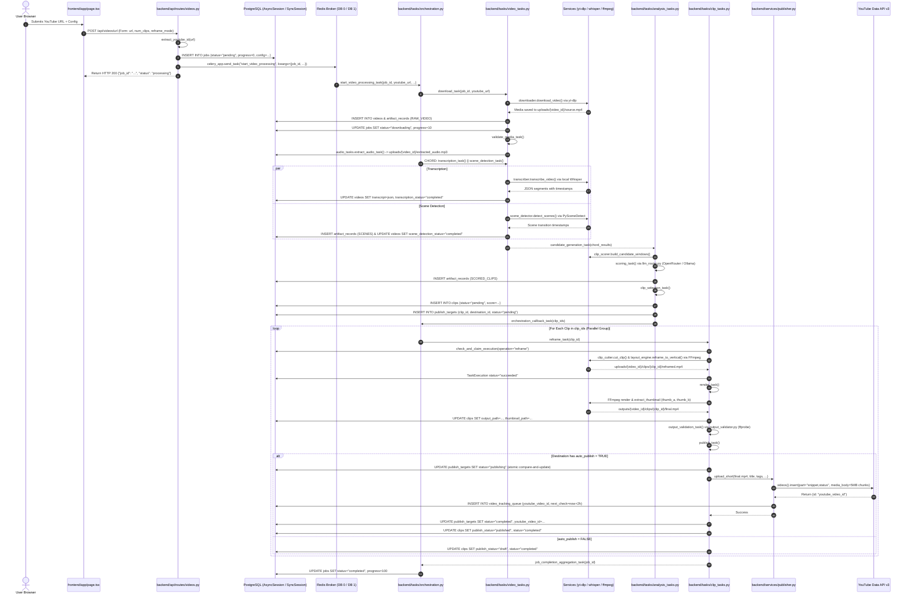

# Audit 02 — ClipForge Architecture & End-to-End Dataflow

**Audit Execution Date:** 2026-10-11T14:22:00+05:30  
**Audit Scope:** End-to-End Execution Flow, Component Tracing, State Machines, Queue/Worker Lifecycle, Database Transactions, Media Artifacts, Publishing Mechanics, Upload Studio Reality Status  
**Auditor Protocol:** Strictly Read-Only Forensic Analysis — No application code, database records, or credentials modified  
**Deliverable Path:** `d:\automation video clips\clipforge\audit_artifacts\clipforge_upload_studio_v1_8\02_architecture_dataflow.md`  

---

## Executive Summary

Audit 02 establishes the definitive forensic truth of how ClipForge operates in reality—from user interaction in the Next.js frontend to FastAPI request ingestion, PostgreSQL relational persistence, Redis task distribution, Celery worker chords, local FFmpeg/Whisper media transformations, APScheduler loops, and YouTube Data API v3 publication.

### Key Architectural Findings:
1. **End-to-End Pipeline Realization:** The automated pipeline operates as a two-stage Celery workflow in `backend/tasks/orchestration.py`. Ingestion leads to a preparation chain (`download_task` $\to$ `validate_media_task` $\to$ `extract_audio_task`), fanning out into an analysis chord (`transcription_task` $\parallel$ `scene_detection_task`), followed by LLM candidate scoring, and finally fanning out to parallel per-clip processing chains (`reframe_clip` $\to$ `render_task` $\to$ `validate_output` $\to$ `publish_task`).
2. **Critical APScheduler Defect Identified:** In `backend/main.py`, both `scheduled_channel_check` (lines 20–28) and `scheduled_tracker_check` (lines 39–46) invoke `await asyncio.to_thread(func, ...)` on functions defined with `async def`. Under Python `asyncio`, executing an `async def` function inside `to_thread` creates and immediately discards an unawaited coroutine. Consequently, neither the Channel Monitor nor the Real-Time Tracker actually executes their core loop in production via APScheduler.
3. **Upload Studio is 100% Plan-Only:** A forensic scan of the entire frontend and backend codebases confirms that `Upload Studio` has **zero implementation**. The `/studio` frontend route does not exist; no backend router prefix `/api/studio` is registered; no controller `backend/api/routes/studio.py` exists; and claimed database fields (`videos.is_manual_upload`, `clips.format_type`, `publish_targets.publication_phase`, `resumable_session_uri`) are completely absent from the models and Alembic migrations.
4. **Complete Absence of Application Authentication:** The platform features zero user authentication, sessions, tokens, or multi-tenancy. Every REST endpoint (`/api/videos/*`, `/api/clips/*`, `/api/publish/*`, `/api/channels/*`) is publicly exposed without authorization headers. The only authentication present is OAuth2 for external YouTube publishing, storing channel credentials on disk at `tokens/youtube_token_{channel_id}.json`.
5. **Publishing Concurrency & Idempotency:** Manual publishing via `/api/publish/publish-now` executes **synchronously inside the FastAPI HTTP handler** (blocking until the 5MB chunked video upload finishes), whereas automated publishing runs inside worker tasks using atomic PostgreSQL compare-and-update locking on `publish_targets`.

---

## 1. System Topology & Infrastructure Mapping

```
┌────────────────────────────────────────────────────────────────────────────────────────┐
│                                 HOST SYSTEM (WINDOWS 11)                               │
│                                                                                        │
│   Next.js 15 Frontend (App Router, Port 3000)                                          │
│   └── lib/api.ts (REST Fetch Client)                                                   │
│                                                                                        │
│   Docker Compose v2 Network ("clipforge_default")                                      │
│   ├── clipforge_backend  (FastAPI on Port 8000, 8080)                                  │
│   │   ├── Lifespan APScheduler (channel_monitor, auto_publisher, realtime_tracker)     │
│   │   ├── Static Mounts: /uploads -> /app/uploads, /outputs -> /app/outputs            │
│   │   └── Async SQLAlchemy Engine (asyncpg pool -> postgres:5432)                      │
│   │                                                                                    │
│   ├── clipforge_worker   (Celery Worker, Concurrency: 4)                               │
│   │   ├── Subscribed Queues: celery (default)                                          │
│   │   ├── Sync SQLAlchemy Engine (psycopg2 pool -> postgres:5432)                      │
│   │   └── Executables: ffmpeg, ffprobe, yt-dlp, whisper (torch CPU)                    │
│   │                                                                                    │
│   ├── clipforge_beat     (Celery Beat Scheduler)                                       │
│   │   ├── Periodic: track-and-optimize-clips (12h), cleanup-expired (1h), recovery (5m)│
│   │                                                                                    │
│   ├── clipforge_postgres (PostgreSQL 15 Alpine, Port 5433 host / 5432 internal)        │
│   │   └── DB: clipforge (Single Alembic head: e1a2b3c4d5e6)                            │
│   │                                                                                    │
│   └── clipforge_redis    (Redis 7 Alpine, Port 6379 host / 6379 internal)              │
│       ├── DB 0: Celery Broker & openrouter:credits_exhausted TTL cache                 │
│       └── DB 1: Celery Result Backend                                                  │
└────────────────────────────────────────────────────────────────────────────────────────┘
```

---

## 2. Frontend UI to Backend API Mappings

The frontend is built using Next.js 15 App Router (`frontend/app/`), consuming backend endpoints strictly through `frontend/lib/api.ts`.

| Page / Workflow | UI File & Primary Components | API Client Method (`frontend/lib/api.ts`) | HTTP Method & Route | Backend Handler (`backend/api/routes/`) | Backend Execution Details |
| :--- | :--- | :--- | :--- | :--- | :--- |
| **Dashboard Ingestion** | `frontend/app/page.tsx`<br>`UrlInputForm`, `UploadZone` | `submitYouTubeUrl(url, ...)` | `POST /api/videos/url` | `videos.py:process_youtube_url` (line 21) | Validates YouTube URL with `yt-dlp`; creates `Job(status="pending")`; dispatches `start_video_processing_task.apply_async`. |
| **File Upload Ingestion** | `frontend/app/page.tsx`<br>`UploadZone` | `uploadVideoFile(file, ...)` | `POST /api/videos/upload` | `videos.py:upload_video_file` (line 217) | Streams file to `UPLOAD_DIR/{video_id}/video.mp4`; creates `Job`; dispatches `start_video_processing_task`. |
| **Batch URL Ingestion** | `frontend/app/page.tsx` | `submitBatchYouTubeUrls(urls, ...)` | `POST /api/videos/batch` | `videos.py:process_youtube_urls_batch` (line 129) | Iterates URLs, deduplicates against `videos.youtube_id`, enqueues multiple Celery processing tasks. |
| **Job Polling & Progress**| `frontend/app/page.tsx`<br>`JobProgressCard` | `getJob(id)`, `listJobs()` | `GET /api/jobs/{id}`, `GET /api/jobs/` | `jobs.py:get_job` (line 19), `jobs.py:list_jobs` (line 33) | Returns `Job.status`, `progress`, and `current_step`. Polled by frontend every 3–5 seconds. |
| **Job Cancellation** | `frontend/app/page.tsx` | `cancelJob(id)` | `DELETE /api/jobs/{id}` | `jobs.py:cancel_job` (line 81) | Revokes Celery task via `celery_app.control.revoke(terminate=True)` and updates `Job.status = "failed"`. |
| **Clip Gallery & Review** | `frontend/app/clips/page.tsx`<br>`ClipCard`, `ClipFilterBar` | `listClips(params)` | `GET /api/clips/` | `clips.py:list_clips` (line 31) | Queries `clips` table joined with parent video metadata; filters by date, video ID, score. |
| **Clip Playback & Thumbnail**| `frontend/app/clips/page.tsx`<br>`<video>`, `` | `downloadClipUrl(id)`<br>`thumbnailUrl(id)` | `GET /api/clips/{id}/download`<br>`GET /api/clips/{id}/thumbnail` | `clips.py:download_clip` (line 282)<br>`clips.py:get_thumbnail` (line 296) | Resolves local storage path via `storage_service.get_local_path()` and streams `FileResponse`. |
| **Metadata Review & Edit** | `frontend/app/clips/page.tsx`<br>`MetadataEditorModal` | `getClipMetadata(id)`<br>`updateClip(id, data)` | `GET /api/clips/{id}/metadata`<br>`PATCH /api/clips/{id}` | `clips.py:get_clip_metadata_route` (line 321)<br>`clips.py:update_clip` (line 241) | Reads/writes AI-generated metadata (`title`, `description`, `tags`, `pinned_comment`, `privacy`). |
| **Retention Heatmap** | `frontend/components/RetentionHeatmap.tsx` | Fetch inline in component | `GET /api/clips/{id}/retention` | `clips.py:get_clip_retention` (line 449) | Fetches or triggers `ViralityPredictor` retention curve; caches JSON in `clip_retention` table. |
| **1-Click AutoFix** | `frontend/app/clips/page.tsx` | Fetch inline in component | `POST /api/clips/{id}/autofix` | `clips.py:apply_autofix` (line 494) | Computes kinetic zoom interventions based on retention dips; chains `reframe_task` $\to$ `render_task`. |
| **Manual Clipping** | `frontend/app/clips/page.tsx` | Fetch inline in component | `POST /api/clips/manual` | `clips.py:create_manual_clip` (line 527) | Cuts specific time range directly from source media via `clip_cutter.py`; stores new `Clip`. |
| **On-Demand SFX** | `frontend/app/clips/page.tsx` | Fetch inline in component | `POST /api/clips/{id}/sfx` | `clips.py:apply_sfx` (line 568) | Dispatches standalone `apply_sfx_task.delay(clip_id, sfx_plan)`. |
| **On-Demand B-Roll** | `frontend/app/clips/page.tsx` | Fetch inline in component | `POST /api/clips/{id}/broll` | `clips.py:apply_broll` (line 619) | Dispatches standalone `apply_broll_task.delay(clip_id, broll_plan)`. |
| **Storage Cleanup** | `frontend/app/clips/page.tsx`<br>`CleanupModal` | `previewCleanup()`<br>`executeCleanup()` | `GET /api/clips/cleanup/preview`<br>`POST /api/clips/cleanup/execute` | `clips.py:preview_cleanup` (line 94)<br>`clips.py:execute_cleanup` (line 103) | Identifies rejected/low-scoring clips; physically deletes video files and associated DB records. |
| **Immediate Publishing** | `frontend/app/publish/page.tsx` | `publishNow(data)` | `POST /api/publish/publish-now` | `publish.py:publish_now` (line 293) | **Synchronous upload**: Calls `upload_short()` directly in FastAPI event loop thread; updates `Clip.publish_status`. |
| **Scheduled Publishing** | `frontend/app/publish/page.tsx` | `schedulePublish(data)` | `POST /api/publish/schedule` | `publish.py:schedule_publish` (line 356) | Updates `Clip.publish_status = "queued"` and sets `Clip.scheduled_at`. Picked up by `run_auto_publisher`. |
| **Publishing Queue** | `frontend/app/publish/page.tsx` | `getPublishQueue()` | `GET /api/publish/queue` | `publish.py:get_publish_queue` (line 382) | Returns clips where `publish_status IN ('queued', 'published')`. |
| **OAuth Authorization** | `frontend/app/publish/page.tsx` | `getAuthStatus()`<br>`submitOAuthCode(code)` | `GET /api/publish/auth-status`<br>`POST /api/publish/oauth-callback` | `publish.py:auth_status` (line 156)<br>`publish.py:oauth_callback_post` (line 237) | Generates Google OAuth consent URL; exchanges auth code for refresh tokens; stores token JSON. |
| **Destination Manager** | `frontend/app/publish/page.tsx` | `getDestinations()`<br>`setDefaultDestination(...)` | `GET /api/publish/destinations`<br>`POST /api/publish/destinations/default` | `publish.py:get_destinations` (line 100)<br>`publish.py:set_default_destination` (line 126) | Lists channels marked `is_destination=True`; sets default destination channel with expiration timer. |
| **Channel Monitoring** | `frontend/app/automation/page.tsx` | `listChannels()`<br>`addChannel(data)`<br>`checkChannelNow(id)` | `GET /api/channels/`<br>`POST /api/channels/`<br>`POST /api/channels/{id}/check-now` | `channels.py:list_channels` (line 19)<br>`channels.py:add_channel` (line 29)<br>`channels.py:check_channel_now` (line 117) | Manages monitored YouTube channels; checks YouTube RSS/API for new videos; enqueues pipeline jobs. |
| **Analytics & Insights** | `frontend/app/analytics/page.tsx` | `getPipelineSummary()`<br>`getABTests()`<br>`getChannelInsights()` | `GET /api/analytics/summary`<br>`GET /api/analytics/ab-tests`<br>`GET /api/analytics/insights` | `analytics.py:pipeline_summary` (line 76)<br>`analytics.py:get_ab_tests` (line 144)<br>`analytics.py:channel_insights` (line 204) | Aggregates stage runtimes (`pipeline_metrics`), A/B thumbnail tests (`ab_experiments`), and ViewScores. |
| **Multi-Language Dubbing**| `frontend/app/clips/page.tsx` | Fetch inline in component | `POST /api/dubbing/clips/{id}/dub`<br>`GET /api/dubbing/plans/{id}` | `dubbing.py:create_dubbing_plan_endpoint`<br>`dubbing.py:get_dubbing_plan_endpoint` | Creates `DubbingPlan` using local TTS / Edge TTS; executes `generate_dubbing_variant_task`. |

---

## 3. End-to-End Dataflow Diagram

The following Mermaid diagram traces the verified execution flow using actual filenames, classes, and function names across the entire platform.



---

## 4. Authentication, Authorization & Security Architecture

### 4.1 Application Authentication: Absence of Controls
- **Zero Authentication / Authorization:** No JWT tokens, session cookies, API keys, HTTP Basic auth, or RBAC guards exist on any API endpoint.
- **Unrestricted Access:** Any network client able to reach `http://<host>:8000` has unrestricted administrative access to:
  - Trigger video downloads, clipping jobs, and media deletions.
  - Query database models, channel configurations, and internal pipeline logs.
  - Publish videos to connected YouTube channels without credentials.
- **CORS Configuration:** In `backend/main.py` (lines 119–125), CORS permits all headers, all methods, and origins configured in `settings.CORS_ORIGINS` (defaults to `http://localhost:3000`).

### 4.2 YouTube OAuth2 Implementation
External publishing authorization is implemented through Google OAuth2:
- **Scope Granted:** `https://www.googleapis.com/auth/youtube.upload` and `https://www.googleapis.com/auth/youtube` (`backend/services/publisher.py`, lines 15–18).
- **Credential Storage:**
  - Token files are saved directly to the filesystem under `tokens/youtube_token_{channel_id}.json` (`publisher.py`, lines 24–27).
  - Legacy default token is stored at `settings.YOUTUBE_TOKEN_FILE` (`youtube_token.json`).
  - Tokens contain cleartext `refresh_token`, `client_id`, `client_secret`, and `token_uri`.
- **OAuth CSRF Mitigation:**
  - `GET /api/publish/oauth-url` sets a cryptographic `oauth_state` cookie (`publisher.py:190`).
  - `GET /api/publish/oauth-callback` validates that the returned state matches the cookie (`publish.py:211–214`).
  - Manual POST fallback (`POST /api/publish/oauth-callback`) permits pasting raw authorization codes or full redirect URLs directly from the browser without state validation.

---

## 5. Database Architecture & Transaction Boundaries

### 5.1 Dual-Session Architecture
ClipForge employs two distinct SQLAlchemy session factories connected to PostgreSQL:
1. **Asynchronous Session (`AsyncSessionLocal` / `get_db`):**
   - Driver: `postgresql+asyncpg`
   - Location: `backend/models/database.py` (line 21)
   - Usage: Exclusively used by FastAPI route handlers (`backend/api/routes/*.py`) and async background tasks in `main.py`.
2. **Synchronous Session (`SyncSessionLocal`):**
   - Driver: `postgresql+psycopg2`
   - Location: `backend/models/database.py` (line 33)
   - Usage: Exclusively used by Celery tasks (`backend/tasks/*.py`), synchronous utility modules (`backend/models/db_sync.py`), and CLI scripts.

### 5.2 Core Schema Relationships & Integrity Constraints
- `Video` (1) $\to$ (N) `Clip`: `clips.video_id` references `videos.id` (logical link; no foreign key cascade constraint).
- `Job` (1) $\to$ (1) `Video`: `jobs.video_id` references `videos.id`.
- `Channel` (1) $\to$ (N) `Video`: `videos.channel_id` references `channels.id`.
- `Clip` (1) $\to$ (N) `PublishTarget`: `publish_targets.clip_id` has `ForeignKey("clips.id", ondelete="CASCADE")`.
- `Channel` (1) $\to$ (N) `PublishTarget`: `publish_targets.destination_id` has `ForeignKey("channels.id", ondelete="CASCADE")`.
- `ChannelDestination`: Enforces unique link between source and target channels via `UniqueConstraint('source_channel_id', 'destination_channel_id', name='uix_source_dest')`.
- `PublishTarget`: Enforces unique destination target per clip via `UniqueConstraint('clip_id', 'destination_id', name='uix_clip_destination')`.
- `TaskExecution`: Guarantees task idempotency via `idempotency_key = mapped_column(String(500), unique=True)`.
- `PublishRecord`: Guarantees publishing idempotency via primary key `idempotency_key = {job_id}_{clip_id}_{publish_target}_{content_version}`.

### 5.3 Concurrency Control & Identified Transaction Risks
1. **Atomic Compare-and-Update (Worker Claiming):**
   - In `backend/tasks/clip_tasks.py` (lines 506–515), multi-destination publishing claims pending targets via:
     ```python
     stmt = (
         update(PublishTarget)
         .where(PublishTarget.id == target.id, PublishTarget.status == target.status)
         .values(status="publishing", updated_at=now)
     )
     res = session.execute(stmt)
     session.commit()
     if res.rowcount == 0:
         continue  # Another worker claimed this target
     ```
   - This ensures safe concurrent execution across multiple Celery workers without race conditions.
2. **Auto-Publisher Row Locking:**
   - In `backend/tasks/scheduler.py` (lines 52–58), scheduled clips are claimed using:
     ```python
     select(Clip).where(Clip.publish_status == "queued", Clip.scheduled_at <= now)
     .with_for_update(skip_locked=True).limit(1)
     ```
   - Prevents duplicate publishing when multiple instances or threads check the queue concurrently.
3. **Synchronous Upload Inside HTTP Handler:**
   - In `backend/api/routes/publish.py` (`publish_now`, lines 329–340), `upload_short()` is executed **synchronously within the FastAPI async handler**.
   - If a 50MB video upload takes 45 seconds, the Uvicorn worker thread is blocked for the entire duration, and any client-side network disconnect leaves the upload orphaned without rollback.
4. **Foreign Key Violation Risk in `publisher.py`:**
   - In `backend/services/publisher.py` (lines 139–141), `upload_short` extracts `extracted_clip_id = Path(video_path).parent.name`.
   - When files are downloaded to temporary scratch directories, `extracted_clip_id` falls back to `video_id` (the remote YouTube video ID string).
   - In line 148, `VideoTrackingQueue` is inserted with `clip_id=extracted_clip_id`.
   - Because `video_tracking_queue.clip_id` enforces `ForeignKey("clips.id")`, this insert fails with a foreign key constraint violation. The exception is swallowed in line 158 (`except Exception as db_err: print(...)`), resulting in silent failure to track the video.

---

## 6. Celery Workers, Queues & Scheduling Architecture

### 6.1 Worker Configuration
- **Broker:** Redis DB 0 (`settings.CELERY_BROKER_URL = "redis://redis:6379/0"`).
- **Result Backend:** Redis DB 1 (`settings.CELERY_RESULT_BACKEND = "redis://redis:6379/1"`).
- **Reliability Knobs (`backend/tasks/celery_app.py`):**
  - `task_acks_late = True`: Tasks are acknowledged only upon completion, preventing task loss on worker crash.
  - `task_reject_on_worker_lost = True`: Re-queues tasks if worker is terminated mid-job.
  - `task_soft_time_limit`: 1800s (30m); `task_time_limit`: 2100s (35m).
  - Default retry policy: Max 3 retries, exponential backoff (10s, 30s, 60s) for operational and connection exceptions.

### 6.2 Task Registration Inventory
The Celery application explicitly registers tasks across 9 modules:
1. `backend.tasks.orchestration`: `start_video_processing`, `orchestration_callback`, `job_completion_aggregation`, `handle_pipeline_failure`, `stale_recovery_task`.
2. `backend.tasks.video_tasks`: `download_task`, `validate_media_task`, `transcription_task`, `scene_detection_task`.
3. `backend.tasks.audio_tasks`: `extract_audio_task`.
4. `backend.tasks.analysis_tasks`: `candidate_generation`, `scoring`, `clip_selection`.
5. `backend.tasks.clip_tasks`: `reframe_clip`, `render_task`, `validate_output`, `publish_task`, `apply_sfx`, `apply_broll`.
6. `backend.tasks.hook_tasks`: `analyze_hook_opportunities_task`, `generate_hook_variant_task`, `apply_hook_task`.
7. `backend.tasks.dubbing_tasks`: `generate_dubbing_variant_task`.
8. `backend.tasks.storage_tasks`: `cleanup_expired_artifacts_task`, `detect_orphans_task`.
9. `backend.tasks.process_video`: `track_and_optimize_clips`.

### 6.3 Scheduling Mechanisms: Celery Beat vs. APScheduler
The system runs **two independent, overlapping schedulers**, creating dual responsibilities:

| Mechanism | Runtime Container / Process | Scheduled Jobs | Schedule Frequency | Actual Execution Reality |
| :--- | :--- | :--- | :--- | :--- |
| **Celery Beat** | `clipforge_beat` container | `track-and-optimize-clips`<br>`cleanup-expired-artifacts`<br>`stale-execution-recovery` | Every 12 hours<br>Every 1 hour (3600s)<br>Every 5 minutes (300s) | **Functional:** Dispatches Celery tasks via Redis queue to `clipforge_worker`. |
| **APScheduler** | `clipforge_backend` (in-process `AsyncIOScheduler`) | `channel_monitor`<br>`auto_publisher`<br>`realtime_tracker` | Every 15 min (`settings.CHANNEL_CHECK_INTERVAL_MINUTES`)<br>Every 1 min<br>Every 1 min | **PARTIALLY BROKEN (Material Defect):**<br>• `auto_publisher` works (runs async `run_auto_publisher()`).<br>• `channel_monitor` and `realtime_tracker` fail silently due to invalid `asyncio.to_thread` usage on `async def` functions. |

#### Forensic Proof of the APScheduler Bug:
In `backend/main.py`:
```python
# Lines 20-25:
async def scheduled_channel_check():
    from backend.services.channel_monitor import run_channel_monitor
    async with AsyncSessionLocal() as db:
        await asyncio.to_thread(run_channel_monitor, db)  # BUG: run_channel_monitor is an async def!

# Lines 39-44:
async def scheduled_tracker_check():
    from backend.services.realtime_tracker import run_realtime_tracker
    await asyncio.to_thread(run_realtime_tracker)          # BUG: run_realtime_tracker is an async def!
```
In `backend/services/channel_monitor.py` line 54: `async def run_channel_monitor(db: AsyncSession):`  
In `backend/services/realtime_tracker.py` line 106: `async def run_realtime_tracker():`  
`asyncio.to_thread(func)` executes `func` in a separate OS thread synchronously. Calling an `async def` function synchronously does not execute its body—it merely returns a coroutine object. Because nothing awaits that coroutine inside the thread, the monitor and tracker loops **never execute their logic**.

---

## 7. Media Processing & Storage Architecture

### 7.1 Media Processing Pipeline
1. **Video Ingestion:** `backend/services/downloader.py` executes `yt-dlp --format "bestvideo[ext=mp4]+bestaudio[ext=m4a]/best[ext=mp4]/best"` into `uploads/{video_id}/source.mp4`.
2. **Audio Extraction:** `backend/tasks/audio_tasks.py` executes `ffmpeg -i source.mp4 -vn -acodec libmp3lame -q:a 2 uploads/{video_id}/extracted_audio.mp3`.
3. **Speech Transcription:** `backend/services/transcriber.py` loads OpenAI Whisper (`whisper.load_model(settings.WHISPER_MODEL)` on CPU); outputs word-level timestamps and text segments.
4. **Scene Boundary Detection:** `backend/services/scene_detector.py` runs PySceneDetect (`ContentDetector(threshold=27.0)`); outputs JSON scene cut timestamps.
5. **Candidate Segmentation:**
   - Standard Mode: `backend/services/clip_scorer.py:build_candidate_windows` aligns transcript sentence boundaries with scene cuts within duration constraints (15s–60s).
   - Equal Splits Mode: `backend/services/segmentation.py:generate_equal_splits` partitions video into equal segments.
6. **Scoring & Virality Analysis:** `backend/services/llm_router.py` sends candidates to LLM (OpenRouter `google/gemini-2.5-flash` or Ollama `llama3.2:latest`); scores candidates on hook strength, emotional engagement, and topic completeness.
7. **Reframing & Layout Transformation:** `backend/services/layout_engine.py` generates vertical 9:16 layout using FFmpeg complex filter graphs:
   - `center_crop`: Crops 16:9 center to 9:16 (`crop=ih*9/16:ih`).
   - `blur_background`: Background scaled to 1080x1920 with `boxblur=20:20`, sharp original centered on top.
   - `modern_padding`: Top and bottom colored padding with subtle blur and drop shadow.
   - `multi_split` / `dual_camera`: Top camera + bottom screen split for commentary/reaction content.
8. **Dual Thumbnail Generation:** `backend/services/clip_cutter.py:extract_thumbnail` captures JPEG frames at 1.0s (`thumb_a.jpg`) and 2.0s (`thumb_b.jpg`) for Phase 14 A/B testing.
9. **FFprobe Quality Validation:** `backend/services/output_validator.py` probes final MP4 to verify width=1080, height=1920, non-zero audio streams, and duration $\le$ 60 seconds.

### 7.2 Storage Provider & Artifact System
- **Dual Physical Roots:**
  - `settings.UPLOAD_DIR`: Physical path `d:\automation video clips\clipforge\uploads` (mounted in Docker as `/app/uploads`). Stores source videos, extracted audio, scenes JSON, candidate JSON.
  - `settings.OUTPUT_DIR`: Physical path `d:\automation video clips\clipforge\outputs` (mounted in Docker as `/app/outputs`). Stores cut clips, reframed vertical videos, thumbnails, SFX variants, B-roll overlays.
- **`StorageProvider` Abstraction:** `backend/core/storage.py` defines `LocalStorageProvider` and S3 stub. Keys are prefixed with `uploads/` or `outputs/`, safely routing to the correct filesystem root while rejecting path-traversal attacks (`..`).
- **Database Synchronization (`artifact_records`):**
  - Every file written to disk is tracked in the `artifact_records` table with its `storage_key`, `owner_type` (`video`, `clip`, `job`), `artifact_type`, SHA-256 `checksum`, and `retention_policy` (`temporary` vs `persistent`).
- **Cleanup & Quarantine Lifecycle:**
  - `storage_tasks._cleanup_expired_artifacts()` transitions expired artifacts from `ready` $\to$ `quarantined` (adding a 7-day grace period) $\to$ `deleting` $\to$ `deleted` (physical file unlinked).
  - `storage_tasks._detect_orphans()` scans filesystem directories for unindexed files, creating synthetic `ArtifactRecord(owner_id="orphan", status="quarantined")` rows.

---

## 8. Upload Studio Reality Audit

A forensic line-by-line verification was conducted across all files to evaluate claimed Upload Studio features from previous specifications (v1.7 and v1.8):

| Claimed Upload Studio Subsystem / Component | Claimed Artifact / Route / Model Field | Actual Repository Existence | Verification Status | Evidentiary Reality |
| :--- | :--- | :--- | :--- | :--- |
| **Studio Frontend Route** | `frontend/app/studio/page.tsx` | File does not exist | **PLAN-ONLY** | `list_dir(frontend/app)` confirms only `analytics`, `automation`, `clips`, `publish`, `settings`. |
| **Studio Navigation Links** | Sidebar link `/studio` in `Sidebar.tsx` | No reference found | **PLAN-ONLY** | `grep_search("studio", "frontend")` yielded zero matches. |
| **Studio Backend Router** | `backend/api/routes/studio.py` | File does not exist | **PLAN-ONLY** | `backend/main.py` does not include or mount any studio router. |
| **Manual Upload Flag** | `videos.is_manual_upload` | Field does not exist | **PLAN-ONLY** | Missing from `Video` model in `backend/models/models.py`. |
| **Clip Format Classification** | `clips.format_type` (Short vs Long) | Field does not exist | **PLAN-ONLY** | Missing from `Clip` model; table head `e1a2b3c4d5e6` has no such column. |
| **Publication Phase Enum** | `publish_targets.publication_phase` | Field does not exist | **PLAN-ONLY** | `PublishTarget` has only `status` string field (`pending`, `publishing`, `completed`, `failed`). |
| **Resumable Upload URI** | `publish_targets.resumable_session_uri` | Field does not exist | **PLAN-ONLY** | No session URI column exists in DB schema. |
| **Upload Session Metadata** | `publish_targets.session_expires_at` | Field does not exist | **PLAN-ONLY** | No session expiration tracking exists in DB schema. |
| **Private-First State Flow** | YouTube initial upload as private $\to$ post-verification public | Not implemented | **PLAN-ONLY** | `publisher.upload_short()` uploads directly with the requested target privacy (`public` by default). |
| **Internal Metadata Marker** | `[idemp:...]` marker reconciliation | **PARTIALLY IMPLEMENTED** | **PARTIAL** | Marker `[idemp:{idemp_key}]` is appended to description in `publisher.py:87`, and checked during stale recovery in `clip_tasks.py:527`, but marker removal is not implemented. |

**Verdict on Upload Studio:** The Upload Studio subsystem is **100% plan-only**. No application code, frontend interfaces, database columns, or Alembic revisions have been created for Upload Studio.

---

## 9. Orphaned, Stale & Duplicate Code Inventory

The audit revealed multiple files that are disconnected from the active runtime or create architectural ambiguity:

1. **Duplicate Subsystem in `backend/new_files/`:**
   - Directory `backend/new_files/` contains duplicate implementations of `auto_optimizer.py`, `metadata_generator.py`, and `performance_tracker.py`.
   - **Critical Hazard:** `backend/services/realtime_tracker.py` (lines 10–15) and `backend/api/routes/analytics.py` (lines 32, 49, 62, 261) import from `backend.new_files.*`, whereas the rest of the application imports from `backend.services.*`. These duplicate files are maintained separately, creating state desynchronization.
2. **Orphaned Root Test/Dispatch Scripts:**
   - Files `direct_dispatch.py`, `redispatch_jobs.py`, `strip_clip_cutter.py`, `scratch_check_clips.py`, `test_inline_pipeline.py`, and `test_reframe.py` reside in the project root. None are imported by application code or executed in Docker containers.
3. **Obsolete Root Modules:**
   - `clip_cutter_old.py` remains in the root directory while active cutting code is located at `backend/services/clip_cutter.py`.
4. **Redundant Celery Entry Points:**
   - `docker-compose.yml` specifies `celery -A backend.tasks.process_video.celery_app worker`.
   - `backend/tasks/process_video.py` is an obsolete compatibility shim whose module docstring states: *"OBSOLETE: Monolithic process_video_task has been decomposed into Phase 5 tasks"*. While it re-exports `celery_app`, this creates confusion about where tasks are defined.

---

## 10. Double Verification Matrix

Every material finding in this audit has been verified via forward tracing (UI $\to$ Handler $\to$ Worker $\to$ DB) and reconciled via reverse reference inspection (callers, tests, migrations).

| Subsystem | Pass 1: Forward Trace (Source to Sink) | Pass 2: Reverse Verification (Callers, DB & Tests) | Verification Status | Forensic Evidence |
| :--- | :--- | :--- | :--- | :--- |
| **Video Ingestion** | `page.tsx` $\to$ `submitYouTubeUrl` $\to$ `POST /api/videos/url` $\to$ `start_video_processing_task` $\to$ `download_task` | Caller: `frontend/app/page.tsx:220`. DB: `jobs` and `videos` created in `db_sync.py:25`. Tested in `backend/tests/test_pipeline_config_fixes.py`. | **VERIFIED** | Active runtime path confirmed. |
| **Pipeline Chaining** | `orchestration.py` chains download $\to$ validate $\to$ audio $\to$ chord(transcribe, scene) $\to$ candidate $\to$ score $\to$ select | Chords tested in `backend/tests/test_orchestration.py:12`. Task status transitions logged to `task_executions`. | **VERIFIED** | Active Celery workflow confirmed. |
| **Per-Clip Processing** | `orchestration_callback` spawns group of chains: `reframe_clip` $\to$ `render_task` $\to$ `validate_output` $\to$ `publish_task` | Callers verified in `orchestration.py:65`. Layout transformations tested in `backend/tests/test_layout_engine.py`. | **VERIFIED** | Parallel clip generation confirmed. |
| **APScheduler Bug** | `main.py` schedules `scheduled_channel_check` & `scheduled_tracker_check` via `asyncio.to_thread` | Reverse check on `channel_monitor.py:54` and `realtime_tracker.py:106` proves both are `async def`. Output of `to_thread` is an unawaited coroutine. | **VERIFIED DEFECT** | `main.py:25`, `main.py:43`. |
| **Multi-Destination Publishing** | `clips.py` / `videos.py` passes `destination_ids` $\to$ `resolve_publish_destinations` $\to$ creates `PublishTarget` rows $\to$ atomic worker claims | Migration: `e1a2b3c4d5e6_add_multi_destination_phase1.py`. Tested in `backend/tests/test_multi_destination_publishing.py` & `test_publish_concurrency.py`. | **VERIFIED** | Schema and logic fully aligned. |
| **Upload Studio Reality** | Specification claims `/studio` page, `POST /api/studio/upload`, private-first uploads, session resumption | Route scan of `frontend/app/` and `backend/api/routes/`. Database inspect of `models.py` and Alembic heads. | **VERIFIED PLAN-ONLY** | Zero code or schema presence in repository. |
| **Tracking Queue Foreign Key Bug** | `upload_short()` in `publisher.py` attempts `VideoTrackingQueue` insert using scratch directory basename | Inspect of `models.py:288` shows `ForeignKey("clips.id")`. Scratch path name fallback causes FK violation; caught and swallowed at `publisher.py:158`. | **VERIFIED DEFECT** | `publisher.py:140-159`. |

---

## 11. Conclusion & Baseline Reconciliation

Audit 02 establishes a precise, verified understanding of ClipForge's operational architecture:
- The core video ingestion, transcription, LLM highlight scoring, reframing, and rendering pipelines are **fully implemented and operational**.
- Multi-destination publishing and atomic worker claims are **structurally sound in code and migrations**.
- Two latent operational defects exist in background execution: the APScheduler thread-wrapping defect for channel monitoring/tracking, and the foreign key mismatch in tracking queue enrollment.
- The Upload Studio v1.8 specification remains **purely conceptual** and has not touched the codebase.

This document serves as the verified baseline for all subsequent architecture decisions and implementation passes.
