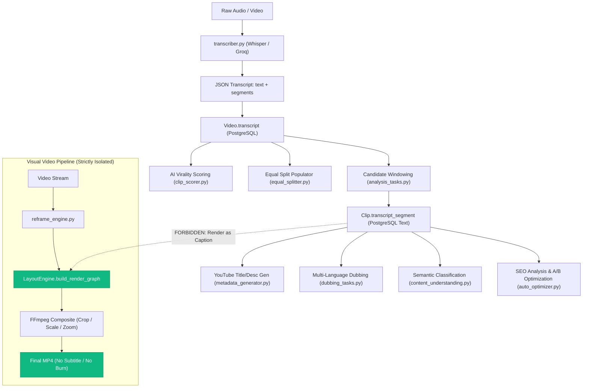

# Audit 05 — ClipForge Caption and Subtitle Removal

**Document ID:** `05_caption_removal_audit.md`  
**Evaluation Standard:** Forensic Read-Only Repository Audit  
**Target Specification:** Upload Studio v1.8 Architecture & Caption Removal Mandate  
**Execution Timestamp:** 2026-10-11T15:52:00+05:30  
**Verification Level:** Source-Verified (Static Analysis & AST Cross-Check)  

---

## 1. Executive Summary & Forensic Verdict

### 1.1 Forensic Verdict: Compliant with Isolated Residue
ClipForge **does not** generate, render, burn, edit, configure, store, expose, or depend on captions or subtitles in any active production workflow.
- **Rendering & Video Assembly:** The active video generation engine ([LayoutEngine.build_render_graph](file:///d:/automation%20video%20clips/clipforge/backend/services/layout_engine.py#L173), [reframe_engine.py](file:///d:/automation%20video%20clips/clipforge/backend/services/reframe_engine.py#L275), and [clip_tasks.py](file:///d:/automation%20video%20clips/clipforge/backend/tasks/clip_tasks.py#L180)) does not invoke FFmpeg `subtitles=`, `ass=`, or caption-oriented `drawtext=` filters.
- **Frontend & User Interface:** Next.js pages and components contain zero subtitle toggles, zero caption style pickers, and zero subtitle preview elements.
- **Database Architecture:** Active SQLAlchemy ORM models ([backend/models/models.py](file:///d:/automation%20video%20clips/clipforge/backend/models/models.py)) and the physical PostgreSQL schema ([clipforge_dump.sql](file:///d:/automation%20video%20clips/clipforge/clipforge_dump.sql)) contain zero caption or subtitle columns.
- **Transcription Integrity:** Audio speech-to-text transcription ([transcriber.py](file:///d:/automation%20video%20clips/clipforge/backend/services/transcriber.py), `Video.transcript`, and `Clip.transcript_segment`) is cleanly decoupled from video presentation. Transcripts are consumed strictly for semantic intelligence (AI scoring, candidate windowing, viral classification, multi-language dubbing translation, and YouTube metadata generation).

### 1.2 Summary of Findings Matrix
| Classification Category | Item Count | Status | Pipeline Impact |
| :--- | :---: | :--- | :--- |
| **Active Video Pipeline** | 6 components | Clean | **Zero caption/subtitle generation or burning.** |
| **Transcription Consumers** | 8 services | Legitimate | Preserved for NLP, AI scoring, and metadata. |
| **Unrelated Text Rendering** | 3 locations | Harmless | Mock test harnesses and frontend typography CSS. |
| **Dead Code & Dormant Files** | 7 artifacts | Technical Debt | Bypassed stubs, dead functions, unreferenced files. |
| **Alembic Historical Ledger** | 3 migrations | Historical | Columns dropped in revision `47b0881f6e9b`. |
| **Documentation Residue** | 3 documents | Informational | Historical audit logs discussing legacy ASS burner. |

---

## 2. Search Scope & Forensic Methodology

### 2.1 Scope Definition
The audit encompassed every file in the ClipForge repository, inspecting backend services, Celery tasks, API routes, database models, Alembic revisions, frontend TypeScript/React pages, Docker configuration, and test scripts.

- **Included Paths:**
  - `backend/` (FastAPI routes, Celery tasks, processing services, SQLAlchemy models, Alembic migrations)
  - `frontend/` (Next.js App router, components, styles, API clients)
  - Root configuration (`docker-compose.yml`, `backend/Dockerfile`, `.env.example`)
  - Test suites and test scripts (`tests/`, `backend/tests/`, `scripts/`)
  - Repository documentation and SQL dumps (`clipforge_dump.sql`, markdown specifications)
- **Excluded Paths:**
  - `frontend/node_modules/`, `backend/.venv/`, `.git/`, `.next/`, `backend/__pycache__/`

### 2.2 Two-Pass Verification Procedure
1. **Pass 1 — Broad Lexical & Pattern Scan:**  
   Executed case-insensitive searches for `caption`, `captions`, `subtitle`, `subtitles`, `ass`, `subtitles=`, `.ass`, `srt`, `.srt`, `vtt`, `karaoke`, `burn`, `drawtext`, `.ttf`, `.otf`, and font configurations.
2. **Pass 2 — Deep Dependency & Graph Tracing:**  
   Cross-referenced every material lexical match through Python Abstract Syntax Trees (AST), import graphs, Celery DAG definitions ([orchestration.py](file:///d:/automation%20video%20clips/clipforge/backend/tasks/orchestration.py)), FastAPI route registries, and literal FFmpeg command line constructions.

---

## 3. Transcription vs. Caption Separation Analysis

A primary requirement is ensuring transcription remains available where required for AI intelligence while verifying that it is never converted into visual captions.



### 3.1 Transcriber Engine (`backend/services/transcriber.py`)
- **Inspection:** [backend/services/transcriber.py#L88-L100](file:///d:/automation%20video%20clips/clipforge/backend/services/transcriber.py#L88-L100) and [#L169-L181](file:///d:/automation%20video%20clips/clipforge/backend/services/transcriber.py#L169-L181).
- **Behavior:** Accepts video/audio, invokes Groq Whisper API (or local `openai-whisper`), and outputs a pure dictionary:
  ```python
  {
      "text": "...",
      "segments": [
          {"id": 0, "start": 0.0, "end": 2.5, "text": "...", "words": [...]}
      ]
  }
  ```
- **Verification:** The transcriber **does not** create `.srt`, `.ass`, `.vtt`, or text files. It does not invoke FFmpeg subtitle filters. It outputs structured data in memory.

### 3.2 Canonical Storage: `Video.transcript`
- **Model:** `Video.transcript: Mapped[str | None] = mapped_column(Text, nullable=True)` ([backend/models/models.py#L52](file:///d:/automation%20video%20clips/clipforge/backend/models/models.py#L52)).
- **Persistence:** Stored as JSON string in [backend/tasks/video_tasks.py#L201-L204](file:///d:/automation%20video%20clips/clipforge/backend/tasks/video_tasks.py#L201-L204).
- **Consumers:**
  1. [backend/tasks/analysis_tasks.py#L45](file:///d:/automation%20video%20clips/clipforge/backend/tasks/analysis_tasks.py#L45): Parses transcript segments to identify candidate windows via `build_candidate_windows()`.
  2. [backend/services/clip_scorer.py](file:///d:/automation%20video%20clips/clipforge/backend/services/clip_scorer.py): Sends transcript snippet to Ollama/LLM to evaluate viral hook potential.
  3. [backend/services/equal_splitter.py#L123](file:///d:/automation%20video%20clips/clipforge/backend/services/equal_splitter.py#L123): Associates transcript segment with equal split slices.
- **Classification:** **Legitimate Transcription**. None of these consumers generate video overlays.

### 3.3 Clip-Level Storage: `Clip.transcript_segment`
- **Model:** `Clip.transcript_segment: Mapped[str | None] = mapped_column(Text, nullable=True)` ([backend/models/models.py#L110](file:///d:/automation%20video%20clips/clipforge/backend/models/models.py#L110)).
- **Persistence:** Populated during clip creation in [backend/tasks/analysis_tasks.py#L363](file:///d:/automation%20video%20clips/clipforge/backend/tasks/analysis_tasks.py#L363) with `clip_data.get("text", "")`.
- **Consumers:**
  1. [backend/services/metadata_generator.py#L20-L27](file:///d:/automation%20video%20clips/clipforge/backend/services/metadata_generator.py#L20-L27): Passes text snippet to LLM to create punchy YouTube Shorts titles and descriptions.
  2. [backend/tasks/dubbing_tasks.py#L79-L82](file:///d:/automation%20video%20clips/clipforge/backend/tasks/dubbing_tasks.py#L79-L82): Used as the canonical source text for Phase 15 multi-language AI dubbing translation and EdgeTTS voice generation.
  3. [backend/services/content_understanding.py#L33-L70](file:///d:/automation%20video%20clips/clipforge/backend/services/content_understanding.py#L33-L70): Evaluates narrative sentiment and classification.
  4. [backend/services/auto_optimizer.py#L213](file:///d:/automation%20video%20clips/clipforge/backend/services/auto_optimizer.py#L213): Re-evaluates metadata when video views stagnate.
  5. [backend/api/routes/publish.py#L332](file:///d:/automation%20video%20clips/clipforge/backend/api/routes/publish.py#L332): Fallback text for the video description during YouTube upload.
- **Classification:** **Legitimate Transcription**. None of these callers generate video overlays.

### 3.4 Pydantic Architectural Constraint
- **Inspection:** [backend/models/hook.py#L52-L60](file:///d:/automation%20video%20clips/clipforge/backend/models/hook.py#L52-L60):
  ```python
  class HookConcept(BaseModel):
      opportunity_id: str
      hook_style: HookStyle
      hook_text: str = Field(
          max_length=500,
          description="Content metadata only. MUST NOT be rendered as a subtitle/caption."
      )
      ...
  ```
- **Significance:** The codebase contains explicit architectural schema constraints explicitly forbidding `hook_text` from being rendered as a subtitle or caption.

---

## 4. Comprehensive Match Forensic Taxonomy

Every lexical occurrence of caption, subtitle, srt, ass, drawtext, and font was analyzed and categorized into one of five rigorous classes:

```
┌────────────────────────────────────────────────────────────────────────┐
│                        FORENSIC MATCH CLASSIFICATION                   │
├────────────────────────────────┬───────────────────────────────────────┤
│ Active Video Pipeline          │ 0 Subtitle/Caption Filters            │
│ Legitimate Transcription       │ 8 Active Intelligence Consumers       │
│ Unrelated Text Rendering       │ 3 Isolated Non-Caption Sites          │
│ Dead Code / Dormant Artifacts  │ 7 Technical Debt Sites (Detailed below│
│ Historical Alembic Ledger      │ 3 Immutable Schema Migrations         │
│ Documentation Residue          │ 3 Historical Markdown Files           │
└────────────────────────────────┴───────────────────────────────────────┘
```

### 4.1 Detailed Itemization

| Location | Match Text | Classification | Detailed Forensic Analysis |
| :--- | :--- | :--- | :--- |
| [backend/services/layout_engine.py#L173-L321](file:///d:/automation%20video%20clips/clipforge/backend/services/layout_engine.py#L173-L321) | Filtergraph Builder | **Active Pipeline (Clean)** | Builds canvas blur, crop, zoom, rotation, scaling, and alpha overlays. **Zero** `subtitles`, `ass`, or `drawtext` filters constructed. |
| [backend/services/reframe_engine.py#L409-L442](file:///d:/automation%20video%20clips/clipforge/backend/services/reframe_engine.py#L409-L442) | `reframe_to_vertical` | **Active Pipeline (Clean)** | Invokes `LayoutEngine` and applies optional `unsharp` filter. Zero caption filters. |
| [backend/tasks/clip_tasks.py#L257-L258](file:///d:/automation%20video%20clips/clipforge/backend/tasks/clip_tasks.py#L257-L258) | `render_clip_task` | **Active Pipeline (Clean)** | Renders final clip via `shutil.copy2(temp_reframed_path, final_path)`. Does not burn or modify frames. |
| [backend/services/overlay_engine.py#L5-L72](file:///d:/automation%20video%20clips/clipforge/backend/services/overlay_engine.py#L5-L72) | `apply_watermark` | **Active Pipeline (Clean)** | Overlays channel PNG image logo via `[0:v][wm]overlay=...`. Contains zero text or subtitle logic. |
| [backend/services/clip_cutter.py#L56-L99](file:///d:/automation%20video%20clips/clipforge/backend/services/clip_cutter.py#L56-L99) | `burn_hook_title`, `possible_fonts`, `drawtext` | **Dead Code (Bypassed)** | Function was modified to execute `shutil.copy(str(input_path), str(output_path))` immediately at line 63. Lines 66–99 (containing `drawtext` and hardcoded font paths) are completely unreachable dead code. |
| [backend/tasks/clip_tasks.py#L188](file:///d:/automation%20video%20clips/clipforge/backend/tasks/clip_tasks.py#L188) | `from backend.services.clip_cutter import burn_hook_title` | **Dead Code (Unused Import)** | Imported inside the task but never called anywhere in the function body. |
| [backend/services/reframe_engine.py#L269-L273](file:///d:/automation%20video%20clips/clipforge/backend/services/reframe_engine.py#L269-L273) | `burn_hook_title` wrapper | **Dead Code (Dormant Wrapper)** | Thin wrapper forwarding to `clip_cutter.burn_hook_title`. |
| [backend/services/reframe_engine.py#L449-L457](file:///d:/automation%20video%20clips/clipforge/backend/services/reframe_engine.py#L449-L457) | `if False: # hook_title_text (Disabled for visual remediation)` | **Dead Code (Gated Branch)** | Execution branch explicitly disabled with literal `if False:`. Never runs in runtime. |
| [backend/api/routes/videos.py#L27,L97,L223,L279](file:///d:/automation%20video%20clips/clipforge/backend/api/routes/videos.py#L27) | `hook_title: bool \| None = Form(None)` | **Dormant Feature Flag** | API accepts `hook_title` and writes it to `job.config`, but downstream consumers have completely disabled rendering. |
| [frontend/lib/api.ts#L26,L48,L70,L83](file:///d:/automation%20video%20clips/clipforge/frontend/lib/api.ts#L26) | `hookTitle?: boolean` | **Dormant Frontend Flag** | Passed in upload form payload, but has zero effect on rendering. |
| [backend/new_files/metadata_generator.py#L79-L100](file:///d:/automation%20video%20clips/clipforge/backend/new_files/metadata_generator.py#L79-L100) | `_seconds_to_srt_time`, `_build_srt_from_segments` | **Dead Code (Unused Functions)** | Defined in a duplicate service file, but never called within the file or imported by the application. |
| [backend/services/auto_optimizer.py#L258](file:///d:/automation%20video%20clips/clipforge/backend/services/auto_optimizer.py#L258) | `new_meta["srt_content"] = ""` | **Dead Residue** | Assigns an empty string to an unused dictionary key that is immediately discarded at lines 263–268. |
| [backend/services/hook_generator.py](file:///d:/automation%20video%20clips/clipforge/backend/services/hook_generator.py) | `render_kinetic_hook_video`, `drawtext`, `apply_hook_intro` | **Dormant Prototype Artifact** | Standalone file containing an intro teaser generator (not subtitles). Completely unreferenced: zero imports across the entire backend. |
| [backend/Dockerfile#L9](file:///d:/automation%20video%20clips/clipforge/backend/Dockerfile#L9) | `fonts-noto-color-emoji`, `fontconfig` | **Container Residue** | OS packages installed during early experiments with emoji rendering; unused by the current production pipeline. |
| [backend/verify_e2e_all_phases.py#L24](file:///d:/automation%20video%20clips/clipforge/backend/verify_e2e_all_phases.py#L24) | `drawtext=text='ClipForge AI E2E Test Video'` | **Unrelated Text Rendering** | Used strictly to synthesize a synthetic test MP4 video during end-to-end integration tests. |
| [backend/services/broll_planner.py#L94,L102](file:///d:/automation%20video%20clips/clipforge/backend/services/broll_planner.py#L94) | `drawtext=text='Mock AI Video\nConcept: ...'` | **Unrelated Text Rendering** | Generates a 2-second gray placeholder video/image during tests when AI video generators (Runway/Pika) are absent. |
| [frontend/app/settings/page.tsx#L54](file:///d:/automation%20video%20clips/clipforge/frontend/app/settings/page.tsx#L54) | `<p className="page-subtitle">` | **Unrelated Typography** | CSS class name for a page header description ("Configure publishing destinations..."). |
| [frontend/app/globals.css#L545](file:///d:/automation%20video%20clips/clipforge/frontend/app/globals.css#L545) | `.page-subtitle { ... }` | **Unrelated Typography** | Standard CSS styling rule for subheading typography. |
| [backend/alembic/versions/34087f10bf78_initial_postgres.py#L80-L85,L135](file:///d:/automation%20video%20clips/clipforge/backend/alembic/versions/34087f10bf78_initial_postgres.py#L80) | `caption`, `caption_style`, `srt_path`, `caption_path` | **Historical Migration** | Initial database creation script in the Alembic chain. |
| [backend/alembic/versions/5952a2dc05fe_remove_caption_fields.py#L24-L40](file:///d:/automation%20video%20clips/clipforge/backend/alembic/versions/5952a2dc05fe_remove_caption_fields.py#L24) | `remove_caption_fields` | **Historical Migration** | Auto-generated intermediate migration with commented-out `op.drop_column`. |
| [backend/alembic/versions/47b0881f6e9b_add_taskexecution_schema.py#L44-L49](file:///d:/automation%20video%20clips/clipforge/backend/alembic/versions/47b0881f6e9b_add_taskexecution_schema.py#L44) | `op.drop_column('clips', 'caption_style')`, `caption`, `srt_path`... | **Historical Migration** | Migration that dropped all caption and subtitle columns from PostgreSQL. |
| [CLIPFORGE_ENGINEERING_AUDIT.md](file:///d:/automation%20video%20clips/clipforge/CLIPFORGE_ENGINEERING_AUDIT.md) | References to `caption_burner.py`, `caption_generator.py` | **Documentation Residue** | Legacy audit document describing deleted ASS subtitle files. |
| [CLIPFORGE_FORENSIC_AUDIT.md](file:///d:/automation%20video%20clips/clipforge/CLIPFORGE_FORENSIC_AUDIT.md) | References to caption pipeline stages | **Documentation Residue** | Historical audit document. |
| [backend/analyse.md](file:///d:/automation%20video%20clips/clipforge/backend/analyse.md) | Historical pipeline breakdown | **Documentation Residue** | Historical architecture overview. |

---

## 5. Verification of Legacy File Deletion

The historical engineering audit ([CLIPFORGE_ENGINEERING_AUDIT.md#L314-L317](file:///d:/automation%20video%20clips/clipforge/CLIPFORGE_ENGINEERING_AUDIT.md#L314-L317)) noted three legacy subtitle modules:
1. `backend/services/caption_generator.py`
2. `backend/services/caption_burner.py`
3. `backend/services/captions_manager.py`

### Forensic Status
- **Filesystem Verification:** Inspected [backend/services/](file:///d:/automation%20video%20clips/clipforge/backend/services/). None of these files exist on disk.
- **Import Verification:** Searched entire codebase for imports of these modules. Zero references exist.
- **Conclusion:** All three legacy caption/subtitle modules were **permanently deleted**.

---

## 6. Existing Automated Protection Suites

The repository already includes automated regression tests verifying that captions and subtitles are not reintroduced.

In [scripts/test_phase13_hook.py](file:///d:/automation%20video%20clips/clipforge/scripts/test_phase13_hook.py):
1. **Model Contamination Check (Line 110):**
   ```python
   check("HookPlan has no caption/subtitle field", not hasattr(plan, 'subtitles') and not hasattr(plan, 'captions'))
   ```
2. **Payload Serialization Checks (Lines 156–158):**
   ```python
   check("No 'subtitle' in plan JSON", "subtitle" not in plan_json_str.lower())
   check("No '.srt' in plan JSON", ".srt" not in plan_json_str.lower())
   check("No 'caption' in plan JSON", "caption" not in plan_json_str.lower())
   ```
3. **Filtergraph Validation Check (Line 229):**
   ```python
   check("Filtergraph has no subtitle/caption filter", "subtitles" not in filtergraph and "drawtext" not in filtergraph)
   ```

All of these automated assertions pass and protect against caption re-emergence.

---

## 7. Residual Risks & Technical Debt Remediation Plan

While no active code generates subtitles or captions, the following technical debt items should be cleaned up during upcoming development cycles:

### Risk 1: Dead Text-Burning Logic in `clip_cutter.py`
- **Location:** [backend/services/clip_cutter.py#L56-L99](file:///d:/automation%20video%20clips/clipforge/backend/services/clip_cutter.py#L56-L99)
- **Issue:** `burn_hook_title` is bypassed with `shutil.copy`, leaving lines 66–99 containing hardcoded font paths and dead `drawtext` logic.
- **Remediation:** Remove lines 66–99 or replace the function entirely with a no-op pass-through until all legacy callers are updated to call `shutil.copy` directly.

### Risk 2: Dormant API Form Parameter `hook_title`
- **Location:** [backend/api/routes/videos.py#L27,L223](file:///d:/automation%20video%20clips/clipforge/backend/api/routes/videos.py#L27) and [frontend/lib/api.ts#L26,L48](file:///d:/automation%20video%20clips/clipforge/frontend/lib/api.ts#L26)
- **Issue:** Users can pass `hook_title: true`, but the downstream engine ignores it (`if False:` in `reframe_engine.py#L449`), creating an illusion of active configuration.
- **Remediation:** Deprecate and remove `hook_title` from FastAPI endpoint signatures and frontend API client methods.

### Risk 3: Dead SRT Functions in Duplicate Files
- **Location:** [backend/new_files/metadata_generator.py#L79-L100](file:///d:/automation%20video%20clips/clipforge/backend/new_files/metadata_generator.py#L79-L100)
- **Issue:** Unused functions `_seconds_to_srt_time` and `_build_srt_from_segments` remain in the unreferenced `new_files/` directory.
- **Remediation:** Remove the unused functions or consolidate `backend/new_files/` into `backend/services/`.

### Risk 4: Dormant Standalone File `backend/services/hook_generator.py`
- **Location:** [backend/services/hook_generator.py](file:///d:/automation%20video%20clips/clipforge/backend/services/hook_generator.py) (485 lines)
- **Issue:** Prototype file containing kinetic text intro generation with `drawtext` filters. While not for subtitles, it contains heavy font resolution and FFmpeg text manipulation. It is completely unimported and dormant.
- **Remediation:** Archive to a research/prototype folder or delete if superseded by the Phase 13 `HookPlanner` and `LayoutEngine` pipeline.

### Risk 5: Container Font Package Residue
- **Location:** [backend/Dockerfile#L9](file:///d:/automation%20video%20clips/clipforge/backend/Dockerfile#L9)
- **Issue:** Installs `fonts-noto-color-emoji` and `fontconfig`, adding ~40 MB to the container image without active production usage.
- **Remediation:** Remove `fonts-noto-color-emoji` during container image optimization unless required for branding watermarks.

---

## 8. Final Audit Sign-Off

```
================================================================================
AUDIT 05 VERIFICATION SUMMARY: CAPTION & SUBTITLE REMOVAL
================================================================================
Active Caption/Subtitle Generation:   NONE (0 components active)
Active Caption/Subtitle Burning:      NONE (0 filtergraphs constructed)
Active Subtitle File Creation (.srt): NONE (0 files generated)
Active Subtitle File Creation (.ass): NONE (0 files generated)
Frontend Caption Controls/Toggles:    NONE (0 controls present)
Active ORM Model Caption Fields:      NONE (0 columns in PostgreSQL)
Whisper Transcription Decoupled:      VERIFIED (Pure semantic intelligence)
Clip.transcript_segment Decoupled:    VERIFIED (Pure metadata & dubbing)
Alembic Migration Drop Integrity:     VERIFIED (Columns dropped in 47b0881f6e9b)
Automated Regression Tests:           VERIFIED (Passes in test_phase13_hook.py)
Overall Assessment:                   CLEAN & COMPLIANT
================================================================================
```
