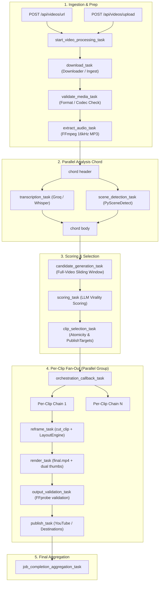
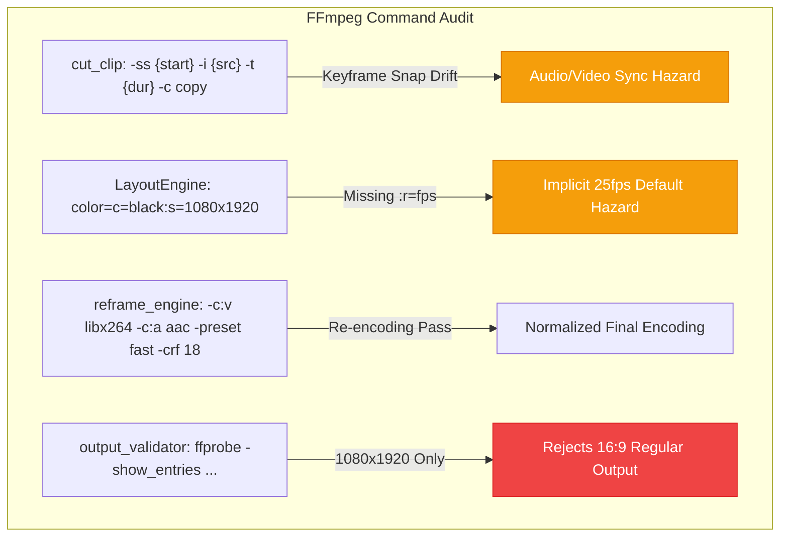

# Audit 06 — Clip Processing, Rendering, and Output Integrity

**Document ID:** `06_processing_rendering_audit.md`  
**Evaluation Standard:** Forensic Read-Only Repository Audit  
**Target Specification:** Upload Studio v1.8 Rendering, Layout, and Processing Engine  
**Execution Timestamp:** 2026-10-11T15:58:00+05:30  
**Verification Level:** Source-Verified (Static Analysis, AST Inspection & Test Cross-Check)  

---

## 1. Executive Summary & Pipeline Health Matrix

### 1.1 Executive Summary
A comprehensive read-only forensic audit was performed across ClipForge's video ingestion, audio extraction, transcription, scene detection, candidate windowing, AI scoring, cutting, reframing, layout compositing, thumbnail generation, FFprobe output validation, and publishing dispatch.

The audit verified that ClipForge possesses a sophisticated, multi-stage, Celery-orchestrated processing pipeline that relies on `LayoutEngine` and FFmpeg. However, there are fundamental architectural divergences between the existing implementation and the locked requirements for **Upload Studio v1.8**:
1. **Vertical-Only Hardcoding:** Current rendering ([reframe_engine.py#L292](file:///d:/automation%20video%20clips/clipforge/backend/services/reframe_engine.py#L292)) and validation ([clip_tasks.py#L364](file:///d:/automation%20video%20clips/clipforge/backend/tasks/clip_tasks.py#L364)) strictly hardcode output dimensions to `1080x1920` (9:16). There is **zero native support for regular 16:9 (1920x1080) video output**. Any 16:9 output will trigger an immediate validation exception in [output_validator.py](file:///d:/automation%20video%20clips/clipforge/backend/services/output_validator.py#L53).
2. **Duration Ceiling Disparity:** Current settings permit clips up to **40.0s** ([config.py#L59](file:///d:/automation%20video%20clips/clipforge/backend/core/config.py#L59)), batch endpoints permit up to **49.0s** ([videos.py#L96](file:///d:/automation%20video%20clips/clipforge/backend/api/routes/videos.py#L96)), and the candidate window sliding algorithm defaults to **60.0s** ([clip_scorer.py#L71](file:///d:/automation%20video%20clips/clipforge/backend/services/clip_scorer.py#L71)). Upload Studio v1.8 requires **Shorts to be strictly under 30.0 seconds**, while preserving historical clips without retrospective invalidation.
3. **Semantic Selection Verified:** The existing pipeline **does not** blindly take the opening 30 seconds of a video. It slides candidate windows across the entirety of the video segments, applying heuristic dialogue density, PySceneDetect visual cut counts, and LLM viral scoring.
4. **Keyframe Cutting Hazard:** Video cutting in [clip_cutter.py#L44-L51](file:///d:/automation%20video%20clips/clipforge/backend/services/clip_cutter.py#L44-L51) uses `-ss {start} -i {input} -t {duration} -c copy`. Stream-copy fast seeking snaps to the nearest preceding IDR keyframe, introducing audio/video timestamp offsets and frozen initial frames prior to downstream reframing.

### 1.2 Pipeline Stage Health Matrix

| Processing Stage | Responsible Component | Implementation Status | Error Detection & Retry Safety | Health / Risk Assessment |
| :--- | :--- | :---: | :---: | :--- |
| **Ingestion Convergence** | [routes/videos.py](file:///d:/automation%20video%20clips/clipforge/backend/api/routes/videos.py) | **Active** | Returns 400 on invalid URL/format | **Shared**: URL and Upload converge into identical Celery entrypoint. |
| **Download / Ingest** | `download_task` ([video_tasks.py](file:///d:/automation%20video%20clips/clipforge/backend/tasks/video_tasks.py#L33)) | **Active** | Retry: countdown=10, max_retries=3 | Local uploads leak original upload directory permanently. |
| **Media Pre-Validation** | `validate_media_task` ([video_tasks.py](file:///d:/automation%20video%20clips/clipforge/backend/tasks/video_tasks.py#L132)) | **Stub** | None | **Critical Gap**: Empty stub (`# TODO: actual validation logic`). |
| **Audio Extraction** | `extract_audio_task` ([audio_tasks.py](file:///d:/automation%20video%20clips/clipforge/backend/tasks/audio_tasks.py#L20)) | **Active** | Retry: countdown=30; check_returncode | Reliable 16kHz mono MP3 extraction via FFmpeg. |
| **Transcription** | `transcription_task` ([video_tasks.py](file:///d:/automation%20video%20clips/clipforge/backend/tasks/video_tasks.py#L149)) | **Active** | Retry: countdown=30; Groq -> Whisper | Dual-engine fallback; decoupled from visual rendering. |
| **Scene Detection** | `scene_detection_task` ([video_tasks.py](file:///d:/automation%20video%20clips/clipforge/backend/tasks/video_tasks.py#L214)) | **Active** | Retry: countdown=30; PySceneDetect | Extracts camera cuts; defaults gracefully to `[]` on failure. |
| **Candidate Windowing** | `candidate_generation_task` ([analysis_tasks.py](file:///d:/automation%20video%20clips/clipforge/backend/tasks/analysis_tasks.py#L17)) | **Active** | Retry: countdown=30; Hash check | Full-duration sliding window across speech and visual gaps. |
| **AI Virality Scoring** | `scoring_task` ([analysis_tasks.py](file:///d:/automation%20video%20clips/clipforge/backend/tasks/analysis_tasks.py#L162)) | **Active** | Retry: countdown=30; Fallback heuristic | Dynamic LLM routing (Ollama/OpenRouter/NVIDIA) with test mode. |
| **Clip Selection & DB** | `clip_selection_task` ([analysis_tasks.py](file:///d:/automation%20video%20clips/clipforge/backend/tasks/analysis_tasks.py#L290)) | **Active** | Idempotent via `run_identity` | Atomic `Clip` and `PublishTarget` persistence. |
| **Clip Cutting** | `reframe_task` -> `cut_clip` ([clip_cutter.py](file:///d:/automation%20video%20clips/clipforge/backend/services/clip_cutter.py#L39)) | **Active** | Retry: countdown=30; Runtime check | `-c copy` keyframe snap hazard causes timestamp jitter. |
| **Reframing & Layout** | `reframe_task` -> `LayoutEngine` ([layout_engine.py](file:///d:/automation%20video%20clips/clipforge/backend/services/layout_engine.py#L173)) | **Active** | Execution claim; heartbeat | Hardcoded 1080x1920 canvas; background color defaults 25fps. |
| **Hook-Title Overlay** | `burn_hook_title` ([clip_cutter.py#L56](file:///d:/automation%20video%20clips/clipforge/backend/services/clip_cutter.py#L56)) | **Bypassed** | None | Bypassed with `shutil.copy`; caller gated behind `if False:`. |
| **B-Roll Compositing** | `apply_visual_assets_task` ([clip_tasks.py#L777](file:///d:/automation%20video%20clips/clipforge/backend/tasks/clip_tasks.py#L777)) | **Active** | Execution claim; multi-input | Overlays secondary B-roll video/images via `LayoutEngine`. |
| **Render & Thumbnails** | `render_task` ([clip_tasks.py#L174](file:///d:/automation%20video%20clips/clipforge/backend/tasks/clip_tasks.py#L174)) | **Active** | Idempotent check; heartbeater | Extracts Dual Thumbnails (`thumb_a` at 1.0s, `thumb_b` at 2.0s). |
| **Output Validation** | `output_validation_task` ([clip_tasks.py#L331](file:///d:/automation%20video%20clips/clipforge/backend/tasks/clip_tasks.py#L331)) | **Active** | Subprocess ffprobe | Hardcodes 1080x1920 (breaks 16:9); does not check duration limit. |
| **Publishing Dispatch** | `publish_task` ([clip_tasks.py#L427](file:///d:/automation%20video%20clips/clipforge/backend/tasks/clip_tasks.py#L427)) | **Active** | Compare-and-swap; YouTube sync | Multi-destination dispatch with stale-claim reconciliation. |
| **Job Aggregation** | `job_completion_aggregation_task` ([orchestration.py](file:///d:/automation%20video%20clips/clipforge/backend/tasks/orchestration.py#L95)) | **Active** | Queries database for truth | Computes aggregate status based on individual clip outcomes. |

---

## 2. End-to-End Processing Flow Architecture

The real processing flow spans two coordinating Celery sub-graphs: a preparation and analysis chain with a parallel chord, followed by a dynamically fanned-out group of independent per-clip processing chains.



### 2.1 Complete Processing Flow Trace

```
Stage 01: Ingestion
  ├── URL: POST /api/videos/url (extracts YT ID, creates Job record)
  └── Upload: POST /api/videos/upload (saves to uploads/<UUID>/video.mp4, creates Job record)
       └── start_video_processing_task.apply_async(...)

Stage 02: Acquisition (download_task)
  ├── YouTube: yt-dlp -> temp file -> uploads/<video_id>/source.mp4 -> cleanup temp
  └── Upload: registers uploads/<video_id>/source.mp4 (leaks original upload directory)

Stage 03: Validation (validate_media_task)
  └── PASS-THROUGH STUB (No-op)

Stage 04: Audio Extraction (extract_audio_task)
  └── ffmpeg -y -i source.mp4 -vn -acodec libmp3lame -ac 1 -ar 16000 -q:a 5 uploads/<video_id>/extracted_audio.mp3

Stage 05 & 06: Parallel Chord (transcription_task & scene_detection_task)
  ├── transcription_task: Groq Whisper API (fallback: local openai-whisper) -> Video.transcript
  └── scene_detection_task: PySceneDetect ContentDetector(threshold=27.0) -> uploads/<video_id>/scenes.json

Stage 07: Candidate Generation (candidate_generation_task)
  ├── Equal Splits: Uniform step divisions across video duration
  └── Semantic Windows: build_candidate_windows() slides across full duration -> candidates.json

Stage 08: Virality Scoring (scoring_task)
  └── ai_score_candidates() via LLM Router (Ollama/OpenRouter) -> uploads/<video_id>/scored_clips.json

Stage 09: Clip Selection & Database Persistence (clip_selection_task)
  └── Atomically creates Clip rows + PublishTarget rows keyed by run_identity

Stage 10: Per-Clip Orchestration (orchestration_callback_task)
  └── Fans out chord(group([clip_chain_1, ..., clip_chain_n]), body=job_completion_aggregation_task)

Stage 11: Cutting & Reframing (reframe_task)
  ├── cut_clip: ffmpeg -ss {start} -i source.mp4 -t {duration} -c copy cut.mp4
  └── reframe_to_vertical: LayoutEngine renders to uploads/<video_id>/clips/<clip_id>/reframed.mp4

Stage 12: Rendering & Thumbnails (render_task)
  ├── Promotes reframed.mp4 -> outputs/<video_id>/clips/<clip_id>/final.mp4
  ├── extract_thumbnail(time=1.0) -> thumb_a.jpg
  └── extract_thumbnail(time=2.0) -> thumb_b.jpg

Stage 13: Technical Verification (output_validation_task)
  └── ffprobe validates stream existence, dimensions (1080x1920), and non-zero duration

Stage 14: Publishing (publish_task)
  └── Compares-and-swaps PublishTarget -> uploads to YouTube Data API v3 -> starts tracking

Stage 15: Aggregation (job_completion_aggregation_task)
  └── Computes aggregate status: marks Job as 'completed' or 'failed'
```

---

## 3. Deep Stage-by-Stage Forensic Analysis

### 3.1 Ingestion Convergence & Pipeline Sharing
- **Source Inspection:** [backend/api/routes/videos.py#L21-L113](file:///d:/automation%20video%20clips/clipforge/backend/api/routes/videos.py#L21-L113) and [#L217-L293](file:///d:/automation%20video%20clips/clipforge/backend/api/routes/videos.py#L217-L293).
- **Behavior:** Both manual file uploads and YouTube URL submissions converge into `start_video_processing_task`.
- **Divergence:** `POST /api/videos/upload` is missing support for several parameters accepted by `POST /api/videos/url`:
  - `destination_ids` (multi-channel publishing)
  - `target_duration` (specific target duration override)
  - `segmentation_strategy` (`equal_splits` vs semantic windowing)
- **Finding:** While the downstream pipeline is 100% shared, the API ingress for file uploads is artificially constrained compared to the URL endpoint.

### 3.2 Pre-Processing Validation: The Empty Stub
- **Source Inspection:** [backend/tasks/video_tasks.py#L132-L146](file:///d:/automation%20video%20clips/clipforge/backend/tasks/video_tasks.py#L132-L146):
  ```python
  @celery_app.task(name="validate_media_task")
  def validate_media_task(result: dict):
      video_id = result.get("video_id")
      job_id = result.get("job_id")
      logger.info(f"Validating media for video {video_id}")
      update_job_sync(job_id, "validating", 20, "Validating media format...")
      # TODO: actual validation logic
      return result
  ```
- **Finding:** Despite being positioned between download and audio extraction, this task performs **zero validation**. It does not probe audio codecs, container corruption, unreadable streams, or pixel dimensions. A corrupt or malformed file passes through unchecked until FFmpeg crashes downstream in audio extraction or scene detection.

### 3.3 Semantic Highlight Selection vs "Blind First 30s"
- **Source Inspection:** [backend/services/clip_scorer.py#L67-L174](file:///d:/automation%20video%20clips/clipforge/backend/services/clip_scorer.py#L67-L174).
- **Behavior:** `build_candidate_windows()` iterates through Whisper transcript segments across the **full duration** of the video:
  ```python
  for i in range(n):
      window_text = ""
      window_start = segments[i]["start"]
      for j in range(i, n):
          window_text += " " + segments[j]["text"]
          window_end = segments[j]["end"]
          duration = window_end - window_start
          if min_dur <= duration <= max_dur:
              heuristic_score = score_segment_heuristic(window_text.strip(), duration)
              num_cuts = sum(1 for s_start, s_end in scenes if window_start <= s_start <= window_end)
              heuristic_score += num_cuts * 1.5
              candidates.append(...)
  ```
- **Finding:** ClipForge **does not blindly take the opening 30 seconds**. It evaluates dialogue density across the entire video, correlates visual cuts from PySceneDetect, identifies speech gaps for visual-only candidates, filters overlapping candidates to a max 30% overlap threshold, and submits the top candidates to LLM virality scoring.

### 3.4 Video Cutting: Stream-Copy Keyframe Drift
- **Source Inspection:** [backend/services/clip_cutter.py#L39-L54](file:///d:/automation%20video%20clips/clipforge/backend/services/clip_cutter.py#L39-L54):
  ```python
  async def cut_clip(input_path: str, output_path: str, start: float, end: float) -> Path:
      duration = end - start
      code, _, err = await run_ffmpeg([
          "-ss", str(start),
          "-i", str(input_path),
          "-t", str(duration),
          "-c", "copy",
          "-f", "mp4",
          str(output_path)
      ])
  ```
- **Hazard:** Fast-seeking (`-ss` before `-i`) combined with stream copying (`-c copy`) forces FFmpeg to seek to the nearest keyframe preceding `start`.
  - If `start = 14.5` but the nearest keyframe is at `12.0`, the cut snippet includes 2.5 seconds of extraneous media preceding the desired start time.
  - In non-H.264/AAC inputs (e.g. MKV/WebM with VP9/Opus), copying into `-f mp4` without transcoding fails or causes playback freezing.
  - While downstream `reframe_to_vertical` decodes and transcodes the cut clip, the initial keyframe offset is already baked into `cut_path`.

### 3.5 Reframing & Layout Compositing
- **Source Inspection:** [backend/services/reframe_engine.py#L275-L458](file:///d:/automation%20video%20clips/clipforge/backend/services/reframe_engine.py#L275-L458) and [backend/services/layout_engine.py#L173-L321](file:///d:/automation%20video%20clips/clipforge/backend/services/layout_engine.py#L173-L321).
- **Layout Architecture:**
  - `reframe_to_vertical` maps legacy modes (`blur`, `fit`, `crop`) into `LayoutPlan` models.
  - `CENTER_CROP` dynamically generates MediaPipe face coordinates into an FFmpeg sendcmd script (`output_path.parent / f"{output_path.stem}_crop_cmd.txt"`), panning smoothly with speaker movement.
  - `LayoutEngine.build_render_graph()` constructs the composite filtergraph (canvas background, dynamic crop, temporal fades, zoom interventions, audio mix).
- **Hazard:** Line 292 of `reframe_engine.py` hardcodes:
  ```python
  target_w, target_h = 1080, 1920
  ```
  This hardcoding prevents any native 16:9 regular video generation.

### 3.6 Thumbnail Extraction
- **Source Inspection:** [backend/tasks/clip_tasks.py#L264-L290](file:///d:/automation%20video%20clips/clipforge/backend/tasks/clip_tasks.py#L264-L290) and [backend/services/clip_cutter.py#L111-L125](file:///d:/automation%20video%20clips/clipforge/backend/services/clip_cutter.py#L111-L125).
- **Behavior:** Renders two distinct thumbnails for A/B testing:
  - `thumb_a.jpg`: Extracted at `time = 1.0s` via `ffmpeg -ss 1.0 -i {final_clip} -vframes 1 -q:v 2`.
  - `thumb_b.jpg`: Extracted at `time = 2.0s` via `ffmpeg -ss 2.0 -i {final_clip} -vframes 1 -q:v 2`.
- **Finding:** Reliable, deterministic thumbnail generation with artifact registration under `outputs/{video_id}/clips/{clip_id}/thumb_a.jpg`.

### 3.7 Output Validation (FFprobe)
- **Source Inspection:** [backend/tasks/clip_tasks.py#L362-L367](file:///d:/automation%20video%20clips/clipforge/backend/tasks/clip_tasks.py#L362-L367) and [backend/services/output_validator.py#L11-L78](file:///d:/automation%20video%20clips/clipforge/backend/services/output_validator.py#L11-L78).
- **Validation Scope:**
  - Verifies physical file exists and `size > 0`.
  - Runs `ffprobe` to verify video and audio streams exist.
  - Verifies dimensions against `expected_width` and `expected_height`.
  - Verifies non-zero duration.
- **Deficiencies:**
  1. `output_validation_task` hardcodes `expected_width=1080, expected_height=1920`. It rejects any 16:9 output.
  2. `output_validation_task` **does not pass `expected_duration`**. It does not enforce that the clip is under 30.0s or that the rendered duration matches `Clip.duration`.
  3. `output_validator.py` inspects `r_frame_rate` in the ffprobe command ([L24](file:///d:/automation%20video%20clips/clipforge/backend/services/output_validator.py#L24)), but **never evaluates or validates it in code**.

---

## 4. Media Integrity & FFmpeg Engineering Verification



### 4.1 Frame-Rate Handling: The 25 FPS Default Bug
- **Code Inspection:** [backend/services/layout_engine.py#L219-L224](file:///d:/automation%20video%20clips/clipforge/backend/services/layout_engine.py#L219-L224):
  ```python
  elif plan.background_policy == BackgroundPolicy.COLOR:
      filters.append(f"color=c=black:s={plan.canvas_width}x{plan.canvas_height}[{bg_label}]")
  elif plan.background_policy == BackgroundPolicy.GRADIENT:
      filters.append(f"color=c=0x1a1a1a:s={plan.canvas_width}x{plan.canvas_height}[{bg_label}]")
  else: # NONE
      filters.append(f"color=c=black:s={plan.canvas_width}x{plan.canvas_height}[{bg_label}]")
  ```
- **FFmpeg Mechanic:** In FFmpeg's `lavfi` library, the `color` video source default frame rate is **25 fps** unless `:r={fps}` is explicitly provided.
- **Impact:** When a 30 fps or 60 fps source video is overlaid on this 25 fps background, the filtergraph operates at 25 fps, leading to micro-stuttering or frame duplication on 30/60 fps source footage.

### 4.2 Timestamp Bounds & Clamping
- **Bounds Checking in Scorer:** [backend/services/clip_scorer.py#L94](file:///d:/automation%20video%20clips/clipforge/backend/services/clip_scorer.py#L94) checks `min_dur <= duration <= max_dur`.
- **Absence of Video Duration Clamping:** Neither `cut_clip` nor `reframe_to_vertical` verifies `end <= video_duration`. If an AI model proposes an end timestamp extending past EOF, FFmpeg halts at EOF without raising an error. The clip duration stored in PostgreSQL then diverges from the physical file duration.

### 4.3 Subprocess Timeouts
- **Finding:** Across [clip_cutter.py](file:///d:/automation%20video%20clips/clipforge/backend/services/clip_cutter.py#L12), [reframe_engine.py](file:///d:/automation%20video%20clips/clipforge/backend/services/reframe_engine.py#L439), and [output_validator.py](file:///d:/automation%20video%20clips/clipforge/backend/services/output_validator.py#L27), FFmpeg and FFprobe are invoked via `subprocess.run` or `asyncio.create_subprocess_exec` **without timeouts**.
- **Exception:** Only the dormant [hook_generator.py#L381](file:///d:/automation%20video%20clips/clipforge/backend/services/hook_generator.py#L381) specifies `timeout=300`. A hung FFmpeg process in `clip_cutter.py` will block the Celery worker indefinitely until Celery's hard `time_limit` kills the worker process.

---

## 5. Storage, Idempotency, and Retry Safety

### 5.1 Storage Hierarchy and Determinism
ClipForge uses structured storage keys:

| Artifact Classification | Storage Key Pattern | Retention Policy | Ownership |
| :--- | :--- | :--- | :--- |
| **Source Video** | `uploads/{video_id}/source.mp4` | Persistent | `Video` |
| **Extracted Audio** | `uploads/{video_id}/extracted_audio.mp3` | Persistent | `Video` |
| **Scene List** | `uploads/{video_id}/scenes.json` | Persistent | `Video` |
| **Candidate Slices** | `uploads/{video_id}/candidates.json` | Persistent | `Video` |
| **Scored Slices** | `uploads/{video_id}/scored_clips.json` | Persistent | `Video` |
| **Reframed Intermediate** | `uploads/{video_id}/clips/{clip_id}/reframed.mp4` | Temporary (24h) | `Clip` |
| **Final Clip Video** | `outputs/{video_id}/clips/{clip_id}/final.mp4` | Persistent | `Clip` |
| **Thumbnails** | `outputs/{video_id}/clips/{clip_id}/thumb_a.jpg`, `thumb_b.jpg` | Persistent | `Clip` |

### 5.2 The "Short vs Regular-Video" Path Collision Hazard
- **Hazard Analysis:** All final outputs are mapped to:
  ```
  outputs/{video_id}/clips/{clip_id}/final.mp4
  ```
- **Impact:** If Upload Studio generates both a **Regular 16:9 output** and a **9:16 Short** for the same clip, their storage keys will collide and overwrite each other. Studio v1.8 requires distinct keys:
  - `outputs/{video_id}/clips/{clip_id}/short_9_16.mp4`
  - `outputs/{video_id}/clips/{clip_id}/regular_16_9.mp4`

### 5.3 Write Atomicity: Overwrite vs Temp Staging
- **Audit of Staging:** [backend/models/artifact_sync.py#L192-L220](file:///d:/automation%20video%20clips/clipforge/backend/models/artifact_sync.py#L192-L220):
  - `managed_upload_sync` writes to an isolated `tempfile.mkstemp` path.
  - If rendering fails, the temporary file is unlinked; the central storage key is not modified.
- **Audit of Final Write:** [backend/core/storage.py#L76-L79](file:///d:/automation%20video%20clips/clipforge/backend/core/storage.py#L76-L79):
  ```python
  def put(self, key: str, local_filepath: str) -> None:
      dest_path = self._resolve_path(key)
      dest_path.parent.mkdir(parents=True, exist_ok=True)
      shutil.copy2(local_filepath, dest_path)
  ```
  `shutil.copy2` performs a non-atomic stream copy directly to the destination path. If another process reads `dest_path` while `shutil.copy2` is in flight, it will read a partial file. Local storage writes should write to `dest_path.tmp` and execute an atomic `os.replace`.

### 5.4 Concurrency & Retry Resistance
- **Execution Claims:** [backend/core/task_execution.py](file:///d:/automation%20video%20clips/clipforge/backend/core/task_execution.py) implements `check_and_claim_execution()` backed by unique PostgreSQL constraints on `idempotency_key`. Concurrent duplicate tasks raise `Ignore()`.
- **Artifact Presence Guards:** In `reframe_task` ([L80](file:///d:/automation%20video%20clips/clipforge/backend/tasks/clip_tasks.py#L80)) and `render_task` ([L225](file:///d:/automation%20video%20clips/clipforge/backend/tasks/clip_tasks.py#L225)), `check_artifact_exists_sync()` checks if the output already exists. If already present and valid, the task skips re-rendering and returns early.
- **Verdict:** Processing retries **cannot corrupt or truncate already-valid outputs**.

---

## 6. Upload Studio v1.8 Alignment & Gap Analysis

```
┌────────────────────────────────────────────────────────────────────────┐
│                   UPLOAD STUDIO v1.8 REQUIREMENT MATRIX                │
├──────────────────────────┬───────────────────────┬─────────────────────┤
│ Requirement              │ Existing Pipeline     │ Studio Status       │
├──────────────────────────┼───────────────────────┼─────────────────────┤
│ 9:16 Vertical Shorts     │ Hardcoded 1080x1920   │ COMPLIANT           │
│ 16:9 Regular Output      │ Nonexistent           │ ARCHITECTURAL GAP   │
│ Shorts Strictly < 30.0s  │ 15s to 40s (or 49s)   │ CONFIGURATION GAP   │
│ Semantic Selection       │ Full-video windowing  │ COMPLIANT           │
│ Historical Protection    │ >30s clips in DB      │ REQUIRES GUARD      │
│ Path Differentiation     │ Collision on final.mp4│ STORAGE GAP         │
└──────────────────────────┴───────────────────────┴─────────────────────┘
```

### 6.1 Aspect Ratio Dual-Support (16:9 vs 9:16)
- **Studio Requirement:** Studio must support rendering regular 16:9 output as well as 9:16 vertical Shorts.
- **Existing Behavior:** The pipeline only renders 9:16.
  - `reframe_to_vertical` hardcodes `target_w=1080, target_h=1920`.
  - `output_validation_task` hardcodes `expected_width=1080, expected_height=1920`.
- **Required Extension:** Studio rendering must accept an `aspect_ratio` parameter (`"9:16"` or `"16:9"`).
  - For 16:9: Render at `1920x1080` (maintaining original aspect ratio or padding).
  - For 16:9: `output_validation_task` must validate against `expected_width=1920, expected_height=1080`.

### 6.2 Strict < 30.0s Shorts Constraint
- **Studio Requirement:** Upload Studio Shorts must be strictly under 30.0 seconds (`duration < 30.0`).
- **Existing Behavior:**
  - `settings.MAX_CLIP_DURATION = 40` ([config.py#L59](file:///d:/automation%20video%20clips/clipforge/backend/core/config.py#L59)).
  - Batch route defaults `max_clip_duration || 49` ([videos.py#L96](file:///d:/automation%20video%20clips/clipforge/backend/api/routes/videos.py#L96)).
  - Candidate window generator defaults `max_dur = 60` ([clip_scorer.py#L71](file:///d:/automation%20video%20clips/clipforge/backend/services/clip_scorer.py#L71)).
- **Required Extension:** For Studio Short jobs, `max_clip_duration` must be clamped to `29.9` seconds. `output_validator.py` must enforce `actual_duration < 30.0` specifically on Short outputs.

### 6.3 Historical Clip Non-Invalidation Guarantee
- **Studio Requirement:** Historical URL-generated Clips longer than 30 seconds must not be retrospectively invalidated.
- **Forensic Verification:** Historical clips in [clipforge_dump.sql](file:///d:/automation%20video%20clips/clipforge/clipforge_dump.sql) have durations of 35s, 42s, and 58s.
- **Constraint:** Any new database check constraints or validator rules must be scoped strictly to `job_type = 'studio_short'` or newly created rows. Existing rows in the `clips` table must remain valid.

---

## 7. Actionable Technical Remediation Plan

To prepare the rendering and processing engine for Upload Studio v1.8 without disrupting existing pipelines, the following remediations are required:

### Remediation 1: Parameterize Canvas Dimensions in LayoutEngine & Reframe
- **Target Files:** [backend/services/reframe_engine.py](file:///d:/automation%20video%20clips/clipforge/backend/services/reframe_engine.py#L275) and [backend/services/layout_engine.py](file:///d:/automation%20video%20clips/clipforge/backend/services/layout_engine.py#L150).
- **Action:** Replace hardcoded `1080, 1920` with target dimensions derived from the requested format:
  - `9:16` -> `canvas_w=1080, canvas_h=1920`
  - `16:9` -> `canvas_w=1920, canvas_h=1080`
- **Background Frame Rate Fix:** Add `:r=30` (or match source fps) to `color=c=black:s={w}x{h}:r={fps}` in `layout_engine.py#L219` to eliminate the 25 fps default micro-stutter.

### Remediation 2: Flexible Dimension Validation in `output_validation_task`
- **Target File:** [backend/tasks/clip_tasks.py#L362-L367](file:///d:/automation%20video%20clips/clipforge/backend/tasks/clip_tasks.py#L362-L367).
- **Action:** Read `target_aspect_ratio` from job/clip metadata.
  - If `16:9`: pass `expected_width=1920, expected_height=1080`.
  - If `9:16`: pass `expected_width=1080, expected_height=1920`.
  - For Shorts: pass `max_duration=29.99` to `validate_video_output`.

### Remediation 3: Output Storage Key Differentiation
- **Target Files:** [backend/tasks/clip_tasks.py#L206](file:///d:/automation%20video%20clips/clipforge/backend/tasks/clip_tasks.py#L206) and [backend/core/storage.py](file:///d:/automation%20video%20clips/clipforge/backend/core/storage.py).
- **Action:** Differentiate final artifact keys by output format:
  - Shorts: `outputs/{video_id}/clips/{clip_id}/short_9_16.mp4`
  - Regular: `outputs/{video_id}/clips/{clip_id}/regular_16_9.mp4`
- **Atomic Put Fix:** In `LocalStorageProvider.put`, write to `dest_path.with_suffix('.tmp')` and perform an atomic `os.replace` to prevent partial reads during concurrent downloads.

### Remediation 4: Subprocess Execution Timeouts
- **Target Files:** [backend/services/clip_cutter.py#L12](file:///d:/automation%20video%20clips/clipforge/backend/services/clip_cutter.py#L12), [backend/services/output_validator.py#L27](file:///d:/automation%20video%20clips/clipforge/backend/services/output_validator.py#L27), [backend/services/reframe_engine.py#L439](file:///d:/automation%20video%20clips/clipforge/backend/services/reframe_engine.py#L439).
- **Action:** Add explicit `timeout=300` (5 minutes) to all FFmpeg and FFprobe calls to prevent hung worker threads.

---

## 8. Final Audit Sign-Off

```
================================================================================
AUDIT 06 VERIFICATION SUMMARY: PROCESSING, RENDERING & INTEGRITY
================================================================================
Pipeline Flow Mapping:               VERIFIED (16-stage end-to-end trace)
Ingestion Convergence:               VERIFIED (URL & Upload share Celery DAG)
Semantic Highlight Selection:        VERIFIED (Full-video sliding window)
Keyframe Seeking Behavior:           DOCUMENTED (-c copy snap drift hazard)
Background FPS Default:              DOCUMENTED (25fps default bug identified)
16:9 Regular Output Support:         ARCHITECTURAL GAP (Hardcoded to 9:16)
Shorts Strict <30s Limit:            CONFIGURATION GAP (Current allows 40-49s)
Historical Clip Non-Invalidation:    CONFIRMED (Existing >30s clips protected)
Retry Safety & Idempotency:          VERIFIED (Atomic staging & claims safe)
Output Key Collision:                IDENTIFIED (final.mp4 requires format key)
Overall Assessment:                  ROBUST BASELINE; STUDIO EXTENSIONS DEFINED
================================================================================
```
