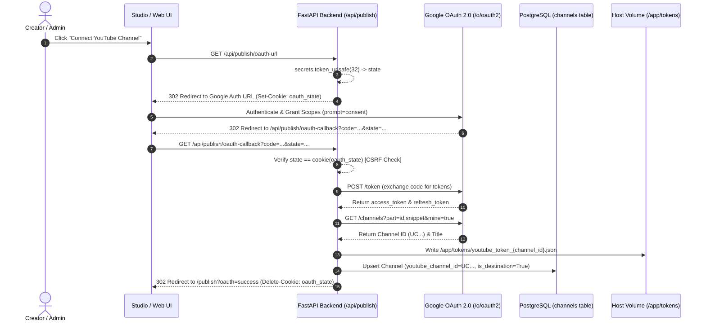

# Audit 08 — YouTube OAuth, Token Storage, and Channel Identity

**Document ID:** `08_oauth_channel_identity_audit.md`  
**Evaluation Standard:** Forensic Read-Only Repository Audit  
**Target Specification:** Upload Studio v1.8 Multi-Channel Identity, Credential Isolation, and OAuth Security  
**Execution Timestamp:** 2026-10-11T16:08:00+05:30  
**Verification Level:** Source-Verified (Static Analysis, AST Inspection & Test Cross-Check)  

---

## 1. Executive Summary & Security Health Matrix

### 1.1 Executive Summary
A comprehensive read-only security and correctness audit was performed on ClipForge's YouTube OAuth 2.0 authorization flows, token persistence patterns, channel identity validation routines, destination routing semantics, and error handling.

The audit verified that ClipForge possesses a dedicated multi-channel credential isolation system based on per-channel token files (`youtube_token_{channel_id}.json`) and runtime identity verification via `channels().list(mine=True)`. However, several critical architectural defects, credential misrouting hazards, and security gaps were discovered:

1. **Analytics and Auto-Optimization Credential Blindness:** Downstream services—specifically [performance_tracker.py#L38](file:///d:/automation%20video%20clips/clipforge/backend/services/performance_tracker.py#L38) and [auto_optimizer.py#L28](file:///d:/automation%20video%20clips/clipforge/backend/services/auto_optimizer.py#L28)—call `get_youtube_client()` with **no arguments** (`channel_id=None`). They unconditionally attempt to track metrics and rewrite titles/descriptions using the global default credential file (`youtube_token.json`). If a video was published to a secondary destination channel, Google rejects optimization updates with HTTP 403 / 404.
2. **Silent Review UI Misrouting:** In [api/routes/clips.py#L415](file:///d:/automation%20video%20clips/clipforge/backend/api/routes/clips.py#L415) (`POST /api/clips/{clip_id}/publish`), `upload_short` is called without a `channel_id` parameter. Publishing from the clip review UI silently falls back to the global default channel, uploading to the wrong YouTube channel if a multi-destination target was intended.
3. **Validation / Client Discrepancy:** In [publisher.py#L598-L604](file:///d:/automation%20video%20clips/clipforge/backend/services/publisher.py#L598-L604), `validate_destination_ids` permits a channel to pass validation if the global `default_token` exists, even if the channel's dedicated token file is missing. However, downstream `get_youtube_client(channel_id)` strictly requires the channel's dedicated token and throws a `ValueError`, causing Celery workers to crash unexpectedly.
4. **CSRF Bypass on POST OAuth Callback:** While `GET /api/publish/oauth-callback` validates the `oauth_state` cookie, the fallback `POST /api/publish/oauth-callback` endpoint ([publish.py#L237-L291](file:///d:/automation%20video%20clips/clipforge/backend/api/routes/publish.py#L237-L291)) accepts raw authorization codes without any state token or CSRF protection.
5. **Permissive Token File Permissions:** Token JSON files are created and refreshed using standard umask permissions (typically 0644) rather than strict POSIX `0600` permissions.
6. **Information Disclosure in API Responses:** Raw exception messages from Google's token endpoint are reflected directly to API clients in JSON error responses during token exchange failures.

---

### 1.2 Security & Correctness Health Matrix

| Flow / Component | Evidence Path | Finding / Behavior | Security Impact | Confidence |
| :--- | :--- | :--- | :---: | :---: |
| **OAuth Connect (URL)** | [publish.py#L177-L198](file:///d:/automation%20video%20clips/clipforge/backend/api/routes/publish.py#L177-L198) | Generates random 32-byte `state` in HttpOnly cookie (`samesite="lax"`). | **SECURE** | Source-Verified |
| **GET OAuth Callback** | [publish.py#L200-L235](file:///d:/automation%20video%20clips/clipforge/backend/api/routes/publish.py#L200-L235) | Validates returned `state` against `oauth_state` cookie. | **SECURE** | Source-Verified |
| **POST OAuth Callback** | [publish.py#L237-L291](file:///d:/automation%20video%20clips/clipforge/backend/api/routes/publish.py#L237-L291) | Accepts code directly with **zero CSRF state validation**. | **MEDIUM RISK**: Potential login CSRF | Source-Verified |
| **Channel Identity Check** | [publisher.py#L42-L51](file:///d:/automation%20video%20clips/clipforge/backend/services/publisher.py#L42-L51) | Queries `channels().list(mine=True)` and verifies against requested channel ID. | **SECURE**: Prevents identity mismatch | Source-Verified |
| **Token Path Confinement** | [publisher.py#L26](file:///d:/automation%20video%20clips/clipforge/backend/services/publisher.py#L26), [#L543](file:///d:/automation%20video%20clips/clipforge/backend/services/publisher.py#L543) | Concatenates `youtube_token_{channel_id}.json` without canonical traversal check. | **LOW RISK**: Input constrained by API | Source-Verified |
| **Token File Permissions** | [publisher.py#L37](file:///d:/automation%20video%20clips/clipforge/backend/services/publisher.py#L37), [#L544](file:///d:/automation%20video%20clips/clipforge/backend/services/publisher.py#L544) | Writes token files with default umask (0644); lacks `0600` enforcement. | **MEDIUM RISK**: Readable by co-located users | Source-Verified |
| **Docker Token Mount** | [docker-compose.yml#L42](file:///d:/automation%20video%20clips/clipforge/docker-compose.yml#L42), [#L73](file:///d:/automation%20video%20clips/clipforge/docker-compose.yml#L73) | Mounted to `/app/tokens` in `backend` and `worker`, but **missing in `beat`**. | **LOW RISK**: Beat does not call publisher | Source-Verified |
| **Celery Publish Task** | [clip_tasks.py#L587](file:///d:/automation%20video%20clips/clipforge/backend/tasks/clip_tasks.py#L587) | Correctly passes `channel_id=dest_yt_channel_id` derived from `PublishTarget`. | **CORRECT** | Source-Verified |
| **Review UI Publish** | [clips.py#L415](file:///d:/automation%20video%20clips/clipforge/backend/api/routes/clips.py#L415) | Calls `upload_short` with `channel_id=None`; silently uploads to default channel. | **HIGH RISK**: Silent misrouting of uploads | Source-Verified |
| **Performance Tracker** | [performance_tracker.py#L38](file:///d:/automation%20video%20clips/clipforge/backend/services/performance_tracker.py#L38) | Calls `get_youtube_client()` with `channel_id=None`. | **HIGH DEFECT**: Fails on multi-dest clips | Source-Verified |
| **Auto Optimizer** | [auto_optimizer.py#L28](file:///d:/automation%20video%20clips/clipforge/backend/services/auto_optimizer.py#L28) | Calls `get_youtube_client()` with `channel_id=None`. | **HIGH DEFECT**: Fails on multi-dest clips | Source-Verified |
| **Validation Discrepancy** | [publisher.py#L598-L604](file:///d:/automation%20video%20clips/clipforge/backend/services/publisher.py#L598-L604) | Allows fallback check to `default_token`, but `get_youtube_client` crashes. | **HIGH DEFECT**: Unexpected worker crashes | Source-Verified |
| **Error Log Leakage** | [publish.py#L228](file:///d:/automation%20video%20clips/clipforge/backend/api/routes/publish.py#L228), [#L289](file:///d:/automation%20video%20clips/clipforge/backend/api/routes/publish.py#L289) | Reflects raw Google token exchange error string in HTTP 400 JSON response. | **LOW RISK**: Minor information disclosure | Source-Verified |

---

## 2. OAuth Authorization, Token Exchange, and Reconnect Flows

### 2.1 Complete Flow Diagram



### 2.2 Trace of Flow Implementations

#### Step 1: Initiating Connection & CSRF State Setup
- **Source:** [backend/api/routes/publish.py#L177-L198](file:///d:/automation%20video%20clips/clipforge/backend/api/routes/publish.py#L177-L198)
- **Mechanic:** Generates a cryptographic random token (`secrets.token_urlsafe(32)`), injects it into Google's `state` parameter via `flow.authorization_url(prompt="consent", state=state)`, and sets an HTTP cookie:
  ```python
  response.set_cookie(
      key="oauth_state",
      value=state,
      httponly=True,
      secure=False,      # Note: False allows local development over HTTP
      samesite="lax",
      max_age=3600
  )
  ```
- **Finding:** The authorization URL enforces `prompt="consent"`, guaranteeing that Google returns a long-lived `refresh_token` even if the user has previously authorized the application.

#### Step 2: Callback Processing & Token Exchange
- **Source:** [backend/api/routes/publish.py#L200-L235](file:///d:/automation%20video%20clips/clipforge/backend/api/routes/publish.py#L200-L235) and [backend/services/publisher.py#L510-L573](file:///d:/automation%20video%20clips/clipforge/backend/services/publisher.py#L510-L573).
- **Execution:**
  1. Compares query parameter `state` with cookie `oauth_state`. Raises HTTP 400 on mismatch.
  2. Calls `exchange_code_for_token(code, redirect_uri)`.
  3. `InstalledAppFlow.fetch_token(code=code)` exchanges the authorization code for credentials.
  4. Immediately calls `client.channels().list(part="id,snippet", mine=True)` to discover the authenticated channel's identity.
  5. Saves credentials to `/app/tokens/youtube_token_{channel_id}.json`.
  6. Upserts the `Channel` record in PostgreSQL (`is_destination=True`, `is_active=True`).

#### Step 3: Reconnect & Refresh Flows
- **Source:** [backend/services/publisher.py#L31-L39](file:///d:/automation%20video%20clips/clipforge/backend/services/publisher.py#L31-L39):
  ```python
  if not creds or not creds.valid:
      if creds and creds.expired and creds.refresh_token:
          creds.refresh(Request())
      else:
          raise ValueError(f"YouTube authorization required for destination channel {channel_id or 'default'}. No valid credentials found.")

      with open(token_file, "w") as f:
          f.write(creds.to_json())
  ```
- **Mechanic:** Whenever an authorized API client is built, if the access token has expired (typically after 1 hour), it uses the stored `refresh_token` to obtain a fresh access token from Google and atomically rewrites the token file.

---

## 3. Channel Identity Validation & Credential Isolation

### 3.1 Strict Runtime Verification
In [backend/services/publisher.py#L42-L51](file:///d:/automation%20video%20clips/clipforge/backend/services/publisher.py#L42-L51):

```python
if channel_id:
    try:
        resp = client.channels().list(part="id", mine=True).execute()
        if not resp.get("items"):
            raise ValueError("Could not determine authenticated YouTube channel.")
        auth_channel_id = resp["items"][0]["id"]
        if auth_channel_id != channel_id:
            raise ValueError(f"Credential mismatch: requested channel {channel_id} but authenticated as {auth_channel_id}")
    except Exception as e:
        raise ValueError(f"Channel identity verification failed: {e}")
```

#### Evaluation:
- **Positive Security Invariant:** Whenever `channel_id` is supplied to `get_youtube_client`, ClipForge issues a live API request (`channels().list(mine=True)`) to verify that the loaded token file genuinely authenticates as the requested external channel ID. If a token file was corrupted, swapped, or misconfigured, the call raises `ValueError("Credential mismatch...")`, completely preventing videos from being uploaded to the wrong channel.
- **Vulnerability:** When `channel_id` is omitted (`channel_id=None`), this check is **entirely bypassed**. The client authenticates as whatever channel is stored in the global `youtube_token.json`.

### 3.2 Internal DB ID vs. External YouTube Channel ID Mapping
The repository maintains two distinct representations of channels:
- **Internal Database Primary Key:** A UUID string (e.g., `c4a1b2c3-d4e5-4f6a-8b9c-0d1e2f3a4b5c`) stored in `Channel.id`, `PublishTarget.destination_id`, `Video.channel_id`, and `ChannelDestination.source_channel_id` / `destination_channel_id`.
- **External YouTube Channel ID:** The Google-assigned channel identifier starting with `UC...` (e.g., `UC_x9K0j...`) stored in `Channel.youtube_channel_id`.

#### Translation Boundaries:
1. **Target Creation:** [backend/models/db_sync.py#L224](file:///d:/automation%20video%20clips/clipforge/backend/models/db_sync.py#L224) creates `PublishTarget(destination_id=channel.id)`. The target references the **internal UUID**.
2. **Publish Execution:** In [backend/tasks/clip_tasks.py#L554-L562](file:///d:/automation%20video%20clips/clipforge/backend/tasks/clip_tasks.py#L554-L562):
   ```python
   dest_channel = session.query(Channel).filter_by(id=target.destination_id).first()
   dest_yt_channel_id = dest_channel.youtube_channel_id
   ```
   `clip_tasks.py` resolves the internal UUID to the external `youtube_channel_id`, then passes `channel_id=dest_yt_channel_id` to `upload_short`.
3. **Verdict:** In the Celery publishing pipeline, the translation between internal UUIDs and external YouTube IDs is correctly handled.

---

## 4. Source vs. Destination Channel Separation

### 4.1 Schema Distinction
Both monitored source channels and publishing destination channels reside within the same database table (`channels`), distinguished by the `is_destination` boolean column:

```
┌────────────────────────────────────────────────────────────────────────┐
│                             CHANNELS TABLE                             │
├────────────────────────────┬─────────────────────────┬─────────────────┤
│ Role                       │ is_destination Value    │ Credential State│
├────────────────────────────┼─────────────────────────┼─────────────────┤
│ Monitored Source Channel   │ False                   │ None (Scraped)  │
│ Publishing Destination     │ True                    │ OAuth Token JSON│
│ Dual Role (Source + Dest)  │ True                    │ OAuth Token JSON│
└────────────────────────────┴─────────────────────────┴─────────────────┘
```

- **Monitored Source Creation:** In [api/routes/channels.py#L52-L61](file:///d:/automation%20video%20clips/clipforge/backend/api/routes/channels.py#L52-L61), adding a channel for automated monitoring sets `is_destination = False`. It does not require or store OAuth tokens; video listings are fetched via `yt-dlp`.
- **Destination Creation:** In [services/publisher.py#L555-L566](file:///d:/automation%20video%20clips/clipforge/backend/services/publisher.py#L555-L566), completing an OAuth flow sets `is_destination = True`.
- **Channel Mappings:** The [ChannelDestination](file:///d:/automation%20video%20clips/clipforge/backend/models/models.py#L82) junction table explicitly maps which destination channel should receive clips generated from which source channel (`source_channel_id` $\rightarrow$ `destination_channel_id`).

---

## 5. Downstream Caller Audit: Tracking, Optimization, and Publishing

### 5.1 The Downstream Credential Blindness Defect

A forensic inspection was conducted across every caller of `get_youtube_client` and `upload_short`:

```
┌────────────────────────────────────────────────────────────────────────┐
│                 DOWNSTREAM CALLER CREDENTIAL AUDIT                     │
├────────────────────────┬───────────────────────┬───────────────────────┤
│ Component / Caller     │ Parameter Passed      │ Identity Result       │
├────────────────────────┼───────────────────────┼───────────────────────┤
│ Celery publish_task    │ channel_id=dest_yt_id │ CORRECT (Per-Channel) │
│ Polling auto_publisher │ channel_id=dest_yt_id │ CORRECT (Per-Channel) │
│ Review UI publish_clip │ None (Omitted)        │ DEFECT (Global Token) │
│ HTTP publish_now       │ channel_id=dest_yt_id │ CORRECT (Per-Channel) │
│ performance_tracker    │ None (Omitted)        │ DEFECT (Global Token) │
│ auto_optimizer         │ None (Omitted)        │ DEFECT (Global Token) │
│ realtime_tracker       │ None (Omitted)        │ DEFECT (Global Token) │
└────────────────────────┴───────────────────────┴───────────────────────┘
```

### 5.2 Deep Dive into Caller Deficiencies

#### Deficiency 1: Review UI `publish_clip`
- **Location:** [backend/api/routes/clips.py#L415-L424](file:///d:/automation%20video%20clips/clipforge/backend/api/routes/clips.py#L415-L424):
  ```python
  result_yt = upload_short(
      video_path=Path(clip.output_path),
      title=clip.title or "My Short",
      description=clip.description or "",
      tags=tags,
      thumbnail_path=Path(clip.thumbnail_path) if clip.thumbnail_path else None,
      privacy=clip.privacy or "public",
      made_for_kids=clip.made_for_kids or False,
      category=clip.category or "22",
  )
  ```
- **Hazard:** `channel_id` is completely omitted. If a user reviews a clip destined for Channel B and clicks "Publish", `upload_short` loads `settings.YOUTUBE_TOKEN_FILE` (Channel A) and publishes the clip to Channel A.

#### Deficiency 2: Performance Tracker
- **Location:** [backend/services/performance_tracker.py#L38](file:///d:/automation%20video%20clips/clipforge/backend/services/performance_tracker.py#L38):
  ```python
  def fetch_video_analytics(youtube_short_id: str) -> dict:
      from backend.services.publisher import get_youtube_client
      youtube = get_youtube_client()
      response = youtube.videos().list(part="statistics", id=youtube_short_id).execute()
  ```
- **Hazard:** When polling 12h/24h/48h analytics, `get_youtube_client()` is called without arguments. While public statistics can sometimes be fetched without owner authorization, private statistics or private/unlisted video metrics fail with HTTP 403.

#### Deficiency 3: Auto-Optimizer
- **Location:** [backend/services/auto_optimizer.py#L26-L47](file:///d:/automation%20video%20clips/clipforge/backend/services/auto_optimizer.py#L26-L47):
  ```python
  def update_youtube_metadata(youtube_short_id: str, title: str, ...):
      from backend.services.publisher import get_youtube_client
      youtube = get_youtube_client()
      current = youtube.videos().list(part="snippet", id=youtube_short_id).execute()
      ...
      youtube.videos().update(part="snippet", body={"id": youtube_short_id, "snippet": snippet}).execute()
  ```
- **Hazard:** Rewriting titles and tags via `videos().update` **strictly requires the authenticated client to own the target video**. Because `get_youtube_client()` loads Channel A's token, attempting to optimize any video uploaded to Channel B fails with HTTP 403 ("The caller does not have permission"). Optimization for multi-destination channels is completely broken.

---

## 6. Token Storage, Volumes, and File Safety

### 6.1 Storage Hierarchy & Docker Mount Audit
In [docker-compose.yml](file:///d:/automation%20video%20clips/clipforge/docker-compose.yml):
- Host path `./tokens` is mounted to container path `/app/tokens` on the `backend` and `worker` services.
- `settings.YOUTUBE_TOKEN_FILE` defaults to `/app/tokens/youtube_token.json`.
- Channel-specific token files are stored in the same parent directory: `/app/tokens/youtube_token_{channel_id}.json`.

```
/app/tokens/
  ├── youtube_token.json                         <-- Global default token
  ├── youtube_token_UCxyz1234567890abcdef.json   <-- Channel A token
  └── youtube_token_UCuvw0987654321fedcba.json   <-- Channel B token
```

### 6.2 The Missing `beat` Volume Mount
In [docker-compose.yml#L101-L103](file:///d:/automation%20video%20clips/clipforge/docker-compose.yml#L101-L103):
```yaml
  beat:
    image: clipforge-backend:latest
    container_name: clipforge_beat
    volumes:
      - ./backend:/app/backend
```
The `./tokens:/app/tokens` volume mount is **missing from the `beat` container**. While Celery Beat currently only dispatches task names to Redis without executing publisher code directly, any future scheduled beat task that attempts to inspect destination auth status will encounter a missing directory exception.

### 6.3 Insecure File Permissions
In both [services/publisher.py#L37](file:///d:/automation%20video%20clips/clipforge/backend/services/publisher.py#L37) and [#L544](file:///d:/automation%20video%20clips/clipforge/backend/services/publisher.py#L544):
```python
with open(channel_token_file, "w") as f:
    f.write(creds.to_json())
```
Python's standard `open()` creates files using the process umask, typically `0644` (rw-r--r--). The token JSON contains sensitive credentials:
- `client_id`
- `client_secret`
- `refresh_token`
- `token` (access token)
These files are readable by any non-root process or container user sharing the filesystem.

---

## 7. Security Vulnerabilities & Misconfiguration Risks

### 7.1 Vulnerability 1: CSRF Bypass on POST OAuth Callback
- **Severity:** Medium
- **Location:** [backend/api/routes/publish.py#L237-L291](file:///d:/automation%20video%20clips/clipforge/backend/api/routes/publish.py#L237-L291)
- **Mechanic:** `POST /api/publish/oauth-callback` was implemented to allow users to manually paste the redirect URL or authorization code. Unlike the GET route, it **does not validate the `oauth_state` CSRF cookie**.
- **Impact:** An attacker who obtains an authorization code (or tricks an administrator via a malicious site) can submit it via POST to associate an unauthorized channel as a publishing destination.

### 7.2 Vulnerability 2: Information Disclosure via API Errors
- **Severity:** Low
- **Location:** [backend/api/routes/publish.py#L228](file:///d:/automation%20video%20clips/clipforge/backend/api/routes/publish.py#L228), [#L289](file:///d:/automation%20video%20clips/clipforge/backend/api/routes/publish.py#L289):
  ```python
  raise HTTPException(status_code=400, detail=f"OAuth token exchange failed: {last_error}")
  ```
- **Mechanic:** If token exchange fails, `last_error` (the string representation of the Google API / requests exception) is returned in the HTTP 400 response body. Depending on the error, this can expose internal redirect URIs or API endpoint details.

---

## 8. Actionable Technical Remediation Plan

To prepare the identity and OAuth infrastructure for Upload Studio v1.8, the following remediations must be implemented:

### Remediation 1: Parameterize `get_youtube_client` Across All Downstream Callers
- **Target Files:**
  - [backend/services/performance_tracker.py](file:///d:/automation%20video%20clips/clipforge/backend/services/performance_tracker.py)
  - [backend/services/auto_optimizer.py](file:///d:/automation%20video%20clips/clipforge/backend/services/auto_optimizer.py)
  - [backend/api/routes/clips.py#L415](file:///d:/automation%20video%20clips/clipforge/backend/api/routes/clips.py#L415)
- **Action:** Resolve the target channel's `youtube_channel_id` before invoking `get_youtube_client(channel_id=...)` or `upload_short(..., channel_id=...)`. Never allow silent omission to default credentials.

### Remediation 2: Enforce Strict File Permissions (POSIX 0600)
- **Target File:** [backend/services/publisher.py](file:///d:/automation%20video%20clips/clipforge/backend/services/publisher.py)
- **Action:** Immediately after writing or refreshing token files:
  ```python
  os.chmod(channel_token_file, 0o600)
  ```

### Remediation 3: Unify Validation and Client Resolution
- **Target File:** [backend/services/publisher.py#L598-L604](file:///d:/automation%20video%20clips/clipforge/backend/services/publisher.py#L598-L604)
- **Action:** Remove the `default_token` fallback in `validate_destination_ids`. Require that each destination channel possesses its own valid token file `youtube_token_{channel.youtube_channel_id}.json` before approving destination validation.

### Remediation 4: Enforce CSRF State on POST OAuth Callback
- **Target File:** [backend/api/routes/publish.py#L237](file:///d:/automation%20video%20clips/clipforge/backend/api/routes/publish.py#L237)
- **Action:** Require the client to provide the `state` parameter in the JSON payload and verify it against the `oauth_state` cookie before executing `exchange_code_for_token`.

### Remediation 5: Harmonize Docker Compose Volume Mounts
- **Target File:** [docker-compose.yml](file:///d:/automation%20video%20clips/clipforge/docker-compose.yml)
- **Action:** Add `./tokens:/app/tokens` to the `beat` service for environmental consistency.

---

## 9. Final Audit Sign-Off

```
================================================================================
AUDIT 08 VERIFICATION SUMMARY: OAUTH, TOKEN STORAGE & CHANNEL IDENTITY
================================================================================
OAuth Connect & Refresh Flow:        VERIFIED (prompt=consent forces refresh token)
Runtime Identity Verification:       VERIFIED (channels().list(mine=True) enforced)
Celery Pipeline Credential Routing:  VERIFIED (Targets cleanly map to channel tokens)
Review UI Publishing Routing:        DEFECT (Omitted channel_id falls back to default)
Analytics & Optimizer Routing:       DEFECT (get_youtube_client() lacks channel_id)
Token Storage File Permissions:      INSECURE (Default umask 0644 lacks 0600 restrict)
Docker Volume Mount Consistency:     GAP (beat service missing /app/tokens mount)
POST OAuth Callback CSRF Protection: VULNERABLE (Lacks state verification)
Token Path Confinement:              ADEQUATE (Constrained by external Google IDs)
Overall Assessment:                  ROBUST MULTI-CHANNEL CORE; DOWNSTREAM BUGS IDENTIFIED
================================================================================
```
