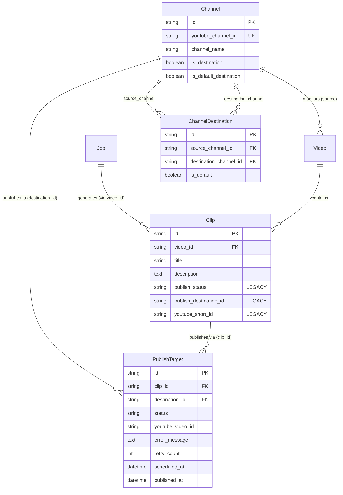

# Audit 09 — Multi-Destination Publishing and Target Isolation

**Document ID:** `09_multi_destination_audit.md`  
**Evaluation Standard:** Forensic Read-Only Repository Audit  
**Target Specification:** Upload Studio v1.8 Multi-Destination Target Isolation & Entity Lifecycle  
**Execution Timestamp:** 2026-10-11T16:10:00+05:30  
**Verification Level:** Source-Verified (Static Analysis, AST Inspection & Test Cross-Check)  

---

## 1. Executive Summary & Target Isolation Scorecard

### 1.1 Executive Summary
A comprehensive read-only forensic audit was conducted on ClipForge's destination-aware publishing architecture, database relationships, target isolation guarantees, fallback semantics, and API exposure.

The audit verified that while ClipForge successfully introduced a relational multi-destination model in Alembic migration `e1a2b3c4d5e6` via the [PublishTarget](file:///d:/automation%20video%20clips/clipforge/backend/models/models.py#L215) entity and atomic creation in [db_sync.py#L224](file:///d:/automation%20video%20clips/clipforge/backend/models/db_sync.py#L224), **the current multi-destination system is only partially realized and suffers from severe isolation and operational defects**:

1. **Complete API & UI Target Blindness:** In the API routing layer ([backend/api/routes](file:///d:/automation%20video%20clips/clipforge/backend/api/routes)), there is **zero usage of `PublishTarget`**. All list, get, schedule, publish, and queue endpoints interact exclusively with the legacy single-destination columns on [Clip](file:///d:/automation%20video%20clips/clipforge/backend/models/models.py#L97) (`publish_status`, `publish_destination_id`, `youtube_short_id`). The UI cannot display per-destination status, external video links, or independent error messages for multi-channel jobs.
2. **Serial Loop Target Starvation:** In [clip_tasks.py#L491-L608](file:///d:/automation%20video%20clips/clipforge/backend/tasks/clip_tasks.py#L491-L608), `publish_task` iterates through destination targets serially. If Target 1 encounters an upload failure (e.g., token expired or quota hit), line 607 executes `raise`, aborting the task. **Target 2 is never executed and remains indefinitely starved** as long as Target 1 fails.
3. **Zero Metadata Isolation:** The `publish_targets` table does not contain `title`, `description`, `tags`, or snapshot fields. All destination targets for a given clip share the exact same metadata from `Clip`. Target-specific customization (e.g. customized titles or channel-specific hashtags) is impossible.
4. **Manual Upload Destination Dropping:** While `POST /api/videos/url` supports multi-destination `destination_ids`, `POST /api/videos/upload` ([videos.py#L218](file:///d:/automation%20video%20clips/clipforge/backend/api/routes/videos.py#L218)) does not accept `destination_ids`. Manual uploads automatically fall back to the global default channel via `resolve_publish_destinations` step 2.
5. **Constraint Collision with Multi-Format Clips:** `publish_targets` enforces `UniqueConstraint('clip_id', 'destination_id', name='uix_clip_destination')`. If a single `Clip` represents both a Regular 16:9 video and a 9:16 Short, attempting to publish both to the same destination violates this uniqueness constraint. Studio v1.8's architecture of **separate `Clip` entities per format** is strictly necessary to satisfy this constraint.

---

### 1.2 Multi-Destination Target Isolation Scorecard

| Dimension | Existing Implementation | Upload Studio v1.8 Requirement | Evaluation / Status |
| :--- | :--- | :--- | :---: |
| **Independent Target Status** | `PublishTarget.status` independent per target | Independent 7-phase publication lifecycle per target | **PARTIAL** (DB supported, API blind) |
| **Independent Video IDs** | `PublishTarget.youtube_video_id` independent | Independent `youtube_video_id` committed in Phase 3 | **VERIFIED** |
| **Independent Error Messages** | `PublishTarget.error_message` independent | Independent `diagnostic_context` per target | **VERIFIED** |
| **Independent Scheduling** | `PublishTarget.scheduled_at` independent | Native `publishAt` ISO schedule per target | **VERIFIED** |
| **Metadata Isolation** | Nonexistent; shared on `Clip` | Per-target `snapshot_title`, format, channel metadata | **DEFECT** (Zero isolation) |
| **Fault Isolation on Publish** | Serial loop; Target 1 failure starves Target 2 | Parallel execution; Target 1 failure does not affect Target 2 | **CRITICAL DEFECT** (Cascading stall) |
| **Clip Status Aggregation** | `any_failed` marks `Clip.publish_status = 'failed'` | Independent target progress; overall job completion aggregation | **FLAWED** (Blunt aggregation) |
| **Uniqueness Guard** | `uix_clip_destination` on `(clip_id, destination_id)` | Maintained via separate Clip entities per format type | **HAZARD** (Blocks dual-format single-clip) |
| **API Target Visibility** | Zero API endpoints query `PublishTarget` | Full `/api/studio/targets` CRUD and monitoring | **ARCHITECTURAL GAP** |
| **Manual Upload Routing** | Missing `destination_ids`; falls back to default | Full multi-destination selection in Upload Studio UI | **FUNCTIONAL GAP** |

---

## 2. Relational Architecture & Entity Dataflow

### 2.1 Entity Relationship Diagram



### 2.2 Relational Invariants & Cascade Behavior
- `PublishTarget.clip_id` $\rightarrow$ `ForeignKey("clips.id", ondelete="CASCADE")`:
  Deleting a `Clip` permanently and immediately deletes all associated `PublishTarget` rows.
- `PublishTarget.destination_id` $\rightarrow$ `ForeignKey("channels.id", ondelete="CASCADE")`:
  Deleting a `Channel` permanently deletes all associated `PublishTarget` rows.
- `uix_clip_destination`:
  PostgreSQL enforces that a given `clip_id` can appear at most once with a given `destination_id`.

---

## 3. Target Creation & Concurrency Prevention

### 3.1 Atomic Creation in `save_clip_record`
In [backend/models/db_sync.py#L209-L234](file:///d:/automation%20video%20clips/clipforge/backend/models/db_sync.py#L209-L234):

```python
# Create PublishTarget rows
target_dest_ids = []
if destination_ids:
    for dest_id in destination_ids:
        ch = session.query(Channel).filter_by(id=dest_id).first()
        if ch:
            target_dest_ids.append(dest_id)
elif publish_destination_id:
    ch = session.query(Channel).filter_by(id=publish_destination_id).first()
    if ch:
        target_dest_ids.append(publish_destination_id)

for d_id in target_dest_ids:
    pt = PublishTarget(
        id=str(uuid.uuid4()),
        clip_id=clip_id,
        destination_id=d_id,
        status="pending",
        created_at=now,
        updated_at=now
    )
    session.add(pt)

session.commit()
```

#### Invariant Verification:
1. **Single Transaction Boundary:** The `Clip` row and all associated `PublishTarget` rows are committed in the same database transaction. A failure during target creation rolls back the `Clip` record, preventing orphaned parent clips without targets.
2. **Channel Existence Validation:** Lines 214 and 219 explicitly verify that each destination ID references an existing row in `channels`. Orphaned or invalid destination IDs are filtered out, preventing foreign key integrity errors.
3. **Deduplication on Insert:** If `clip_selection_task` is retried, line 327 of [analysis_tasks.py](file:///d:/automation%20video%20clips/clipforge/backend/tasks/analysis_tasks.py#L327) checks `existing_clips = session.query(Clip).filter_by(run_identity=run_identity).all()`. If found, it returns early without re-executing `save_clip_record`.
4. **Constraint Enforcement:** If two workers attempt concurrent inserts for the same `(clip_id, destination_id)`, PostgreSQL's `uix_clip_destination` raises an `IntegrityError`, preventing duplicate target rows.

---

## 4. Destination Selection Semantics: Explicit vs. Implicit Fallback

### 4.1 Resolution Hierarchy in `resolve_publish_destinations`
In [backend/services/publisher.py#L610-L670](file:///d:/automation%20video%20clips/clipforge/backend/services/publisher.py#L610-L670):

```
                       ┌──────────────────────────────┐
                       │  resolve_publish_destinations│
                       └──────────────┬───────────────┘
                                      │
                   Is "destination_ids" in job_config?
                                     ╱ ╲
                                    ╱   ╲
                             YES   ╱     ╲   NO
                                  ▼       ▼
                     ┌────────────────┐  ┌───────────────────────────────────┐
                     │ Explicit Mode  │  │ Implicit Fallback Mode           │
                     └───────┬────────┘  └─────────────────┬─────────────────┘
                             │                             │
               Is destination_ids == []?     Does ChannelDestination have default?
                    ╱        ╲                           ╱        ╲
             YES   ╱          ╲   NO              YES   ╱          ╲   NO
                  ▼            ▼                       ▼            ▼
        ┌───────────────┐ ┌───────────────┐     ┌──────────────┐ ┌───────────────────┐
        │ BLOCK PUBLISH │ │ Validate Dests│     │ Return Source│ │ Check legacy      │
        │  Return []    │ │ (No Fallback) │     │  Defaults    │ │ is_default_dest   │
        └───────────────┘ └───────────────┘     └──────────────┘ └─────────┬─────────┘
                                                                           │
                                                                   Found? ╱ ╲ Not Found?
                                                                         ▼   ▼
                                                                     [Default]  []
```

### 4.2 Explicit Selection Guarantees
- **Strict Block on `[]`:** If the job configuration explicitly provides `"destination_ids": []`, publishing is completely blocked. It **never falls back** to source defaults or global defaults. Verified by test [test_resolve_destinations_explicit_empty_blocks](file:///d:/automation%20video%20clips/clipforge/backend/tests/test_multi_destination_publishing.py#L88).
- **Strict Validation:** If `"destination_ids": ["dest_1", "dest_2"]` is provided, every ID is verified to exist, have `is_destination=True`, and have `is_active=True`. If any destination fails, `validate_destination_ids` raises a `ValueError`. It **never silently substitutes** valid channels for invalid ones.

### 4.3 The Implicit Fallback Vulnerability in Manual Uploads
- In [api/routes/videos.py#L218-L230](file:///d:/automation%20video%20clips/clipforge/backend/api/routes/videos.py#L218-L230) (`POST /api/videos/upload`), the form schema accepts `publish_destination_id: str | None`, but **does not accept `destination_ids`**.
- As a result, `"destination_ids"` is absent from `job.config`.
- When `clip_selection_task` runs for a manual upload:
  - `source_channel_id` is `None` (manual files have no monitored channel).
  - `resolve_publish_destinations` falls through to line 663:
    ```python
    default_ch = session.query(Channel).filter_by(is_default_destination=True, is_active=True).first()
    if default_ch:
        return validate_destination_ids([default_ch.id], session)
    ```
- **Hazard:** If an administrator configured a default publishing destination, any manual video upload that does not provide `publish_destination_id` will **automatically and silently be queued to publish to that default channel**!

---

## 5. Cascading Failure & Target Starvation Analysis

### 5.1 Serial Execution Loop in `publish_task`
In [backend/tasks/clip_tasks.py#L490-L608](file:///d:/automation%20video%20clips/clipforge/backend/tasks/clip_tasks.py#L490-L608):

```python
last_yt_id = None
for target_id in target_ids:
    with SyncSessionLocal() as session:
        target = session.query(PublishTarget).filter_by(id=target_id).first()
        ...
        # Atomic CAS to publishing
        if target.status in ("pending", "failed"):
            stmt = update(PublishTarget)...values(status="publishing")
            res = session.execute(stmt)
            session.commit()

    with managed_download_sync(storage_key=final_storage_key) as temp_path:
        try:
            yt_id = upload_short(...)
            with SyncSessionLocal() as session:
                tg = session.query(PublishTarget).filter_by(id=target_id).first()
                tg.status = "completed"
                session.commit()
            last_yt_id = yt_id
        except Exception as exc:
            logger.error(f"[Publish] Upload failed for target {target_id}: {exc}")
            with SyncSessionLocal() as session:
                tg = session.query(PublishTarget).filter_by(id=target_id).first()
                tg.status = "failed"
                tg.error_message = str(exc)
                session.commit()
            raise  # <-- CRITICAL FLAW: Aborts the entire loop!
```

### 5.2 The Cascading Starvation Mechanism
1. Suppose a clip has two targets:
   - `target_1`: Destination Channel A (credentials expired).
   - `target_2`: Destination Channel B (credentials valid).
2. `publish_task` begins iterating over `[target_1, target_2]`.
3. `target_1` attempts to upload via `upload_short` and fails due to expired credentials.
4. Line 604 records `target_1.status = 'failed'` and commits.
5. **Line 607 executes `raise`**.
6. The Python loop immediately terminates. `target_2` is **never attempted**.
7. The task handler catches the exception in line 627 and executes `raise self.retry(exc=e, countdown=30)`.
8. Thirty seconds later, Celery retries the task:
   - Loop starts over at index 0.
   - `target_1` is in `failed` status. Line 505 claims `target_1` and re-attempts upload.
   - `target_1` fails again and raises again!
9. **Impact:** As long as `target_1` has a persistent failure (invalid token, channel suspended, quota hit), **`target_2` is permanently starved and will never be published**.
10. **Clip-Level Aggregation Bug:** In line 620:
    ```python
    elif any_failed:
        update_clip_publish_sync(clip_id, "failed", None)
        update_clip_status_sync(clip_id, "failed", "One or more publish targets failed")
    ```
    Even if `target_2` had previously completed successfully, a failure on `target_1` causes the entire parent `Clip.publish_status` to be stamped as `failed`, masking the successful publication of `target_2`.

---

## 6. Historical Single-Destination Compatibility

### 6.1 Dynamic Backfill Pattern
In [backend/tasks/clip_tasks.py#L444-L463](file:///d:/automation%20video%20clips/clipforge/backend/tasks/clip_tasks.py#L444-L463):
```python
targets = session.query(PublishTarget).filter_by(clip_id=clip_id).all()
if not targets:
    # If no targets exist, check legacy publish_destination_id
    if clip.publish_destination_id:
        ch = session.query(Channel).filter_by(id=clip.publish_destination_id).first()
        if ch:
            new_target = PublishTarget(
                id=str(uuid.uuid4()),
                clip_id=clip_id,
                destination_id=ch.id,
                status="pending",
                created_at=now,
                updated_at=now
            )
            session.add(new_target)
            session.commit()
            targets = [new_target]
```

#### Evaluation:
- If an older clip created prior to the multi-destination migration is published, `publish_task` transparently creates a `PublishTarget` from `clip.publish_destination_id` before proceeding.
- Verified: Single-destination legacy jobs continue to execute without disruption.

### 6.2 The September 22, 2026 Legacy Cutoff Invariant
In [backend/services/publisher.py#L673-L701](file:///d:/automation%20video%20clips/clipforge/backend/services/publisher.py#L673-L701):
```python
def sync_resolve_publish_destination(clip_id: str, session) -> str | None:
    LEGACY_FALLBACK_CUTOFF = datetime(2026, 9, 22, 12, 0, 0, tzinfo=timezone.utc)
    ...
    if clip.publish_destination_id:
        channel = session.query(Channel).filter_by(id=clip.publish_destination_id).first()
        return channel.youtube_channel_id if channel else None

    is_legacy = clip.created_at and clip.created_at < LEGACY_FALLBACK_CUTOFF
    if is_legacy:
        if clip.video_id:
            video = session.query(Video).filter_by(id=clip.video_id).first()
            if video and video.channel_id:
                channel = session.query(Channel).filter_by(id=video.channel_id).first()
                return channel.youtube_channel_id if channel else None

    return None
```
- **Rule:** Clips created before `2026-09-22 12:00:00 UTC` without a destination fallback to `video.channel_id`.
- **Enforcement:** Newly created clips (after the cutoff) return `None`, preventing unintended implicit publishing.

---

## 7. API and UI Identity Disconnect

### 7.1 Comprehensive API Route Audit
A complete grep search across all files in `backend/api/routes` revealed **zero occurrences of `PublishTarget`**:

```
backend/api/routes/analytics.py:  0 references to PublishTarget
backend/api/routes/channels.py:   0 references to PublishTarget
backend/api/routes/clips.py:      0 references to PublishTarget
backend/api/routes/dubbing.py:    0 references to PublishTarget
backend/api/routes/jobs.py:       0 references to PublishTarget
backend/api/routes/publish.py:    0 references to PublishTarget
backend/api/routes/videos.py:     0 references to PublishTarget
```

### 7.2 Consequences of API Blindness
1. **Queue Endpoint (`GET /api/publish/queue`):**
   [publish.py#L382](file:///d:/automation%20video%20clips/clipforge/backend/api/routes/publish.py#L382) queries `Clip.publish_status in ("queued", "published")`. It returns a list of clips with a single `youtube_short_id`. In a multi-destination publish, only one YouTube ID is visible to the client.
2. **Review UI Actions (`POST /api/clips/{id}/publish`):**
   Directly updates `Clip.publish_status = 'published'`, completely bypassing `PublishTarget`.
3. **Clip Listing (`GET /api/clips/`):**
   Returns `clip.publish_status` and `clip.publish_destination_id`. It cannot indicate that a clip was published to Channel A and Channel B simultaneously.

---

## 8. Multi-Format Separation & Uniqueness Constraints

### 8.1 The `uix_clip_destination` Conflict Hazard
In [backend/models/models.py#L217-L220](file:///d:/automation%20video%20clips/clipforge/backend/models/models.py#L217-L220):
```python
class PublishTarget(Base):
    __tablename__ = "publish_targets"
    __table_args__ = (
        UniqueConstraint('clip_id', 'destination_id',
                         name='uix_clip_destination'),
    )
```

#### Hazard Analysis:
- In the existing schema, a video highlight segment is represented by a single `Clip` row (`id = clip_uuid`).
- If Upload Studio were to generate both a **Regular 16:9 output** and a **Short 9:16 output** from the same highlight segment and associate both outputs with the same `clip_uuid`:
  - Target 1: `PublishTarget(clip_id=clip_uuid, destination_id=channel_uuid)` [Regular 16:9]
  - Target 2: `PublishTarget(clip_id=clip_uuid, destination_id=channel_uuid)` [Short 9:16]
- **Collision:** Inserting Target 2 triggers an immediate PostgreSQL constraint violation:
  ```
  psycopg2.errors.UniqueViolation: duplicate key value violates unique constraint "uix_clip_destination"
  DETAIL: Key (clip_id, destination_id)=(..., ...) already exists.
  ```

### 8.2 The Upload Studio v1.8 Solution
Upload Studio v1.8 resolves this constraint by establishing that **Regular and Short outputs are distinct `Clip` entities in the database**:

```
┌────────────────────────────────────────────────────────────────────────┐
│                   UPLOAD STUDIO v1.8 FORMAT SEPARATION                 │
├────────────────────────────────────────────────────────────────────────┤
│ Video: "Keynote 2026" (video_uuid)                                     │
│   ├── Clip A (UUID_1): format_type='regular', aspect_ratio='16:9'     │
│   │     └── PublishTarget (UUID_T1): destination_id=Channel_A          │
│   │                                                                    │
│   └── Clip B (UUID_2): format_type='short', aspect_ratio='9:16'       │
│         └── PublishTarget (UUID_T2): destination_id=Channel_A          │
└────────────────────────────────────────────────────────────────────────┘
```

- Because `Clip A` and `Clip B` have distinct primary keys (`UUID_1 != UUID_2`), both `PublishTarget` rows coexist cleanly under the `uix_clip_destination` uniqueness constraint without any database constraint modifications.

---

## 9. Actionable Technical Remediation Plan

To transition the multi-destination publishing architecture to Upload Studio v1.8, the following remediations are required:

### Remediation 1: Independent Target Dispatch in Celery
- **Target File:** [backend/tasks/clip_tasks.py#L490](file:///d:/automation%20video%20clips/clipforge/backend/tasks/clip_tasks.py#L490)
- **Action:** Replace the serial loop in `publish_task` with individual, per-target Celery tasks dispatched in parallel:
  ```python
  chord(
      group(publish_target_task.s(target.id) for target in targets),
      body=publish_aggregation_task.s(clip_id)
  )
  ```
- **Benefit:** A failure on Target 1 will never block Target 2. Each target retries independently according to its own retry policy.

### Remediation 2: Add Metadata Snapshot Fields to `PublishTarget`
- **Target File:** [backend/models/models.py#L215](file:///d:/automation%20video%20clips/clipforge/backend/models/models.py#L215)
- **Action:** Implement migration `f1b2c3d4e5f6` to add snapshot fields:
  - `snapshot_title`, `snapshot_format_type`, `snapshot_video_id`, `snapshot_channel_title`.
  - Store frozen metadata at the moment of publishing so targets retain historical accuracy even if the parent clip is edited.

### Remediation 3: Upgrade API Routes to Expose `PublishTarget`
- **Target Files:**
  - Create `/api/studio/targets` endpoint to list and filter publish targets by status, channel, and format.
  - Upgrade `/api/clips/{id}` to return nested `publish_targets: list[PublishTargetResponse]`.
  - Deprecate `/api/publish/queue` in favor of target-centric queries.

### Remediation 4: Add `destination_ids` to Manual File Upload API
- **Target File:** [backend/api/routes/videos.py#L218](file:///d:/automation%20video%20clips/clipforge/backend/api/routes/videos.py#L218)
- **Action:** Add `destination_ids: str | None = Form(None)` to `upload_video_file` to eliminate unintended fallbacks to the global default destination.

---

## 10. Final Audit Sign-Off

```
================================================================================
AUDIT 09 VERIFICATION SUMMARY: MULTI-DESTINATION & TARGET ISOLATION
================================================================================
Atomic Target Persistence:           VERIFIED (db_sync.py atomic in single tx)
Target Uniqueness Enforcement:       VERIFIED (uix_clip_destination constraint active)
Explicit Block on Empty List:        VERIFIED (resolve_publish_destinations blocks [])
Fault Isolation between Targets:     DEFECT (Serial loop raises and starves targets)
Metadata Isolation per Target:       ABSENT (Title, desc, tags shared on Clip)
API & UI Target Exposure:            GAP (Zero API routes query PublishTarget)
Manual Upload Destination Routing:   VULNERABLE (Missing field -> default fallback)
Multi-Format Constraint Alignment:   VERIFIED (v1.8 separate Clip entities required)
Historical Path Compatibility:       VERIFIED (Dynamic backfill & cutoff preserved)
Overall Assessment:                  DATA MODEL SOUND; RUNTIME DISPATCH & API REQUIRE UPGRADE
================================================================================
```
