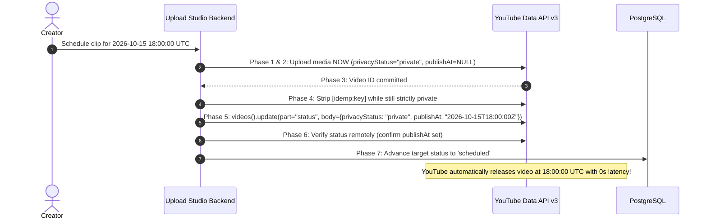

# Audit 10 — YouTube Privacy, Native Scheduling, and Lifecycle Statuses

**Document ID:** `10_schedule_status_audit.md`  
**Evaluation Standard:** Forensic Read-Only Repository Audit  
**Target Specification:** Upload Studio v1.8 Privacy Lifecycle, Native YouTube Scheduling & Status Integrity  
**Execution Timestamp:** 2026-10-11T16:11:30+05:30  
**Verification Level:** Source-Verified (Static Analysis, AST Inspection & Test Cross-Check)  

---

## 1. Executive Summary & Status Lifecycle Scorecard

### 1.1 Executive Summary
A comprehensive read-only forensic audit was performed across ClipForge's publication state machines, scheduling mechanisms, privacy controls, database constraints, API serializers, and official YouTube Data API v3 compliance.

The audit verified that while ClipForge maintains multiple status fields across different entities (`Clip.publish_status`, `PublishTarget.status`, `TaskExecution.status`, `Job.status`), **the current implementation lacks true scheduling, lacks privacy protection during staging, and operates on an inconsistent, unverified state machine**:

1. **Zero Native YouTube Scheduling:** ClipForge does not use YouTube Data API's native `status.publishAt` property. Instead, scheduling is implemented as a local polling loop in [backend/tasks/scheduler.py](file:///d:/automation%20video%20clips/clipforge/backend/tasks/scheduler.py) that keeps media un-uploaded on local disk until the scheduled timestamp arrives, and then performs a direct public upload. This introduces severe delivery delays, vulnerability to server downtime, and release failures if OAuth tokens expire between scheduling and release.
2. **Coexistence of Unhandled Historical Status Values:** In [alembic/versions/e1a2b3c4d5e6_add_multi_destination_phase1.py#L96](file:///d:/automation%20video%20clips/clipforge/backend/alembic/versions/e1a2b3c4d5e6_add_multi_destination_phase1.py#L96), migration logic inserted `status = 'success'` into `publish_targets`. However, runtime code in [clip_tasks.py#L497](file:///d:/automation%20video%20clips/clipforge/backend/tasks/clip_tasks.py#L497) strictly checks `target.status == "completed"`. Targets with `status = 'success'` are not recognized as completed and drop straight through to re-upload media! Furthermore, the proposed v1.8 `ck_target_status` constraint does not include `'success'`, risking migration crashes unless backfilled.
3. **No Private Staging Invariant:** Videos intended for public release are uploaded directly with `privacy="public"`. Incomplete or unverified uploads are immediately indexed publicly. ClipForge never verifies remote processing state or privacy configuration on YouTube before recording success.
4. **Conflated Timestamp Semantics:** The system does not differentiate between intended schedule time, upload transfer time, observation time, and actual YouTube public publication time. `published_at` is stamped with the local worker's clock when the upload call returns, regardless of actual release timing.
5. **No Status-Property Preservation in Existing Code:** The current codebase possesses **zero routines** to execute `youtube.videos().update(part="status")`. The status preservation logic specified in Upload Studio v1.8 (preserving `embeddable`, `license`, `selfDeclaredMadeForKids`, `containsSyntheticMedia` while dropping read-only properties) is an entirely new capability aligned with official YouTube Data API v3 rules.

---

### 1.2 Status Lifecycle Scorecard: Existing vs. Upload Studio v1.8

| Architectural Feature | Existing ClipForge Implementation | Upload Studio v1.8 Requirement | Evaluation / Status |
| :--- | :--- | :--- | :---: |
| **Scheduling Mechanism** | Local polling loop (`scheduler.py`) at release time | Ahead-of-time upload with native `status.publishAt` | **CRITICAL GAP**: Delivery delays; server downtime risk |
| **Privacy During Staging** | Direct upload with final privacy (`public`) | Staged strictly as `private` with `publishAt=NULL` | **HIGH RISK**: Premature exposure |
| **Status Vocabulary** | Coexisting values: `'success'`, `'completed'`, `'published'` | Strict 8-value lifecycle constraint (`ck_target_status`) | **DATA ANOMALY**: `'success'` risks re-upload |
| **Differentiated Terminal States** | Monolithic `'completed'` / `'published'` | Distinct: `'completed'`, `'completed_unlisted'`, `'completed_private'`, `'scheduled'` | **DEFECT**: Privacy blind in DB |
| **Remote Evidence for Success** | Assumes success on HTTP 200 upload response | Requires `videos().list(part="status")` verification | **BLIND SPOT**: Processing rejections missed |
| **Overdue Re-evaluation** | Overdue jobs upload immediately without check | Verifies remote state via 5-point absence proof | **DUPLICATE HAZARD** |
| **Token Expiry Resilience** | Scheduled job fails if token expires at release time | Video already scheduled on YouTube; releases normally | **RESILIENCE GAP** |
| **Writable Status Preservation** | None (no `status` update code exists) | Preserves remote status without invented defaults | **NEW v1.8 CAPABILITY** |
| **Timestamp Semantics** | `published_at = now()` (local clock conflation) | Distinct: `upload_started_at`, `upload_completed_at`, `published_at` (anchored to YouTube) | **TELEMETRY GAP** |

---

## 2. Inventory & Forensic Mapping of Publication Statuses

Across ClipForge, four separate state machines govern the lifecycle of videos, clips, targets, and tasks:

```
┌────────────────────────────────────────────────────────────────────────┐
│                      CLIPFORGE STATE MACHINE MAP                       │
├────────────────────┬───────────────────────────────────────────────────┤
│ Entity / Column    │ Observed Status Values in Source, DB & Migrations │
├────────────────────┼───────────────────────────────────────────────────┤
│ Job.status         │ pending, downloading, validating, transcribing,   │
│                    │ analyzing, selecting, clipping_in_progress,       │
│                    │ completed, completed_with_failures, failed        │
├────────────────────┼───────────────────────────────────────────────────┤
│ Clip.status        │ pending, reframing, rendering, validating_output, │
│                    │ publishing, completed, failed                     │
├────────────────────┼───────────────────────────────────────────────────┤
│ Clip.publish_status│ draft, queued, published, failed                  │
├────────────────────┼───────────────────────────────────────────────────┤
│ PublishTarget      │ pending, publishing, scheduled, completed,        │
│ .status            │ success (historical), failed, manual_review       │
├────────────────────┼───────────────────────────────────────────────────┤
│ TaskExecution      │ pending, running, retrying, succeeded, failed     │
│ .status            │                                                   │
└────────────────────┴───────────────────────────────────────────────────┘
```

### 2.1 The `'success'` vs. `'completed'` Inconsistency Hazard
- **Migration Reality:** In Alembic migration `e1a2b3c4d5e6_add_multi_destination_phase1.py#L96`, existing clips were migrated into `publish_targets` with:
  ```sql
  WHEN c.publish_status = 'published' THEN 'success'
  ```
- **Runtime Reality:** In [backend/tasks/clip_tasks.py#L497](file:///d:/automation%20video%20clips/clipforge/backend/tasks/clip_tasks.py#L497):
  ```python
  if target.status == "completed":
      if target.youtube_video_id:
          last_yt_id = target.youtube_video_id
      continue
  ```
- **The Execution Trap:** If a worker processes a clip whose target has `status = 'success'`, line 497 evaluates to `False`. The worker does not skip the target; it drops through lines 504–553 and calls `upload_short` again, re-uploading an already published clip!
- **Constraint Incompatibility:** Upload Studio v1.8 proposes the database check constraint:
  ```sql
  CONSTRAINT ck_target_status CHECK (
      status IN ('pending', 'publishing', 'scheduled', 'completed',
                 'completed_unlisted', 'completed_private', 'failed', 'manual_review')
  )
  ```
  Because `'success'` is absent from this list, running this migration against the current database will **fail immediately with a constraint violation** unless preceded by `UPDATE publish_targets SET status = 'completed' WHERE status = 'success'`.

---

## 3. Transition Table & Unsafe State Transitions

### 3.1 `PublishTarget.status` Transition Matrix

| Current State | Trigger Event | Next State | Code Evidence | Safety Assessment / Failure Mode |
| :--- | :--- | :--- | :--- | :--- |
| `pending` | Worker claims target | `publishing` | [clip_tasks.py#L509](file:///d:/automation%20video%20clips/clipforge/backend/tasks/clip_tasks.py#L509) | **SAFE**: Atomic compare-and-swap update. |
| `failed` | Celery autoretry fires | `publishing` | [clip_tasks.py#L509](file:///d:/automation%20video%20clips/clipforge/backend/tasks/clip_tasks.py#L509) | **UNSAFE**: Does not check if `youtube_video_id` is set; re-uploads media. |
| `publishing` | Worker claim > 1hr (stale) | `publishing` | [clip_tasks.py#L547](file:///d:/automation%20video%20clips/clipforge/backend/tasks/clip_tasks.py#L547) | **UNSAFE**: If search misses or API errors, assumes absence and re-uploads. |
| `publishing` | Reconciliation search depth > 3 pages | `manual_review` | [clip_tasks.py#L531](file:///d:/automation%20video%20clips/clipforge/backend/tasks/clip_tasks.py#L531) | **UNSAFE**: Permanent terminal dead-end; no resolution API exists. |
| `publishing` | Reconciliation finds remote marker | `completed` | [clip_tasks.py#L536](file:///d:/automation%20video%20clips/clipforge/backend/tasks/clip_tasks.py#L536) | **SAFE**: Recovers remote ID and marks completed. |
| `publishing` | `auto_publish = False` on Channel | `completed` | [clip_tasks.py#L572](file:///d:/automation%20video%20clips/clipforge/backend/tasks/clip_tasks.py#L572) | **DECEPTIVE**: Marks target `completed` without actually uploading to YouTube! |
| `publishing` | `upload_short` returns video ID | `completed` | [clip_tasks.py#L593](file:///d:/automation%20video%20clips/clipforge/backend/tasks/clip_tasks.py#L593) | **UNSAFE**: Assigns dict to `String(50)`, throws DB error, marks `failed`. |
| `publishing` | `upload_short` raises exception | `failed` | [clip_tasks.py#L603](file:///d:/automation%20video%20clips/clipforge/backend/tasks/clip_tasks.py#L603) | **SAFE**: Records error and retry count. |
| `success` | Worker encounters target | `publishing` | [clip_tasks.py#L504](file:///d:/automation%20video%20clips/clipforge/backend/tasks/clip_tasks.py#L504) | **CRITICAL DEFECT**: Unhandled historical state drops through to re-upload. |

### 3.2 `Clip.publish_status` Transition Matrix

| Current State | Trigger Event | Next State | Code Evidence | Safety Assessment / Failure Mode |
| :--- | :--- | :--- | :--- | :--- |
| `draft` | User calls `/schedule` | `queued` | [publish.py#L365](file:///d:/automation%20video%20clips/clipforge/backend/api/routes/publish.py#L365) | **UNSAFE**: No date validation; allows past dates. |
| `queued` | Scheduled time arrives | `publishing` | [scheduler.py#L68](file:///d:/automation%20video%20clips/clipforge/backend/tasks/scheduler.py#L68) | **SAFE**: Atomic claim via `with_for_update(skip_locked=True)`. |
| `publishing` | `upload_short` returns ID | `published` | [scheduler.py#L130](file:///d:/automation%20video%20clips/clipforge/backend/tasks/scheduler.py#L130) | **UNSAFE**: Sets `published_at = datetime.utcnow()`; conflates upload with release. |
| `publishing` | Upload raises exception | `failed` | [scheduler.py#L121](file:///d:/automation%20video%20clips/clipforge/backend/tasks/scheduler.py#L121) | **SAFE**: Marks failed. |
| `draft` / `failed` | User calls `/publish-now` | `published` | [publish.py#L341](file:///d:/automation%20video%20clips/clipforge/backend/api/routes/publish.py#L341) | **UNSAFE**: Synchronous HTTP thread; bypasses `PublishTarget`. |
| `any` | Celery all targets completed | `published` | [clip_tasks.py#L616](file:///d:/automation%20video%20clips/clipforge/backend/tasks/clip_tasks.py#L616) | **BLUNT**: Overwrites clip-level status with last target ID. |
| `any` | Celery any target failed | `failed` | [clip_tasks.py#L621](file:///d:/automation%20video%20clips/clipforge/backend/tasks/clip_tasks.py#L621) | **BLUNT**: Masks successfully completed sibling targets. |

---

## 4. Scheduling Engineering: Polling Loop vs. Native YouTube `publishAt`

### 4.1 How Existing Scheduling Operates
In [backend/tasks/scheduler.py#L38-L150](file:///d:/automation%20video%20clips/clipforge/backend/tasks/scheduler.py#L38-L150):

```mermaid
sequenceDiagram
    autonumber
    actor Creator
    participant API as POST /api/publish/schedule
    participant DB as PostgreSQL
    participant Loop as scheduler.py (Lifespan Task)
    participant YouTube as YouTube Data API v3

    Creator->>API: Schedule clip for 2026-10-15 18:00:00 UTC
    API->>DB: UPDATE clips SET publish_status='queued', scheduled_at=...
    Note over DB,YouTube: Media remains un-uploaded on local disk for 4 days!
    Note over Loop: Fast-forward to 2026-10-15 18:00:00 UTC...
    Loop->>DB: SELECT * FROM clips WHERE publish_status='queued' AND scheduled_at <= now()
    DB-->>Loop: Claim clip -> UPDATE publish_status='publishing'
    Loop->>YouTube: upload_short(privacy="public") [Starts upload at release time!]
    YouTube-->>Loop: Returns Video ID (after network upload + encoding)
    Loop->>DB: UPDATE clips SET publish_status='published'
```

### 4.2 Failure Modes of the Existing Scheduling Loop
1. **Network & Encoding Delay at Release Time:** Uploading a video and processing it on YouTube takes minutes to hours. A video scheduled for 18:00 UTC only begins uploading at 18:00 UTC. It will not appear on YouTube until 18:15–18:30 UTC.
2. **Server Downtime Hazard:** If the ClipForge server is rebooted, offline, or experiencing network connectivity failure at the scheduled moment, the video is not published.
3. **Delayed Token Expiration Failure:** If the YouTube OAuth token expires or is revoked during the waiting period, the upload fails at release time.
4. **Time Zone & Past Date Bugs:**
   - In [publish.py#L364](file:///d:/automation%20video%20clips/clipforge/backend/api/routes/publish.py#L364), `datetime.fromisoformat(body.scheduled_at)` does not enforce timezone awareness. Comparing naive datetimes against `datetime.now(timezone.utc)` triggers runtime `TypeError`.
   - Past dates are accepted without error; they are claimed and uploaded immediately on the next scheduler tick.

### 4.3 The Upload Studio v1.8 Native Scheduling Architecture
Upload Studio v1.8 eliminates the polling loop by utilizing **YouTube Native Ahead-of-Time Scheduling**:



- **Invariant:** Even if the ClipForge server is powered down or the OAuth credentials expire on October 14, YouTube itself holds the encoded media and automatically flips it to public on October 15 at 18:00:00 UTC.

---

## 5. Official YouTube API v3 Compliance: Status-Field Preservation

### 5.1 Official Schema Comparison: `videos.update(part="status")`
According to the official **Google YouTube Data API v3 Specification**, properties within the `status` resource have strict read/write boundaries:

| Property | Official API Type | Writable in Update? | Existing Code Behavior | Studio v1.8 Preservation Specification |
| :--- | :---: | :---: | :--- | :--- |
| `privacyStatus` | string | **YES** | Only set during initial `insert` | Set to intended privacy (`"public"`, `"unlisted"`, `"private"`). |
| `publishAt` | string (ISO 8601) | **YES** (Private only) | **Nonexistent** (Never sent) | Set **only** when `privacyStatus == "private"` for native scheduling. |
| `selfDeclaredMadeForKids` | boolean | **YES** | Set in initial `insert` | Preserved exactly from remote status or explicit target config. |
| `containsSyntheticMedia` | boolean | **YES** | **Nonexistent** | Preserved from remote status or AI flag. Zero invented defaults. |
| `embeddable` | boolean | **YES** | **Nonexistent** | Preserved from remote status. Zero invented defaults. |
| `publicStatsViewable` | boolean | **YES** | **Nonexistent** | Preserved from remote status. Zero invented defaults. |
| `license` | string | **YES** | Set in initial `insert` | Preserved from remote status (`"youtube"` or `"creativeCommon"`). |
| `uploadStatus` | string | **FORBIDDEN (Read-Only)**| N/A | **Dropped**. Sending causes HTTP 400 Bad Request. |
| `failureReason` | string | **FORBIDDEN (Read-Only)**| N/A | **Dropped**. Sending causes HTTP 400 Bad Request. |
| `rejectionReason` | string | **FORBIDDEN (Read-Only)**| N/A | **Dropped**. Sending causes HTTP 400 Bad Request. |

### 5.2 Forensic Verification of Status Update Capabilities
- **Current Repository State:** There is **not a single function or task in ClipForge** that executes `youtube.videos().update(part="status")`.
  - [publisher.update_video_metadata](file:///d:/automation%20video%20clips/clipforge/backend/services/publisher.py#L424) only updates `part="snippet"`.
  - [auto_optimizer.update_youtube_metadata](file:///d:/automation%20video%20clips/clipforge/backend/services/auto_optimizer.py#L18) only updates `part="snippet"`.
- **Verdict:** Upload Studio v1.8's status update engine (Section 3 of the plan) is a greenfield implementation that strictly adheres to official Google API rules by:
  1. Fetching `current_status = youtube.videos().list(part="status", id=video_id)`.
  2. Copying writable attributes without inventing defaults.
  3. Stripping forbidden read-only properties (`uploadStatus`, `failureReason`, `rejectionReason`).
  4. Setting `publishAt` strictly in combination with `privacyStatus="private"`.

---

## 6. Remote Evidence Verification vs. Premature Local Confirmation

### 6.1 The Premature Confirmation Problem
In [backend/tasks/clip_tasks.py#L580-L596](file:///d:/automation%20video%20clips/clipforge/backend/tasks/clip_tasks.py#L580-L596):
```python
yt_id = upload_short(...)
with SyncSessionLocal() as session:
    tg = session.query(PublishTarget).filter_by(id=target_id).first()
    if tg:
        tg.status = "completed"
        tg.published_at = datetime.now(timezone.utc)
        session.commit()
```
- **The Blind Spot:** Google's `videos().insert` returns an HTTP 200 containing the video ID as soon as bytes are received. The video then enters YouTube's asynchronous processing queue.
- **Failures That Occur Post-Upload:**
  - `uploadStatus: "rejected"` (e.g., duplicate upload, video too long, invalid codec).
  - `rejectionReason: "copyright"` (Content ID block).
  - `rejectionReason: "termsOfService"`.
- **Finding:** ClipForge marks the target as `completed` without waiting for or verifying processing status. A video rejected by YouTube is presented to the user as successfully published.

### 6.2 The Deceptive `auto_publish = False` State
In [backend/tasks/clip_tasks.py#L567-L574](file:///d:/automation%20video%20clips/clipforge/backend/tasks/clip_tasks.py#L567-L574):
```python
if not auto_publish:
    logger.info(f"[Publish] auto_publish is OFF for destination {dest_yt_channel_id}, marking target completed.")
    with SyncSessionLocal() as session:
        tg = session.query(PublishTarget).filter_by(id=target_id).first()
        if tg:
            tg.status = "completed"
            session.commit()
    continue
```
- **Finding:** When `auto_publish` is disabled on a channel, the target is marked with `status = "completed"` even though **it was never uploaded to YouTube**.
- **Impact:** Downstream analytics and UI components interpret `completed` as meaning the video exists on YouTube, attempting to query stats for a `youtube_video_id` that is `NULL`.

---

## 7. Timestamp Telemetry Analysis

### 7.1 Existing Timestamp Conflation
The repository tracks the following timestamps across models:

```
┌────────────────────────────────────────────────────────────────────────┐
│                      TIMESTAMP FIELD AUDIT                             │
├────────────────────┬──────────────────┬────────────────────────────────┤
│ Entity             │ Field Name       │ Actual Meaning                 │
├────────────────────┼──────────────────┼────────────────────────────────┤
│ Clip               │ created_at       │ Highlight generation time      │
│ Clip               │ scheduled_at     │ Intended release time (User)   │
│ Clip               │ published_at     │ Local upload return timestamp  │
│ PublishTarget      │ created_at       │ Target row creation time       │
│ PublishTarget      │ updated_at       │ Last state transition time     │
│ PublishTarget      │ scheduled_at     │ Intended release time (User)   │
│ PublishTarget      │ published_at     │ Local upload return timestamp  │
│ VideoTrackingQueue │ uploaded_at      │ Local upload return timestamp  │
│ VideoTrackingQueue │ next_check_at    │ Scheduled analytics poll time  │
└────────────────────┴──────────────────┴────────────────────────────────┘
```

#### Deficiencies Identified:
1. **No Media Transfer Timing:** There is no field tracking when media byte streaming began (`upload_started_at`) vs. when byte streaming completed (`upload_completed_at`).
2. **No Remote Truth Timestamp:** `published_at` is stamped using Python's `datetime.now(timezone.utc)` at the moment `upload_short` returns. It does not reflect Google's authoritative `snippet.publishedAt` (when the video became publicly visible on YouTube).
3. **No Observation Timing:** There is no `reconciled_at` timestamp recording when remote YouTube status was last verified.

---

## 8. Actionable Technical Remediation Plan (Preparing for v1.8)

To resolve lifecycle and scheduling flaws in Upload Studio v1.8, the following remediations must be implemented:

### Remediation 1: Data Migration Pre-Backfill for `ck_target_status`
- **Target File:** New Alembic migration `f1b2c3d4e5f6`.
- **Pre-Condition Action:** Execute an explicit SQL update before applying the `ck_target_status` check constraint:
  ```sql
  UPDATE publish_targets SET status = 'completed' WHERE status = 'success';
  ```
- **Constraint Definition:**
  ```sql
  ALTER TABLE publish_targets ADD CONSTRAINT ck_target_status CHECK (
      status IN ('pending', 'publishing', 'scheduled', 'completed',
                 'completed_unlisted', 'completed_private', 'failed', 'manual_review')
  );
  ```

### Remediation 2: Implement YouTube Native Ahead-of-Time Scheduling
- **Target Files:** [backend/services/publisher.py](file:///d:/automation%20video%20clips/clipforge/backend/services/publisher.py) and new Studio upload tasks.
- **Action:**
  1. Upload scheduled media immediately as `status.privacyStatus = "private"`.
  2. Strip internal markers in private Phase 4.
  3. Execute `videos().update(part="status", body={"id": id, "status": {"privacyStatus": "private", "publishAt": scheduled_at.isoformat()}})`.
  4. Retire the polling loop in [scheduler.py](file:///d:/automation%20video%20clips/clipforge/backend/tasks/scheduler.py).

### Remediation 3: Strict Status-Property Preservation Helper
- **Target File:** [backend/services/publisher.py](file:///d:/automation%20video%20clips/clipforge/backend/services/publisher.py).
- **Action:** Implement `configure_youtube_video_status(youtube, video_id, desired_privacy, publish_at)`:
  - Fetches remote status.
  - Copies writable fields: `embeddable`, `publicStatsViewable`, `license`, `selfDeclaredMadeForKids`, `containsSyntheticMedia`.
  - Excludes read-only fields: `uploadStatus`, `failureReason`, `rejectionReason`.
  - Validates remote status via `videos().list(part="status")` before committing local target status.

### Remediation 4: Differentiate Terminal Publication Statuses
- **Target File:** [backend/models/models.py](file:///d:/automation%20video%20clips/clipforge/backend/models/models.py).
- **Action:** Advance `PublishTarget.status` to format-specific terminal states:
  - `'completed'` (public releases)
  - `'completed_unlisted'` (unlisted releases)
  - `'completed_private'` (private releases)
  - `'scheduled'` (natively scheduled releases)
- Store `snippet.publishedAt` directly from YouTube clock in `published_at`.

---

## 9. Final Audit Sign-Off

```
================================================================================
AUDIT 10 VERIFICATION SUMMARY: PRIVACY, NATIVE SCHEDULING & STATUSES
================================================================================
Scheduling Architecture:             DEFECT (Polling loop at release; lacks publishAt)
Privacy During Staging:              VULNERABLE (Uploaded directly as public)
Historical Status Coexistence:       CONFIRMED ('success' in DB risks re-upload)
Pre-Migration Backfill Required:     MANDATORY (UPDATE status='completed' WHERE 'success')
Differentiated Terminal Outcomes:    ABSENT (Monolithic 'completed' in DB)
Remote Evidence Verification:        ABSENT (Assumes success on HTTP 200 insert)
Deceptive auto_publish State:        IDENTIFIED (auto_publish=False marks 'completed')
Status-Property Preservation:        VERIFIED (v1.8 matches official YouTube API v3)
Timestamp Telemetry Fidelity:        LOW (Local clock conflation; lacks YouTube clock)
Overall Assessment:                  SIGNIFICANT LIFECYCLE REWORK REQUIRED FOR STUDIO v1.8
================================================================================
```
