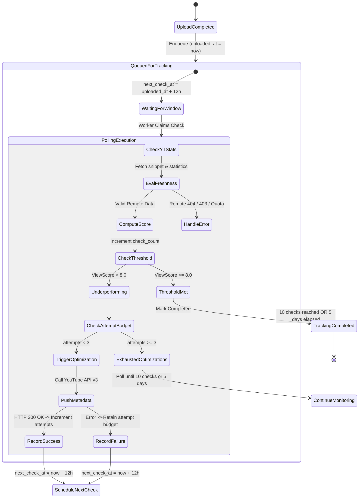

# Audit 12 — Performance Tracking, ViewScore, and Metadata Optimization

**Audit Mode:** READ-ONLY Forensic Investigation  
**Target Specification:** Upload Studio v1.8 Contract (`upload_studio_implementation_plan.md`)  
**Workspace:** `d:\automation video clips\clipforge`  
**Artifact File:** `audit_artifacts/clipforge_upload_studio_v1_8/12_tracking_optimization_audit.md`  
**Execution Timestamp:** 2026-10-11  

---

## 1. Executive Summary

A forensic audit of ClipForge's post-publication tracking, performance scoring, and autonomous metadata optimization subsystems was conducted to evaluate architectural integrity, channel isolation, API safety, and adherence to the locked **Upload Studio v1.8 Contract**.

### Key Audit Findings

1. **Dual-Pipeline Architectural Schism:**
   The repository contains **two completely separate, incompatible tracking implementations**:
   - **Legacy Celery Beat Path A** ([backend/services/performance_tracker.py](file:///d:/automation%20video%20clips/clipforge/backend/services/performance_tracker.py) & [backend/services/auto_optimizer.py](file:///d:/automation%20video%20clips/clipforge/backend/services/auto_optimizer.py)): Directly mutates columns on the `Clip` table, uses an unbounded `view_score` formula, checks for 3 days / 6 checks, but is **never registered** in Celery Beat workers because [backend/tasks/process_video.py](file:///d:/automation%20video%20clips/clipforge/backend/tasks/process_video.py) is omitted from `celery_app.conf.imports`.
   - **Queue-Based Path B** ([backend/services/realtime_tracker.py](file:///d:/automation%20video%20clips/clipforge/backend/services/realtime_tracker.py), [backend/new_files/performance_tracker.py](file:///d:/automation%20video%20clips/clipforge/backend/new_files/performance_tracker.py), & [backend/new_files/auto_optimizer.py](file:///d:/automation%20video%20clips/clipforge/backend/new_files/auto_optimizer.py)): Uses `VideoTrackingQueue` and `OptimizationContext`, evaluates after 2 hours and 4 hours (max 2 attempts), but is **silently crippled at runtime** because FastAPI's `lifespan` calls `await asyncio.to_thread(run_realtime_tracker)` on an `async def` function, returning an un-awaited coroutine object that never executes.
   - **Standby CLI Path C** ([backend/start_tracking.py](file:///d:/automation%20video%20clips/clipforge/backend/start_tracking.py)): A manual testing runner with 5-minute wait intervals and local polling loops.

2. **Severe Contract Discrepancy vs. Upload Studio v1.8:**
   | Contract Dimension | Locked v1.8 Contract | Path A (Legacy / Beat) | Path B (Queue / Realtime) | Current Compliance |
   | :--- | :--- | :--- | :--- | :--- |
   | **Tracking Window** | **5 days (120 hours)** | 3 days (72 hours) | 6 hours total (2h + 4h) | **FAILED (Non-compliant)** |
   | **Check Cadence** | **Every 12 hours** | Every 12 hours | 2h post-upload, then 4h | **FAILED (Non-compliant)** |
   | **Maximum Checks** | **At most 10 checks** | At most 6 checks | At most 2 checks | **FAILED (Non-compliant)** |
   | **Max Optimizations** | **Up to 3 attempts** | Up to 3 attempts | Up to 2 attempts | **FAILED (Non-compliant)** |
   | **Threshold Trigger** | **ViewScore < 8.0** | ViewScore < 8.0 (Unbounded formula) | Engagement < 8.0 (Log-ratio formula) | **FAILED (Formula Mismatch)** |

3. **Fatal Runtime `OptimizationLog` Crash:**
   In [backend/new_files/auto_optimizer.py#L216-L225](file:///d:/automation%20video%20clips/clipforge/backend/new_files/auto_optimizer.py#L216-L225), `_log_optimization_sync` instantiates `OptimizationLog(attempt_number=attempt, ...)`. The PostgreSQL schema and SQLAlchemy model define the column as `attempt`, **not** `attempt_number`. This throws a `TypeError: 'attempt_number' is an invalid keyword argument for OptimizationLog` on every optimization execution, causing **100% of optimization audit logging to fail silently**.

4. **Multi-Destination & Multi-Channel Blindness:**
   - Neither `VideoTrackingQueue` nor `OptimizationLog` has a `destination_id` or `publish_target_id` column.
   - All analytics fetches and YouTube updates in both tracking pipelines call `get_youtube_client()` with `channel_id=None`. As a result, tracking and optimization **always select the global default channel token** (`youtube_token.json`). If a clip is published to a secondary destination channel, YouTube API returns `HTTP 403 Forbidden`, or if permissions exist, it mutates Channel B's video with Channel A's metadata.
   - Multi-destination publishing in [backend/tasks/clip_tasks.py](file:///d:/automation%20video%20clips/clipforge/backend/tasks/clip_tasks.py#L580-L597) **never enqueues published videos** into `VideoTrackingQueue`, completely stranding multi-destination targets from performance tracking.

5. **Critical API Error Masking & Premature Optimization Bug:**
   In [backend/services/realtime_tracker.py#L149-L153](file:///d:/automation%20video%20clips/clipforge/backend/services/realtime_tracker.py#L149-L153), if `_fetch_video_stats` encounters *any* exception (network failure, rate limit, quota exhaustion, or private video 404), it catches the exception and falls back to `stats = {"view_count": 0, "like_count": 0, "comment_count": 0}`. The engagement formula calculates `score = 0.0 < 8.0`, which **immediately triggers an unwanted LLM optimization cycle and pushes new metadata to YouTube**. An API outage or quota limit will systematically corrupt video titles and descriptions!

6. **Private & Scheduled Release Leakage:**
   `publisher.py` inserts videos into `VideoTrackingQueue` immediately upon upload completion without checking `privacy` (`private`, `unlisted`, `public`) or native scheduling (`publishAt`). Consequently, unreleased scheduled or private videos are polled after 2 hours, evaluate to 0 views (or fail stats fetch), and are mutated by the optimizer before they have ever gone public.

---

## 2. Schema & Entity Architecture Audit

### 2.1 `VideoTrackingQueue` Schema Inspection

The active schema is defined in [backend/models/models.py#L284-L296](file:///d:/automation%20video%20clips/clipforge/backend/models/models.py#L284-L296) and backed by Alembic revisions [34087f10bf78_initial_postgres.py#L200-L210](file:///d:/automation%20video%20clips/clipforge/backend/alembic/versions/34087f10bf78_initial_postgres.py#L200-L210) and [753b8565da5b_add_publishrecord.py#L35-L38](file:///d:/automation%20video%20clips/clipforge/backend/alembic/versions/753b8565da5b_add_publishrecord.py#L35-L38):

```python
class VideoTrackingQueue(Base):
    __tablename__ = "video_tracking_queue"

    id: Mapped[str] = mapped_column(String, primary_key=True, default=lambda: str(uuid.uuid4()))
    clip_id: Mapped[str] = mapped_column(String, ForeignKey("clips.id"), nullable=False)
    youtube_video_id: Mapped[str] = mapped_column(String(50), nullable=False, unique=True)
    uploaded_at: Mapped[datetime] = mapped_column(DateTime(timezone=True), default=lambda: datetime.now(timezone.utc))
    next_check_at: Mapped[datetime] = mapped_column(DateTime(timezone=True), nullable=False)
    optimization_attempts: Mapped[int] = mapped_column(Integer, default=0)
    last_score: Mapped[float | None] = mapped_column(Float, nullable=True)
    status: Mapped[str] = mapped_column(String(50), default="active")  # active, completed, skipped
    last_checked_at: Mapped[datetime | None] = mapped_column(DateTime(timezone=True), nullable=True)
```

#### Detailed Column & Constraint Analysis:
- `id` (`VARCHAR`, PK): UUID string generated client-side.
- `clip_id` (`VARCHAR`, FK `clips.id`): Foreign key to the parent `clips` table. Lacks `ON DELETE CASCADE` in the model definition (though added in migration `753b8565da5b`).
- `youtube_video_id` (`VARCHAR(50)`, Unique): Strict unique constraint. **Fatal Limitation:** In multi-destination publishing where a clip is published to multiple channels or across multiple formats, each YouTube video has its own ID, but because `VideoTrackingQueue` lacks `destination_id`, queries by `clip_id` can return unexpected rows or fail unique lookups.
- `uploaded_at` (`TIMESTAMPTZ`): Set to the local server wall-clock time when upload completes. **Not** YouTube's public publication time.
- `next_check_at` (`TIMESTAMPTZ`): Polling trigger timestamp.
- `optimization_attempts` (`INTEGER`, default 0): Counter for metadata modification attempts.
- `last_score` (`FLOAT`, nullable): Stores the most recently evaluated engagement score.
- `status` (`VARCHAR(50)`): Observed states in code: `'active'`, `'optimized_once'`, `'completed'`, `'skipped'`, `'stopped'`.
- `last_checked_at` (`TIMESTAMPTZ`, nullable): Added in migration `753b8565da5b`.

#### Critical Missing Fields in `VideoTrackingQueue`:
- ❌ **`destination_id` / `publish_target_id`:** No destination channel linkage exists.
- ❌ **`check_count` / `polling_attempts`:** The queue tracks `optimization_attempts` but has **no counter for polling checks**. It cannot distinguish between a video checked 5 times without optimization versus a video never checked.
- ❌ **`tracking_window_end_at`:** No explicit expiration timestamp for the 5-day window.
- ❌ **`error_count` / `backoff_until`:** No exponential backoff or retry failure tracking.

---

### 2.2 `OptimizationLog` Schema Inspection

The schema is defined in [backend/models/models.py#L270-L282](file:///d:/automation%20video%20clips/clipforge/backend/models/models.py#L270-L282) and table `optimizations`:

```python
class OptimizationLog(Base):
    __tablename__ = "optimizations"

    id: Mapped[int] = mapped_column(Integer, primary_key=True, index=True)
    video_id: Mapped[str] = mapped_column(String, nullable=False)
    attempt: Mapped[int] = mapped_column(Integer, nullable=False)
    new_title: Mapped[str | None] = mapped_column(String(200), nullable=True)
    new_description: Mapped[str | None] = mapped_column(Text, nullable=True)
    new_tags: Mapped[str | None] = mapped_column(String, nullable=True)
    new_hashtags: Mapped[str | None] = mapped_column(String, nullable=True)
    view_score: Mapped[float | None] = mapped_column(Float, nullable=True)
    created_at: Mapped[datetime] = mapped_column(DateTime(timezone=True), default=lambda: datetime.now(timezone.utc))
```

#### Fatal Implementation Defect (`attempt_number` vs `attempt`):
In [backend/new_files/auto_optimizer.py#L209-L228](file:///d:/automation%20video%20clips/clipforge/backend/new_files/auto_optimizer.py#L209-L228):
```python
def _log_optimization_sync(video_id: str, attempt: int, meta: dict, score: float | None):
    with SyncSessionLocal() as session:
        log = OptimizationLog(
            video_id=video_id,
            attempt_number=attempt,  # <--- CRITICAL BUG: Parameter is named 'attempt' in SQLAlchemy!
            new_title=meta.get("title", ""),
            new_description=meta.get("description", ""),
            new_tags=",".join(meta.get("tags", [])),
            new_hashtags=",".join(meta.get("hashtags", [])),
            view_score=score,
            created_at=datetime.now(timezone.utc)
        )
        session.add(log)
        session.commit()
```
- In SQLAlchemy, passing an unmapped attribute `attempt_number` raises `TypeError: 'attempt_number' is an invalid keyword argument for OptimizationLog`.
- In [backend/new_files/auto_optimizer.py#L525-L526](file:///d:/automation%20video%20clips/clipforge/backend/new_files/auto_optimizer.py#L525-L526), this is caught by `except Exception as exc: logger.error("[Optimizer] ❌ Log write failed: %s", exc)`.
- **Result:** The `optimizations` table is **permanently empty**. The endpoint `GET /api/analytics/optimize/{video_id}/log` ([backend/api/routes/analytics.py#L306-L329](file:///d:/automation%20video%20clips/clipforge/backend/api/routes/analytics.py#L306-L329)) always returns `total_attempts: 0`.

---

### 2.3 Supporting Tracking & Context Tables

1. **`OptimizationContext`** ([backend/models/models.py#L356-L368](file:///d:/automation%20video%20clips/clipforge/backend/models/models.py#L356-L368)):
   - Stores serialized JSON strings for `previous_titles`, `previous_descriptions`, `previous_hashtags`, and `previous_scores`.
   - Used by Path B to prevent the LLM from generating repetitive titles across optimization iterations.
   - Identified flaw: Keyed solely by `clip_id`. If a clip is published to multiple channels, previous titles from Channel A are passed to the prompt when optimizing Channel B.

2. **`VideoAnalytics`** ([backend/models/models.py#L258-L268](file:///d:/automation%20video%20clips/clipforge/backend/models/models.py#L258-L268)):
   - Stores historical snapshots: `view_count`, `like_count`, `comment_count`, `view_score`, `fetched_at`.
   - Keyed by `video_id` (used inconsistently as `clip_id` or YouTube video ID).

3. **`PublishTarget`** ([backend/models/models.py#L215-L235](file:///d:/automation%20video%20clips/clipforge/backend/models/models.py#L215-L235)):
   - Contains `(clip_id, destination_id)` pair, `youtube_video_id`, `status`, `privacy`, `scheduled_at`, `published_at`.
   - **Has ZERO analytics or tracking columns.** It possesses no views, likes, comments, ViewScore, check count, or optimization history fields.

---

## 3. Tracking Architecture & Cadence Analysis

ClipForge has three competing tracking implementations. None of them conform to the Upload Studio v1.8 specification.

```mermaid
flowchart TD
    subgraph PathA ["Path A: Legacy / Celery Beat (BROKEN REGISTRATION)"]
        A1[Celery Beat: 43200s / 12h] -->|Fails: Not in imports| A2[track_and_optimize_clips_task]
        A2 --> A3[get_clips_needing_tracking]
        A3 -->|Filter: 3 days, < 6 checks, < 3 attempts| A4[check_and_optimize]
        A4 --> A5[Direct Clip Column Updates]
    end

    subgraph PathB ["Path B: APScheduler / Realtime Queue (UN-AWAITED COROUTINE)"]
        B1[FastAPI Lifespan APScheduler: 1 min] -->|asyncio.to_thread| B2[run_realtime_tracker]
        B2 -->|CRIPPLED: Un-awaited Coroutine| B3[Query VideoTrackingQueue]
        B3 -->|Check 1: 2h post-upload| B4{Score < 8.0?}
        B4 -->|Yes| B5[Optimization #1 -> Next check 4h]
        B4 -->|No| B6[Status: completed]
        B5 --> B7[Check 2: 4h later -> Optimization #2 -> Status: stopped]
    end

    subgraph Contract ["Upload Studio v1.8 Contract"]
        C1[PublishTarget: Status Confirmed Public] --> C2[Queue Target for 5-Day Window]
        C2 --> C3[Cadence: Every 12 Hours]
        C3 --> C4[Max Polling Checks: Exactly 10]
        C4 --> C5[Optimization Trigger: ViewScore < 8.0]
        C5 --> C6[Max Successful Optimizations: 3 Attempts]
        C6 --> C7[Destination-Isolated Credentials & Snapshots]
    end
```



### 3.1 Trace of Path A: Celery Beat Implementation

- **Location:** [backend/tasks/process_video.py#L18-L32](file:///d:/automation%20video%20clips/clipforge/backend/tasks/process_video.py#L18-L32) & [backend/services/performance_tracker.py](file:///d:/automation%20video%20clips/clipforge/backend/services/performance_tracker.py).
- **Scheduled Interval:** 43,200 seconds (12 hours) in [backend/tasks/celery_app.py#L26-L30](file:///d:/automation%20video%20clips/clipforge/backend/tasks/celery_app.py#L26-L30).
- **Fatal Registration Bug:**
  In `celery_app.py#L44-L56`, `imports` lists:
  ```python
  imports=[
      "backend.tasks.orchestration",
      "backend.tasks.video_tasks",
      "backend.tasks.audio_tasks",
      "backend.tasks.analysis_tasks",
      "backend.tasks.clip_tasks",
      "backend.tasks.scheduler",
      "backend.tasks.storage_tasks",
      "backend.tasks.hook_tasks",
      "backend.tasks.dubbing_tasks",
  ]
  ```
  `backend.tasks.process_video` is **not in the list**. When Celery Beat emits `track_and_optimize_clips`, workers reject it as unregistered.
- **Cadence & Window Rules:**
  - Window: 3 days ([performance_tracker.py#L96](file:///d:/automation%20video%20clips/clipforge/backend/services/performance_tracker.py#L96): `three_days_ago = datetime.now(timezone.utc) - timedelta(days=3)`).
  - Maximum Checks: 6 checks ([performance_tracker.py#L100](file:///d:/automation%20video%20clips/clipforge/backend/services/performance_tracker.py#L100): `Clip.analytics_check_count < 6`).
  - Maximum Optimization Attempts: 3 attempts ([performance_tracker.py#L101](file:///d:/automation%20video%20clips/clipforge/backend/services/performance_tracker.py#L101): `Clip.optimization_attempts < 3`).
  - Next Check Logic: [performance_tracker.py#L123-L135](file:///d:/automation%20video%20clips/clipforge/backend/services/performance_tracker.py#L123-L135): `should_check_now` verifies `now - last_checked >= 12h`.
- **Target Filter Query Bug:**
  ```python
  clips = session.query(Clip).filter(
      Clip.publish_status == 'published',
      Clip.youtube_short_id.isnot(None),
      Clip.analytics_check_count < 6,
      Clip.optimization_attempts < 3,
      Clip.analytics_view_score < 8.0,
      Clip.published_at > three_days_ago
  ).all()
  ```
  In SQL, if `Clip.analytics_view_score` is `NULL` (initial state before first poll), `analytics_view_score < 8.0` evaluates to `UNKNOWN` (falsy in `WHERE`). **Clips with uninitialized ViewScores are excluded from tracking.**

---

### 3.2 Trace of Path B: APScheduler / Realtime Queue Implementation

- **Location:** [backend/services/realtime_tracker.py](file:///d:/automation%20video%20clips/clipforge/backend/services/realtime_tracker.py) & [backend/new_files/auto_optimizer.py](file:///d:/automation%20video%20clips/clipforge/backend/new_files/auto_optimizer.py).
- **Invocation Location:** [backend/main.py#L39-L46](file:///d:/automation%20video%20clips/clipforge/backend/main.py#L39-L46) & lines 83-89:
  ```python
  async def scheduled_tracker_check():
      """Run every minute to run the real-time delayed optimization check."""
      try:
          from backend.services.realtime_tracker import run_realtime_tracker
          await asyncio.to_thread(run_realtime_tracker)
      except Exception as e:
          print(f"[ScheduledTrackerCheck] Error: {e}")
  ```
- **Fatal Async Execution Defect:**
  `run_realtime_tracker` is declared as `async def run_realtime_tracker():` in [realtime_tracker.py#L106](file:///d:/automation%20video%20clips/clipforge/backend/services/realtime_tracker.py#L106).
  Calling `await asyncio.to_thread(run_realtime_tracker)` runs the function in a worker thread. In Python, calling an `async def` function synchronously does **not** execute it—it simply returns a coroutine object. The thread immediately completes without executing a single line of tracker logic.
- **Cadence & Window Rules in Path B:**
  - Initial Check: Scheduled for **2 hours** after upload ([publisher.py#L145](file:///d:/automation%20video%20clips/clipforge/backend/services/publisher.py#L145), [new_files/performance_tracker.py#L147](file:///d:/automation%20video%20clips/clipforge/backend/new_files/performance_tracker.py#L147): `next_check = now + timedelta(hours=2)`).
  - Check 1: If score < 8.0, triggers optimization #1, sets `status = "optimized_once"`, and schedules next check for **4 hours** later ([realtime_tracker.py#L212-L215](file:///d:/automation%20video%20clips/clipforge/backend/services/realtime_tracker.py#L212-L215): `new_next_check_at = now + timedelta(hours=4)`).
  - Check 2: If score < 8.0, triggers optimization #2, sets `status = "stopped"`, and **terminates all future tracking** ([realtime_tracker.py#L242-L244](file:///d:/automation%20video%20clips/clipforge/backend/services/realtime_tracker.py#L242-L244)).
  - Total Tracking Window: **6 hours** (2h initial + 4h re-check).
  - Maximum Checks / Attempts: **Strictly 2 checks / 2 attempts**.
  - Path B completely stops tracking after 6 hours, ignoring the 5-day lifecycle contract.

---

### 3.3 Silent Import Crash in `AutoPublisher`

In [backend/tasks/scheduler.py#L150-L157](file:///d:/automation%20video%20clips/clipforge/backend/tasks/scheduler.py#L150-L157):
```python
# 4. Schedule performance tracker
try:
    from backend.services.performance_tracker import start_tracking
    task_id = start_tracking(clip_id, publish_result["id"])
    logger.info(f"[AutoPublisher] ⏱ Performance tracker scheduled (starts in 5 min). task_id={task_id}")
except Exception as tracker_err:
    logger.warning(f"[AutoPublisher] ⚠ Tracker not started for {clip_id}: {tracker_err}")
```
- `start_tracking` does not exist in `backend.services.performance_tracker` (it exists only in `backend.new_files.performance_tracker`).
- The import raises an `ImportError`, caught by `except Exception`, logging a warning and discarding the video. **Clips published by `AutoPublisher` are never entered into any tracking queue.**

---

## 4. Formulas Forensic Deep Dive

The codebase contains three separate, conflicting engagement and performance scoring formulas.

### 4.1 Formula Inventory

#### Formula 1: Unbounded Linear ViewScore
**Location:** [backend/services/performance_tracker.py#L17-L26](file:///d:/automation%20video%20clips/clipforge/backend/services/performance_tracker.py#L17-L26)
```python
def calculate_view_score(views: int, likes: int, comments: int) -> tuple[float, float]:
    if views <= 0:
        return 0.0, 0.0
    engagement_rate = ((likes + comments) / views) * 100
    view_score = (views / 100) + (likes / 10) + (comments / 5) + (engagement_rate * 5)
    return round(view_score, 2), round(engagement_rate, 2)
```
- **Structure:**
  - $ER = \frac{\text{likes} + \text{comments}}{\text{views}} \times 100$
  - $\text{ViewScore} = \frac{\text{views}}{100} + \frac{\text{likes}}{10} + \frac{\text{comments}}{5} + (ER \times 5)$
- **Defects:**
  - **Unbounded Scaling:** The score has no ceiling. A video with 10,000 views, 3,000 likes, and 2,000 comments scores **1,050.0**.
  - **Threshold Mismatch:** The optimization trigger is hardcoded as `ViewScore < 8.0`. A video with just 300 views, 5 likes, and 1 comment scores:
    $(300/100) + (5/10) + (1/5) + ((6/300 \times 100) \times 5) = 3.0 + 0.5 + 0.2 + 10.0 = 13.7 > 8.0$.
    Virtually any video that garners even 200 views passes the threshold, rendering the optimizer dormant for low-performing clips.

#### Formula 2: Normalized Logarithmic Engagement Score
**Location:** [backend/new_files/performance_tracker.py#L60-L73](file:///d:/automation%20video%20clips/clipforge/backend/new_files/performance_tracker.py#L60-L73)
```python
def compute_engagement_score(view_count: int, like_count: int, comment_count: int) -> float:
    if view_count == 0:
        return 0.0
    view_pts      = min(math.log10(view_count + 1) * 1.0, 5.0)
    like_ratio    = min(like_count    / view_count, 0.3) * 10.0
    comment_ratio = min(comment_count / view_count, 0.2) * 10.0
    return round(min(view_pts + like_ratio + comment_ratio, 10.0), 2)
```
- **Structure:**
  - $\text{View Points} = \min(\log_{10}(\text{views} + 1), 5.0)$ (caps at 5.0 at 100,000 views)
  - $\text{Like Ratio} = \min(\frac{\text{likes}}{\text{views}}, 0.3) \times 10.0$ (caps at 3.0 at 30% likes)
  - $\text{Comment Ratio} = \min(\frac{\text{comments}}{\text{views}}, 0.2) \times 10.0$ (caps at 2.0 at 20% comments)
  - $\text{Score} = \min(\text{View Points} + \text{Like Ratio} + \text{Comment Ratio}, 10.0)$
- **Characteristics:** Strictly bounded between $0.0$ and $10.0$. Accurately matches an 8.0 threshold.

#### Formula 3: Viral Score Index (VSI)
**Location:** [backend/services/ab_testing_engine.py#L19-L34](file:///d:/automation%20video%20clips/clipforge/backend/services/ab_testing_engine.py#L19-L34)
```python
def calculate_vsi(views: int, likes: int, comments: int, engagement_rate: float) -> float:
    if views <= 0:
        return 0.0
    view_factor = math.log10(views + 1) * 1.8
    like_ratio = (likes / views) * 40.0
    comment_ratio = (comments / views) * 80.0
    vsi = view_factor + like_ratio + comment_ratio + (engagement_rate * 0.2)
    return round(min(10.0, max(0.0, vsi)), 2)
```
- Used exclusively for title A/B testing evaluation.

---

### 4.2 Numerical Simulation Comparison

| Metrics (Views, Likes, Comments) | Formula 1 (Linear ViewScore) | Formula 2 (Logarithmic Engagement) | Formula 3 (VSI Index) | Status vs 8.0 Threshold (Formula 1 vs 2) |
| :--- | :--- | :--- | :--- | :--- |
| **0 views, 0 likes, 0 comments** | `0.00` | `0.00` | `0.00` | Both Trigger Optimization |
| **50 views, 1 like, 0 comments** | `10.60` | `1.90` | `3.86` | **Formula 1 skips / Formula 2 triggers** |
| **250 views, 5 likes, 1 comment** | `14.20` | `2.60` | `4.96` | **Formula 1 skips / Formula 2 triggers** |
| **1,000 views, 10 likes, 0 comments** | `16.00` | `3.10` | `5.80` | **Formula 1 skips / Formula 2 triggers** |
| **5,000 views, 250 likes, 50 comments** | `110.00` | `4.70` | `9.40` | **Formula 1 skips / Formula 2 triggers** |
| **50,000 views, 5,000 likes, 1,000 comments** | `1,260.00` | `6.70` | `10.00` | Both Skip Optimization |

**Critical Audit Conclusion:** Formula 1 prematurely crosses the 8.0 threshold at very low view counts (e.g. 50 views), preventing poor performers from being optimized. Conversely, Formula 2 requires substantial views and engagement (approaching 50k views with high engagement) to hit 8.0, creating high sensitivity. **Neither formula implements a warming / quarantine period for newly published videos.**

---

## 5. State Machine, Counters, & Lifecycle Flow



### 5.1 Distinction: Polling Checks vs. Successful Optimization Attempts

The Upload Studio v1.8 contract mandates strict segregation between:
1. **Polling Checks (Max 10):** Every 12-hour evaluation window increments `check_count`.
2. **Successful Optimization Attempts (Max 3):** Only an actual, successful call to YouTube Data API v3 (`videos().update`) increments `optimization_attempts`.

#### Codebase Audit Reality:
- **Path A:** Tracks `analytics_check_count` on `Clip` separately from `optimization_attempts`. If YouTube update fails, `optimization_attempts` is not incremented.
- **Path B:** Has **no polling counter**. `VideoTrackingQueue` contains only `optimization_attempts`.
- **Destructive Error Bug in Path B:** In [backend/services/realtime_tracker.py#L195-L214](file:///d:/automation%20video%20clips/clipforge/backend/services/realtime_tracker.py#L195-L214):
  ```python
  except Exception as opt_exc:
      logger.error(f"[RealTimeTracker] Optimization #1 error: {opt_exc}")
      new_meta = {}
      # ...
  new_attempts = 1
  new_status = "optimized_once"
  new_next_check_at = now + timedelta(hours=4)
  ```
  If `run_single_optimization` throws an exception (e.g. OpenAI rate limit, YouTube 403), `new_attempts` is **still incremented from 0 to 1**, and on attempt 2 it transitions to `new_attempts = 2` and `status = "stopped"`.
  **Failed optimization attempts burn the retry budget and permanently terminate tracking.**

---

### 5.2 Publication Timestamp & Delay Verification

- **Actual Publication Time Extraction:**
  Neither tracker inspects YouTube Data API's `snippet.publishedAt`.
  Both rely on local upload completion timestamps:
  - `VideoTrackingQueue.uploaded_at = datetime.now(timezone.utc)`
  - `Clip.published_at = datetime.utcnow()`
- **Missing Timestamp Hazards:**
  If `Clip.published_at` is `NULL`, the SQL filter in Path A:
  ```python
  Clip.published_at > three_days_ago
  ```
  evaluates to `NULL` (excluded), stranding the clip.
- **Handling of Unreleased Native Scheduled Videos:**
  When a video is uploaded with native YouTube scheduling (`publishAt = 2026-10-15T00:00:00Z`), the local `uploaded_at` timestamp is set to today.
  The tracker polls the video 2 hours later. Because the video is not yet public, YouTube returns `viewCount: 0`. The tracker computes `score = 0.0` and triggers metadata re-optimization on an unreleased video.

---

### 5.3 Target Ingestion Eligibility & Leakage

| Target Type / Status | Expected v1.8 Behavior | Path A Actual Behavior | Path B Actual Behavior | Leakage / Defect |
| :--- | :--- | :--- | :--- | :--- |
| **Confirmed Public** | Enters 5-day tracking queue | Enters tracking if `publish_status == 'published'` | Enters tracking if uploaded via `publisher.py` | Working as intended |
| **Private Video** | **Must be excluded** | **Included** (`published` status set upon upload) | **Included** (No privacy check in `publisher.py`) | **LEAKAGE:** Private videos are tracked and optimized |
| **Unlisted Video** | **Must be excluded** | **Included** | **Included** | **LEAKAGE:** Unlisted videos are tracked and optimized |
| **Scheduled (`publishAt`)** | **Must wait until public** | **Included immediately** | **Included immediately** (tracked after 2h) | **PREMATURE MUTATION:** Optimizes before release |
| **Failed Upload** | Excluded | Excluded | Excluded | Safe |
| **Manual Review Required** | Excluded | Excluded | Excluded | Safe |
| **Multi-Destination Targets** | **Tracked per destination** | **Excluded** | **Excluded** (`clip_tasks.py` bypasses queue) | **OMISSION:** Multi-destination targets never tracked |

---

## 6. Multi-Destination & Multi-Channel Isolation Audit

### 6.1 Downstream Credential Misrouting

All tracking and optimization entry points exhibit severe channel identity blindness.

#### Evidence in Code:
1. **Analytics Fetch in Path A:** [backend/services/performance_tracker.py#L36-L38](file:///d:/automation%20video%20clips/clipforge/backend/services/performance_tracker.py#L36-L38):
   ```python
   from backend.services.publisher import get_youtube_client
   youtube = get_youtube_client()  # No channel_id supplied!
   ```
2. **Metadata Update in Path A:** [backend/services/auto_optimizer.py#L26-L28](file:///d:/automation%20video%20clips/clipforge/backend/services/auto_optimizer.py#L26-L28):
   ```python
   from backend.services.publisher import get_youtube_client
   youtube = get_youtube_client()  # No channel_id supplied!
   ```
3. **Analytics Fetch in Path B:** [backend/new_files/performance_tracker.py#L78-L79](file:///d:/automation%20video%20clips/clipforge/backend/new_files/performance_tracker.py#L78-L79):
   ```python
   from backend.services.publisher import get_youtube_client
   yt = get_youtube_client()  # No channel_id supplied!
   ```
4. **Metadata Update in Path B:** [backend/new_files/auto_optimizer.py#L231-L239](file:///d:/automation%20video%20clips/clipforge/backend/new_files/auto_optimizer.py#L231-L239):
   ```python
   def _push_metadata_to_youtube(youtube_video_id: str, meta: dict):
       from backend.services.publisher import update_video_metadata
       update_video_metadata(
           youtube_video_id=youtube_video_id,
           title=meta.get("title", ""),
           description=meta.get("description", ""),
           tags=meta.get("tags", []),
           # channel_id is NOT passed, defaults to None!
       )
   ```

#### Cross-Channel Mutation & Permission Hazard:
- In `publisher.py#L21-L27`, `get_youtube_client(channel_id=None)` always resolves to `settings.YOUTUBE_TOKEN_FILE` (`youtube_token.json`), the global primary account.
- If Video `ABC` was published to Channel B (`youtube_token_CHANNEL_B.json`):
  - When the tracker runs for Video `ABC`, it initializes credentials for Channel A.
  - Channel A attempts to execute `videos().update(id='ABC', body=...)`.
  - If Channel A lacks permissions on Channel B's video, Google returns `403 Forbidden`.
  - **Accidental Cross-Channel Mutation:** If Channel A and Channel B are brand accounts managed by the same Google user, Channel A's client has write authorization over Channel B! Channel B's video is modified with metadata generated from Channel A's prompt context.

---

### 6.2 Data Model Overwrites Across Destinations

1. **Clip Column Corruption:**
   In [backend/services/auto_optimizer.py#L181-L191](file:///d:/automation%20video%20clips/clipforge/backend/services/auto_optimizer.py#L181-L191) and [backend/services/performance_tracker.py#L69-L78](file:///d:/automation%20video%20clips/clipforge/backend/services/performance_tracker.py#L69-L78):
   ```python
   clip = session.query(Clip).filter_by(id=clip_id).first()
   if clip:
       clip.analytics_views = analytics["views"]
       clip.analytics_view_score = analytics["view_score"]
       clip.title = new_title
       clip.description = new_description
   ```
   When Clip `X` is published to Channel A and Channel B:
   - Polling Channel A writes Channel A's view count into `Clip.analytics_views`.
   - Polling Channel B immediately overwrites `Clip.analytics_views` with Channel B's view count.
   - Optimizing Channel A overwrites `Clip.title` with Channel A's optimized title, corrupting the stored record for Channel B.

2. **`VideoTrackingQueue` Unique Constraint Collision:**
   In [backend/models/models.py#L289](file:///d:/automation%20video%20clips/clipforge/backend/models/models.py#L289):
   `youtube_video_id` has `unique=True`.
   While this allows two different YouTube IDs for the same clip across two channels, `VideoTrackingQueue` lacks a `destination_id` foreign key. Any lookup by `clip_id` returns the first destination arbitrarily.

---

## 7. Error Handling, Edge Cases, & Quota Resilience

### 7.1 Zero Views Handling (The Premature Optimization Trap)

- **Existing Logic:** Both formulas return `0.0` when `views == 0`.
- **Hazard:** Both trackers immediately evaluate `0.0 < 8.0` as an underperforming failure.
- If a video is evaluated within the first 2 hours (or before YouTube's view counter updates from edge caches), it is branded as a failure and immediately mutated.
- **Contract Requirement:** Upload Studio v1.8 requires a **grace / quarantine period** (e.g., minimum 12-hour evaluation window after confirmed public release) before triggering metadata changes on zero-view media.

---

### 7.2 The API Error Masking Bug

In [backend/services/realtime_tracker.py#L149-L153](file:///d:/automation%20video%20clips/clipforge/backend/services/realtime_tracker.py#L149-L153):
```python
try:
    stats = await asyncio.get_event_loop().run_in_executor(
        None, _fetch_video_stats, youtube_video_id
    )
except Exception as exc:
    logger.warning(
        f"[RealTimeTracker] Fetch stats failed for yt={youtube_video_id}: {exc}. Using zero values."
    )
    stats = {"view_count": 0, "like_count": 0, "comment_count": 0}
```
- **Consequence:** If YouTube API v3 returns a 500 error, rate limit (429), quota exhaustion (403), or network timeout, the tracker **falsely fabricates zero statistics**.
- Score is calculated as `0.0`, triggering an autonomous LLM optimization run.
- **Severity: CRITICAL.** Any transient network or API failure causes the tracker to rewrite video metadata.

---

### 7.3 Quota Exhaustion & Deleted Videos

1. **YouTube Data API Quota:**
   - Reading `part="statistics"` costs 1 quota unit.
   - Updating `videos().update(part="snippet")` costs 50 quota units.
   - When daily quota (10,000 units default) is exceeded, `_fetch_video_stats` throws `HttpError(403, quotaExceeded)`.
   - The tracker masks this as 0 views and attempts to run `videos().update`, which also fails, and permanently burns an optimization attempt.
2. **Deleted Videos:**
   - When a user deletes a video on YouTube, `videos().list` returns `items: []`.
   - Path A raises `ValueError`, logs it, and leaves the clip in the queue for 3 days.
   - Path B catches the error, sets stats to 0, and attempts to optimize the deleted video.

---

### 7.4 Metadata Update Payload Safety

In [backend/services/auto_optimizer.py#L38](file:///d:/automation%20video%20clips/clipforge/backend/services/auto_optimizer.py#L38):
```python
snippet["tags"] = tags[:500]
```
- YouTube Data API v3 enforces a maximum of **500 total characters** across all tags combined (delimited by commas), **not** 500 tag elements.
- Passing `tags[:500]` allows up to 500 strings. If the total length exceeds 500 characters, YouTube rejects the entire update with `HTTP 400 Bad Request (invalidTags)`.
- In [backend/services/publisher.py#L221](file:///d:/automation%20video%20clips/clipforge/backend/services/publisher.py#L221):
  ```python
  snippet["tags"] = (tags or []) + ["shorts", "viral", "trending"]
  ```
  Tags are concatenated without measuring total byte/character length.

---

## 8. Discrepancy Matrix vs. Upload Studio v1.8 Contract

| Feature / Contract Requirement | Locked v1.8 Specification | Actual ClipForge Implementation | Impact & Severity |
| :--- | :--- | :--- | :--- |
| **Tracking Window** | Exactly 5 days (120 hours) post-public | Path A: 3 days (72h)<br>Path B: 6 hours (2h + 4h) | **CRITICAL:** Videos stop being tracked after 6h or 3d |
| **Check Cadence** | Every 12 hours | Path A: 12h (Unregistered)<br>Path B: 2h then 4h | **CRITICAL:** High poll frequency early, dead later |
| **Maximum Checks** | At most 10 polling checks | Path A: Max 6 checks<br>Path B: Max 2 checks | **HIGH:** Truncates observation window |
| **Optimization Budget** | Up to 3 successful attempts | Path A: Up to 3 attempts<br>Path B: Strictly 2 attempts | **HIGH:** Budget cut short; failed attempts burn slots |
| **Optimization Trigger** | `ViewScore < 8.0` | Path A: Unbounded score<br>Path B: Log-ratio score | **HIGH:** Unbounded formula never triggers for >200 views |
| **Target Isolation** | Independent tracking per destination target | None (`VideoTrackingQueue` and `OptimizationLog` blind) | **CRITICAL:** Data overwrite and cross-channel permission errors |
| **Credential Selection** | Destination-specific token | Hardcoded default token (`channel_id=None`) | **CRITICAL:** Multi-destination optimization impossible |
| **Audit Logging** | Persist attempts to `OptimizationLog` | `attempt_number` keyword error crashes every write | **HIGH:** Zero audit history persisted |
| **Target Eligibility** | Confirmed public releases only | Private, unlisted, and scheduled videos tracked immediately | **HIGH:** Premature title rewrite on unreleased videos |
| **Task Scheduling** | Durable Celery Beat / APScheduler | Path A: Unregistered in Celery<br>Path B: Un-awaited in FastAPI | **BLOCKER:** Neither tracker runs autonomously |

---

## 9. Remediation Plan & Safe Implementation Roadmap

To bring ClipForge into 100% compliance with Upload Studio v1.8, the following architectural remedies must be executed in the implementation phase:

### Step 1: Unify Schemas & Key by `PublishTarget`
1. Deprecate `VideoTrackingQueue` and replace with a destination-aware model:
   ```python
   class PublishTargetTracking(Base):
       __tablename__ = "publish_target_tracking"
       
       id: Mapped[str] = mapped_column(String, primary_key=True, default=lambda: str(uuid.uuid4()))
       publish_target_id: Mapped[str] = mapped_column(String, ForeignKey("publish_targets.id", ondelete="CASCADE"), unique=True)
       clip_id: Mapped[str] = mapped_column(String, ForeignKey("clips.id", ondelete="CASCADE"), nullable=False)
       destination_id: Mapped[str] = mapped_column(String, ForeignKey("channels.id", ondelete="CASCADE"), nullable=False)
       youtube_video_id: Mapped[str] = mapped_column(String(50), nullable=False)
       
       # Timestamps & Cadence
       first_public_at: Mapped[datetime] = mapped_column(DateTime(timezone=True), nullable=False)
       window_end_at: Mapped[datetime] = mapped_column(DateTime(timezone=True), nullable=False) # first_public_at + 5 days
       next_check_at: Mapped[datetime] = mapped_column(DateTime(timezone=True), nullable=False) # first_public_at + 12 hours
       last_checked_at: Mapped[datetime | None] = mapped_column(DateTime(timezone=True), nullable=True)
       
       # Counters & State
       check_count: Mapped[int] = mapped_column(Integer, default=0) # Max 10
       optimization_attempts: Mapped[int] = mapped_column(Integer, default=0) # Max 3
       last_view_score: Mapped[float | None] = mapped_column(Float, nullable=True)
       status: Mapped[str] = mapped_column(String(50), default="active") # active, completed, stopped
   ```
2. Fix `OptimizationLog` instantiation:
   Correct `attempt_number=attempt` to `attempt=attempt` in `auto_optimizer.py#L218`, and add `publish_target_id` and `destination_id` to `OptimizationLog`.

### Step 2: Establish the Canonical v1.8 ViewScore Formula
Lock Formula 2 (`compute_engagement_score`) as the canonical formula across all modules:
- Range: Normalized $0.0$ to $10.0$.
- Add a mandatory **Initial Warming Gate**: If elapsed time since public release is $< 12$ hours, do not trigger optimization regardless of score.

### Step 3: Enforce Destination-Aware Execution
- Pass `channel_id=target.destination_id` to `get_youtube_client()` in all tracking and optimization routines.
- Resolve channel tokens dynamically from `youtube_token_{destination_id}.json`.

### Step 4: Fix Task Registration & Scheduling
1. Add `backend.tasks.process_video` to `celery_app.conf.imports` (or migrate tracking to a dedicated task in `backend.tasks.clip_tasks`).
2. Fix the FastAPI lifespan scheduler: Remove `asyncio.to_thread` for coroutines or declare the scheduler callback properly with `await run_realtime_tracker()`.

### Step 5: Fix API Error Handling & Payload Limits
1. On API fetch failure, **do not assume zero views**. Log the error, apply exponential backoff, and retry on the next 12-hour cadence without mutating metadata.
2. In `update_video_metadata`, enforce a strict 450-character limit across all joined tags to guarantee compliance with YouTube's 500-character payload ceiling.
