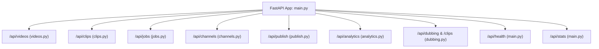
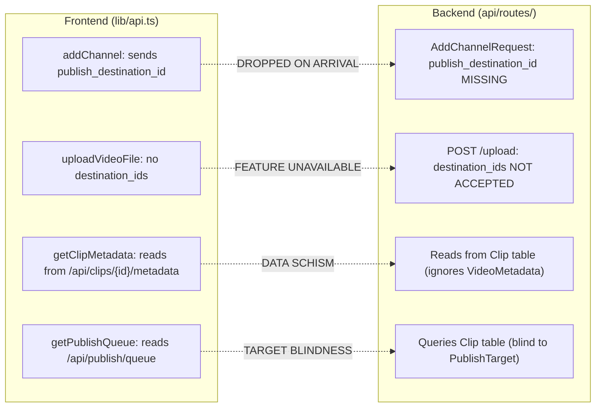

# Audit 13 — FastAPI Routes, Contracts, Validation, and Errors

**Audit Mode:** READ-ONLY Forensic Investigation  
**Target Specification:** Upload Studio v1.8 Contract (`upload_studio_implementation_plan.md`)  
**Workspace:** `d:\automation video clips\clipforge`  
**Artifact File:** `audit_artifacts/clipforge_upload_studio_v1_8/13_backend_api_contract_audit.md`  
**Execution Timestamp:** 2026-10-11  

---

## 1. Executive Summary

A comprehensive, read-only forensic audit of ClipForge's FastAPI backend route registrations, endpoint contracts, request/response validation schemas, HTTP status codes, error-handling semantics, and frontend-backend parity was conducted.

### Key Audit Findings

1. **Complete Absence of Authentication & Authorization (Zero Auth):**
   Every single route across all seven registered routers in `backend/api/routes` is completely unauthenticated. The only dependency used across the entire API is `db: AsyncSession = Depends(get_db)`. There is **no API key verification, session cookie check, JWT bearer token, or RBAC mechanism**. Any client capable of reaching the network port can delete all clips, execute destructive storage cleanups, trigger arbitrary uploads, change YouTube channel automation flags, or push live video updates to connected YouTube accounts.

2. **The `/api/studio` Router is 100% Non-Existent:**
   A forensic scan of the codebase confirms that **zero endpoints, schemas, or controllers exist for `/api/studio`**. The planned endpoints in Upload Studio v1.8 (`POST /api/studio/upload`, `GET /api/studio/targets`, `POST /api/studio/targets/{id}/publish`, `POST /api/studio/targets/{id}/resolve-manual`) have **zero implementation** in the repository.

3. **Status of the Automation & `/jobs` Routes:**
   - **Backend API:** The backend registers `prefix="/api/jobs"` ([backend/api/routes/jobs.py#L10](file:///d:/automation%20video%20clips/clipforge/backend/api/routes/jobs.py#L10)) providing job polling, stats, active queue count, WebSocket streaming (`/ws/{job_id}`), and retry endpoints.
   - **Frontend App:** The frontend page is at `/automation` ([frontend/app/automation/page.tsx](file:///d:/automation%20video%20clips/clipforge/frontend/app/automation/page.tsx)). Next.js has **no `/jobs` page**. The frontend regression test in [frontend/test/routes.test.mjs#L34-L51](file:///d:/automation%20video%20clips/clipforge/frontend/test/routes.test.mjs#L34-L51) explicitly asserts that no page navigates to a `/jobs` route. Job tracking is surfaced directly on the `/` Dashboard and `/automation`.

4. **Severe Schema Mismatches Between Frontend and Backend:**
   - **Channel Creation Destination Drop:** When adding a monitored channel, the frontend sends `publish_destination_id` ([frontend/lib/api.ts#L128](file:///d:/automation%20video%20clips/clipforge/frontend/lib/api.ts#L128)), but the backend `AddChannelRequest` schema ([backend/api/routes/channels.py#L17-L21](file:///d:/automation%20video%20clips/clipforge/backend/api/routes/channels.py#L17-L21)) does not declare this field. The destination channel selection is **silently discarded on creation**.
   - **Local Upload Multi-Destination Blindness:** `POST /api/videos/upload` ([backend/api/routes/videos.py#L217-L231](file:///d:/automation%20video%20clips/clipforge/backend/api/routes/videos.py#L217-L231)) does not accept `destination_ids`. Only YouTube URL processing supports multi-destination inputs.
   - **Disjoint Dual Metadata Endpoints:** `POST /api/publish/metadata/{video_id}` writes to the `VideoMetadata` table, while `PATCH /api/clips/{clip_id}/metadata` writes to the `Clip` table. The frontend review UI reads from `Clip` while other parts read from `VideoMetadata`.

5. **Lack of Idempotency, Concurrency Locks, and Atomic Boundaries:**
   - `POST /api/publish/publish-now` executes `upload_short` outside any database transaction or row lock. Double-clicking "Publish" in the UI executes two concurrent uploads to YouTube, generating **duplicate public YouTube videos**.
   - `DELETE /api/clips/{clip_id}` explicitly deletes child records from a hardcoded list of tables, but **omits `publish_targets`, `optimizations`, and `ab_experiments`**, risking foreign key constraint violations and 500 errors.

6. **Unbounded Payloads, Missing Pagination, and Injection Hazards:**
   - Video upload (`POST /api/videos/upload`) has **no file size limit** (no HTTP 413 checks); files are streamed directly to disk via `shutil.copyfileobj`.
   - List endpoints (`GET /api/videos/`, `GET /api/clips/`, `GET /api/jobs/`) have **hardcoded `.limit()` values with zero pagination parameters** (`skip`, `offset`, `limit`). Items beyond the initial page are permanently unreachable.
   - `POST /api/publish/schedule` accepts `scheduled_at` as a raw string without ISO-8601 validation in Pydantic; invalid dates crash with an unhandled 500 error instead of 400/422.

---

## 2. Complete Router & Endpoint Inventory

The FastAPI application is instantiated in [backend/main.py#L104-L135](file:///d:/automation%20video%20clips/clipforge/backend/main.py#L104-L135) with seven included routers and two root endpoints.



### Table 1: Complete Backend Endpoint Registry

| Route Path | HTTP Method | Router File | Handler Function | Auth | Request Body / Params | Status Codes |
| :--- | :--- | :--- | :--- | :--- | :--- | :--- |
| `/api/health` | `GET` | `main.py` | `health()` | None | None | 200 |
| `/api/stats` | `GET` | `main.py` | `stats()` | None | None | 200 |
| `/api/videos/url` | `POST` | `videos.py` | `process_youtube_url` | None | 14 `Form(...)` fields | 200, 400 |
| `/api/videos/batch` | `POST` | `videos.py` | `process_youtube_urls_batch` | None | `BatchURLRequest` (JSON) | 200, 400 |
| `/api/videos/upload` | `POST` | `videos.py` | `upload_video_file` | None | `UploadFile` + 10 `Form(...)` | 200, 400 |
| `/api/videos/` | `GET` | `videos.py` | `list_videos` | None | None (hardcoded limit 50) | 200 |
| `/api/videos/{video_id}` | `GET` | `videos.py` | `get_video` | None | Path: `video_id: str` | 200, 404 |
| `/api/clips/cleanup/preview` | `GET` | `clips.py` | `preview_cleanup` | None | None | 200 |
| `/api/clips/cleanup/execute` | `POST` | `clips.py` | `execute_cleanup` | None | None | 200 |
| `/api/clips/` | `GET` | `clips.py` | `list_clips` | None | Query: `video_id`, `from_date`, `to_date` | 200, 400, 500 |
| `/api/clips/{clip_id}` | `GET` | `clips.py` | `get_clip` | None | Path: `clip_id: str` | 200, 404 |
| `/api/clips/{clip_id}` | `PATCH` | `clips.py` | `update_clip` | None | `UpdateClipRequest` | 200, 404 |
| `/api/clips/{clip_id}` | `DELETE` | `clips.py` | `delete_clip` | None | Path: `clip_id: str` | 200, 404 |
| `/api/clips/{clip_id}/download` | `GET` | `clips.py` | `download_clip` | None | Path: `clip_id: str` | 200, 404 |
| `/api/clips/{clip_id}/thumbnail` | `GET` | `clips.py` | `get_thumbnail` | None | Path: `clip_id: str` | 200, 404 |
| `/api/clips/{clip_id}/metadata` | `GET` | `clips.py` | `get_clip_metadata_route` | None | Path: `clip_id: str` | 200, 404 |
| `/api/clips/{clip_id}/metadata` | `PATCH` | `clips.py` | `update_clip_metadata` | None | `MetadataUpdateRequest` | 200, 404 |
| `/api/clips/{clip_id}/publish` | `POST` | `clips.py` | `publish_clip` | None | Path: `clip_id: str` | 200, 400, 404, 500 |
| `/api/clips/{clip_id}/retention` | `GET` | `clips.py` | `get_clip_retention` | None | Path: `clip_id: str` | 200, 404 |
| `/api/clips/{clip_id}/autofix` | `POST` | `clips.py` | `apply_autofix` | None | Path: `clip_id: str` | 200, 404, 500 |
| `/api/clips/{clip_id}/sfx-plan` | `GET` | `clips.py` | `get_clip_sfx_plan` | None | Path: `clip_id: str` | 200, 404 |
| `/api/clips/{clip_id}/sfx-apply` | `POST` | `clips.py` | `apply_sfx` | None | `body: dict` | 200, 400, 404 |
| `/api/clips/{clip_id}/broll-plan` | `GET` | `clips.py` | `get_clip_broll_plan` | None | Path: `clip_id: str` | 200, 404 |
| `/api/clips/{clip_id}/broll-apply` | `POST` | `clips.py` | `apply_broll` | None | `body: dict` | 200, 400, 404 |
| `/api/clips/{clip_id}/hook` | `GET` | `clips.py` | `get_hook_plan` | None | Path: `clip_id: str` | 200, 404 |
| `/api/clips/{clip_id}/hook/plan` | `POST` | `clips.py` | `generate_hook_plan_endpoint` | None | Path: `clip_id: str` | 200, 404, 500 |
| `/api/clips/{clip_id}/hook/apply` | `POST` | `clips.py` | `apply_hook_plan_endpoint` | None | `body: dict` | 200, 400, 404 |
| `/api/jobs/` | `GET` | `jobs.py` | `list_jobs` | None | None (hardcoded limit 20) | 200 |
| `/api/jobs/active` | `GET` | `jobs.py` | `list_active_jobs` | None | None | 200 |
| `/api/jobs/queue-count` | `GET` | `jobs.py` | `queue_count` | None | None | 200 |
| `/api/jobs/stats` | `GET` | `jobs.py` | `get_job_stats` | None | None | 200 |
| `/api/jobs/{job_id}` | `GET` | `jobs.py` | `get_job` | None | Path: `job_id: str` | 200, 404 |
| `/api/jobs/{job_id}` | `DELETE` | `jobs.py` | `cancel_job` | None | Path: `job_id: str` | 200, 404 |
| `/api/jobs/ws/{job_id}` | `WEBSOCKET` | `jobs.py` | `job_status_ws` | None | Path: `job_id: str` | WS Stream |
| `/api/jobs/{job_id}/retry` | `POST` | `jobs.py` | `retry_failed_job` | None | Path: `job_id: str` | 200, 400, 404 |
| `/api/channels/` | `POST` | `channels.py` | `add_channel` | None | `AddChannelRequest` | 200, 400, 409 |
| `/api/channels/` | `GET` | `channels.py` | `list_channels` | None | None | 200 |
| `/api/channels/{channel_id}` | `PATCH` | `channels.py` | `update_channel` | None | `UpdateChannelRequest` | 200, 404 |
| `/api/channels/{channel_id}` | `DELETE` | `channels.py` | `delete_channel` | None | Path: `channel_id: str` | 200, 404 |
| `/api/channels/{channel_id}/check-now` | `POST` | `channels.py` | `check_channel_now` | None | Path: `channel_id: str` | 200, 400, 404 |
| `/api/channels/{channel_id}/videos` | `GET` | `channels.py` | `get_channel_recent_videos` | None | Path: `channel_id: str` | 200, 400, 404 |
| `/api/publish/metadata/{video_id}` | `GET` | `publish.py` | `get_metadata` | None | Path: `video_id: str` | 200 |
| `/api/publish/metadata/{video_id}` | `POST` | `publish.py` | `save_metadata` | None | `payload: dict = Body(...)` | 200 |
| `/api/publish/destinations` | `GET` | `publish.py` | `get_destinations` | None | None | 200 |
| `/api/publish/destinations/default` | `POST` | `publish.py` | `set_default_destination` | None | `SetDefaultDestinationRequest` | 200, 400, 404 |
| `/api/publish/auth-status` | `GET` | `publish.py` | `get_auth_status` | None | None | 200 |
| `/api/publish/channel-info` | `GET` | `publish.py` | `get_channel_info_route` | None | None | 200, 401 |
| `/api/publish/oauth-url` | `GET` | `publish.py` | `get_oauth_url` | None | None | 200 |
| `/api/publish/oauth-callback` | `GET` | `publish.py` | `oauth_callback_get` | None | Query: `code: str` | 200, 400 |
| `/api/publish/oauth-callback` | `POST` | `publish.py` | `oauth_callback_post` | None | `OAuthCallbackRequest` | 200, 400 |
| `/api/publish/publish-now` | `POST` | `publish.py` | `publish_now` | None | `PublishRequest` | 200, 400, 401, 404, 500 |
| `/api/publish/schedule` | `POST` | `publish.py` | `schedule_publish` | None | `PublishRequest` | 200, 404, 500 |
| `/api/publish/queue` | `GET` | `publish.py` | `get_publish_queue` | None | None | 200 |
| `/api/analytics/track/{video_id}` | `POST` | `analytics.py` | `track_video` | None | Path: `video_id: str` | 200 |
| `/api/analytics/cancel/{task_id}` | `POST` | `analytics.py` | `cancel_tracking_task` | None | Path: `task_id: str` | 200, 404 |
| `/api/analytics/active` | `GET` | `analytics.py` | `get_active_trackers` | None | None | 200 |
| `/api/analytics/ab-tests` | `GET` | `analytics.py` | `get_ab_tests` | None | None | 200 |
| `/api/analytics/insights` | `GET` | `analytics.py` | `get_channel_insights` | None | None | 200 |
| `/api/analytics/summary` | `GET` | `analytics.py` | `get_pipeline_summary` | None | None | 200, 500 |
| `/api/analytics/seo/{video_id}` | `GET` | `analytics.py` | `get_seo_analysis` | None | Path: `video_id: str` | 200, 404 |
| `/api/analytics/{video_id}` | `GET` | `analytics.py` | `get_analytics` | None | Path: `video_id: str` | 200 |
| `/api/analytics/optimize/{video_id}` | `POST` | `analytics.py` | `trigger_optimization` | None | Path: `video_id: str` | 200 |
| `/api/analytics/optimize/{video_id}/flag` | `PATCH` | `analytics.py` | `toggle_auto_optimize` | None | `body: AutoOptimizeFlagRequest` | 200, 404 |
| `/api/analytics/optimize/{video_id}/log` | `GET` | `analytics.py` | `get_optimization_log` | None | Path: `video_id: str` | 200 |
| `/api/dubbing/{clip_id}` | `POST` | `dubbing.py` | `trigger_dubbing` | None | `DubbingRequest` | 200, 400, 403, 404 |
| `/api/clips/{clip_id}/dub` | `POST` | `dubbing.py` | `trigger_dubbing` | None | `DubbingRequest` | 200, 400, 403, 404 |
| `/clips/{clip_id}/dub` | `POST` | `dubbing.py` | `trigger_dubbing` | None | `DubbingRequest` | 200, 400, 403, 404 |

---

## 3. Authentication & Authorization Vulnerability Audit

### 3.1 Unprotected Endpoints

Across all 67 registered handlers, **zero endpoints enforce authentication**.

```python
# Universal dependency signature across all route files:
db: AsyncSession = Depends(get_db)
```

- **Impact:**
  - `DELETE /api/clips/{clip_id}`: Any unauthenticated caller can delete user clips and physical video files from disk.
  - `POST /api/clips/cleanup/execute`: Anyone can trigger bulk deletion of clips and database rows.
  - `POST /api/publish/publish-now`: Anyone can publish videos to the connected YouTube channel.
  - `POST /api/publish/destinations/default`: Anyone can switch the active publishing channel.
  - `POST /api/channels/`: Anyone can add or delete monitored channels.
  - `DELETE /api/jobs/{job_id}`: Anyone can terminate running Celery workers.

### 3.2 Misleading "401" Errors Without Real Auth

In [backend/api/routes/publish.py#L350-L351](file:///d:/automation%20video%20clips/clipforge/backend/api/routes/publish.py#L350-L351):
```python
except ValueError as e:
    raise HTTPException(status_code=401, detail=str(e))
```
- The route catches internal `ValueError` exceptions raised when Google OAuth tokens are expired or missing, and maps them to HTTP 401.
- In HTTP semantics, 401 indicates that the *caller* must authenticate with ClipForge. Here, it indicates that ClipForge's backend lacks an upstream YouTube token.
- Furthermore, any incidental `ValueError` (e.g. data conversion errors) is erroneously returned as a 401 Unauthorized.

---

## 4. Request Validation, Identifiers, and Schema Gaps

### 4.1 Identifier & Path Parameter Validation

- **No UUID Enforcement:** Path parameters (`{clip_id}`, `{video_id}`, `{job_id}`, `{channel_id}`) are typed as plain Python `str`.
- **Validation Defect:** Neither regex pattern matching nor `pydantic.UUID4` validation is applied. Passing non-UUID strings hits the database directly.
- **Path Traversal Hazard:** In [backend/api/routes/clips.py#L265](file:///d:/automation%20video%20clips/clipforge/backend/api/routes/clips.py#L265):
  `storage_service.delete(path)` deletes files located at `clip.output_path`. If an unvalidated string is persisted, arbitrary file deletion can occur.

---

### 4.2 Schemas & Data Types Deficiencies

#### 1. Untyped Request Bodies:
Multiple mutation endpoints accept completely untyped dictionaries:
- `POST /api/publish/metadata/{video_id}` ([publish.py#L59](file:///d:/automation%20video%20clips/clipforge/backend/api/routes/publish.py#L59)): `payload: dict = Body(...)`
- `POST /api/clips/{clip_id}/sfx-apply` ([clips.py#L568](file:///d:/automation%20video%20clips/clipforge/backend/api/routes/clips.py#L568)): `body: dict`
- `POST /api/clips/{clip_id}/broll-apply` ([clips.py#L619](file:///d:/automation%20video%20clips/clipforge/backend/api/routes/clips.py#L619)): `body: dict`
- `POST /api/clips/{clip_id}/hook/apply` ([clips.py#L671](file:///d:/automation%20video%20clips/clipforge/backend/api/routes/clips.py#L671)): `body: dict`

#### 2. Schedule Validation Flaws:
In `PublishRequest` ([publish.py#L21](file:///d:/automation%20video%20clips/clipforge/backend/api/routes/publish.py#L21)):
`scheduled_at: str | None = None`
- It is typed as a loose string instead of `datetime`.
- In `schedule_publish` ([publish.py#L364](file:///d:/automation%20video%20clips/clipforge/backend/api/routes/publish.py#L364)):
  `scheduled_time = datetime.fromisoformat(body.scheduled_at) if body.scheduled_at else None`
- If an invalid string is provided (e.g. `"tomorrow"` or malformed ISO), Python raises an unhandled `ValueError`, returning an **unhandled HTTP 500 error** instead of an informative 422 or 400.
- **No Future Check:** The backend does **not** validate that `scheduled_at` is in the future. Past dates are saved without error.

#### 3. Privacy & Enum Validation Gaps:
In `PublishRequest` ([publish.py#L20](file:///d:/automation%20video%20clips/clipforge/backend/api/routes/publish.py#L20)):
`privacy: str = "public"`
- It is not validated against an Enum (`public`, `unlisted`, `private`).
- If an invalid value like `"hidden"` is sent, it passes backend validation and only fails downstream inside Google's client library.

#### 4. Duration Boundary Discrepancy:
- The frontend tests strictly require Shorts durations to be `< 30.0` seconds ([frontend/test/validation.test.mjs#L21-L23](file:///d:/automation%20video%20clips/clipforge/frontend/test/validation.test.mjs#L21-L23)).
- The backend accepts any integer without limits (`max_clip_duration: int | None = Form(None)`). In `BatchURLRequest` ([videos.py#L122](file:///d:/automation%20video%20clips/clipforge/backend/api/routes/videos.py#L122)), the default is `49`, directly violating the frontend's 30-second constraint.

---

### 4.3 Pagination & Query Validation Failures

| Endpoint | Hardcoded Limit | Pagination Supported? | Risk / Consequence |
| :--- | :--- | :--- | :--- |
| `GET /api/videos/` | `limit(50)` | **NO** | Videos 51+ can never be listed or managed via UI |
| `GET /api/clips/` | `limit(100)` | **NO** | Clips 101+ are permanently inaccessible |
| `GET /api/jobs/` | `limit(20)` | **NO** | Jobs 21+ cannot be inspected |
| `GET /api/channels/` | None (Unbounded) | **NO** | Unbounded memory growth if many channels exist |
| `GET /api/publish/queue` | None (Unbounded) | **NO** | Returns all `queued` and `published` clips indefinitely |

---

## 5. Frontend-Backend Contract Parity Audit

### 5.1 Field & Schema Discrepancy Matrix



#### Detailed Discrepancies:

1. **`addChannel` Drops Destination ID:**
   - **Frontend:** [frontend/lib/api.ts#L128](file:///d:/automation%20video%20clips/clipforge/frontend/lib/api.ts#L128) sends:
     `{ channel_url, auto_clip, auto_publish, publish_destination_id }`
   - **Backend Schema:** [backend/api/routes/channels.py#L17-L21](file:///d:/automation%20video%20clips/clipforge/backend/api/routes/channels.py#L17-L21):
     ```python
     class AddChannelRequest(BaseModel):
         channel_url: str
         auto_clip: bool = True
         auto_publish: bool = False
     ```
   - **Result:** `publish_destination_id` is excluded from the Pydantic schema and silently discarded. A user selecting a publishing destination when adding a channel has their choice dropped.

2. **File Upload Lacks Multi-Destination Support:**
   - `POST /api/videos/url` accepts `destination_ids: str | None = Form(None)`.
   - `POST /api/videos/upload` does **not** accept `destination_ids`.
   - **Result:** Multi-destination publishing is only available for YouTube URL downloads, not for directly uploaded files.

3. **Dual Disjoint Metadata Endpoints:**
   - [backend/api/routes/publish.py#L39-L95](file:///d:/automation%20video%20clips/clipforge/backend/api/routes/publish.py#L39-L95) provides `GET /api/publish/metadata/{video_id}` and `POST /api/publish/metadata/{video_id}`, which read and write to the `VideoMetadata` table.
   - [backend/api/routes/clips.py#L321-L385](file:///d:/automation%20video%20clips/clipforge/backend/api/routes/clips.py#L321-L385) provides `GET /api/clips/{clip_id}/metadata` and `PATCH /api/clips/{clip_id}/metadata`, which read and write to the `Clip` table.
   - The frontend's `getClipMetadata` ([frontend/lib/api.ts#L115](file:///d:/automation%20video%20clips/clipforge/frontend/lib/api.ts#L115)) calls `/api/clips/{id}/metadata`. Edits made in one route are completely invisible to the other.

4. **Multi-Destination Target Blindness in API Responses:**
   - `GET /api/clips/` returns a list of clips joined with `Video`. It has **no awareness of `PublishTarget`**.
   - `GET /api/publish/queue` queries `Clip.publish_status.in_(["queued", "published"])`. It has **no awareness of `PublishTarget`**.
   - If a clip has targets published to multiple destinations, the frontend cannot observe per-target statuses, external video IDs, or errors.

---

### 5.2 Performance: N+1 Query Problem in `list_clips`

In [backend/api/routes/clips.py#L185-L216](file:///d:/automation%20video%20clips/clipforge/backend/api/routes/clips.py#L185-L216):
```python
result = await db.execute(query.limit(100))
clips = result.scalars().all()

response = []
for clip in clips:
    # Fetch video info separately for every single clip!
    video_result = await db.execute(select(Video).where(Video.id == clip.video_id))
    video = video_result.scalar_one_or_none()
```
- Line 162 already performs an `.outerjoin(Video, Clip.video_id == Video.id)`.
- However, the handler loops through all 100 clips and executes an individual `SELECT` query for each clip.
- **Impact:** 101 database roundtrips on every request to `/api/clips`, causing significant latency.

---

## 6. Concurrency, Transaction Boundaries, & Failure States

### 6.1 Duplicate Upload Concurrency Race in `publish-now`

In [backend/api/routes/publish.py#L293-L354](file:///d:/automation%20video%20clips/clipforge/backend/api/routes/publish.py#L293-L354):
```python
# 1. Fetch clip without row lock
result = await db.execute(select(Clip).where(Clip.id == body.clip_id))
clip = result.scalar_one_or_none()

# 2. Update attributes and commit
clip.privacy = body.privacy
...
await db.commit()

# 3. Network call to YouTube (takes 10-60 seconds) OUTSIDE transaction
publish_result = upload_short(...)

# 4. Mark published and commit
clip.publish_status = "published"
clip.youtube_short_id = publish_result["id"]
await db.commit()
```

- **Race Condition:**
  - If a user double-clicks "Publish" or two requests arrive concurrently, both requests fetch `clip` in `draft` state.
  - Both invoke `upload_short(...)` concurrently against YouTube Data API.
  - YouTube receives two identical video uploads and assigns two separate video IDs.
  - The second DB commit overwrites `clip.youtube_short_id` with the second ID, leaving the first video orphaned on YouTube.
- **Contract Requirement:** The endpoint must use atomic status transition (`UPDATE clips SET publish_status='publishing' WHERE id=:id AND publish_status='draft'`) and an idempotency key.

---

### 6.2 Partial Failure State Leakage

In `publish_now` ([publish.py#L320](file:///d:/automation%20video%20clips/clipforge/backend/api/routes/publish.py#L320)):
- The handler commits the updated title, description, and destination to the database **before** calling `upload_short`.
- If `upload_short` subsequently fails (due to YouTube API quota, invalid token, or network abort), the transaction has already committed.
- The clip remains in the database with altered metadata, but with `publish_status` still set to `"draft"`. The operation partially succeeded and left inconsistent state.

---

### 6.3 Foreign Key Cascading Failure in `delete_clip`

In [backend/api/routes/clips.py#L246-L278](file:///d:/automation%20video%20clips/clipforge/backend/api/routes/clips.py#L246-L278):
```python
dependent_tables = [
    "publish_records", "video_tracking_queue", "task_executions",
    "clip_retention", "clip_variants", "clip_sfx_plans", "clip_visual_plans"
]
for table in dependent_tables:
    await db.execute(text(f"DELETE FROM {table} WHERE clip_id = :clip_id"), {"clip_id": clip.id})

await db.delete(clip)
await db.commit()
```
- The handler attempts to clean up child tables manually before deleting `clip`.
- **Missing Tables:** It fails to clean up:
  - `publish_targets`
  - `optimizations`
  - `optimization_context`
  - `seo_analysis`
  - `content_analysis`
  - `ab_experiments`
- If any of these tables have records referencing `clip.id`, PostgreSQL raises an `IntegrityError` (foreign key violation), resulting in an unhandled 500 error.

---

## 7. Forensic Verification of `/api/studio` & `/jobs`

### 7.1 Does `/api/studio` Exist?

- **Audit Procedure:** Full filesystem search of `backend/` and `frontend/` for `studio`.
- **Result:**
  - **Zero router files:** No `backend/api/routes/studio.py`.
  - **Zero router mounts:** `main.py` contains no `/api/studio` router mount.
  - **Zero schema models:** `backend/models/models.py` has no studio models.
  - **Zero frontend pages:** `frontend/app/` has no `studio/page.tsx`.
- **Verdict:** Upload Studio v1.8 is **entirely plan-only**. No code exists for `/api/studio`.

---

### 7.2 Does the Automation `/jobs` Route Exist?

- **Audit Procedure:** Cross-reference route registrations in `main.py`, `jobs.py`, Next.js pages, and test files.
- **Result:**
  - **Backend:** `jobs.router` is mounted at `/api/jobs` in `main.py#L130`, providing a full REST and WebSocket interface for jobs.
  - **Frontend:** The automation page is at `/automation` ([frontend/app/automation/page.tsx](file:///d:/automation%20video%20clips/clipforge/frontend/app/automation/page.tsx)), while job execution telemetry is rendered on `/` (Dashboard).
  - **Dead Route Assertion:** [frontend/test/routes.test.mjs#L34-L51](file:///d:/automation%20video%20clips/clipforge/frontend/test/routes.test.mjs#L34-L51) explicitly asserts that no frontend page navigates to `/jobs`:
    ```javascript
    test('Dead Route Prevention: No page navigates to nonexistent /jobs route', () => {
        ...
        assert.ok(!content.includes("router.push('/jobs')"), "Should not push to nonexistent /jobs route");
    });
    ```
- **Verdict:** The `/jobs` frontend route does not exist and was deliberately avoided in favor of `/automation` and `/`.

---

## 8. HTTP Status Codes & Error Handling Evaluation

| Status Code | Current Usage in Codebase | Recommended Contract Practice |
| :--- | :--- | :--- |
| **200 OK** | Used for all successful GET, POST, PATCH, DELETE operations. | Acceptable, but creation should return `201 Created`. |
| **400 Bad Request** | Used for invalid URLs, file formats, and OAuth failures. | Correct, but should include structured error details. |
| **401 Unauthorized** | Abused in `publish.py#L351` for upstream Google OAuth token expiration. | Should be reserved for ClipForge client authentication. Upstream errors should return `502 Bad Gateway` or `424 Failed Dependency`. |
| **403 Forbidden** | Used only in `dubbing.py#L27` for unauthorized voice cloning. | Must be extended to authorization and channel permission checks. |
| **404 Not Found** | Consistently used across routes when entity IDs do not exist. | Correct. |
| **409 Conflict** | Used only in `channels.py#L50` for duplicate monitored channels. | **Missing:** Must be used for concurrent publishing attempts and duplicate target creation. |
| **413 Payload Too Large** | **Never used.** File upload has no size check. | **Missing:** Must enforce the 2 GB maximum file limit. |
| **422 Unprocessable Entity** | Auto-generated by FastAPI on Pydantic validation failure. | Weakened by endpoints accepting loose `dict = Body(...)`. |
| **500 Internal Error** | Frequent fallback for unhandled exceptions in database and tasks. | Should be replaced with structured domain error responses. |

---

## 9. Comprehensive Route-by-Route Remediation Matrix

| Route | Method | Defect / Vulnerability | Required Remediation for v1.8 |
| :--- | :--- | :--- | :--- |
| `/api/videos/upload` | `POST` | No size limit (413 missing), no `destination_ids` accepted | Add 2GB limit, accept `destination_ids`, stream-check file header |
| `/api/videos/url` | `POST` | Accepts loose form fields without Pydantic model | Migrate to structured Pydantic model with URL regex validation |
| `/api/videos/` | `GET` | Hardcoded `limit(50)`, no pagination | Add `page`, `page_size`, `total_count` envelope |
| `/api/clips/` | `GET` | N+1 database queries, hardcoded `limit(100)` | Remove loop query, join `Video` properly, add pagination |
| `/api/clips/{id}` | `DELETE` | FK violation risk; misses `publish_targets` & other child tables | Add DB `ON DELETE CASCADE` or include all child tables |
| `/api/clips/{id}/metadata` | `PATCH` | Desynchronized from `VideoMetadata` table | Unify metadata storage into a single canonical model |
| `/api/clips/{id}/publish` | `POST` | Legacy orphaned duplicate of `/api/publish/publish-now` | Deprecate and route all publishing through unified studio publisher |
| `/api/publish/publish-now` | `POST` | No concurrency lock, duplicate upload race, partial update bug | Add atomic row lock, idempotency key, commit only after verification |
| `/api/publish/schedule` | `POST` | `scheduled_at` is unvalidated string, past dates accepted | Validate ISO-8601, enforce future timestamp, check channel token |
| `/api/publish/queue` | `GET` | Blind to `PublishTarget`, returns published clips indefinitely | Query `PublishTarget`, filter active queued targets, add pagination |
| `/api/channels/` | `POST` | `publish_destination_id` dropped from request body | Add `publish_destination_id` to `AddChannelRequest` schema |
| `/api/jobs/ws/{id}` | `WS` | DB polling loop (1 req/sec per user) hammers Postgres | Migrate WebSocket updates to Redis Pub/Sub event streaming |
| `/api/studio/*` | `ALL` | Entire router missing from codebase | Implement full `/api/studio` specification per v1.8 contract |
