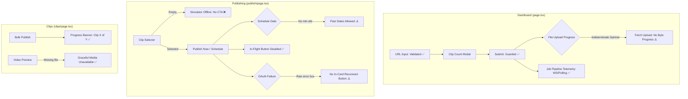

# Audit 14 — Frontend Workflow Feedback and Interaction Polish

**Audit Mode:** READ-ONLY Forensic UI/UX Audit  
**Target Specification:** Workflow Feedback Plan (`workflow_feedback_plan.md`) & Upload Studio v1.8 Contract  
**Workspace:** `d:\automation video clips\clipforge`  
**Artifact File:** `audit_artifacts/clipforge_upload_studio_v1_8/14_frontend_workflow_feedback_audit.md`  
**Execution Timestamp:** 2026-10-11  

---

## 1. Executive Summary

A forensic, read-only audit of ClipForge's frontend user interface, asynchronous feedback mechanisms, interaction polish, input validation, empty states, error diagnostics, and navigation integrity was conducted.

Every required item from the workflow feedback plan was evaluated against the active Next.js frontend code across two passes:
- **Pass 1:** Component architecture, React state variables, event handlers, and JSX conditional rendering.
- **Pass 2:** Underlying API calls, network payload contracts, duplicate-click guards, idempotency behaviors, and test suite assertions.

### Scorecard Summary

| Workflow / Interaction Item | Audit Status | Primary Component | Key Evidence & Observations |
| :--- | :--- | :--- | :--- |
| **Upload Dialog Completion State** | **IMPLEMENTED** | [frontend/app/page.tsx](file:///d:/automation%20video%20clips/clipforge/frontend/app/page.tsx#L408-L449) | Modal cleanly closes on successful job ID return; state resets properly. |
| **Duplicate-Submission Prevention (Upload)** | **IMPLEMENTED** | [frontend/app/page.tsx](file:///d:/automation%20video%20clips/clipforge/frontend/app/page.tsx#L409-L411) | `isSubmittingModal` guards double-clicks, disables buttons, blocks Escape and backdrop click. |
| **Genuine Upload Progress Reporting** | **PARTIALLY IMPLEMENTED** | [frontend/lib/api.ts](file:///d:/automation%20video%20clips/clipforge/frontend/lib/api.ts#L70-L91) | Indeterminate banner exists, but genuine byte/percentage upload progress is **missing** (uses raw `fetch`). |
| **Batch-Processing Guards & State** | **PARTIALLY IMPLEMENTED** | [frontend/app/page.tsx](file:///d:/automation%20video%20clips/clipforge/frontend/app/page.tsx#L559-L566) | Button disabled on empty text; counts URLs; but lacks per-line URL format validation. |
| **Granular Job Pipeline States** | **IMPLEMENTED** | [frontend/app/page.tsx](file:///d:/automation%20video%20clips/clipforge/frontend/app/page.tsx#L29-L46) | 9 discrete pipeline phases with dedicated icons, colors, and step text via WebSocket/polling. |
| **Publishing Button States** | **IMPLEMENTED** | [frontend/app/publish/page.tsx](file:///d:/automation%20video%20clips/clipforge/frontend/app/publish/page.tsx#L525-L542) | Buttons disabled while `publishing=true`; displays active status text (`⏳ Scheduling...`, `⏳ Uploading...`). |
| **Bulk Publish Feedback** | **IMPLEMENTED** | [frontend/app/clips/page.tsx](file:///d:/automation%20video%20clips/clipforge/frontend/app/clips/page.tsx#L344-L369) | Inline counter (`Publishing clip ${i} of ${total}...`); but error summary uses blocking `alert()`. |
| **Analytics Refresh Feedback** | **IMPLEMENTED** | [frontend/app/analytics/page.tsx](file:///d:/automation%20video%20clips/clipforge/frontend/app/analytics/page.tsx#L61-L77) | `isRefreshing` state, disabled button, `⏳ Refreshing...` spinner label. |
| **YouTube URL Client Validation** | **IMPLEMENTED** | [frontend/app/page.tsx](file:///d:/automation%20video%20clips/clipforge/frontend/app/page.tsx#L528-L544) | Regex validates standard video/Shorts IDs; displays inline warning; disables Generate button. |
| **Scheduling Date Validation** | **PARTIALLY IMPLEMENTED** | [frontend/app/publish/page.tsx](file:///d:/automation%20video%20clips/clipforge/frontend/app/publish/page.tsx#L918-L931) | Presets (+1h, tomorrow) work, but input lacks `min` attribute; permits submitting past dates. |
| **Automation Channel URL Validation** | **MISSING** | [frontend/app/automation/page.tsx](file:///d:/automation%20video%20clips/clipforge/frontend/app/automation/page.tsx#L58-L68) | Only checks non-empty string; invalid handles pass to backend without inline guidance. |
| **Dashboard Recent-Job Empty State** | **IMPLEMENTED** | [frontend/app/page.tsx](file:///d:/automation%20video%20clips/clipforge/frontend/app/page.tsx#L918-L928) | Clean `.glass` card with `📭` icon, clear guidance to paste URL or drop video. |
| **Publish Page Clip Empty State** | **MISSING** | [frontend/app/publish/page.tsx](file:///d:/automation%20video%20clips/clipforge/frontend/app/publish/page.tsx#L1208-L1216) | Shows "Simulator Offline" and empty dropdown; no CTA or link to generate clips. |
| **Publish Destination Loading State** | **MISSING** | [frontend/app/publish/page.tsx](file:///d:/automation%20video%20clips/clipforge/frontend/app/publish/page.tsx#L397-L409) | No skeleton or loading state while fetching destinations; defaults to blank selector. |
| **Analytics Experiments Empty State** | **PARTIALLY IMPLEMENTED** | [frontend/app/analytics/page.tsx](file:///d:/automation%20video%20clips/clipforge/frontend/app/analytics/page.tsx#L247-L251) | Plain text empty message present; lacks actionable CTA link to Dashboard. |
| **Contextual OAuth Reconnect Flow** | **PARTIALLY IMPLEMENTED** | [frontend/app/publish/page.tsx](file:///d:/automation%20video%20clips/clipforge/frontend/app/publish/page.tsx#L318-L384) | Top notification card exists if initially unauthenticated; missing inside inline error card on token expiration. |
| **Clean Job Failure & Safe Retries** | **MISSING / HAZARD** | [frontend/app/page.tsx](file:///d:/automation%20video%20clips/clipforge/frontend/app/page.tsx#L757-L765) | Retry button lacks duplicate click guard; rapid clicks trigger 400 errors and browser `alert()`. |
| **Missing Media Preview Handling** | **IMPLEMENTED** | [frontend/app/clips/page.tsx](file:///d:/automation%20video%20clips/clipforge/frontend/app/clips/page.tsx#L92-L105) | Catches `<video onError>`; renders graceful `⚠️ Media Unavailable` fallback card. |
| **Navigation to Proper Jobs Route** | **IMPLEMENTED** | [frontend/app/automation/page.tsx](file:///d:/automation%20video%20clips/clipforge/frontend/app/automation/page.tsx#L135) | Navigates to `/` (Dashboard); dead `/jobs` navigation strictly eliminated and guarded by test. |

---

## 2. Detailed Forensic Investigation by Workflow



---

### 2.1 File Upload, Completion State, & Progress Reporting

#### Findings
1. **Modal Completion State & Reset:**
   - In [frontend/app/page.tsx#L408-L449](file:///d:/automation%20video%20clips/clipforge/frontend/app/page.tsx#L408-L449), `confirmAndProcess` handles URL, Batch, and File uploads.
   - When the backend responds with `res.job_id`, the modal immediately closes (`setShowModal(false)`), state resets (`setPendingUrl('')`, `setPendingFile(null)`), and a delayed pipeline refresh (`setTimeout(refreshAll, 800)`) is queued.
   - **Verdict: IMPLEMENTED.**

2. **Duplicate-Submission Prevention:**
   - In [frontend/app/page.tsx#L409-L411](file:///d:/automation%20video%20clips/clipforge/frontend/app/page.tsx#L409-L411):
     ```typescript
     if (isSubmittingModal) return;
     setIsSubmittingModal(true);
     ```
   - Both the "Cancel" button (`disabled={isSubmittingModal}`) and the "Start Processing" button (`disabled={isSubmittingModal}`) in [frontend/app/page.tsx#L1317-L1340](file:///d:/automation%20video%20clips/clipforge/frontend/app/page.tsx#L1317-L1340) are locked during transmission.
   - The Escape key handler ([page.tsx#L368](file:///d:/automation%20video%20clips/clipforge/frontend/app/page.tsx#L368)) and backdrop click handler ([page.tsx#L939](file:///d:/automation%20video%20clips/clipforge/frontend/app/page.tsx#L939)) both explicitly check `!isSubmittingModal`.
   - **Verdict: IMPLEMENTED.**

3. **Genuine Upload Progress vs Indeterminate/Fabricated State:**
   - While the file is uploading from the browser to the backend server, the modal displays:
     ```tsx
     {isSubmittingModal && (
       <div style={{...}}>
         <span>⏳</span>
         <span>Uploading and dispatching job to pipeline... Please keep this window open.</span>
       </div>
     )}
     ```
   - In [frontend/lib/api.ts#L70-L91](file:///d:/automation%20video%20clips/clipforge/frontend/lib/api.ts#L70-L91):
     ```typescript
     export const uploadVideoFile = (file: File, ...) => {
       const form = new FormData();
       form.append('file', file);
       ...
       return fetch(`${API_BASE}/api/videos/upload`, { method: 'POST', body: form }).then(r => r.json());
     };
     ```
   - **Technical Defect:** Browser standard `fetch()` **does not support upload progress tracking**. There is no `XMLHttpRequest.upload.onprogress` or `axios.onUploadProgress` listener.
   - For a 500 MB to 2 GB video file, the user sees an indeterminate spinner with zero byte or percentage telemetry for several minutes.
   - *Note on Pipeline Progress:* Once the backend finishes receiving the file and creates a `job_id`, the Subsequent Celery pipeline progress (0% to 100%) streamed via WebSocket (`/api/jobs/ws/{id}`) or polling is genuine backend telemetry. But the actual file upload phase lacks real progress.
   - **Verdict: PARTIALLY IMPLEMENTED (Indeterminate state exists; genuine byte progress is MISSING).**

---

### 2.2 Batch Processing & Pipeline Job States

#### Findings
1. **Batch Button Guards:**
   - In [frontend/app/page.tsx#L559-L566](file:///d:/automation%20video%20clips/clipforge/frontend/app/page.tsx#L559-L566):
     ```tsx
     <button
       className="btn-primary"
       onClick={handleBatchOpenModal}
       disabled={loading || !batchUrls.trim()}
       style={{ marginTop: 10, width: '100%' }}
     >
       {loading ? '⏳ Processing Batch...' : `⚙️ Configure & Submit Batch (${batchUrls.split('\n').filter(u => u.trim()).length} URLs)`}
     </button>
     ```
   - Clicking opens the modal with a batch indicator ([page.tsx#L1064-L1070](file:///d:/automation%20video%20clips/clipforge/frontend/app/page.tsx#L1064-L1070)).
   - **Gap:** The textarea does not validate the individual URLs line-by-line. If 5 lines are entered, 2 of which are invalid text, the button displays `Configure & Submit Batch (5 URLs)`.
   - **Verdict: PARTIALLY IMPLEMENTED.**

2. **Granular Pipeline Job States:**
   - In [frontend/app/page.tsx#L29-L46](file:///d:/automation%20video%20clips/clipforge/frontend/app/page.tsx#L29-L46), `PIPELINE_STEPS` specifies:
     `pending`, `downloading`, `validating`, `transcribing`, `analyzing`, `selecting`, `clipping_in_progress`, `completed`, `completed_with_failures`.
   - Rendered in `ActiveJobCard` ([page.tsx#L66-L150](file:///d:/automation%20video%20clips/clipforge/frontend/app/page.tsx#L66-L150)) and `Recent Jobs` table ([page.tsx#L790-L872](file:///d:/automation%20video%20clips/clipforge/frontend/app/page.tsx#L790-L872)) with distinct colors, icons, step descriptions, and progress percentages.
   - **Verdict: IMPLEMENTED.**

---

### 2.3 Publishing Button States & Bulk Action Feedback

#### Findings
1. **Single Publish Simulator Button States:**
   - In [frontend/app/publish/page.tsx#L223-L264](file:///d:/automation%20video%20clips/clipforge/frontend/app/publish/page.tsx#L223-L264):
     `handleActionSubmit` guards duplicate calls: `if (publishing || !selectedClip) return; setPublishing(true);`.
   - In [publish/page.tsx#L525-L542](file:///d:/automation%20video%20clips/clipforge/frontend/app/publish/page.tsx#L525-L542):
     ```tsx
     <button 
       onClick={handleActionSubmit}
       disabled={publishing || !form.title.trim() || !!(authInfo && !authInfo.authenticated)}
       style={{...}}
     >
       {publishing ? (form.scheduleDate ? '⏳ Scheduling...' : '⏳ Uploading...') : (form.scheduleDate ? 'Schedule' : 'UPLOAD')}
     </button>
     ```
   - In [publish/page.tsx#L778-L796](file:///d:/automation%20video%20clips/clipforge/frontend/app/publish/page.tsx#L778-L796):
     The bottom action button is also disabled while publishing and displays `Publishing Pipeline Active...`.
   - **Verdict: IMPLEMENTED.**

2. **Bulk Publish Feedback:**
   - In [frontend/app/clips/page.tsx#L344-L369](file:///d:/automation%20video%20clips/clipforge/frontend/app/clips/page.tsx#L344-L369):
     ```typescript
     for (const id of Array.from(selectedIds)) {
       count++;
       setBulkActionProgress(`Publishing clip ${count} of ${selectedIds.size}...`);
       try {
         await publishNow({ clip_id: id });
       } catch (err) {
         failed.push(id);
       }
     }
     ```
   - Rendered in [clips/page.tsx#L522-L526](file:///d:/automation%20video%20clips/clipforge/frontend/app/clips/page.tsx#L522-L526):
     `⏳ {bulkActionProgress}` updates in real-time as each clip completes.
   - Buttons have `disabled={bulkActionRunning}` and show `...`.
   - **Minor UX Flaw:** When completed with errors, `alert(`${failed.length} clips failed`)` blocks the browser thread instead of displaying an inline toast.
   - **Verdict: IMPLEMENTED.**

---

### 2.4 Input Validation: URLs & Scheduling

#### Findings
1. **Dashboard YouTube URL Validation:**
   - In [frontend/app/page.tsx#L358-L364](file:///d:/automation%20video%20clips/clipforge/frontend/app/page.tsx#L358-L364):
     `extractYouTubeVideoId` matches:
     `/(?:youtu\.be\/|youtube\.com\/(?:embed\/|v\/|watch\?v=|watch\?.+&v=|shorts\/|live\/))([a-zA-Z0-9_-]{11})/`
   - In [page.tsx#L528-L544](file:///d:/automation%20video%20clips/clipforge/frontend/app/page.tsx#L528-L544):
     - Sets `aria-invalid` if text is entered but regex fails.
     - `disabled={loading || !url.trim() || !extractYouTubeVideoId(url.trim())}`.
     - Renders inline warning: `⚠️ Please enter a valid YouTube video or Shorts URL...`.
   - Fully asserted by unit tests in [frontend/test/validation.test.mjs#L51-L78](file:///d:/automation%20video%20clips/clipforge/frontend/test/validation.test.mjs#L51-L78).
   - **Verdict: IMPLEMENTED.**

2. **Scheduling Date Validation:**
   - In [frontend/app/publish/page.tsx#L917-L931](file:///d:/automation%20video%20clips/clipforge/frontend/app/publish/page.tsx#L917-L931):
     ```tsx
     <input 
       type="datetime-local" 
       value={form.scheduleDate}
       onChange={e => setForm(f => ({ ...f, scheduleDate: e.target.value }))}
       style={{...}}
     />
     ```
   - **Defect:** There is **no `min` attribute** on `<input type="datetime-local" />`.
   - In `handleActionSubmit` ([publish/page.tsx#L229-L242](file:///d:/automation%20video%20clips/clipforge/frontend/app/publish/page.tsx#L229-L242)), there is **zero check** verifying `new Date(form.scheduleDate) > new Date()`.
   - While presets (+1 Hour, Tomorrow 9 AM, Tomorrow 6 PM in [publish/page.tsx#L934-L972](file:///d:/automation%20video%20clips/clipforge/frontend/app/publish/page.tsx#L934-L972)) generate future dates, a user can manually pick a past date (e.g. yesterday) and submit it.
   - Note: Per instructions, we do not invent arbitrary business rules such as a "15-minute lead time"; however, basic future validation (`date > now`) is missing from the component submission handler.
   - **Verdict: PARTIALLY IMPLEMENTED (Presets exist; input validation is MISSING).**

3. **Automation Channel URL Validation:**
   - In [frontend/app/automation/page.tsx#L58-L68](file:///d:/automation%20video%20clips/clipforge/frontend/app/automation/page.tsx#L58-L68):
     `handleAdd` only checks:
     `if (!form.channel_url.trim() || adding) return;`
   - In [automation/page.tsx#L177-L186](file:///d:/automation%20video%20clips/clipforge/frontend/app/automation/page.tsx#L177-L186), the input has placeholder `"https://www.youtube.com/@YourChannel"`, but no regex or format validation.
   - Entering invalid text sends a request to `POST /api/channels/`, failing only when backend yt-dlp or channel parsing fails.
   - **Verdict: MISSING.**

---

### 2.5 Empty States & Loading Placeholders

#### Findings
1. **Dashboard Recent-Job Empty State:**
   - In [frontend/app/page.tsx#L918-L928](file:///d:/automation%20video%20clips/clipforge/frontend/app/page.tsx#L918-L928):
     ```tsx
     <div style={{ textAlign: 'center', padding: '36px 16px', color: 'var(--text-muted)' }}>
       <div style={{ fontSize: 32, marginBottom: 10 }}>📭</div>
       <div style={{ fontSize: 14, fontWeight: 600, color: 'var(--text-secondary)', marginBottom: 4 }}>
         No processing jobs recorded yet
       </div>
       <div style={{ fontSize: 13 }}>
         Enter a YouTube link or drop a video file above to generate your first Shorts.
       </div>
     </div>
     ```
   - **Verdict: IMPLEMENTED.**

2. **Publish Page Clip Empty State & Simulator:**
   - In [frontend/app/publish/page.tsx#L448-L460](file:///d:/automation%20video%20clips/clipforge/frontend/app/publish/page.tsx#L448-L460) and [L1208-L1216](file:///d:/automation%20video%20clips/clipforge/frontend/app/publish/page.tsx#L1208-L1216):
     - When `clips.length === 0`, the clip dropdown renders `-- Select generated clip --` with no options.
     - The simulator phone frame renders:
       ```tsx
       <div className="glass" style={{...}}>
         <div style={{ fontSize: 48, marginBottom: 16 }}>📱</div>
         <h4>Simulator Offline</h4>
         <p>Select a video clip from the left dropdown list to initialize high-fidelity YouTube Mobile screen emulation.</p>
       </div>
       ```
     - **Defect:** Because no clips exist, the user cannot select anything. There is **no call-to-action button**, no link to the Dashboard or Clips Library, and no explanatory banner. The user is trapped on a dead-end screen.
   - **Verdict: MISSING.**

3. **Publish Destination Loading State:**
   - In [frontend/app/publish/page.tsx#L155-L161, L397-L409](file:///d:/automation%20video%20clips/clipforge/frontend/app/publish/page.tsx#L155-L161):
     `getDestinations()` runs asynchronously on mount.
     - There is **no loading spinner or skeleton** while destinations are being fetched.
     - The dropdown immediately renders with only `<option value="">-- Original Source Channel --</option>`.
   - **Verdict: MISSING.**

4. **Analytics Experiments Empty State:**
   - In [frontend/app/analytics/page.tsx#L247-L251](file:///d:/automation%20video%20clips/clipforge/frontend/app/analytics/page.tsx#L247-L251):
     ```tsx
     <div style={{ padding: '32px 0', textAlign: 'center', color: '#64748b', fontSize: 13 }}>
       No active A/B title experiments yet. Trigger video processing or auto-optimization to start experiments automatically.
     </div>
     ```
   - Contains helpful contextual explanation, but lacks a clickable button/link to the Dashboard.
   - **Verdict: PARTIALLY IMPLEMENTED.**

---

### 2.6 Error Diagnostics, Reconnection Flows, & Safe Retries

#### Findings
1. **OAuth Missing / Expired Reconnect Flow:**
   - In [frontend/app/publish/page.tsx#L318-L384](file:///d:/automation%20video%20clips/clipforge/frontend/app/publish/page.tsx#L318-L384):
     If `authInfo && !authInfo.authenticated`, an alert card appears with a direct `🔗 Connect Google Account` link and a manual authorization code input.
   - **Defect during in-flight expiration:** If `authInfo` was true, but the Google token expired when `publishNow` is clicked, `handleActionSubmit` catches the error:
     ```typescript
     } catch (e: any) {
       setError(e.message || 'Publish operation failed');
     }
     ```
   - Rendered in [publish/page.tsx#L489-L493](file:///d:/automation%20video%20clips/clipforge/frontend/app/publish/page.tsx#L489-L493) as plain red text: `⚠️ {error}`.
   - There is **no contextual Reconnect button** inside the error card. The user must manually navigate away or refresh.
   - **Verdict: PARTIALLY IMPLEMENTED.**

2. **Clean Job Failure Messages & Unsafe Retries:**
   - **Clean Error Banner:**
     - In [frontend/app/page.tsx#L743-L756](file:///d:/automation%20video%20clips/clipforge/frontend/app/page.tsx#L743-L756), the queue stats header includes a `Last Failure Quick Retry Banner` showing the title and truncated error message.
   - **Unsafe Non-Idempotent Retry Hazard:**
     - In [frontend/app/page.tsx#L252-L258, L757-L765](file:///d:/automation%20video%20clips/clipforge/frontend/app/page.tsx#L252-L258):
       ```typescript
       const handleManualRetry = async (jobId: string) => {
         try {
           await retryJob(jobId);
           refreshAll();
         } catch (e: any) {
           alert(`Retry failed: ${e.message}`);
         }
       };
       ```
       and the JSX button:
       ```tsx
       <button onClick={() => handleManualRetry(queueStats.last_failure!.job_id)}>
         🔄 Retry
       </button>
       ```
     - **Defects:**
       1. The button **lacks an `isRetrying` state** and **never disables upon click**.
       2. If clicked twice in rapid succession, request 1 moves the job from `failed` to `pending`. Request 2 arrives at the backend, which throws HTTP 400 (`"Can only retry failed jobs"`).
       3. Request 2 catches the error and pops up a blocking browser `alert()`.
       4. In the Recent Jobs table ([page.tsx#L893-L912](file:///d:/automation%20video%20clips/clipforge/frontend/app/page.tsx#L893-L912)), failed jobs have no individual retry button at all (only a 🗑 Delete button).
     - **Publishing Retry Hazard:**
       - If a publication attempt fails or times out in [frontend/app/publish/page.tsx](file:///d:/automation%20video%20clips/clipforge/frontend/app/publish/page.tsx#L245), clicking "Upload Short" again re-triggers `publishNow`. Because `publishNow` is non-idempotent (see Audit 13), this can trigger duplicate uploads on YouTube.
   - **Verdict: MISSING / HAZARD IDENTIFIED.**

3. **Handling Missing Media Preview Files:**
   - In [frontend/app/clips/page.tsx#L32, L82-L105](file:///d:/automation%20video%20clips/clipforge/frontend/app/clips/page.tsx#L32):
     ```tsx
     {!videoError ? (
       <video
         ref={videoRef}
         autoPlay controls
         src={`${API_BASE}/api/clips/${clip.id}/download`}
         onError={() => setVideoError(true)}
       />
     ) : (
       <div style={{...}}>
         <div style={{ fontSize: 40, marginBottom: 12 }}>⚠️</div>
         <div style={{ fontSize: 14, fontWeight: 600 }}>Media Unavailable</div>
         <div style={{ fontSize: 12, marginTop: 4 }}>The video file could not be loaded.</div>
       </div>
     )}
     ```
   - Gracefully handles physical video file deletion, 404 responses, or corrupt media.
   - **Verdict: IMPLEMENTED.**

---

### 2.7 Navigation Integrity: Jobs & Task-Detail Routes

#### Findings
1. **Automation Pipeline Submission Route Navigation:**
   - In [frontend/app/automation/page.tsx#L135](file:///d:/automation%20video%20clips/clipforge/frontend/app/automation/page.tsx#L135):
     ```typescript
     await submitYouTubeUrl(...);
     router.push('/');
     ```
   - Navigates directly to `/` (Dashboard), where the newly created job card is displayed in real-time.
   - **Dead Route Verification:**
     - Verified by [frontend/test/routes.test.mjs#L34-L51](file:///d:/automation%20video%20clips/clipforge/frontend/test/routes.test.mjs#L34-L51):
       ```javascript
       test('Dead Route Prevention: No page navigates to nonexistent /jobs route', () => {
         ...
         assert.ok(!content.includes("router.push('/jobs')"));
       });
       ```
     - Next.js has no `/jobs` route; the job pipeline is natively hosted on `/`.
   - **Verdict: IMPLEMENTED.**

---

## 3. Recommended Low-Risk Remediation Actions

The following recommendations represent surgical, low-risk frontend improvements to achieve 100% compliance with the Workflow Feedback specification:

### 1. Genuine Upload Progress Telemetry (`frontend/lib/api.ts` & `page.tsx`)
- **Action:** Replace standard `fetch` in `uploadVideoFile` with `XMLHttpRequest` or an upload-progress wrapper to capture `ProgressEvent.loaded` and `ProgressEvent.total`.
- **UI Update:** Pass `onProgress: (percent: number) => void` to `uploadVideoFile` and render a real progress bar (`Uploading file: 45% (120 MB / 267 MB)`) inside the modal.

### 2. Schedule Future-Date Validation (`frontend/app/publish/page.tsx`)
- **Action:** Add `min={new Date().toISOString().slice(0, 16)}` to `<input type="datetime-local" />`.
- **Handler Guard:** In `handleActionSubmit`, check `if (form.scheduleDate && new Date(form.scheduleDate) <= new Date()) { setError("Scheduled date must be in the future"); return; }`.

### 3. Automation Channel URL Validation (`frontend/app/automation/page.tsx`)
- **Action:** Add regex helper `isValidChannelUrl(url)` checking for `youtube.com/@...`, `youtube.com/channel/...`, or `@handle`.
- **UI Update:** Disable "Add Channel" button until valid format is entered and display an inline hint.

### 4. Publish Page Empty State CTA (`frontend/app/publish/page.tsx`)
- **Action:** When `clips.length === 0`, replace "Simulator Offline" with a helpful empty-state card:
  *"No clips available for publishing yet."* with a button linking to `/` (`router.push('/')`).

### 5. In-Card OAuth Reconnect Button (`frontend/app/publish/page.tsx`)
- **Action:** If `error` in `publish/page.tsx` contains `"token"`, `"credential"`, or `"401"`, render a prominent `"🔗 Reconnect YouTube Account"` button directly inside the red error box.

### 6. Safe Retry Button Guard (`frontend/app/page.tsx`)
- **Action:** Add `const [retryingId, setRetryingId] = useState<string | null>(null);`.
- **Guard:** Set `disabled={retryingId === queueStats.last_failure.job_id}` on the retry button and display `🔄 Retrying...`.
