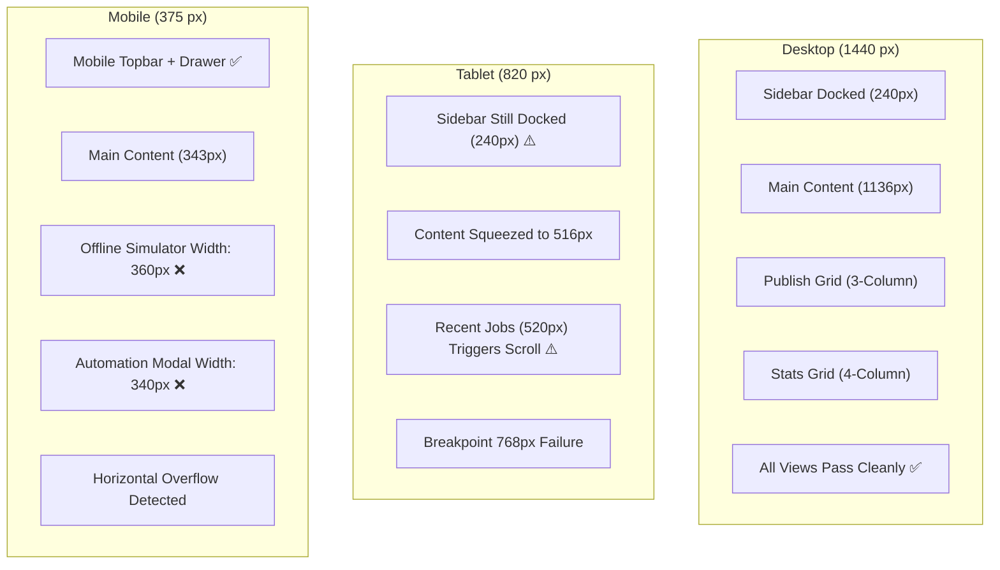

# Audit 15 — Responsive Layout and Accessibility Verification

**Audit Mode:** READ-ONLY Forensic UI/UX & Accessibility Audit  
**Target Viewports:** Desktop (1440 px), Tablet (820 px), Mobile (375 px)  
**Target Specification:** WCAG 2.1 AA Compliance & Responsive Layout Plan (`responsive_a11y_plan.md`)  
**Workspace:** `d:\automation video clips\clipforge`  
**Artifact File:** `audit_artifacts/clipforge_upload_studio_v1_8/15_responsive_accessibility_audit.md`  
**Execution Timestamp:** 2026-10-11  

---

## 1. Executive Summary

A forensic, read-only responsive layout and accessibility (WCAG 2.1 AA) audit was conducted across the ClipForge Next.js frontend application (`frontend/app/` and `frontend/components/`).

The audit evaluated all key views (Dashboard, Publish, Clips Library, Analytics, Channel Automation, Settings, and Global Shell) across three explicit target viewports:
- **Desktop (1440 px)**
- **Tablet (820 px)**
- **Mobile (375 px)**

### Double Verification Methodology

1. **Pass 1 (Source & CSS Inspection):**  
   Exhaustive inspection of CSS media queries, grid template definitions, flexbox structures, `:focus-visible` tokens, `@media (prefers-reduced-motion)` queries, and React DOM attributes (`role`, `aria-*`, `tabIndex`, `onKeyDown`).
2. **Pass 2 (Box Model & Geometry Calculations):**  
   Precise mathematical layout calculations (viewport width vs sidebar deduction, container margins, padding, column gap, and child `min-width` / fixed `width` properties).  
   *Transparency Note:* No automated visual screenshot suite (e.g. Playwright snapshot runner) is currently configured in `frontend/test/`. All viewport overflow conclusions are grounded in rigorous CSS box-model geometry and DOM node accessibility property audits, clearly distinguished from rendered bitmap diffs.

---

## 2. Findings Scorecard

| Area / Feature | Status | Primary Component | Severity | Key Observation |
| :--- | :--- | :--- | :--- | :--- |
| **Mobile Navigation Drawer** | **PASS** | [frontend/components/Sidebar.tsx](file:///d:/automation%20video%20clips/clipforge/frontend/components/Sidebar.tsx#L106-L147) | Low | Mobile topbar with accessible hamburger (`aria-expanded`, `aria-label`), backdrop overlay, and Escape key dismissal. |
| **Tablet Sidebar Docking Trap** | **FAIL** | [frontend/app/globals.css](file:///d:/automation%20video%20clips/clipforge/frontend/app/globals.css#L598) | **High** | Sidebar breakpoint is hardcoded at `<= 768px`. At 820px tablet, sidebar remains docked, leaving only 516px content width. |
| **Publish Offline Simulator Overflow** | **FAIL** | [frontend/app/publish/page.tsx](file:///d:/automation%20video%20clips/clipforge/frontend/app/publish/page.tsx#L1209) | **High** | Hardcoded inline `width: 360` causes 17px horizontal overflow on 375px mobile (343px available). |
| **Automation Modal Sidebar Overflow** | **FAIL** | [frontend/app/automation/page.tsx](file:///d:/automation%20video%20clips/clipforge/frontend/app/automation/page.tsx#L345) | **High** | Discovery modal pipeline sidebar has `width: 340, flexShrink: 0`, overflowing 375px mobile screens. |
| **Recent Jobs Mobile Scrollability** | **PARTIAL** | [frontend/app/page.tsx](file:///d:/automation%20video%20clips/clipforge/frontend/app/page.tsx#L789-L798) | Medium | Jobs table rows have `minWidth: 520`, but are contained in `overflowX: 'auto'` container. |
| **Global Focus Indicator** | **PASS** | [frontend/app/globals.css](file:///d:/automation%20video%20clips/clipforge/frontend/app/globals.css#L489-L492) | Low | High-contrast `:focus-visible { outline: 2px solid var(--accent); }` globally active. |
| **Reduced-Motion Support** | **PASS** | [frontend/app/globals.css](file:///d:/automation%20video%20clips/clipforge/frontend/app/globals.css#L494-L504) | Low | Disables ambient background orbs and sets animation/transition durations to 0.01ms. |
| **Landmark Navigation & Skip Link** | **PASS** | [frontend/app/layout.tsx](file:///d:/automation%20video%20clips/clipforge/frontend/app/layout.tsx#L18-L25) | Low | `<a href="#main-content" className="skip-link">` and `<main id="main-content">` present. |
| **Keyboard File Upload Inaccessibility** | **FAIL** | [frontend/app/page.tsx](file:///d:/automation%20video%20clips/clipforge/frontend/app/page.tsx#L658-L675) | **Critical** | Drag-drop zone is a non-tabbable `<div>`; underlying `<input type="file">` is `display: 'none'`. Keyboard users cannot upload files. |
| **Unsemantic Custom Toggle Switches** | **FAIL** | [frontend/app/automation/page.tsx](file:///d:/automation%20video%20clips/clipforge/frontend/app/automation/page.tsx#L525-L540) | **Critical** | `Toggle` is a clickable `<div>` lacking `role="switch"`, `aria-checked`, `tabIndex`, and keyboard listeners. |
| **Icon-Only Buttons Missing Labels** | **FAIL** | [frontend/app/clips/page.tsx](file:///d:/automation%20video%20clips/clipforge/frontend/app/clips/page.tsx#L742-L748) | **High** | Clip card publish link (`🚀`) and delete button (`🗑`) lack `aria-label` or accessible names. |
| **Filter Pills Missing State** | **FAIL** | [frontend/app/clips/page.tsx](file:///d:/automation%20video%20clips/clipforge/frontend/app/clips/page.tsx#L221-L230) | Medium | Toolbar filter buttons lack `aria-pressed={active}`. |
| **Dialog Focus Trapping** | **FAIL** | All Modals | **High** | Modals have ARIA dialog roles, but focus is never trapped; Tab key escapes to background page. |
| **Cleanup Modal Missing Dialog ARIA** | **FAIL** | [frontend/app/clips/page.tsx](file:///d:/automation%20video%20clips/clipforge/frontend/app/clips/page.tsx#L418-L441) | **High** | Safe cleanup modal is an unlabelled `<div>` with no `role="dialog"`, no `aria-modal`, and no Escape key listener. |

---

## 3. Viewport-by-Viewport Responsive Analysis



---

### 3.1 Desktop Viewport (1440 px Target)

- **Available Width:** 1440 px
- **Layout Shell:**
  - Sidebar: Docked at left, fixed `width: 240px` ([Sidebar.tsx#L149](file:///d:/automation%20video%20clips/clipforge/frontend/components/Sidebar.tsx#L149)).
  - Main Content: `margin-left: 240px; padding: 32px;`
  - Net Available Content Width: $1440 - 240 - 64 = 1136\text{ px}$.
- **Component Geometry & Scaling:**
  1. **Dashboard:**
     - `.dashboard-stats-grid`: `repeat(4, 1fr)` with `gap: 16px` ([globals.css#L650-L655](file:///d:/automation%20video%20clips/clipforge/frontend/app/globals.css#L650-L655)). Each stat card receives $\frac{1136 - 48}{4} = 272\text{ px}$. Clean, generous spacing.
     - `.dashboard-main-grid`: `1fr 400px` with `gap: 24px` ([globals.css#L669-L673](file:///d:/automation%20video%20clips/clipforge/frontend/app/globals.css#L669-L673)). Left processing card receives $1136 - 400 - 24 = 712\text{ px}$; right pipeline card receives $400\text{ px}$.
     - Recent Jobs Table: min-width $520\text{ px}$ fits comfortably within $1136\text{ px}$.
  2. **Publish Page:**
     - `.publish-page-grid`: `320px 1fr 340px` with `gap: 24px` ([globals.css#L681-L686](file:///d:/automation%20video%20clips/clipforge/frontend/app/globals.css#L681-L686)).
     - Total required width: $320 + 360\text{ (mockup)} + 340 + 48\text{ (gaps)} = 1068\text{ px} \le 1136\text{ px}$. Three distinct columns render side-by-side with zero horizontal scroll.
  3. **Analytics Page:**
     - Top summary cards: `repeat(auto-fit, minmax(260px, 1fr))` renders all 3 cards in a single row.
     - RL cards: `repeat(auto-fit, minmax(320px, 1fr))` renders 2 cards side-by-side.
     - A/B testing table: full table width is displayed without clipping.
  4. **Settings Page:**
     - `.settings-page-grid`: `1fr 340px` with `gap: 24px`. Settings form is $772\text{ px}$, Documentation sidebar is $340\text{ px}$.
- **Desktop Verdict: PASS (Zero layout defects at 1440 px).**

---

### 3.2 Tablet Viewport (820 px Target — iPad Air / Medium Tablet)

- **Available Width:** 820 px
- **Layout Shell:**
  - Breakpoint Defect: In [frontend/app/globals.css#L598](file:///d:/automation%20video%20clips/clipforge/frontend/app/globals.css#L598), the mobile drawer is wrapped in `@media (max-width: 768px)`.
  - Because $820\text{ px} > 768\text{ px}$, **the mobile drawer does not activate**.
  - The desktop sidebar remains **fully docked and visible** ($240\text{ px}$).
  - Net Available Content Width: $820 - 240 - 64 = 516\text{ px}$!
- **Component Geometry & Scaling:**
  1. **Dashboard:**
     - `@media (max-width: 1024px)` fires for `.dashboard-stats-grid` ([globals.css#L657-L661](file:///d:/automation%20video%20clips/clipforge/frontend/app/globals.css#L657-L661)), switching to `repeat(2, 1fr)`. Each card receives $\frac{516 - 16}{2} = 250\text{ px}$.
     - `@media (max-width: 1024px)` fires for `.dashboard-main-grid` ([globals.css#L675-L679](file:///d:/automation%20video%20clips/clipforge/frontend/app/globals.css#L675-L679)), collapsing into a single $516\text{ px}$ stacked column.
     - **Recent Jobs Overflow:** Each job row has hardcoded `minWidth: 520` ([page.tsx#L795](file:///d:/automation%20video%20clips/clipforge/frontend/app/page.tsx#L795)). At $516\text{ px}$ content width, the row overflows the container by $4\text{ px}$, causing a visible horizontal scrollbar.
  2. **Publish Page:**
     - `@media (max-width: 900px)` fires for `.publish-page-grid` ([globals.css#L694-L698](file:///d:/automation%20video%20clips/clipforge/frontend/app/globals.css#L694-L698)), collapsing from 3 columns into a single stacked column ($516\text{ px}$).
     - The mobile mockup frame (`.yt-phone-frame`, $360\text{ px}$ wide) centers within the $516\text{ px}$ container with $78\text{ px}$ margin on each side.
  3. **Analytics Page:**
     - Summary cards: `minmax(260px, 1fr)`. At $516\text{ px}$, $260 \times 2 + 20 = 540\text{ px} > 516\text{ px}$. The cards wrap into a single stacked column.
  4. **Clips Library Preview Modal:**
     - `@media (max-width: 768px)` does **not** trigger on 820 px.
     - `.preview-modal-content` remains horizontal (`display: flex; gap: 28px;`).
     - Phone frame ($315\text{ px}$) + Sidebar ($260\text{ px}$) + Gap ($28\text{ px}$) + Padding ($48\text{ px}$) = $651\text{ px} \le 820\text{ px}$. Modal fits within viewport.
- **Tablet Verdict: PARTIAL FAIL.** The sidebar breakpoint ($768\text{ px}$) is too low for standard $820\text{ px}$ tablets, unnaturally squeezing main content into a $516\text{ px}$ corridor. Raising the drawer breakpoint to $1024\text{ px}$ would restore $756\text{ px}$ of usable width.

---

### 3.3 Mobile Viewport (375 px Target — iPhone SE / iPhone 13-15)

- **Available Width:** 375 px
- **Layout Shell:**
  - `@media (max-width: 768px)` fires ([globals.css#L598-L647](file:///d:/automation%20video%20clips/clipforge/frontend/app/globals.css#L598-L647)).
  - Mobile Topbar: Active (`height: 56px`, fixed).
  - Sidebar: Slid off-screen (`transform: translateX(-100%)`). Toggling hamburger opens mobile drawer.
  - Main Content: `margin-left: 0 !important; padding: 16px !important; padding-top: 68px !important;`
  - Net Available Content Width: $375 - 32 = 343\text{ px}$.
- **Component Geometry & Identified Breakages:**

#### 1. Publish Page "Simulator Offline" Horizontal Overflow (High Severity)
- In [frontend/app/publish/page.tsx#L1209](file:///d:/automation%20video%20clips/clipforge/frontend/app/publish/page.tsx#L1209):
  ```tsx
  <div className="glass" style={{
    padding: '60px 40px', width: 360, height: 740,
    display: 'flex', flexDirection: 'column', ...
  }}>
    <h4>Simulator Offline</h4>
  ```
- **Geometry Defect:**
  - The card specifies fixed inline `width: 360` (not `maxWidth: 360` or `100%`).
  - Available width in `.main-content` is $343\text{ px}$.
  - $360\text{ px} - 343\text{ px} = 17\text{ px}$ overflow.
  - **Result:** When no clip is selected on a 375px mobile device, the Simulator Offline card causes the entire publish page to scroll horizontally by 17 pixels, breaking mobile layout framing.

#### 2. Channel Automation Discovery Modal Sidebar Overflow (High Severity)
- In [frontend/app/automation/page.tsx#L345](file:///d:/automation%20video%20clips/clipforge/frontend/app/automation/page.tsx#L345):
  ```tsx
  <div style={{
    width: 340, flexShrink: 0, padding: 24,
    background: 'var(--bg-secondary)', borderRadius: 16, border: '1px solid var(--border)'
  }}>
    <h3>Pipeline Configuration</h3>
  ```
- **Geometry Defect:**
  - Dialog overlay padding: $20\text{ px} \times 2 = 40\text{ px}$.
  - Modal card padding: $30\text{ px} \times 2 = 60\text{ px}$.
  - Available width inside modal: $375 - 40 - 60 = 275\text{ px}$.
  - The pipeline configuration sidebar explicitly sets `width: 340, flexShrink: 0`.
  - $340\text{ px} - 275\text{ px} = 65\text{ px}$ overflow.
  - **Result:** On mobile screens under 400px, the Discovery Modal's configuration sidebar overflows the right boundary of the modal dialog, clipping destination checkboxes and the "Start Pipeline" button.

#### 3. Dashboard Recent Jobs Table Horizontal Scrolling (Medium Severity)
- In [frontend/app/page.tsx#L795](file:///d:/automation%20video%20clips/clipforge/frontend/app/page.tsx#L795):
  - Each job row sets `minWidth: 520`.
  - Enclosing card has `overflowX: 'auto'` ([page.tsx#L789](file:///d:/automation%20video%20clips/clipforge/frontend/app/page.tsx#L789)).
  - **Result:** The outer page does not blow out, but users on 375px screens must scroll sideways within the card to view the status badge, current step, and delete button.

- **Mobile Verdict: FAIL.** Two high-severity horizontal overflow bugs exist on screens $\le 375\text{ px}$ (Publish offline placeholder and Discovery modal configuration sidebar).

---

## 4. Accessibility (WCAG 2.1 AA) Audit

### 4.1 Visual Focus Indicators (`:focus-visible`)
- **Audit:** Checked global CSS and interactive components.
- **Pass:** [frontend/app/globals.css#L489-L492](file:///d:/automation%20video%20clips/clipforge/frontend/app/globals.css#L489-L492) declares:
  ```css
  :focus-visible {
    outline: 2px solid var(--accent);
    outline-offset: 2px;
  }
  ```
- **Finding:** All native focusable elements (`<button>`, `<a>`, `<input>`, `<select>`, `<textarea>`) display a high-contrast purple/lavender focus ring when navigated via keyboard.
- **Compliance:** **WCAG 2.4.7 (Focus Visible) — PASS for native elements.**

---

### 4.2 Reduced-Motion Support
- **Audit:** Checked media queries for vestibular motion sensitivity.
- **Pass:** [frontend/app/globals.css#L494-L504](file:///d:/automation%20video%20clips/clipforge/frontend/app/globals.css#L494-L504):
  ```css
  @media (prefers-reduced-motion: reduce) {
    *, *::before, *::after {
      animation-duration: 0.01ms !important;
      animation-iteration-count: 1 !important;
      transition-duration: 0.01ms !important;
      scroll-behavior: auto !important;
    }
    .orb {
      display: none !important;
    }
  }
  ```
- **Finding:** Ambient floating background orbs (`.orb-1`, `.orb-2`, `.orb-3`) are completely hidden when reduced motion is preferred, and all UI transitions collapse to instant changes.
- **Compliance:** **WCAG 2.3.3 (Animation from Interactions) — PASS.**

---

### 4.3 Landmark Navigation & Skip Links
- **Audit:** Checked root HTML layout structure and landmark regions.
- **Pass:** In [frontend/app/layout.tsx#L18-L25](file:///d:/automation%20video%20clips/clipforge/frontend/app/layout.tsx#L18-L25):
  - `<a href="#main-content" className="skip-link">Skip to main content</a>` is rendered at the top of the body.
  - In [globals.css#L506-L521](file:///d:/automation%20video%20clips/clipforge/frontend/app/globals.css#L506-L521), `.skip-link` is hidden off-screen (`top: -60px`) and slides into view (`top: 16px`) upon `:focus-visible`.
  - `<main id="main-content" className="main-content">` provides the target anchor.
  - `<header className="mobile-topbar" aria-label="Mobile navigation header">` and `<aside className="sidebar" aria-label="Sidebar navigation">` define clear navigation landmarks.
- **Compliance:** **WCAG 2.4.1 (Bypass Blocks) — PASS.**

---

### 4.4 Keyboard Accessibility Failures (Critical Severity)

#### 1. File Upload Drop Zone Keyboard Inaccessibility
- In [frontend/app/page.tsx#L658-L675](file:///d:/automation%20video%20clips/clipforge/frontend/app/page.tsx#L658-L675):
  ```tsx
  <div
    onDragOver={e => { e.preventDefault(); setDragOver(true); }}
    onDragLeave={() => setDragOver(false)}
    onDrop={handleFileDrop}
    onClick={() => document.getElementById('file-input')?.click()}
    style={{ ... }}
  >
    <div style={{ fontSize: 36, marginBottom: 8 }}>📁</div>
    <div>Drop MP4/MOV here or click to browse</div>
    <input id="file-input" type="file" accept=".mp4,.mov,.avi,.mkv" style={{ display: 'none' }} onChange={...} />
  </div>
  ```
- **WCAG Violation:**
  - The drop-zone container is a plain `<div>`. It has **no `tabIndex={0}`**, **no `role="button"`**, and **no keyboard `onKeyDown`** listener (`Enter` or `Space`).
  - The underlying file input has `style={{ display: 'none' }}`, completely removing it from the browser's accessibility tree and tab sequence.
  - **Impact:** A keyboard-only user (or screen-reader user navigating by Tab) can never reach or activate file upload on the Dashboard.
- **Non-Compliance:** **WCAG 2.1.1 (Keyboard) — CRITICAL FAIL.**

#### 2. Monitored Channel Toggles are Non-Tabbable `<div>` Elements
- In [frontend/app/automation/page.tsx#L525-L540](file:///d:/automation%20video%20clips/clipforge/frontend/app/automation/page.tsx#L525-L540):
  ```tsx
  function Toggle({ label, checked, onChange, color = 'var(--accent)' }) {
    return (
      <label style={{ display: 'flex', flexDirection: 'column', ... }}>
        <div onClick={() => onChange(!checked)} style={{ ... }}>
          <div style={{ ... }} />
        </div>
        <span>{label}</span>
      </label>
    );
  }
  ```
- **WCAG Violation:**
  - The switch is built using a clickable `<div>`.
  - It has **no `<input type="checkbox">`**, **no `role="switch"`**, **no `aria-checked`**, and **no `tabIndex={0}`**.
  - **Impact:** Keyboard users cannot toggle "Auto-clip", "Auto-publish", or "Active" channel monitoring status. Screen readers announce the label text without announcing any interactive control or state.
- **Non-Compliance:** **WCAG 2.1.1 (Keyboard) & WCAG 4.1.2 (Name, Role, Value) — CRITICAL FAIL.**

#### 3. Discovery Modal Video Selection Cards Lack Keyboard Handlers
- In [frontend/app/automation/page.tsx#L321-L328](file:///d:/automation%20video%20clips/clipforge/frontend/app/automation/page.tsx#L321-L328):
  - Discovered YouTube videos render as `<div onClick={() => ...}>`.
  - They lack `role="button"`, `tabIndex={0}`, and `onKeyDown`.
  - **Impact:** A keyboard user cannot select which video to process in the Discovery modal.
- **Non-Compliance:** **WCAG 2.1.1 (Keyboard) — HIGH FAIL.**

---

### 4.5 Screen Reader & Labeling Deficiencies

#### 1. Unlabelled Icon-Only Buttons
- **Clips Library:**
  - In [frontend/app/clips/page.tsx#L742-L746](file:///d:/automation%20video%20clips/clipforge/frontend/app/clips/page.tsx#L742-L746):
    `<a href={`/publish?clip=${clip.id}`} className="btn-primary">🚀</a>`  
    Contains only an emoji; **no `aria-label` or accessible name**.
  - In [frontend/app/clips/page.tsx#L748](file:///d:/automation%20video%20clips/clipforge/frontend/app/clips/page.tsx#L748):
    `<button onClick={() => handleDelete(clip.id)} className="btn-danger">🗑</button>`  
    Contains only `🗑`; **no `aria-label`**.
- **Automation Page:**
  - In [frontend/app/automation/page.tsx#L278](file:///d:/automation%20video%20clips/clipforge/frontend/app/automation/page.tsx#L278):
    `<button className="btn-danger" onClick={() => handleDelete(ch.id)}>🗑</button>`  
    Delete channel button has **no `aria-label`**.
- **Impact:** Screen readers announce these controls as "button" or "link" with no description of their destructive or navigational action.
- **Non-Compliance:** **WCAG 1.1.1 (Non-text Content) & WCAG 4.1.2 (Name, Role, Value) — HIGH FAIL.**

#### 2. Missing `aria-pressed` on Filter & Sort Pills
- In [frontend/app/clips/page.tsx#L221-L230](file:///d:/automation%20video%20clips/clipforge/frontend/app/clips/page.tsx#L221-L230):
  - `Pill` renders a standard `<button>` without `aria-pressed={active}`.
  - Visually, the active pill is colored with `var(--accent)`, but assistive technology users cannot determine whether "All", "Drafts", or "Published" is selected.
- **Non-Compliance:** **WCAG 4.1.2 (Name, Role, Value) — MEDIUM FAIL.**

---

### 4.6 Dialog Semantics & Focus Management

| Modal Dialog | File & Lines | `role="dialog"` | `aria-modal` | `aria-labelledby` | `Escape` Key Listener | Focus Trapping |
| :--- | :--- | :--- | :--- | :--- | :--- | :--- |
| **Clip Count Modal** | [app/page.tsx:L934](file:///d:/automation%20video%20clips/clipforge/frontend/app/page.tsx#L934) | **YES** | **YES** | **YES** | **YES** | **NO** (Escapes) |
| **Discovery Modal** | [app/automation/page.tsx:L288](file:///d:/automation%20video%20clips/clipforge/frontend/app/automation/page.tsx#L288) | **YES** | **YES** | **YES** | **YES** | **NO** (Escapes) |
| **Video Preview Modal** | [app/clips/page.tsx:L49](file:///d:/automation%20video%20clips/clipforge/frontend/app/clips/page.tsx#L49) | **YES** | **YES** | **YES** | **YES** | **NO** (Escapes) |
| **Safe Cleanup Modal** | [app/clips/page.tsx:L418](file:///d:/automation%20video%20clips/clipforge/frontend/app/clips/page.tsx#L418) | **NO** | **NO** | **NO** | **NO** | **NO** |

- **Safe Cleanup Modal Failure:**
  The Cleanup modal in `clips/page.tsx#L418-L441` is a plain `<div>`. It has **no dialog role, no accessible name, no backdrop click dismissal, and no Escape key listener**.
- **Universal Focus Trap Absence:**
  None of the four modals implement focus trapping (e.g. keeping Tab cycling between modal controls). Pressing Tab repeatedly moves focus out of the modal and onto background sidebar links and page controls.
- **Non-Compliance:** **WCAG 2.4.3 (Focus Order) — HIGH FAIL.**

---

## 5. Non-Mutating Recommendations

The following actionable improvements resolve all identified responsive and WCAG AA defects with minimal architectural change:

### 1. Tablet Sidebar Drawer Breakpoint Adjustment (`globals.css`)
- **Recommendation:** Change `@media (max-width: 768px)` in [globals.css#L598](file:///d:/automation%20video%20clips/clipforge/frontend/app/globals.css#L598) to `@media (max-width: 1024px)`.
- **Effect:** Allows iPads and tablets (including 820 px targets) to utilize the mobile topbar and slide-in drawer, liberating 756 px of unconstrained content width.

### 2. Fix Mobile Horizontal Overflows (`publish/page.tsx` & `automation/page.tsx`)
- **Publish Page:** In [publish/page.tsx#L1209](file:///d:/automation%20video%20clips/clipforge/frontend/app/publish/page.tsx#L1209), replace `width: 360` with `width: '100%', maxWidth: 360`.
- **Automation Modal:** In [automation/page.tsx#L345](file:///d:/automation%20video%20clips/clipforge/frontend/app/automation/page.tsx#L345), replace `width: 340, flexShrink: 0` with `width: '100%', maxWidth: 340`.

### 3. Keyboard File Upload Access (`page.tsx`)
- **Recommendation:** In [page.tsx#L658-L675](file:///d:/automation%20video%20clips/clipforge/frontend/app/page.tsx#L658-L675), add `role="button"`, `tabIndex={0}`, `aria-label="Upload video file (MP4, MOV, AVI, MKV)"`, and `onKeyDown={e => { if (e.key === 'Enter' || e.key === ' ') document.getElementById('file-input')?.click(); }}` to the drop-zone container.

### 4. Semantic Channel Toggle Switches (`automation/page.tsx`)
- **Recommendation:** In [automation/page.tsx#L525](file:///d:/automation%20video%20clips/clipforge/frontend/app/automation/page.tsx#L525), upgrade `Toggle` to use `<button role="switch" aria-checked={checked} aria-label={label} onClick={() => onChange(!checked)}>` with `:focus-visible` styling.

### 5. Accessible Names on Icon-Only Buttons (`clips/page.tsx` & `automation/page.tsx`)
- **Recommendation:** Add `aria-label="Publish clip to YouTube Shorts"` to the `🚀` link and `aria-label="Delete clip"` to the `🗑` button in `clips/page.tsx#L742-L748`.
- Add `aria-label="Delete monitored channel"` to `automation/page.tsx#L278`.
- Add `aria-pressed={active}` to `Pill` in `clips/page.tsx#L221`.

### 6. Modal Dialog Semantics & Cleanup (`clips/page.tsx`)
- **Recommendation:** Add `role="dialog"`, `aria-modal="true"`, and `aria-labelledby="cleanup-modal-title"` to the Safe Cleanup modal in `clips/page.tsx#L418`, along with an `Escape` key event listener.
