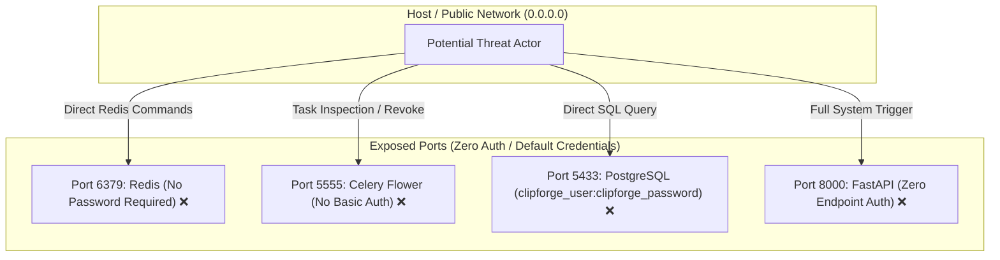
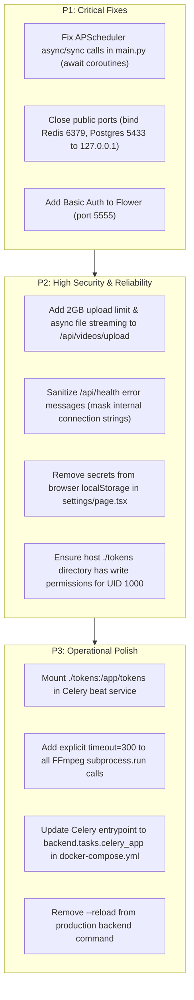

# Audit 17 — Security, Runtime Configuration, and Operational Reliability

**Audit Mode:** READ-ONLY Security, Runtime Configuration, and Reliability Audit  
**Workspace:** `d:\automation video clips\clipforge`  
**Artifact File:** `audit_artifacts/clipforge_upload_studio_v1_8/17_security_runtime_audit.md`  
**Execution Timestamp:** 2026-10-11  

---

## 1. Executive Summary

A forensic, read-only operational reliability, runtime configuration, and security audit was conducted across the ClipForge backend services, FastAPI routers, Celery pipeline, Docker Compose infrastructure, and frontend configuration.

The audit verified secrets management, authorization barriers, network attack surfaces, concurrency and session lifecycles, database connection pooling, Celery worker reliability, container topology, volume mounts, and error diagnostic information leakage.

### Double Verification Methodology
1. **Pass 1 (Configuration, Startup & Deployment Definitions):**  
   Exhaustive inspection of [backend/core/config.py](file:///d:/automation%20video%20clips/clipforge/backend/core/config.py), [docker-compose.yml](file:///d:/automation%20video%20clips/clipforge/docker-compose.yml), [backend/Dockerfile](file:///d:/automation%20video%20clips/clipforge/backend/Dockerfile), [backend/tasks/celery_app.py](file:///d:/automation%20video%20clips/clipforge/backend/tasks/celery_app.py), [backend/models/database.py](file:///d:/automation%20video%20clips/clipforge/backend/models/database.py), and `.env`.
2. **Pass 2 (Runtime Code Consumption & Execution Cross-Check):**  
   Traced the actual consumption of settings, database sessions, subprocess invocations, and Celery error callbacks across routes ([videos.py](file:///d:/automation%20video%20clips/clipforge/backend/api/routes/videos.py), [publish.py](file:///d:/automation%20video%20clips/clipforge/backend/api/routes/publish.py), [jobs.py](file:///d:/automation%20video%20clips/clipforge/backend/api/routes/jobs.py)), tasks ([orchestration.py](file:///d:/automation%20video%20clips/clipforge/backend/tasks/orchestration.py), [clip_tasks.py](file:///d:/automation%20video%20clips/clipforge/backend/tasks/clip_tasks.py)), and background services ([channel_monitor.py](file:///d:/automation%20video%20clips/clipforge/backend/services/channel_monitor.py), [realtime_tracker.py](file:///d:/automation%20video%20clips/clipforge/backend/services/realtime_tracker.py)).

---

## 2. Findings Scorecard

| Area | Status | Location | Severity | Key Observation |
| :--- | :--- | :--- | :--- | :--- |
| **API Authentication / Authorization** | **FAIL** | All API Routers | **Critical** | Zero authentication across all `/api/*` endpoints. Anyone can trigger uploads, delete clips, publish videos, or cancel jobs. |
| **Exposed Public Ports** | **FAIL** | [docker-compose.yml:L6,L19,L125](file:///d:/automation%20video%20clips/clipforge/docker-compose.yml#L6) | **Critical** | Redis (`6379`), Flower (`5555`), and Postgres (`5433`) are exposed to `0.0.0.0` with no authentication or default passwords. |
| **Scheduler Async/Sync Invocation Bug** | **FAIL** | [backend/main.py:L25,L43](file:///d:/automation%20video%20clips/clipforge/backend/main.py#L25) | **Critical** | `asyncio.to_thread` calls `async def` functions without awaiting them. Channel monitor and real-time tracker **never execute in background**. |
| **Client Secret in Browser Storage** | **FAIL** | [frontend/app/settings/page.tsx:L39](file:///d:/automation%20video%20clips/clipforge/frontend/app/settings/page.tsx#L39) | **High** | Settings form writes `YOUTUBE_CLIENT_ID` and `YOUTUBE_CLIENT_SECRET` into unencrypted browser `localStorage`. |
| **Unbounded File Upload (DoS)** | **FAIL** | [backend/api/routes/videos.py:L244](file:///d:/automation%20video%20clips/clipforge/backend/api/routes/videos.py#L244) | **High** | `/api/videos/upload` lacks file size limits. Synchronous `shutil.copyfileobj` blocks async event loop and risks disk exhaustion. |
| **Database Error Information Leak** | **FAIL** | [backend/main.py:L163,L176,L196](file:///d:/automation%20video%20clips/clipforge/backend/main.py#L163) | **High** | Unauthenticated `/api/health` endpoint reflects raw `str(e)`, leaking internal hostnames, ports, and connection strings. |
| **Token Volume Ownership / Permissions** | **FAIL** | [docker-compose.yml:L42,L73](file:///d:/automation%20video%20clips/clipforge/docker-compose.yml#L42) | **High** | Container runs as non-root `appuser`, but mounted `./tokens` from host can cause `PermissionError` when writing OAuth tokens. |
| **Missing Beat Token Mount** | **FAIL** | [docker-compose.yml:L98-L120](file:///d:/automation%20video%20clips/clipforge/docker-compose.yml#L98-L120) | **Medium** | `beat` container does not mount `/app/tokens`, preventing periodic tasks in beat from reading or refreshing channel tokens. |
| **Subprocess Execution Hangs** | **FAIL** | `tasks/clip_tasks.py`, `services/transcriber.py` | **Medium** | Multiple `subprocess.run(["ffmpeg", ...])` calls omit `timeout`, risking permanent worker thread hangs on malformed media. |
| **Obsolete Module in Compose** | **FAIL** | [docker-compose.yml:L96,L119,L144](file:///d:/automation%20video%20clips/clipforge/docker-compose.yml#L96) | **Medium** | Compose commands reference obsolete `backend.tasks.process_video.celery_app` instead of `backend.tasks.celery_app`. |
| **Orphan Startup Recovery Inertia** | **FAIL** | [backend/models/database.py:L57-L79](file:///d:/automation%20video%20clips/clipforge/backend/models/database.py#L57-L79) | **Medium** | `cleanup_orphaned_jobs` only prints orphaned jobs on startup without marking them `failed` or re-dispatching them. |

---

## 3. Security & Access Control Analysis

### 3.1 Total Absence of API Authentication & Authorization (Critical Severity)
- **Evidence:**  
  Across all routers in `backend/api/routes/`:
  - `videos.py`: Unauthenticated `POST /api/videos/url`, `POST /api/videos/upload`, `POST /api/videos/batch`.
  - `clips.py`: Unauthenticated `DELETE /api/clips/{id}`, `POST /api/clips/batch-delete`, `POST /api/clips/{id}/autofix`.
  - `jobs.py`: Unauthenticated `POST /api/jobs/{id}/retry`, `POST /api/jobs/{id}/cancel`, `DELETE /api/jobs/{id}`.
  - `publish.py`: Unauthenticated `POST /api/publish/publish-now`, `POST /api/publish/destinations/default`, `POST /api/publish/oauth-callback`.
  - `channels.py`: Unauthenticated `POST /api/channels/`, `DELETE /api/channels/{id}`.
- **Likely Impact:**  
  Any client on the network (or any malicious website leveraging cross-origin requests if CORS is misconfigured) can trigger infinite rendering jobs, delete the entire clip library, alter monitored channels, or immediately publish video clips to authenticated YouTube channels.
- **Recommended Correction:**  
  Implement a central JWT, session, or API-key dependency (e.g. `Depends(get_current_user)` or `Depends(verify_api_key)`) enforced across all mutating and sensitive endpoints.

---

### 3.2 Network Attack Surface & Unauthenticated Infrastructure Ports (Critical Severity)
In [docker-compose.yml](file:///d:/automation%20video%20clips/clipforge/docker-compose.yml):



1. **Redis Port 6379 ([docker-compose.yml:L6](file:///d:/automation%20video%20clips/clipforge/docker-compose.yml#L6)):**
   - Mapped `6379:6379` to host with **no password** (`requirepass` is omitted).
   - Anyone reaching host port 6379 can execute `FLUSHALL`, inspect task payloads containing OAuth tokens, or inject arbitrary Celery task messages.
2. **Celery Flower Port 5555 ([docker-compose.yml:L125](file:///d:/automation%20video%20clips/clipforge/docker-compose.yml#L125)):**
   - Mapped `5555:5555` to host without `--basic_auth`.
   - Flower provides full web GUI control: terminating worker processes, inspecting task arguments, and inspecting Celery broker state.
3. **PostgreSQL Port 5433 ([docker-compose.yml:L19](file:///d:/automation%20video%20clips/clipforge/docker-compose.yml#L19)):**
   - Mapped `5433:5432` with hardcoded credentials `clipforge_user:clipforge_password`.
   - Allows direct remote database connections from any machine on the network.
- **Recommended Correction:**  
  Bind internal infrastructure ports to localhost only (`127.0.0.1:6379:6379`, `127.0.0.1:5433:5432`). Require Redis authentication password (`--requirepass`). Configure `--basic_auth=admin:[STRONG_PASSWORD]` for Flower.

---

### 3.3 Secrets Management in Frontend & Error Leakage

#### 1. OAuth Secrets in Browser `localStorage` (High Severity)
- In [frontend/app/settings/page.tsx#L5-L42](file:///d:/automation%20video%20clips/clipforge/frontend/app/settings/page.tsx#L5-L42):
  ```tsx
  localStorage.setItem('clipforge_settings', JSON.stringify(env));
  ```
  `env` contains `YOUTUBE_CLIENT_ID` and `YOUTUBE_CLIENT_SECRET`.
- **Vulnerability:** Unencrypted `localStorage` is accessible to any script running on the origin. Storing client secrets client-side violates OAuth 2.0 best practices.
- **Correction:** Remove secret inputs from the frontend. Manage all API keys and OAuth secrets strictly server-side via `.env` or a secure backend configuration vault.

#### 2. Information Leakage in `/api/health` (High Severity)
- In [backend/main.py#L163,L176,L196](file:///d:/automation%20video%20clips/clipforge/backend/main.py#L163):
  ```python
  components["db"] = f"error: {str(e)}"
  components["redis"] = f"error: {str(e)}"
  components["worker"] = f"error: {str(e)}"
  ```
- **Vulnerability:** If PostgreSQL or Redis authentication or network connection fails, `str(e)` in psycopg2/asyncpg includes the full connection string, internal container hostnames (`postgres:5432`), database usernames, and stack traces. Because `/api/health` is public, external scanners can extract internal topology and database configurations.
- **Correction:** Log `str(e)` internally to logger; return sanitized strings (`"error: connection_failed"`) in HTTP responses.

---

## 4. Runtime Configuration & Operational Reliability

### 4.1 Critical APScheduler Coroutine Bug (Confirmed Operational Deadlock)

In [backend/main.py#L20-L46](file:///d:/automation%20video%20clips/clipforge/backend/main.py#L20-L46):
```python
async def scheduled_channel_check():
    from backend.services.channel_monitor import run_channel_monitor
    async with AsyncSessionLocal() as db:
        await asyncio.to_thread(run_channel_monitor, db)  # <--- CRITICAL BUG

async def scheduled_tracker_check():
    from backend.services.realtime_tracker import run_realtime_tracker
    await asyncio.to_thread(run_realtime_tracker)        # <--- CRITICAL BUG
```

#### Forensic Root Cause:
1. Both `run_channel_monitor` ([channel_monitor.py#L54](file:///d:/automation%20video%20clips/clipforge/backend/services/channel_monitor.py#L54)) and `run_realtime_tracker` ([realtime_tracker.py#L106](file:///d:/automation%20video%20clips/clipforge/backend/services/realtime_tracker.py#L106)) are defined as **`async def`** functions.
2. `asyncio.to_thread(func, *args)` runs `func(*args)` in a separate synchronous worker thread.
3. Invoking an `async def` function without awaiting it merely creates a Python coroutine object (`<coroutine object run_channel_monitor at ...>`) without executing its bytecode.
4. The thread exits immediately, returning the unawaited coroutine. Python emits:
   ```
   RuntimeWarning: coroutine 'run_channel_monitor' was never awaited
   RuntimeWarning: coroutine 'run_realtime_tracker' was never awaited
   ```
5. **Operational Consequence:**  
   **Channel monitoring and real-time performance tracking NEVER run in production!**  
   New YouTube uploads are never discovered automatically, and post-publish ViewScore tracking is never polled.
- **Correction:**  
  Change lines 25 and 43 in `backend/main.py` to directly await the coroutines:
  ```python
  # scheduled_channel_check:
  await run_channel_monitor(db)

  # scheduled_tracker_check:
  await run_realtime_tracker()
  ```

---

### 4.2 Resource Exhaustion & Unbounded Uploads (High Severity)

In [backend/api/routes/videos.py#L235-L246](file:///d:/automation%20video%20clips/clipforge/backend/api/routes/videos.py#L235-L246):
```python
if not file.filename.lower().endswith((".mp4", ".mov", ".avi", ".mkv", ".webm")):
    raise HTTPException(status_code=400, detail="Unsupported file format...")

video_id = str(uuid.uuid4())
upload_dir = settings.UPLOAD_DIR / video_id
upload_dir.mkdir(parents=True, exist_ok=True)
file_path = upload_dir / "video.mp4"

with open(file_path, "wb") as f:
    shutil.copyfileobj(file.file, f)
```

1. **No Maximum Size Check:** There is no check on `Content-Length` or total bytes written. An attacker can stream hundreds of gigabytes until disk space is exhausted.
2. **Event Loop Starvation:** `open()` and `shutil.copyfileobj()` are blocking synchronous file I/O operations executed directly on FastAPI's main async event loop. Writing a 2GB file locks the event loop, freezing WebSocket progress updates and HTTP responses for all users.
3. **MIME Verification Absence:** Validation relies solely on file extension string suffix. Malicious binaries renamed to `.mp4` are accepted and written to disk.
- **Correction:**  
  Enforce a streaming chunk counter with a hard cap (e.g. 2GB max). Offload file writes to `asyncio.to_thread` or an async file stream (`aiofiles`). Validate the file header using `ffprobe` or magic bytes before registering the `Job`.

---

### 4.3 Celery Worker Reliability & Task Lifecycle

#### 1. Worker Crash Loop via `task_reject_on_worker_lost=True`
- In [backend/tasks/celery_app.py#L19-L20](file:///d:/automation%20video%20clips/clipforge/backend/tasks/celery_app.py#L19-L20):
  ```python
  task_acks_late = True
  task_reject_on_worker_lost = True
  ```
- **Risk:** If a worker process is OOM-killed while processing an abnormally heavy 4K video or complex Whisper model, Celery rejects the message, and Redis immediately re-queues it. The next worker claims the poison-pill task and also crashes, resulting in an infinite worker crash loop.
- **Correction:** Implement a maximum delivery count or dead-letter queue in Redis/Celery to quarantine tasks after 2 ungraceful worker terminations.

#### 2. Subprocess Execution Timeouts
- Multiple FFmpeg and Whisper invocations (e.g. [clip_tasks.py#L927](file:///d:/automation%20video%20clips/clipforge/backend/tasks/clip_tasks.py#L927), [transcriber.py#L50](file:///d:/automation%20video%20clips/clipforge/backend/services/transcriber.py#L50), [output_validator.py#L27](file:///d:/automation%20video%20clips/clipforge/backend/services/output_validator.py#L27)) call `subprocess.run(cmd)` without specifying a `timeout` argument.
- If FFmpeg deadlocks on corrupted audio streams or pipe stalls, worker threads remain blocked until Celery's global 30-minute task soft time limit expires.
- **Correction:** Add explicit `timeout=300` (5 minutes) to all FFmpeg and external binary `subprocess.run()` calls.

#### 3. Obsolete Celery Entrypoint in Docker Compose
- In [docker-compose.yml#L96,L119,L144](file:///d:/automation%20video%20clips/clipforge/docker-compose.yml#L96):
  `celery -A backend.tasks.process_video.celery_app worker`
- `backend/tasks/process_video.py` is explicitly marked `OBSOLETE: Monolithic process_video_task has been decomposed into Phase 5 tasks`.
- While it re-exports `celery_app` for backwards compatibility, the canonical entrypoint is `backend.tasks.celery_app`.
- **Correction:** Update compose command strings to `celery -A backend.tasks.celery_app worker` and `celery -A backend.tasks.celery_app beat`.

---

### 4.4 Docker Mounts & Token Volume Isolation

1. **Permission Denied Risk on `./tokens` Mount:**
   - [backend/Dockerfile#L31](file:///d:/automation%20video%20clips/clipforge/backend/Dockerfile#L31) enforces `USER appuser` (UID 1000).
   - In [docker-compose.yml#L42,L73](file:///d:/automation%20video%20clips/clipforge/docker-compose.yml#L42), `./tokens:/app/tokens` is mounted from the host.
   - If `./tokens` on the host is created by root, `appuser` cannot write `youtube_token_{channel_id}.json`, throwing `PermissionError: [Errno 13]` during OAuth callback.
2. **Beat Service Missing Token Mount:**
   - In `docker-compose.yml#L98-L120`, the `beat` service mounts `./backend:/app/backend`, but **omits `./tokens:/app/tokens`**.
   - If Celery beat schedules periodic tasks that verify channel tokens (e.g. `channel_monitor`), beat fails to locate credentials in `/app/tokens`.
3. **Hardcoded Image Mount:**
   - Line 43 and 74 in `docker-compose.yml` mounts `./Gemini_Generated_Image_2rh1j72rh1j72rh1.png:/app/Gemini_Generated_Image_2rh1j72rh1j72rh1.png`, a brittle artifact dependency.

---

### 4.5 Environment Variable Discrepancies

1. **`DATABASE_URL` Missing from `.env`:**
   - `.env` does not define `DATABASE_URL` or `SYNC_DATABASE_URL`.
   - Local executions fall back to `config.py` default `localhost:5433` (the mapped container port), while inside Docker it is overridden to `postgres:5432`.
   - Running local scripts without Docker running fails to connect.
2. **`DEBUG=True` Production Hazard:**
   - [backend/core/config.py#L8](file:///d:/automation%20video%20clips/clipforge/backend/core/config.py#L8) defaults `DEBUG: bool = True`.
   - In production containers, `DEBUG=True` causes FastAPI to format unhandled exceptions with full stack traces in HTTP responses.
3. **Uvicorn `--reload` in Container:**
   - In [docker-compose.yml#L63](file:///d:/automation%20video%20clips/clipforge/docker-compose.yml#L63), the backend command specifies `--reload`. File watchers consume unnecessary CPU cycles inside containers and can trigger unexpected process restarts during large uploads.

---

## 5. Prioritized Recommended Corrections



1. **Fix APScheduler Calls ([backend/main.py](file:///d:/automation%20video%20clips/clipforge/backend/main.py)):**
   Directly await `run_channel_monitor(db)` and `run_realtime_tracker()` instead of wrapping them in `asyncio.to_thread`.
2. **Restrict Port Bindings ([docker-compose.yml](file:///d:/automation%20video%20clips/clipforge/docker-compose.yml)):**
   Change host port mappings to `127.0.0.1:6379:6379` and `127.0.0.1:5433:5432`. Add `--basic_auth=admin:[STRONG_PASSWORD]` to Flower service.
3. **Harden File Uploads ([backend/api/routes/videos.py](file:///d:/automation%20video%20clips/clipforge/backend/api/routes/videos.py)):**
   Implement chunk-by-chunk streaming with a 2GB maximum boundary check, and offload file writing to async worker threads.
4. **Sanitize Diagnostic Endpoints ([backend/main.py](file:///d:/automation%20video%20clips/clipforge/backend/main.py)):**
   Replace `str(e)` in `/api/health` with generic status descriptors (`"database_unreachable"`) while logging full exceptions internally.
5. **Secure Browser Storage ([frontend/app/settings/page.tsx](file:///d:/automation%20video%20clips/clipforge/frontend/app/settings/page.tsx)):**
   Remove `YOUTUBE_CLIENT_SECRET` from browser `localStorage`.
6. **Harmonize Celery Entrypoints ([docker-compose.yml](file:///d:/automation%20video%20clips/clipforge/docker-compose.yml)):**
   Update Celery service commands to reference `backend.tasks.celery_app`. Add `./tokens:/app/tokens` mount to `beat` service.
7. **Add Subprocess Timeouts:**
   Pass `timeout=300` to all `subprocess.run()` calls involving FFmpeg and external CLI tools.

---
*The complete forensic evidence inventory is saved in [`audit_artifacts/clipforge_upload_studio_v1_8/17_security_runtime_audit.md`](file:///d:/automation%20video%20clips/clipforge/audit_artifacts/clipforge_upload_studio_v1_8/17_security_runtime_audit.md).*
