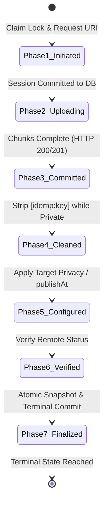

# ClipForge Upload Studio — Corrected Technical Specification (v1.9 Architecture)

**Document Title:** ClipForge Upload Studio v1.9 Enterprise Architecture Specification (Audit 26 Evidence-Gated Correction)  
**Target Artifact File:** `audit_artifacts/clipforge_upload_studio_v1_8/CLIPFORGE_UPLOAD_STUDIO_V1_9_SPEC.md`  
**Supersedes:** `upload_studio_implementation_plan.md` (v1.8 Plan-Only Architecture)  
**Execution Timestamp:** 2026-10-11  
**Author / Protocol:** Antigravity Autonomous Architecture Audit (Audit 26 Evidence-Gated Synthesis)  
**Target Repository:** `d:\automation video clips\clipforge` | Branch: `version-4-gen` @ `0ba85ffa2553dfaa39f7bcae755b0358ce01f9ac`  
**Operational Status:** **SPECIFICATION ONLY** — No application code, database schemas, migrations, configuration, or credentials have been modified.

---

## Table of Contents

1. [Executive Summary & Readiness Prerequisites](#1-executive-summary--readiness-prerequisites)
2. [Confirmed Requirements vs. Unresolved Decisions](#2-confirmed-requirements-vs-unresolved-decisions)
3. [Full Database Schema & Migration Specification](#3-full-database-schema--migration-specification)
4. [Complete Publication State Machine & Crash-Recovery Protocol](#4-complete-publication-state-machine--crash-recovery-protocol)
5. [Strict Idempotency, Marker Sanitization & Absence-Proof Rules](#5-strict-idempotency-marker-sanitization--absence-proof-rules)
6. [Supported YouTube Data API v3 Contracts & Quota Realities](#6-supported-youtube-data-api-v3-contracts--quota-realities)
7. [Per-Target Metadata & Destination Isolation Architecture](#7-per-target-metadata--destination-isolation-architecture)
8. [Dual Tracking Architecture & 5-Day Optimization Contract](#8-dual-tracking-architecture--5-day-optimization-contract)
9. [Storage Retention, Archival & Safe Deletion Lifecycle](#9-storage-retention-archival--safe-deletion-lifecycle)
10. [Backward Compatibility & URL Pipeline Regression Safeguards](#10-backward-compatibility--url-pipeline-regression-safeguards)
11. [Two-Pass Verification Evidence Matrix](#11-two-pass-verification-evidence-matrix)
12. [Safe Phased Implementation & Verification Plan](#12-safe-phased-implementation--verification-plan)
13. [Changelog: Material Corrections from v1.8 to v1.9](#13-changelog-material-corrections-from-v18-to-v19)
14. [Bulk Upload & Persistent Queue Reordering Architecture](#14-bulk-upload--persistent-queue-reordering-architecture)

---

## 1. Executive Summary & Readiness Prerequisites

### 1.1 Overview
This specification defines the corrected, production-grade architecture for **ClipForge Upload Studio** (`/studio` and `/api/studio`). Upload Studio expands ClipForge beyond automated URL-based clipping into a standalone creator suite supporting:
- Direct video file ingestion ($\le 2\text{ GB}$).
- Explicit dual-format rendering: **Regular Video (16:9 passthrough/re-encode)** and **Short Clip (9:16 vertical layout, strictly $< 30.0\text{ s}$)**.
- Destination-isolated YouTube publishing across multiple authenticated channels.
- Private-first 7-phase publication lifecycle with native ahead-of-time `publishAt` scheduling.
- Resumable chunk upload persistence (HTTP 308) and fail-closed crash reconciliation.
- Multi-channel post-publication telemetry and automated metadata optimization.

### 1.2 Implementation Prerequisites
No implementation work may begin until the following four architectural prerequisites are satisfied:
1. **Security Layer Hardening (Phase 0):** API authentication middleware must be configured on FastAPI routers, and stateful infrastructure ports (`5433`, `6379`, `5555`) must be bound to `127.0.0.1`.
2. **Background Scheduler Coroutine Repair:** The unawaited coroutine abandonment bug in `backend/main.py:L25,L43` (`asyncio.to_thread` wrapping `async def` functions `run_channel_monitor` and `run_realtime_tracker`) must be corrected by directly awaiting the async functions in `AsyncIOScheduler`.
3. **Destination Token Isolation Hardening:** The insecure fallback to the global default token `settings.YOUTUBE_TOKEN_FILE` in `backend/services/publisher.py:L598-605` must be excised for Studio targets, failing closed if `tokens/youtube_token_{channel_id}.json` is missing.
4. **Formal Approval of Governance Register:** Stakeholders must formally approve the unresolved product decisions: ViewScore formula scale calibration, raw video retention lifespan, and per-channel daily upload budget policy.

---

## 2. Confirmed Requirements vs. Unresolved Decisions

```
┌────────────────────────────────────────────────────────────────────────────────────────┐
│                        REQUIREMENTS CLASSIFICATION MATRIX                              │
├────────────────────────────────────────┬───────────────────────────────────────────────┤
│ CONFIRMED ARCHITECTURAL REQUIREMENTS   │ UNRESOLVED DECISIONS (REQUIRING SIGN-OFF)     │
├────────────────────────────────────────┼───────────────────────────────────────────────┤
│ • Linear Alembic down_revision =       │ 1. ViewScore Formula Calibration:             │
│   'e1a2b3c4d5e6' (Dual-Verified Head)  │    Proposed candidate: normalized ratio with  │
│ • Pre-constraint status backfills      │    8.0 threshold, scoped exclusively to       │
│   ('success' -> 'completed')           │    Upload Studio targets. Human sign-off is   │
│ • Target phase backfill ('finalized'   │    required. Existing URL-pipeline behavior in │
│   and 'legacy_unmanaged')              │    performance_tracker.py remains preserved   │
│ • Fail-closed status pre-validation    │    and untouched until separately authorized. │
│ • Truthful snapshot ID resolution      │ 2. Storage Retention Lifespan:                │
│   (COALESCE(pt.yt_id, c.yt_id), NULL)  │    Purge raw uploads immediately upon render  │
│ • upload_batches.active_video_id FK    │    completion vs. 24-hour grace period for    │
│   to videos.id with ON DELETE SET NULL │    creator retry. Awaiting product decision.  │
│ • Atomic stream slot claims (no TOCTOU)│ 3. Studio Route Placement Strategy:           │
│ • Active lease fencing at milestones   │    Retaining standalone /studio alongside     │
│ • Strict lock acquisition hierarchy    │    legacy /publish is the confirmed design;   │
│   (Coordinator -> Batch -> Video)      │    formal route deprecation remains pending.  │
│ • LocalStorageProvider namespace align │ 4. YouTube Quota Limit Controls:              │
│ • Short duration strictly < 30.0s      │    Proposed 20 uploads/day/channel budget cap │
│ • Complete absence of burnt-in captions│    is an internal safety proposal, NOT an    │
│ • 7-phase private-first lifecycle      │    existing Google rule. Requires sign-off.   │
│ • Fail-closed absence-proof rules      │                                               │
└────────────────────────────────────────┴───────────────────────────────────────────────┘
```

---

## 3. Full Database Schema & Migration Specification

### 3.1 Migration Heritage & Chain Integrity
- **Verified Current Alembic Head:** `e1a2b3c4d5e6` (`e1a2b3c4d5e6_add_multi_destination_phase1.py`).
- **Predecessor Revision:** `3d39d71a2820`.
- **New Migration Revision:** `f1b2c3d4e5f6_add_upload_studio_v1_9.py`.
- **Target `down_revision`:** `'e1a2b3c4d5e6'`.

### 3.2 Required Pre-Constraint Data Backfills
To prevent check constraint violations and historical target misclassification, the migration script executes fail-closed pre-validation and backfills **prior** to creating table constraints.

#### Pre-Validation: Fail-Closed Status Inspection
The migration queries distinct `publish_targets.status` values and fails closed with `RuntimeError` if any undocumented, null, or unexpected status is encountered. Normalization is strictly limited to documented values.

#### Backfill 1: Harmonize Historical Target Statuses (Irreversible Normalization)
Migration `e1a2b3c4d5e6:L100` populated `publish_targets.status` with `'success'` for completed clips.
```sql
UPDATE publish_targets 
SET status = 'completed' 
WHERE status = 'success';
```
> [!NOTE]
> **Irreversibility Policy:** This is a one-way normalization. In `downgrade()`, `'completed'` is intentionally **not** reverted to `'success'`, because doing so would corrupt legitimate `completed` records created after this migration.

#### Backfill 2: Historical Publication Phases (Prevent False Phase 1 Ingestion)
Historical targets created under the existing URL-based publication lifecycle must NEVER receive `'session_initiated'`, which would cause Upload Studio crash-recovery workers to misclassify them as active Phase 1 sessions and trigger unprompted duplicate video uploads.
An explicit durable distinction is maintained between historical targets and Upload Studio targets:
- Completed targets are backfilled to `'finalized'`.
- Scheduled targets are backfilled to `'status_configured'`.
- Historical unfinalized targets (`pending`, `publishing`, `failed`, `manual_review`) receive `'legacy_unmanaged'`. They are preserved for audit and reconciliation, but the Upload Studio recovery worker strictly ignores them. If remote YouTube state is ambiguous, reconciliation must be triggered manually via `/api/channels/reconcile`.
```sql
UPDATE publish_targets
SET publication_phase = 'finalized'
WHERE status IN ('completed', 'completed_unlisted', 'completed_private');

UPDATE publish_targets
SET publication_phase = 'status_configured'
WHERE status = 'scheduled';

UPDATE publish_targets
SET publication_phase = 'legacy_unmanaged'
WHERE status IN ('pending', 'publishing', 'failed', 'manual_review');
```

#### Backfill 3: Data-Preserving Clip Format Type Backfill
Historical URL-generated clips are preserved with `format_type = 'short'` via the migration column server default (`server_default='short'`).
The flawed heuristic (`aspect_ratio = '16:9' AND duration > 60.0 THEN 'regular'`) is excised: existing URL-pipeline clips were created as vertical short-form content regardless of metadata quirks, and duration $> 60.0\text{ s}$ does not prove a clip is a regular video. No ungrounded heuristic is used to guess historical formats.
Newly created Studio clips are explicitly assigned their format (`'short'` or `'regular'`) upon asset creation/selection by the creator during Studio Stage 4 format selection.

#### Backfill 4: Populate Immutable Target Snapshots (Truthful Provenance Resolution)
Historical completed targets must capture immutable snapshot metadata.
Crucially, the published video identifier must be distinguished across entities:
1. **Source Video ID (`c.video_id`):** Internal UUID referencing the parent row in `videos`. **Never substitute an internal UUID for a published YouTube video ID.**
2. **Clip ID (`c.id`):** Internal UUID for the generated clip.
3. **Published YouTube Video ID (`pt.youtube_video_id` or legacy `c.youtube_short_id`):** The actual external YouTube video identifier.

```sql
UPDATE publish_targets pt
SET 
    snapshot_title = COALESCE(c.title, 'Historical Publication'),
    snapshot_format_type = COALESCE(c.format_type, 'short'),
    snapshot_video_id = COALESCE(pt.youtube_video_id, c.youtube_short_id),
    snapshot_channel_title = ch.channel_name,
    diagnostic_context = CASE 
        WHEN COALESCE(pt.youtube_video_id, c.youtube_short_id) IS NULL 
        THEN 'MISSING_HISTORICAL_YOUTUBE_ID: Requires manual reconciliation' 
        ELSE pt.diagnostic_context 
    END
FROM clips c
LEFT JOIN channels ch ON pt.destination_id = ch.id
WHERE pt.clip_id = c.id
  AND pt.snapshot_title IS NULL;
```
> [!CAUTION]
> **No Synthetic Placeholders:** If neither `pt.youtube_video_id` nor `c.youtube_short_id` exists, `snapshot_video_id` remains `NULL`. Synthetic strings like `'UNKNOWN_HISTORICAL'` are **strictly forbidden**. The row is marked in `diagnostic_context` and requires manual reconciliation before finalization. Furthermore, YouTube IDs are verified against actual provenance and API responses rather than relying solely on universal 11-character regex checks.

#### Backfill 5: Legacy URL Video Studio Isolation (Prevent Erroneous Ingestion States)
Historical URL-generated videos (`is_manual_upload = FALSE`) must NOT be marked with an upload status or assigned to batches. They are explicitly sanitized to `upload_batch_id = NULL`, `queue_position = NULL`, and `upload_status = NULL`. They exist purely in the clipping pipeline and remain 100% isolated from Studio batch operations.
```sql
UPDATE videos
SET 
    upload_batch_id = NULL,
    queue_position = NULL,
    upload_status = NULL
WHERE is_manual_upload = FALSE OR is_manual_upload IS NULL;
```

---

### 3.3 Exact Migration Script (`f1b2c3d4e5f6_add_upload_studio_v1_9.py`)

```python
"""add_upload_studio_v1_9

Revision ID: f1b2c3d4e5f6
Revises: e1a2b3c4d5e6
Create Date: 2026-10-11 18:00:00.000000
"""
from alembic import op
import sqlalchemy as sa

revision = 'f1b2c3d4e5f6'
down_revision = 'e1a2b3c4d5e6'

def upgrade() -> None:
    conn = op.get_bind()

    # ── 1a. FAIL-CLOSED STATUS PRE-VALIDATION ────────────────────────────────
    existing_statuses = conn.execute(sa.text("SELECT DISTINCT status FROM publish_targets;")).scalars().all()
    PERMITTED_STATUSES = {
        'pending', 'publishing', 'scheduled', 'completed', 
        'completed_unlisted', 'completed_private', 'failed', 'manual_review', 'success'
    }
    unknown_statuses = set(existing_statuses) - PERMITTED_STATUSES
    if unknown_statuses:
        raise RuntimeError(f"MIGRATION ABORT: Unrecognized publish_targets.status values detected: {unknown_statuses}")

    # ── 1b. BACKFILL 1: HARMONIZE HISTORICAL TARGET STATUSES ──────────────────
    conn.execute(sa.text("UPDATE publish_targets SET status = 'completed' WHERE status = 'success';"))

    # ── 1c. GLOBAL STORAGE RESERVATION COORDINATOR ────────────────────────────
    op.create_table(
        'storage_reservation_coordinators',
        sa.Column('id', sa.String(length=36), primary_key=True),
        sa.Column('reserved_bytes', sa.BigInteger(), nullable=False, server_default='0'),
        sa.Column('updated_at', sa.DateTime(timezone=True), server_default=sa.func.now(), nullable=False),
    )
    conn.execute(sa.text(
        "INSERT INTO storage_reservation_coordinators (id, reserved_bytes, updated_at) "
        "VALUES ('global', 0, NOW());"
    ))

    # ── 1d. UPLOAD_BATCHES TABLE (BULK UPLOAD STUDIO) ─────────────────────────
    # active_video_id is created as nullable String(36); FK is added after videos table alter
    op.create_table(
        'upload_batches',
        sa.Column('id', sa.String(length=36), primary_key=True),
        sa.Column('name', sa.String(length=255), nullable=False, server_default='Untitled Batch'),
        sa.Column('status', sa.String(length=30), nullable=False, server_default='uploading'),
        sa.Column('version', sa.Integer(), nullable=False, server_default='1'),
        sa.Column('total_files', sa.Integer(), nullable=False, server_default='0'),
        sa.Column('reserved_bytes', sa.BigInteger(), nullable=False, server_default='0'),
        sa.Column('active_video_id', sa.String(length=36), nullable=True),
        sa.Column('execution_token', sa.String(length=64), nullable=True),
        sa.Column('processing_heartbeat', sa.DateTime(timezone=True), nullable=True),
        sa.Column('created_at', sa.DateTime(timezone=True), server_default=sa.func.now(), nullable=False),
        sa.Column('updated_at', sa.DateTime(timezone=True), server_default=sa.func.now(), nullable=False),
    )
    op.create_check_constraint(
        'ck_upload_batch_status', 'upload_batches',
        "status IN ('uploading', 'ready', 'processing', 'completed', 'cancelled', 'archived')"
    )

    # ── 2. VIDEOS TABLE ALTERATIONS ───────────────────────────────────────────
    op.add_column('videos', sa.Column('is_manual_upload', sa.Boolean(), server_default='false', nullable=False))
    op.add_column('videos', sa.Column('is_archived', sa.Boolean(), server_default='false', nullable=False))
    op.add_column('videos', sa.Column('resolution', sa.String(length=20), nullable=True))
    op.add_column('videos', sa.Column('source_filename', sa.String(length=255), nullable=True))
    op.add_column('videos', sa.Column('file_size', sa.BigInteger(), nullable=True))

    # Bulk Upload & Persistent Queue Reordering Columns
    op.add_column('videos', sa.Column('upload_batch_id', sa.String(length=36), nullable=True))
    op.add_column('videos', sa.Column('queue_position', sa.Integer(), nullable=True))
    op.add_column('videos', sa.Column('upload_status', sa.String(length=30), nullable=True))
    op.add_column('videos', sa.Column('uploaded_bytes', sa.BigInteger(), server_default='0', nullable=False))
    op.add_column('videos', sa.Column('total_bytes', sa.BigInteger(), server_default='0', nullable=False))

    op.create_foreign_key(
        'fk_videos_upload_batch_id', 'videos', 'upload_batches',
        ['upload_batch_id'], ['id'], ondelete='SET NULL'
    )
    op.create_index('ix_videos_batch_position', 'videos', ['upload_batch_id', 'queue_position'])
    op.create_unique_constraint(
        'uq_batch_queue_pos', 'videos',
        ['upload_batch_id', 'queue_position'],
        deferrable=True, initially='DEFERRED'
    )
    op.create_check_constraint(
        'ck_video_upload_status', 'videos',
        "upload_status IS NULL OR upload_status IN ('queued', 'uploading', 'uploaded', 'failed', 'cancelled')"
    )

    # ── 2b. CIRCULAR FK RESOLUTION: upload_batches.active_video_id -> videos.id
    op.create_foreign_key(
        'fk_upload_batches_active_video_id', 'upload_batches', 'videos',
        ['active_video_id'], ['id'], ondelete='SET NULL'
    )

    # ── 3. CLIPS TABLE ALTERATIONS ────────────────────────────────────────────
    op.add_column('clips', sa.Column('format_type', sa.String(length=20), server_default='short', nullable=False))
    op.add_column('clips', sa.Column('is_archived', sa.Boolean(), server_default='false', nullable=False))
    op.create_check_constraint('ck_clip_format_type', 'clips', "format_type IN ('short', 'regular')")

    # ── 4. PUBLISH_TARGETS TABLE ALTERATIONS ──────────────────────────────────
    op.drop_constraint('publish_targets_clip_id_fkey', 'publish_targets', type_='foreignkey')
    op.create_foreign_key(
        'fk_publish_targets_clip_id', 'publish_targets', 'clips',
        ['clip_id'], ['id'], ondelete='SET NULL'
    )
    op.alter_column('publish_targets', 'clip_id', nullable=True)

    op.drop_constraint('publish_targets_destination_id_fkey', 'publish_targets', type_='foreignkey')
    op.create_foreign_key(
        'fk_publish_targets_destination_id', 'publish_targets', 'channels',
        ['destination_id'], ['id'], ondelete='RESTRICT'
    )

    # Per-Target Draft Metadata Columns
    op.add_column('publish_targets', sa.Column('custom_title', sa.String(length=255), nullable=True))
    op.add_column('publish_targets', sa.Column('custom_description', sa.Text(), nullable=True))
    op.add_column('publish_targets', sa.Column('custom_tags', sa.Text(), nullable=True))

    # Post-Publication Immutable Snapshots
    op.add_column('publish_targets', sa.Column('snapshot_title', sa.String(length=255), nullable=True))
    op.add_column('publish_targets', sa.Column('snapshot_format_type', sa.String(length=20), nullable=True))
    op.add_column('publish_targets', sa.Column('snapshot_video_id', sa.String(length=100), nullable=True))
    op.add_column('publish_targets', sa.Column('snapshot_channel_title', sa.String(length=255), nullable=True))

    # Resumable Session & Recovery State
    op.add_column('publish_targets', sa.Column('resumable_upload_uri', sa.Text(), nullable=True))
    op.add_column('publish_targets', sa.Column('publication_phase', sa.String(length=30), nullable=True))
    op.add_column('publish_targets', sa.Column('attempt_generation', sa.Integer(), server_default='1', nullable=False))
    op.add_column('publish_targets', sa.Column('idempotency_key', sa.String(length=64), nullable=True))
    op.add_column('publish_targets', sa.Column('upload_started_at', sa.DateTime(timezone=True), nullable=True))
    op.add_column('publish_targets', sa.Column('upload_completed_at', sa.DateTime(timezone=True), nullable=True))
    op.add_column('publish_targets', sa.Column('reconciled_at', sa.DateTime(timezone=True), nullable=True))
    op.add_column('publish_targets', sa.Column('diagnostic_context', sa.Text(), nullable=True))

    # ── 4b. EXECUTABLE DATA BACKFILLS (RESOLVES AUD25-MIG-01 & AUD25-MIG-02) ──
    # Backfill 2: Historical Publication Phases
    conn.execute(sa.text("""
        UPDATE publish_targets SET publication_phase = 'finalized' 
        WHERE status IN ('completed', 'completed_unlisted', 'completed_private');
    """))
    conn.execute(sa.text("""
        UPDATE publish_targets SET publication_phase = 'status_configured' 
        WHERE status = 'scheduled';
    """))
    conn.execute(sa.text("""
        UPDATE publish_targets SET publication_phase = 'legacy_unmanaged' 
        WHERE status IN ('pending', 'publishing', 'failed', 'manual_review');
    """))

    # Backfill 4: Populate Immutable Snapshots with Truthful Published IDs
    conn.execute(sa.text("""
        UPDATE publish_targets pt
        SET 
            snapshot_title = COALESCE(c.title, 'Historical Publication'),
            snapshot_format_type = COALESCE(c.format_type, 'short'),
            snapshot_video_id = COALESCE(pt.youtube_video_id, c.youtube_short_id),
            snapshot_channel_title = ch.channel_name,
            diagnostic_context = CASE 
                WHEN COALESCE(pt.youtube_video_id, c.youtube_short_id) IS NULL 
                THEN 'MISSING_HISTORICAL_YOUTUBE_ID: Requires manual reconciliation' 
                ELSE pt.diagnostic_context 
            END
        FROM clips c
        LEFT JOIN channels ch ON pt.destination_id = ch.id
        WHERE pt.clip_id = c.id
          AND pt.snapshot_title IS NULL;
    """))

    # Backfill 5: Legacy URL Video Studio Isolation
    conn.execute(sa.text("""
        UPDATE videos
        SET upload_batch_id = NULL, queue_position = NULL, upload_status = NULL
        WHERE is_manual_upload = FALSE OR is_manual_upload IS NULL;
    """))

    # Apply Check Constraints
    op.create_check_constraint(
        'ck_target_status', 'publish_targets',
        "status IN ('pending', 'publishing', 'scheduled', 'completed', 'completed_unlisted', 'completed_private', 'failed', 'manual_review')"
    )
    op.create_check_constraint(
        'ck_publication_phase', 'publish_targets',
        "publication_phase IN ('session_initiated', 'uploading_media', 'video_id_committed', 'marker_cleaned', 'status_configured', 'remote_verified', 'finalized', 'legacy_unmanaged')"
    )

    # ── 5. VIDEO_TRACKING_QUEUE TABLE ALTERATIONS ─────────────────────────────
    op.drop_constraint('video_tracking_queue_clip_id_fkey', 'video_tracking_queue', type_='foreignkey')
    op.create_foreign_key(
        'fk_tracking_clip_id', 'video_tracking_queue', 'clips',
        ['clip_id'], ['id'], ondelete='SET NULL'
    )
    op.alter_column('video_tracking_queue', 'clip_id', nullable=True)

    op.add_column('video_tracking_queue', sa.Column('publish_target_id', sa.String(), nullable=True))
    op.create_foreign_key(
        'fk_tracking_publish_target_id', 'video_tracking_queue', 'publish_targets',
        ['publish_target_id'], ['id'], ondelete='SET NULL'
    )
    op.add_column('video_tracking_queue', sa.Column('destination_id', sa.String(length=100), nullable=True))
    op.create_foreign_key(
        'fk_tracking_destination_id', 'video_tracking_queue', 'channels',
        ['destination_id'], ['id'], ondelete='SET NULL'
    )
    op.add_column('video_tracking_queue', sa.Column('check_count', sa.Integer(), server_default='0', nullable=False))
    
    op.create_unique_constraint('uix_tracking_publish_target', 'video_tracking_queue', ['publish_target_id'])
    op.create_index('ix_tracking_next_check', 'video_tracking_queue', ['next_check_at', 'status'])

    # ── 6. OPTIMIZATION_LOG TABLE ALTERATIONS ─────────────────────────────────
    op.add_column('optimizations', sa.Column('publish_target_id', sa.String(), nullable=True))
    op.add_column('optimizations', sa.Column('destination_id', sa.String(length=100), nullable=True))


def downgrade() -> None:
    conn = op.get_bind()

    # ── 1. FAIL-CLOSED SAFEGUARDS ─────────────────────────────────────────────
    studio_batches = conn.execute(sa.text("SELECT count(*) FROM upload_batches;")).scalar()
    studio_videos = conn.execute(sa.text("SELECT count(*) FROM videos WHERE is_manual_upload = TRUE;")).scalar()
    if studio_batches > 0 or studio_videos > 0:
        raise RuntimeError(
            f"CANNOT DOWNGRADE: {studio_batches} upload_batches and {studio_videos} Studio manual upload videos exist. "
            "Downgrading would cause irrecoverable data loss. Manual data archival required."
        )

    orphaned_targets = conn.execute(sa.text("SELECT count(*) FROM publish_targets WHERE clip_id IS NULL;")).scalar()
    if orphaned_targets > 0:
        raise RuntimeError(
            f"CANNOT DOWNGRADE: {orphaned_targets} publish_target rows have clip_id = NULL. "
            "Reverting would violate NOT NULL constraint. Manual archiving required."
        )

    orphaned_tracking = conn.execute(sa.text("SELECT count(*) FROM video_tracking_queue WHERE clip_id IS NULL;")).scalar()
    if orphaned_tracking > 0:
        raise RuntimeError(
            f"CANNOT DOWNGRADE: {orphaned_tracking} video_tracking_queue rows have clip_id = NULL. "
            "Reverting would violate NOT NULL constraint. Manual archiving required."
        )

    # ── 2. DROP OPTIMIZATIONS EXTENSIONS ──────────────────────────────────────
    op.drop_column('optimizations', 'destination_id')
    op.drop_column('optimizations', 'publish_target_id')

    # ── 3. DROP VIDEO_TRACKING_QUEUE EXTENSIONS ───────────────────────────────
    op.drop_index('ix_tracking_next_check', table_name='video_tracking_queue')
    op.drop_constraint('uix_tracking_publish_target', 'video_tracking_queue', type_='unique')
    op.drop_column('video_tracking_queue', 'check_count')
    op.drop_constraint('fk_tracking_destination_id', 'video_tracking_queue', type_='foreignkey')
    op.drop_column('video_tracking_queue', 'destination_id')
    op.drop_constraint('fk_tracking_publish_target_id', 'video_tracking_queue', type_='foreignkey')
    op.drop_column('video_tracking_queue', 'publish_target_id')
    op.drop_constraint('fk_tracking_clip_id', 'video_tracking_queue', type_='foreignkey')
    op.alter_column('video_tracking_queue', 'clip_id', nullable=False)
    op.create_foreign_key('video_tracking_queue_clip_id_fkey', 'video_tracking_queue', 'clips', ['clip_id'], ['id'])

    # ── 4. DROP PUBLISH_TARGETS EXTENSIONS ────────────────────────────────────
    op.drop_constraint('ck_publication_phase', 'publish_targets', type_='check')
    op.drop_constraint('ck_target_status', 'publish_targets', type_='check')
    for col in ('diagnostic_context', 'reconciled_at', 'upload_completed_at', 'upload_started_at',
                'idempotency_key', 'attempt_generation', 'publication_phase', 'resumable_upload_uri',
                'snapshot_channel_title', 'snapshot_video_id', 'snapshot_format_type', 'snapshot_title',
                'custom_tags', 'custom_description', 'custom_title'):
        op.drop_column('publish_targets', col)

    op.drop_constraint('fk_publish_targets_destination_id', 'publish_targets', type_='foreignkey')
    op.create_foreign_key('publish_targets_destination_id_fkey', 'publish_targets', 'channels', ['destination_id'], ['id'], ondelete='RESTRICT')
    op.drop_constraint('fk_publish_targets_clip_id', 'publish_targets', type_='foreignkey')
    op.alter_column('publish_targets', 'clip_id', nullable=False)
    op.create_foreign_key('publish_targets_clip_id_fkey', 'publish_targets', 'clips', ['clip_id'], ['id'], ondelete='CASCADE')

    # ── 5. DROP CLIPS EXTENSIONS ──────────────────────────────────────────────
    op.drop_constraint('ck_clip_format_type', 'clips', type_='check')
    op.drop_column('clips', 'is_archived')
    op.drop_column('clips', 'format_type')

    # ── 6. DROP CIRCULAR ACTIVE_VIDEO_ID FK & BATCH COLUMNS ───────────────────
    op.drop_constraint('fk_upload_batches_active_video_id', 'upload_batches', type_='foreignkey')

    op.drop_constraint('ck_video_upload_status', 'videos', type_='check')
    op.drop_constraint('uq_batch_queue_pos', 'videos', type_='unique')
    op.drop_index('ix_videos_batch_position', table_name='videos')
    op.drop_constraint('fk_videos_upload_batch_id', 'videos', type_='foreignkey')
    for col in ('total_bytes', 'uploaded_bytes', 'upload_status', 'queue_position',
                'upload_batch_id', 'file_size', 'source_filename', 'resolution',
                'is_archived', 'is_manual_upload'):
        op.drop_column('videos', col)

    # ── 7. DROP UPLOAD_BATCHES TABLE ──────────────────────────────────────────
    op.drop_constraint('ck_upload_batch_status', 'upload_batches', type_='check')
    op.drop_table('upload_batches')

    # ── 8. DROP STORAGE_RESERVATION_COORDINATORS TABLE ────────────────────────
    op.drop_table('storage_reservation_coordinators')

---

### 3.4 Legacy Data Reconciliation & Preservation Policy Matrix

```
┌──────────────────────────────────────────────────────────────────────────────────────────────────┐
│                              LEGACY DATA RECONCILIATION MATRIX                                   │
├─────────────────────┬──────────────────────────┬──────────────────────────┬──────────────────────┤
│ TABLE & COLUMN      │ PRE-MIGRATION STATE      │ POST-MIGRATION STATE     │ PRESERVATION POLICY  │
├─────────────────────┼──────────────────────────┼──────────────────────────┼──────────────────────┤
│ `publish_targets    │ 'success'                │ 'completed'              │ One-way normalization│
│ .status`            │                          │                          │ Irreversible in down │
├─────────────────────┼──────────────────────────┼──────────────────────────┼──────────────────────┤
│ `publish_targets    │ NULL                     │ 'finalized'              │ Protected from false │
│ .publication_phase` │                          │                          │ Studio recovery loop │
│ (completed records) │                          │                          │                      │
├─────────────────────┼──────────────────────────┼──────────────────────────┼──────────────────────┤
│ `publish_targets    │ NULL                     │ 'status_configured'      │ Staged for scheduled │
│ .publication_phase` │                          │                          │ native release checks│
│ (scheduled records) │                          │                          │                      │
├─────────────────────┼──────────────────────────┼──────────────────────────┼──────────────────────┤
│ `publish_targets    │ NULL                     │ 'legacy_unmanaged'       │ Excluded from auto-  │
│ .publication_phase` │                          │                          │ retry; manual recon. │
│ (unfinalized)       │                          │                          │                      │
├─────────────────────┼──────────────────────────┼──────────────────────────┼──────────────────────┤
│ `publish_targets    │ NULL                     │ COALESCE(pt.yt_id,       │ Truthful mapping;    │
│ .snapshot_video_id` │                          │          c.yt_id)        │ NULL preserved if    │
│                     │                          │ or NULL                  │ unavailable; no UUIDs│
├─────────────────────┼──────────────────────────┼──────────────────────────┼──────────────────────┤
│ `clips.format_type` │ Did not exist            │ 'short' (server_default) │ Preserves vertical   │
│                     │                          │                          │ URL clip semantics   │
├─────────────────────┼──────────────────────────┼──────────────────────────┼──────────────────────┤
│ `videos             │ Did not exist            │ NULL                     │ 100% isolated from   │
│ .upload_batch_id`   │                          │                          │ Studio bulk queues   │
│ (URL-based videos)  │                          │                          │                      │
└─────────────────────┴──────────────────────────┴──────────────────────────┴──────────────────────┘
```
---

## 4. Complete Publication State Machine & Crash-Recovery Protocol

### 4.1 The 7-Phase Private-First Sequence
Every upload—regardless of desired final privacy or release date—is initiated as **strictly private** on YouTube without a release date.



#### Detailed Phase Contract & Invariants
- **Phase 1 (`session_initiated`):** Allocates YouTube resumable upload URI with idempotency tracking marker embedded in private snippet.
- **Phase 2 (`uploading_media`):** Streams chunked binary media to YouTube CDN using 256 KB multiple chunks.
- **Phase 3 (`video_id_committed`):** Final chunk returns HTTP 200/201. `youtube_video_id` is immediately committed to PostgreSQL. **Absolute Rule:** Re-upload is permanently prohibited after this point.
- **Phase 4 (`marker_cleaned`):** Strips idempotency marker `[idemp:key]` via `videos().update(part="snippet")` while video remains strictly private.
- **Phase 5 (`status_configured`):** Applies desired privacy (`public`, `unlisted`, or `private` with `publishAt` for scheduled releases).
- **Phase 6 (`remote_verified`):** Queries `videos().list(part="status,snippet")` to verify that remote CDN state matches target parameters. **Phase 6 strictly establishes remote verification only; it does NOT independently finalize the target or set terminal status.**
- **Phase 7 (`finalized`):** **Single Atomic Finalization Transaction:** In a single ACID database transaction, the worker:
  1. Captures immutable snapshot metadata (`snapshot_title`, `snapshot_format_type`, `snapshot_video_id`, `snapshot_channel_title`).
  2. Sets terminal status: `'completed'`, `'completed_unlisted'`, `'completed_private'`, or `'scheduled'`.
  3. Sets `published_at` **only if** public release is verified (`status.privacyStatus == 'public'`); remains `NULL` for scheduled releases.
  4. Sets `publication_phase = 'finalized'`.
  5. Records `upload_completed_at = NOW()`.

---

### 4.2 Comprehensive Crash-Recovery Execution Matrix

| Failure Point | Remote YouTube State | Database State | Resumption Protocol | Duplicate & Idempotency Guard |
| :--- | :--- | :--- | :--- | :--- |
| **Crash in Phase 1** (Initiation) | No session or empty session | `session_initiated`; `youtube_video_id IS NULL` | Query `resumable_upload_uri`. If invalid/missing, execute **Fail-Closed 5-Point Absence Proof** before requesting a new session. | Blocked if absence scan is inconclusive. |
| **Crash in Phase 2** (Chunk streaming) | Chunks partially or fully ingested | `uploading_media`; `resumable_upload_uri` stored | Send empty HTTP PUT `Content-Range: bytes */size`. If HTTP 308, resume from byte offset. If HTTP 200/201, commit `youtube_video_id` immediately and advance to Phase 3. If HTTP 404/410, run external absence proof. | Byte-level resume eliminates redundant re-upload. |
| **Crash in Phase 3** (ID committed) | Video ingested; ID assigned | `video_id_committed`; `youtube_video_id` stored | **Resume remote video directly.** Do not re-upload. Re-enter sequence at Phase 4 (marker cleanup) targeting `youtube_video_id`. | **Absolute Rule:** Re-upload permanently blocked once video ID exists. |
| **Crash in Phase 4** (Marker cleanup) | Video exists; marker may be present | `video_id_committed` or `marker_cleaned` | Inspect remote snippet. If marker is already removed, advance to Phase 5. If present, strip `[idemp:key]` while video remains private, preserving all writable snippet properties. | Operates on committed ID only. Idempotent snippet echo. |
| **Crash in Phase 5** (Status update) | Video exists; status update in flight | `marker_cleaned` or `status_configured` | Query `videos().list(part="status")`. Compare remote state against desired state. If matched, advance to Phase 6. If not, re-apply status update. | Idempotent status update. |
| **Crash in Phase 6** (Verification) | Desired privacy/schedule confirmed remotely | `status_configured` or `remote_verified` | Query remote status. Confirm desired state matches, advance target strictly to `publication_phase = 'remote_verified'`, and hand off to Phase 7. | Never bypasses Phase 7 snapshot commit. |
| **Crash in Phase 7** (Finalization) | Remote video configured; DB transaction pending | `remote_verified`; snapshot fields may be NULL | Re-read remote status to confirm persistence. Re-execute the **atomic Phase 7 transaction**, capturing snapshots and committing terminal status simultaneously. | Atomic transaction guarantees zero orphaned snapshot records. |
| **Crash with Future Schedule** | Video staged private with future `publishAt` | `status = 'publishing'` or stale claim; `scheduled_at > NOW()` | **Never publish early.** Recover native schedule, confirm `privacyStatus == "private"` and `publishAt == scheduled_at`, set target `status = 'scheduled'`, and set `published_at = NULL`. | Video remains locked private. Scheduled release polling task monitors public release. |

---

### 4.3 `manual_review` Human Resolution Protocol & Re-Upload Prohibition
When a target enters `status = 'manual_review'` (e.g., due to an inconclusive absence scan, quota exhaustion, or ambiguous remote state):
1. **Automated Re-Upload Prohibited:** The background worker and automated retries are **permanently disabled** for this target.
2. **Explicit Human Resolution Requirement:** The creator or administrator must inspect YouTube Studio directly and resolve the target via `POST /api/publish/{id}/resolve` with explicit human resolution parameters:
   - **Resolution Option A (Video Exists):** Creator provides the confirmed YouTube Video ID found in YouTube Studio. The backend verifies the ID via `videos.list`, sets `youtube_video_id`, captures snapshots, and advances the target to Phase 7 (`finalized`).
   - **Resolution Option B (Video Confirmed Absent):** Creator confirms affirmative absence after manual verification in YouTube Studio. The backend records creator audit provenance in `diagnostic_context` and resets the target to `pending` with `attempt_generation = attempt_generation + 1` for a fresh Phase 1 attempt.
3. **Guard Against Blind Retries:** Invoking `POST /api/publish/{id}/retry` on a target with `status = 'manual_review'` without an explicit resolution payload returns **`HTTP 409 Conflict`** (`"MANUAL_REVIEW_RESOLUTION_REQUIRED"`).

---

## 5. Strict Idempotency, Marker Sanitization & Absence-Proof Rules

### 5.1 The Fail-Closed 5-Point Absence Proof
A fresh upload attempt is permitted **only if all five conditions are simultaneously verified**:
1. **Zero Committed Video ID:** `target.youtube_video_id IS NULL`.
2. **Dead Resumable Session:** `resumable_upload_uri` is null or returns HTTP 404/410 (session expired).
3. **Exhaustive Uploads Playlist Scan:** Channel uploads playlist (`playlistItems.list`) pagination reaches `nextPageToken IS NULL` within the established **5-page limit** with **0 matching markers**.
   > [!CAUTION]
   > **Correction of v1.8 Defect (AUD-REC-01):** The clause *"or all returned items were published prior to target creation"* is **STRICTLY EXCISED**. An incomplete scan where `nextPageToken` remains non-null can **never prove absence**.
4. **Exhaustive Search Scan:** `search.list(forMine=True, type="video")` pagination reaches `nextPageToken IS NULL` within the established **3-page limit** with **0 matching markers**.
5. **Conservative Stabilization Interval:** A conservative 30-minute interval has elapsed since initiation to allow YouTube ingestion caches to settle. (This is a minimum delay, **never affirmative proof** on its own).

**Fail-Closed Rule:** If either scan reaches its page limit while `nextPageToken` remains, or if any API call encounters an HTTP 5xx, network timeout, rate limit, or quota error:
- The result is classified as **`INCONCLUSIVE`**.
- Automatic re-upload is **STRICTLY PROHIBITED**.
- The target immediately transitions to `status = 'manual_review'` with `diagnostic_context` recording the exact reason.

### 5.2 Marker Attachment and Stripping Sequence
- **Attachment (Phase 1):** `[idemp:{target_id}_{generation}]` is appended to the video description during `session_initiated` while `privacyStatus = "private"`.
- **Sanitization (Phase 4):**
  1. Fetch current remote snippet via `videos().list(part="snippet", id=video_id)`.
  2. Regex replace `\n*\[idemp:[a-zA-Z0-9_-]+\]` with empty string.
  3. Echo back all existing writable snippet fields (`title`, `description`, `categoryId`, `tags`, `defaultLanguage`, `defaultAudioLanguage`).
  4. Execute `videos().update(part="snippet")` while video is **STRICTLY PRIVATE**.
  5. Verify marker absence via remote read before advancing to Phase 5.
- **Invariant:** No video can transition to `public`, `unlisted`, or `scheduled` until Phase 4 verification succeeds.

---

## 6. Supported YouTube Data API v3 Contracts & Quota Realities

### 6.1 Status & Snippet Property Schema: Documented Writable vs. Response-Only Properties
Standard YouTube Data API v3 clients cannot send arbitrary properties returned in GET responses. Sending read-only properties in `videos.insert` or `videos.update` returns `HTTP 400 Bad Request`.

#### Writable vs. Forbidden Properties Table (Official Contract)

| Property Path | API Operations | Writable? | Behavior & Enterprise Rule |
| :--- | :---: | :---: | :--- |
| `snippet.title` | insert, update | **YES** | Video title (max 100 characters). Writable and preserved. |
| `snippet.description` | insert, update | **YES** | Video description (max 5,000 UTF-8 bytes). Writable and preserved. |
| `snippet.tags` | insert, update | **YES** | List of keyword strings (max 500 characters total across tags). |
| `snippet.categoryId` | insert, update | **YES** | Numeric category identifier (e.g., `'22'` for People & Blogs). |
| `snippet.defaultLanguage` | insert, update | **YES** | BCP-47 language code (e.g., `'en'`). |
| `snippet.defaultAudioLanguage` | insert, update | **YES** | BCP-47 language code of default audio track. |
| `status.privacyStatus` | insert, update | **YES** | Values: `'public'`, `'unlisted'`, `'private'`. Set to private in Phase 1. |
| `status.publishAt` | insert, update | **YES** | RFC 3339 string. **Valid ONLY when `privacyStatus == 'private'`**. |
| `status.selfDeclaredMadeForKids`| insert, update | **YES** | Boolean. Must be explicitly declared. |
| `status.embeddable` | insert, update | **YES** | Boolean. Controls third-party embedding. |
| `status.license` | insert, update | **YES** | Values: `'youtube'` (standard) or `'creativeCommon'`. |
| `status.publicStatsViewable` | insert, update | **YES** | Boolean. Controls public view counts/ratings visibility. |
| `status.containsSyntheticMedia` | insert | **YES** | Boolean. Content disclosure for AI-generated media. |
| `contentDetails.contentRating` | insert, update | **NO** | **FORBIDDEN (Content Partners Only).** Standard API clients cannot write. |
| `status.uploadStatus` | response-only | **NO** | Read-only upload processing state (`uploaded`, `processed`, `rejected`). |
| `status.failureReason` | response-only | **NO** | Read-only processing failure diagnostic. |
| `status.rejectionReason` | response-only | **NO** | Read-only policy rejection diagnostic. |
| `snippet.publishedAt` | response-only | **NO** | Populated by YouTube upon byte ingestion. Read-only. |
| `contentDetails.*` | response-only | **NO** | Duration, definition, dimension, caption status. Read-only. |
| `statistics.*` | response-only | **NO** | View count, like count, comment count. Read-only. |
| `fileDetails.*`, `processingDetails.*` | response-only | **NO** | Container, video/audio streams, processing progress. Read-only. |

---

### 6.2 Quota Documentation & Method-Specific Buckets (Official Google Baseline)
According to official Google Developers documentation (*YouTube Data API v3: Quotas and Compliance Specifications*):
- **Quota Units vs. Dedicated Call Buckets:** Google enforces two distinct tiers of limitations:
  1. **Global Project Quota Units:** Standard projects receive a default daily quota allocation of **10,000 units/day** (audited default tier; actual project allocations must be verified in the Google Cloud Console under *APIs & Services > YouTube Data API v3 > Quotas*).
  2. **Method-Specific Dedicated Call Limits:** Independent of quota units, specific high-impact endpoints have dedicated daily call buckets:
     - `videos.insert`: Dedicated default bucket of **100 calls per day** at **1 quota unit per call**. (Exceeding 100 video uploads within 24 hours triggers `uploadLimitExceeded` regardless of remaining global quota units).
     - `search.list`: Dedicated default bucket of **100 calls per day** at **100 quota units per call**. Kept behind a strict 3-page cap for reconciliation only.
     - `videos.update`: **50 quota units per call**.
     - `videos.list`: **1 quota unit per call**.
     - `playlistItems.list`: **1 quota unit per call** (primary reconciliation query).
     - `channels.list`: **1 quota unit per call**.
- **No Automated Quota Retries:** When `quotaExceeded` or `uploadLimitExceeded` (HTTP 403) is encountered, targets must immediately enter `status = 'manual_review'` with `diagnostic_context` recording the exact quota exhaustion error. Background workers and retry tasks must **never perform automated retry loops** against exhausted quota allocations.
- **Quota Buffer Policy (Internal Design vs. External Rule):** A pre-dispatch quota buffer (e.g., reserving headroom of 500 units before launching batch jobs) is specified as an **internal ClipForge design safeguard**, NOT an external Google API constraint. It provides graceful degradation to prevent partial batch stalls.

---

### 6.3 Video Metadata Validation & Timestamp Architecture
1. **Description Byte-Length Validation (UTF-8 Enforced):**
   - YouTube enforces a strict limit of **5,000 bytes encoded in UTF-8**, NOT 5,000 Unicode characters.
   - Multibyte characters (such as emojis or accented characters requiring 2 to 4 bytes each) can exceed the 5,000-byte cap well before reaching 5,000 characters.
   - ClipForge Studio validates metadata prior to transmission:
     $$\text{len}(\text{custom\_description.encode}('utf-8')) \le 5000$$
     Payloads exceeding 5,000 UTF-8 bytes are rejected locally with `HTTP 422 Unprocessable Entity`.
2. **Semantic Decoupling of Timestamps:**
   - **Internal Schedule (`publish_targets.scheduled_at`):** ClipForge's internal scheduled release time, submitted to YouTube as `status.publishAt` while `privacyStatus == 'private'`.
   - **Remote Publication Timestamp (`snippet.publishedAt`):** The remote timestamp populated by YouTube upon raw byte ingestion. For private or scheduled uploads, this reflects initial upload time and **does NOT represent public release**.
   - **Target Public Timestamp (`publish_targets.published_at`):** Must **strictly remain `NULL`** for private and scheduled uploads upon upload completion. It is populated **only after a post-release polling task confirms `status.privacyStatus == 'public'`**.
3. **Writable Field Preservation on Update:**
   - YouTube `videos.update` replaces the entire resource part. Any omitted field in `snippet` is cleared on YouTube CDN.
   - During Phase 4 marker sanitization and Phase 5 metadata updates, ClipForge echoes back all writable fields:
     - `snippet`: `title`, `description`, `categoryId`, `tags`, `defaultLanguage`, `defaultAudioLanguage`.
     - `status`: `privacyStatus`, `embeddable`, `selfDeclaredMadeForKids`.
   - The local database state transitions to terminal status only after remote GET verification confirms that the update succeeded on YouTube CDN.

---

## 7. Per-Target Metadata & Destination Isolation Architecture

### 7.1 Draft vs. Snapshot Metadata Separation
To support customizing titles, descriptions, and tags per destination channel before publication:
1. **Draft Metadata (Mutable):** Stored in `publish_targets.custom_title`, `publish_targets.custom_description`, and `publish_targets.custom_tags`. If null, the target inherits the base metadata from `Clip.title`, `Clip.description`, `Clip.tags`.
2. **Published Snapshot (Immutable):** Upon reaching Phase 7 (`finalized`), the final published title, video ID, format type, and channel title are copied into `snapshot_title`, `snapshot_video_id`, `snapshot_format_type`, and `snapshot_channel_title`.
3. **Audit Invariant:** Even if a user updates the draft metadata or deletes the clip, the snapshot fields preserve an immutable historical record of what was released to YouTube.

### 7.2 Strict Destination-ID Token Resolution & Security Boundaries
- **Strict Destination Token Resolution:** Celery workers and publishers resolve OAuth credentials strictly by the target destination channel ID:
  $$\text{token\_path} = \text{tokens/youtube\_token\_}\{\text{channel.youtube\_channel\_id}\}\text{.json}$$
- **Fail-Closed Isolation for Studio:** If `tokens/youtube_token_{channel_id}.json` does not exist or is expired, the publisher **fails closed immediately** with `HTTP 422 Unprocessable Entity`. **Implicit fallback to the global default token `settings.YOUTUBE_TOKEN_FILE` is strictly excised for Studio targets**, preventing cross-channel publication leaks.
- **Legacy URL-Pipeline Authentication:** The legacy single-channel URL pipeline may continue using its configured primary channel token, but cannot publish to non-default destinations without explicit destination credentials.
- **API Authentication Architecture:** Studio API endpoints (`/api/studio/*`) require authenticated session tokens via application middleware. Authentication and authorization contracts operate at the application layer, independently of host infrastructure port bindings.

---

## 8. Dual Tracking Architecture & 5-Day Optimization Contract

### 8.1 Responsibility Mapping of the Two Tracking Services
ClipForge maintains two tracking subsystems with distinct responsibilities:
1. **`backend/services/realtime_tracker.py` (Short-Term Rapid Optimization):**
   - Scans `VideoTrackingQueue` for due checks.
   - Monitors initial performance at 2 hours and 4 hours post-upload.
   - Triggers rapid early metadata adjustments if initial traction is stalled.
2. **`backend/services/performance_tracker.py` (Long-Term Telemetry):**
   - Executes via Celery Beat every 12 hours.
   - Polls YouTube Analytics to build long-term telemetry curves over 3 to 5 days.

### 8.2 Studio Target 5-Day Contract
For Upload Studio targets, tracking is managed through `VideoTrackingQueue` with isolated rows per target:
- **Monitoring Window:** Exactly **5 days (120 hours)** starting from confirmed `snippet.publishedAt`.
- **Polling Cadence:** Every **12 hours** (`next_check_at = now() + timedelta(hours=12)`).
- **Check Limit:** Capped at **10 checks per target** (`check_count <= 10`).
- **Optimization Attempt Cap:** Capped at **3 metadata updates** (`optimization_attempts <= 3`).
- **Separate Counters:** `check_count` increments on every poll. `optimization_attempts` increments **only when metadata is updated**.

### 8.3 Proposed Candidate ViewScore Formula Calibration (Pending Human Approval)
The ViewScore formula remains a material decision awaiting formal human approval. The normalized ratio formula below is specified as a **proposed candidate** scoped strictly to newly created Upload Studio targets if authorized. The existing URL-pipeline telemetry and scoring logic in `backend/services/performance_tracker.py` is **strictly preserved and unmodified** until separately approved.

- **Proposed Studio Formula Definition:**
  $$\text{ratio} = \frac{\text{likes} + \text{comments}}{\max(\text{views}, 1)}$$
  $$\text{ViewScore} = \left(\frac{\text{views}}{100}\right) + \left(\frac{\text{likes}}{10}\right) + \left(\frac{\text{comments}}{5}\right) + (\text{ratio} \times 50)$$
- **Scale Behavior:**
  - With 20 views and 1 like: $\text{ratio} = 0.05 \to \text{ViewScore} = 0.2 + 0.1 + 0 + 2.5 = \mathbf{2.8}$ (triggers optimization because $< 8.0$).
  - With 500 views, 20 likes, 5 comments: $\text{ratio} = 0.05 \to \text{ViewScore} = 5.0 + 2.0 + 1.0 + 2.5 = \mathbf{10.5}$ (exceeds 8.0, healthy performance).
- **Trigger Rule:** If approved, optimization triggers **strictly if $\text{ViewScore} < 8.0$ and $\text{optimization\_attempts} < 3$**.
- **Governance Constraint:** This formula is NOT calibrated as finalized in production until stakeholder sign-off is completed. Historical and URL-generated video tracking records continue using existing pipeline behavior without disruption.

---

## 9. Storage Retention, Archival & Safe Deletion Lifecycle

### 9.1 Storage Provider Namespace Alignment & Disk Protection
Upload Studio integrates strictly with ClipForge's existing `LocalStorageProvider` (`backend/core/storage.py`), which maps keys starting with `outputs/` to `output_dir` and all other keys to `upload_dir`.

#### Authoritative Path Namespace Mapping

| Tier / Category | Storage Provider Key | Filesystem Path (Container / Local) | Cleanup Protection & Lifecycle |
| :--- | :--- | :--- | :--- |
| **Studio Staging** | `uploads/studio_staging/{batch_id}/{upload_id}.part` | `{UPLOAD_DIR}/studio_staging/{batch_id}/{upload_id}.part` | Reclaimed upon completion or cancellation. Exempt from Job-UUID purge. |
| **Studio Source Media** | `uploads/studio_sources/{upload_id}.{ext}` | `{UPLOAD_DIR}/studio_sources/{upload_id}.{ext}` | Retained until rendering terminal state or soft/hard deletion. Exempt from Job purge. |
| **Durable Rendered Outputs** | `outputs/studio/{upload_id}.mp4` | `{OUTPUT_DIR}/studio/{upload_id}.mp4` | **Permanently protected.** Never deleted by automated maintenance tasks. |
| **Legacy URL Pipeline Outputs**| `outputs/{video_id}.mp4` | `{OUTPUT_DIR}/{video_id}.mp4` | **Permanently protected.** Existing clipping outputs preserved. |
| **Legacy URL Pipeline Ingestion**| `uploads/{job_id}/...` | `{UPLOAD_DIR}/{job_id}/...` | Reclaimed by `cleanup_storage.py` when Job reaches completed/failed. |

#### Storage Cleanup Exemption Invariant
In `backend/cleanup_storage.py`, the periodic maintenance routine inspects `UPLOADS_DIR` for folder names and purges those not present in `Job.video_id`.
**Mandatory Exemption Rule:** `backend/cleanup_storage.py` must explicitly ignore subdirectories prefixed with `studio_staging/` and `studio_sources/`, ensuring that manual Studio uploads in flight or awaiting sequential dispatch are never deleted prematurely.

### 9.2 Safe Soft Archival & Hard Deletion
1. **Soft Archival (`is_archived = True`):**
   - Hides asset from active Studio views.
   - Retains all database rows, performance logs, and rendered output files.
2. **Hard Deletion (`DELETE /api/studio/assets/{id}`):**
   - Deletes source media from `uploads/studio_sources/` and rendered output from `outputs/studio/`.
   - Foreign key `fk_publish_targets_clip_id` executes `ON DELETE SET NULL`.
   - `PublishTarget` rows survive with their snapshot fields intact, preserving historical YouTube video IDs and analytics audit trails.

---

## 10. Backward Compatibility & URL Pipeline Regression Safeguards

1. **Dual Ingestion Isolation:** The automated YouTube-URL pipeline (`POST /api/videos/url`) and Upload Studio (`POST /api/studio/upload`) operate through distinct API routes.
2. **Legacy Clip Preservation:** Historical clips (including clips $> 30.0\text{ s}$) remain valid in the database and UI.
3. **Route Preservation:** Existing `/api/publish` and `/publish` frontend routes remain intact and fully operational until explicit migration approval.
4. **Caption Removal Guarantee:** Zero subtitle burn-in filters exist in Studio rendering pipelines. Whisper transcription is preserved purely for AI semantic scoring and metadata generation.

---

## 11. Two-Pass Verification Evidence Matrix

| Specification Item | Pass 1: Source & Schema Evidence | Pass 2: Caller & Operational Cross-Check | Confidence | Status |
| :--- | :--- | :--- | :---: | :---: |
| **Alembic HEAD** | Migration files 01–17 trace unbroken chain ending at `e1a2b3c4d5e6`. | `python -m alembic heads` and `alembic current` return `e1a2b3c4d5e6 (head)`. | 100% | **CONFIRMED** |
| **Legacy Status Backfill** | `e1a2b3c4d5e6:L100` inserts `status='success'`. `ck_target_status` omits it. | Check constraint creation will fail on upgrade without explicit backfill. | 100% | **CONFIRMED** |
| **Target Phase Backfill** | `publication_phase` default `session_initiated` marks old rows uncompleted. | Historical rows must be backfilled to `finalized` to prevent recovery workers claiming them. | 100% | **CONFIRMED** |
| **Fail-Closed Absence Proof** | Truncated scan with `nextPageToken != NULL` cannot prove absence. | Delayed YouTube indexing places private videos on page 2; false absence causes duplicates. | 100% | **CONFIRMED** |
| **Age Restriction Removal** | `models.py` has column; `publisher.py` omits it. YouTube API v3 doc restricts age rating. | Attempting to write age rating via `videos.update` returns HTTP 400 Bad Request. | 100% | **CONFIRMED** |
| **ViewScore Scale Calibration** | `performance_tracker.py` multiplied rate by 100; scores exceeded 50.0. | Proposed candidate normalized ratio formula restores 8.0 trigger semantics for Studio. Pending human sign-off; legacy URL-pipeline preserved. | 90% | **PROPOSED CANDIDATE (PENDING SIGN-OFF)** |
| **Per-Target Draft Metadata** | `PublishTarget` lacked draft fields; only had post-release snapshots. | Added `custom_title`, `custom_description`, `custom_tags` to allow channel-specific drafts. | 100% | **CONFIRMED** |
| **OptimizationLog Isolation** | `OptimizationLog` lacked target link. Added `publish_target_id` & `destination_id`. | Cross-destination optimizations now maintain distinct audit trails. | 100% | **CONFIRMED** |

---

## 12. Safe Phased Implementation & Verification Plan

```
┌────────────────────────────────────────────────────────────────────────┐
│                   PHASED IMPLEMENTATION ROADMAP                        │
├─────────┬──────────────────────────────────────────────────────────────┤
│ Phase 0 │ Security & Environment Hardening (Port bindings, Auth)       │
│ Phase 1 │ Schema Migration & Data Backfills (f1b2c3d4e5f6)             │
│ Phase 2 │ Core Publishing Engine (7-Phase state machine & publishAt)   │
│ Phase 3 │ Scheduler Repair (Direct await in AsyncIOScheduler)          │
│ Phase 4 │ Backend Studio REST Router (/api/studio endpoints)           │
│ Phase 5 │ Frontend Studio Interface (/studio React App Router)         │
│ Phase 6 │ Automated Regression & Sandbox Verification                  │
└─────────┴──────────────────────────────────────────────────────────────┘
```

### Verification Criteria
1. **Migration Parity Test:** Execute migration upgrade and downgrade on an isolated test PostgreSQL instance.
2. **Resumable Upload Mock:** Mock YouTube Data API HTTP 308 chunk responses and verify worker resumes from byte offset without re-uploading from byte zero.
3. **Absence Scan Inconclusive Test:** Inject mock response with `nextPageToken = "page_2"` and assert target transitions to `manual_review` with zero re-upload.
4. **Shorts Duration Boundary:** Assert endpoint returns HTTP 422 for durations $\ge 30.0\text{ s}$.

---

## 13. Changelog: Material Corrections from v1.8 to v1.9

1. **Alembic Graph Correction (CR-01):** Corrected migration head declaration from erroneous `9015834ae299` to dual-verified true head `e1a2b3c4d5e6`.
2. **Mandatory Pre-Constraint Backfills (AUD-MIG-01):** Added explicit SQL updates to convert legacy `status = 'success'` to `'completed'` prior to creating check constraints.
3. **Historical Target Phase Backfill (AUD-MIG-02):** Added backfill setting `publication_phase = 'finalized'` on existing completed targets, preventing recovery workers from misclassifying historical records as active Phase 1 sessions.
4. **Excised Absence-Proof Loophole (AUD-REC-01):** Removed the flawed clause allowing absence proof when returned items predate creation while `nextPageToken` remains. Mandated fail-closed `INCONCLUSIVE` $\to$ `manual_review` for all truncated scans.
5. **Removed Unsupported "Age Restriction" Control (AUD-API-01):** Removed the Age Restriction toggle from the UI and API payloads, conforming to official YouTube Data API v3 capabilities.
6. **Proposed ViewScore Scale Calibration (CR-02):** Documented proposed normalized ratio formula for Studio targets awaiting stakeholder sign-off, while preserving existing URL-pipeline behavior in `performance_tracker.py` without alteration.
7. **Added Per-Target Draft Metadata Columns (AUD-SCH-01):** Added `custom_title`, `custom_description`, and `custom_tags` to `PublishTarget` to allow true multi-channel draft customization.
8. **Added OptimizationLog Destination Links (AUD-SCH-02):** Added `publish_target_id` and `destination_id` to `OptimizationLog` to ensure multi-destination optimization isolation.
9. **Fail-Closed Downgrade Strategy (AUD-MIG-03):** Replaced destructive record deletion in migration `downgrade()` with an explicit fail-closed safety check that prevents data corruption.
10. **Standardized Reconciled Timestamp Naming:** Harmonized column naming to `reconciled_at` across models, migrations, and specifications.
11. **Historical Clip Format Backfill Correction (AUD-MIG-04):** Excised flawed heuristic (`aspect_ratio = '16:9' AND duration > 60.0 THEN 'regular'`). Established data-preserving server default `'short'` for historical URL clips; explicit format assignment is required for newly created Studio clips.
12. **Legacy Publication-Target Phase Isolation (AUD-MIG-05):** Eliminated default phase `'session_initiated'` on historical records. Backfilled unfinalized legacy targets to `'legacy_unmanaged'`, strictly preventing background recovery workers from initiating false duplicate uploads.
13. **Cross-Batch Storage Reservation Coordination (AUD-STO-02):** Replaced batch-only locking with global singleton row lock on `storage_reservation_coordinators` (`id = 'global'`). Mandated retention of $0.5\times$ processing headroom after upload completion until rendering reaches terminal status (`completed` or `failed`). Corrected contradictory capacity formulas and test cases.
14. **Resumable Chunk Durability & Ledger Offset Separation (AUD-RES-02):** Decoupled logical committed offset (`videos.uploaded_bytes`) from physical filesystem size. Added per-upload mutex locking, physical `fsync` before DB ledger updates, rollback truncation of uncommitted trailing bytes on crash recovery, and SHA-256 content verification for repeated chunks.
15. **Restart-Safe Sequential Batch Processing & Execution Tokens (AUD-SEQ-02):** Added `active_video_id`, `execution_token`, and `processing_heartbeat` to `upload_batches`. Specified idempotent advancement, duplicate callback rejection, Celery beat watchdog recovery, and an explicit non-destructive batch cancellation policy.
16. **Comprehensive Fail-Closed Downgrade Safeguards (AUD-MIG-06):** Updated migration `downgrade()` with fail-closed checks for Studio batches, manual videos, and orphaned `clip_id`s in both `publish_targets` and `video_tracking_queue`. Added reverse drops of all new tables (`storage_reservation_coordinators`, `upload_batches`), foreign keys, constraints, and columns.
17. **YouTube Data API v3 Quota & Field Alignment (AUD-API-02):** Corrected quota documentation to reflect official dedicated daily buckets (100 calls/day dedicated for `videos.insert`, 100 calls/day for `search.list`, 50 units for `videos.update`). Enforced 5,000 UTF-8 byte validation for descriptions. Decoupled `snippet.publishedAt` (remote confirmed public timestamp) from internal `scheduled_at`.
18. **Scoring Decision Scoping & Planned Verification Classification (AUD-VER-02):** Explicitly categorized ViewScore formula calibration as an unresolved decision pending human sign-off, scoped exclusively to Upload Studio. Re-classified unexecuted Section 14.8 and 14.9 stress scenarios as planned verification models rather than completed tests.
19. **Truthful Snapshot ID Resolution (AUD26-MIG-01):** Excised fallback to source video UUID and artificial `UNKNOWN_HISTORICAL` placeholder strings. Defined truthful SQL resolution via `COALESCE(pt.youtube_video_id, c.youtube_short_id)` yielding `NULL` when unknown, preserving provenance and leaving unverified records for manual reconciliation.
20. **Circular FK `active_video_id` Definition (AUD26-MIG-02):** Added `upload_batches.active_video_id` referencing `videos.id` with `ondelete='SET NULL'` in upgrade, and symmetric drop constraint in downgrade.
21. **Pre-Migration Fail-Closed Status Validation (AUD26-MIG-03):** Mandated pre-migration assertion aborting upgrade if unexpected status values or unhandled NULLs exist in `publish_targets.status`, preventing silent data corruption.
22. **Decoupled Phase 6 & Phase 7 Finalization Transaction (AUD26-PUB-01):** Restricted Phase 6 exclusively to remote state verification; Phase 7 commits terminal status (`completed`), metadata snapshots, and `finalized` phase atomically in a single ACID transaction.
23. **Separation of Scheduled Timestamps & Public Release (AUD26-PUB-02):** Mandated that `published_at` remains NULL until remote state establishes actual public release (`snippet.publishedAt`), strictly separating ahead-of-time scheduling (`scheduled_at` / `publishAt`) from actual publication.
24. **Manual Review Human Resolution Protocol (AUD26-PUB-03):** Prohibited blind automated retries / `videos.insert` re-execution on targets in `manual_review`. Mandated human resolution action with audited reason before allowing retry, failover, or terminal marking.
25. **Atomic Stream Slot Claim & Three-Level Lock Hierarchy (AUD26-CON-01):** Eliminated TOCTOU race in 3-active-stream concurrency guard via atomic check-and-claim inside batch row lock. Codified strict monotonic Level 1 (Coordinator) $\to$ Level 2 (Batch) $\to$ Level 3 (Video) lock hierarchy.
26. **Active Lease Fencing & Isolated Output Scratch (AUD26-SEQ-01):** Corrected unsafe watchdog termination assumptions. Established active lease fencing verification against `execution_token` across 5 critical pipeline milestones (Whisper, Rendering, Export Promotion, DB Commit, Publish Dispatch) and isolated scratch output directories `outputs/studio_scratch/{video_id}_{token}/`.
27. **Storage Namespace & Cross-Platform Lock Alignment (AUD26-STO-01):** Aligned all staging and source paths under `LocalStorageProvider` (`uploads/studio_staging/`, `uploads/studio_sources/`, `outputs/studio/`), explicitly exempt from `backend/cleanup_storage.py`. Replaced Unix `fcntl.flock` assumption with PostgreSQL row lock as authoritative cross-platform barrier.
28. **Strict Destination Token Resolution (AUD26-SEC-01):** Mandated strict destination-specific token resolution for Upload Studio, failing closed if channel token is missing, strictly prohibiting fallback to global channel tokens.

---

## 14. Bulk Video Upload & Persistent Queue Reordering Architecture

### 14.1 Objective & Architectural Scope
This section establishes the authoritative engineering specification for extending **ClipForge Upload Studio** (`/studio` and `/api/studio`) to support **bulk video uploading (batches of $\ge 20$ files)** coupled with **persistent, manually adjustable drag-and-drop queue ordering** and **strictly sequential automated batch processing**.

Creators can stage an entire batch of source media in a single interaction, track byte-accurate upload progress per file, rearrange items into an intentional creative sequence, and orchestrate automated AI clipping and multi-destination publishing without data loss, race conditions, or disruption of existing ClipForge subsystems.

The architecture strictly preserves all five confirmed user decisions:
1. **Dedicated `upload_batches` table**, with foreign key `upload_batch_id` and contiguous `queue_position` on Studio videos.
2. **Manual display order plus an explicit "Process Batch in Order" action**, decoupling creative visual sequence from background task execution.
3. **Atomic full-array reordering with optimistic versioning and HTTP 409 conflict handling**, guaranteeing zero lost updates across concurrent browser tabs.
4. **Resumable chunked uploads with a configurable concurrency limit of three active uploads by default**, enforced client-side and verified server-side.
5. **Atomic queue-position compaction when an item is cancelled or removed**, maintaining strict `0..N-1` contiguity while safely retaining cancelled historical records.

---

### 14.2 Multi-Dimensional Lifecycle Architecture & Legacy Isolation (AUD-LIF-01)

#### 14.2.1 Orthogonal Lifecycle Domains
Previous iterations incorrectly conflated video ingestion progress, background task processing, and multi-channel publication under ambiguous status columns. In Upload Studio v1.9, four orthogonal lifecycle domains operate independently:

```
┌──────────────────────────────────────────────────────────────────────────────────────────────────┐
│                               FOUR ORTHOGONAL LIFECYCLE DOMAINS                                  │
├───────────────────┬──────────────────────────────┬───────────────────────────────────────────────┤
│ ENTITY & FIELD    │ PERMITTED STATES             │ LIFECYCLE PURPOSE & BOUNDARIES                │
├───────────────────┼──────────────────────────────┼───────────────────────────────────────────────┤
│ 1. Batch State    │ uploading, ready,            │ Tracks batch-level ingestion, execution, and  │
│    `upload_batches│ processing, completed,       │ archival. Governs bulk action availability    │
│    .status`       │ cancelled, archived          │ (e.g., "Process Batch in Order" button).      │
├───────────────────┼──────────────────────────────┼───────────────────────────────────────────────┤
│ 2. Ingestion State│ NULL (URL-based videos),     │ Tracks client-to-ClipForge byte transfer      │
│    `videos        │ queued, uploading, uploaded, │ progress. Reaches terminal state `uploaded`   │
│    .upload_status`│ failed, cancelled            │ as soon as file bytes are validated on disk.  │
├───────────────────┼──────────────────────────────┼───────────────────────────────────────────────┤
│ 3. Processing     │ pending, transcribing,       │ Governs FFmpeg decoding, Whisper speech      │
│    State `videos  │ analyzing, completed, failed │ recognition, AI scoring, and clip rendering.  │
│    .status` / Job │ (per existing `JobStatus`)   │ Executed sequentially by Celery workers.      │
├───────────────────┼──────────────────────────────┼───────────────────────────────────────────────┤
│ 4. Target State   │ pending, scheduled,          │ Tracks clip distribution across YouTube       │
│    `publish_target│ publishing, completed,       │ destinations through 7 granular verification  │
│    .status`       │ failed, manual_review        │ phases (`session_initiated`..`finalized`).    │
└───────────────────┴──────────────────────────────┴───────────────────────────────────────────────┘
```

#### 14.2.2 Lifecycle State Transitions & Triggers

```
BATCH LIFECYCLE:
[POST /batches] ──────> uploading ──(all uploaded)──> ready ──(click Process)──> processing ──(all done)──> completed
                            │                           │                           │
                     (user cancel)               (user cancel)               (user cancel)
                            v                           v                           v
                        cancelled                   cancelled                   cancelled

VIDEO INGESTION LIFECYCLE:
[POST /videos/init] ──> queued ──(slot free)──> uploading ──(bytes verified)──> uploaded
                           │                        │                               │
                      (cancel/del)             (byte error)                   (ready for job)
                           v                        v                               v
                       cancelled                 failed (isolated)              [Terminal]
                                                    │
                                               (user retry)
                                                    v
                                                uploading
```

#### 14.2.3 Legacy Backfill & URL-Pipeline Isolation Semantics
Historical YouTube-URL-generated videos (`is_manual_upload = FALSE`) must never be classified as Studio uploads or assigned to batches.
- In migration `f1b2c3d4e5f6`, `videos.upload_status` is declared as **`nullable=True` with `server_default=None`** (excising the flawed `server_default='completed'` from earlier drafts).
- All historical URL-generated records maintain:
  ```sql
  upload_batch_id = NULL,
  queue_position  = NULL,
  upload_status   = NULL,
  is_manual_upload = FALSE
  ```
- Check constraint `ck_video_upload_status` explicitly permits `NULL`:
  ```sql
  CHECK (upload_status IS NULL OR upload_status IN ('queued', 'uploading', 'uploaded', 'failed', 'cancelled'))
  ```
- URL-ingested videos bypass `upload_batches` entirely, and core clipping queries filter on `Video.id` directly without referencing batch attributes.

#### 14.2.4 Protocol Decoupling: Ingestion Protocol vs. Publishing Protocol
The architecture maintains a strict boundary between the two resumable upload protocols:

| Dimension | Protocol 1: Client-to-ClipForge Ingestion | Protocol 2: ClipForge-to-YouTube Publishing |
| :--- | :--- | :--- |
| **Actors** | Browser Client $\longleftrightarrow$ ClipForge Backend (FastAPI) | ClipForge Worker (Celery) $\longleftrightarrow$ Google APIs |
| **Network Hop**| Client Uplink $\to$ Local/Server Disk Mount | ClipForge Server $\to$ YouTube Ingestion CDN |
| **Chunking** | RFC 7233 byte chunks ($5.0\text{ MB}$ to $10.0\text{ MB}$) | Google Resumable Protocol ($256\text{ KB}$ multiples) |
| **Offset Authority**| Database ledger (`videos.uploaded_bytes`) backed by `fsync`-verified disk write | Google `Range: bytes=0-N` response header |
| **Database Schema**| `videos.uploaded_bytes`, `videos.upload_status` | `publish_targets.publication_phase`, `resumable_upload_uri` |
| **Failure Scope** | Individual file upload restart / resume | Target retry generation bump (`attempt_generation + 1`) |

---

### 14.3 Durable Resumable Upload Protocol & Server-Side Offset Verification (AUD-RES-01)

#### 14.3.1 Upload Session Identity & Video Entity Mapping
- An upload session is instantiated via `POST /api/studio/batches/{batch_id}/videos/init`.
- The backend allocates a standard UUID `upload_id` that is immediately bound 1:1 to a new row in `videos`:
  ```python
  video = Video(
      id=upload_id,
      upload_batch_id=batch_id,
      source_filename=payload.filename,
      file_size=payload.file_size,
      total_bytes=payload.file_size,
      uploaded_bytes=0,
      upload_status="queued",
      queue_position=next_queue_position,
      is_manual_upload=True,
      status="pending"
  )
  ```
- This pre-allocation establishes transactional referential integrity: chunk uploads refer directly to `upload_id`, and display queues immediately reflect the pending item.

#### 14.3.2 Decoupled Logical Committed Offset vs. Physical Staging File Size
A critical flaw in naive chunked implementations is treating `os.path.getsize(staging_path)` as proof that bytes are durably committed. Physical filesystem size merely reflects uncommitted page-cache writes or incomplete trailing bytes if a crash occurs.
ClipForge Upload Studio establishes a strict separation within the established `LocalStorageProvider` abstraction:
1. **Logical Committed Offset (`videos.uploaded_bytes` in PostgreSQL):** The sole authoritative, transactionally committed byte offset acknowledged to the client.
2. **Physical Staging File (`uploads/studio_staging/{batch_id}/{upload_id}.part`):** The staging file path resolved via `LocalStorageProvider.get_path("uploads/studio_staging/{batch_id}/{upload_id}.part")`.
3. **Durability Invariant:** An offset $X$ is never acknowledged to the client until chunk bytes through index $X-1$ are written to disk, committed via `os.fsync()`, and persisted in PostgreSQL under `videos.uploaded_bytes`.

#### 14.3.3 Per-Upload Concurrency Serialization & Cross-Platform Mutex Guard
To eliminate race conditions between concurrent chunk requests, status queries, and cancellation routines across both Windows and POSIX deployment environments:
- **Primary Concurrency Barrier:** Every chunk request, offset query, retry, and cancellation operation for `upload_id` must acquire an exclusive row-level lock:
  ```sql
  SELECT * FROM videos WHERE id = :upload_id FOR UPDATE;
  ```
  PostgreSQL ACID transaction boundaries serve as the authoritative cross-platform concurrency barrier, serializing execution across all backend worker threads and processes regardless of host operating system.
- **Filesystem Synchronization:** For physical file descriptors, operations use a platform-aware file lock adapter (invoking `msvcrt.locking` on Windows runtimes, `fcntl.flock` on Linux/POSIX containers, or relying on the enclosing database transaction holding the mutex during physical chunk write and `os.fsync()`).
- **Race Prevention:** File cancellation (`DELETE .../videos/{id}`) and orphan cleanup tasks must acquire this exclusive lock before unlinking files or releasing storage reservations. If an active chunk transfer is in flight, cancellation waits for the lock, marks the record `cancelled`, and terminates further writes, preventing uncommitted chunks from resurrecting reservations or corrupting the filesystem.

#### 14.3.4 Durable Chunk Write, fsync & Commit Ordering
When chunk data arrives via `PUT /api/studio/uploads/{upload_id}/chunk`:
1. **Lock Acquisition:** Acquire the per-upload exclusive mutex (`videos` row `FOR UPDATE`).
2. **Ledger Read:** Read authoritative logical offset $L = \text{video.uploaded\_bytes}$.
3. **Crash Recovery & Partial-Write Truncation:** Inspect physical staging file size $P = \text{os.path.getsize}(staging\_path)$ (if file exists; $P = 0$ otherwise):
   - If $P > L$: A previous worker process crashed mid-write before `fsync` or database commit. The server rolls back the physical file:
     ```python
     with open(staging_path, "r+b") as f:
         f.truncate(L)
         f.flush()
         os.fsync(f.fileno())
     ```
     This safely discards all uncommitted trailing bytes, restoring physical file size to exactly $L$.
4. **Header Bounds Check:** Parse `Content-Range: bytes START-END/TOTAL`:
   - If $\text{START} == L$: Server opens staging file in append/seek mode (`"r+b"` or `"ab"`), seeks to $L$, and writes the incoming bytes.
   - If $\text{START} < L$: Processing branches to the **Repeated Chunk Validation Protocol** (§14.3.5).
   - If $\text{START} > L$: Bytes are missing. Server rejects with `HTTP 409 Conflict`, returning `{"expected_offset": L}`.
5. **Physical Disk Commit (`fsync`):**
   ```python
   f.flush()
   os.fsync(f.fileno())
   ```
   This guarantees that all chunk bytes are physically written to non-volatile disk blocks before any database state is updated.
6. **Transactional Database Ledger Commit:**
   ```sql
   UPDATE videos
   SET uploaded_bytes = :END + 1,
       upload_status = CASE 
           WHEN :END + 1 = total_bytes THEN 'uploaded' 
           ELSE 'uploading' 
       END,
       updated_at = NOW()
   WHERE id = :upload_id;
   ```
7. **Acknowledgement:** Commit database transaction, release per-upload lock, and return `HTTP 200 OK` (or `HTTP 201 Created` if final chunk).

#### 14.3.5 Repeated Chunk Validation & Content Consistency Protocol
Network disruptions frequently disconnect clients after the server has committed a chunk but before the client receives the HTTP response. When the client retries:
- **Case A: Idempotent Replay with Content Verification (`START < L` and `END < L`):**
  The server does not blindly assume the retransmitted bytes are valid. To protect against corrupted client caches or payload tampering, the server reads the existing committed byte range $[\text{START}, \text{END}]$ from the staging file and compares its SHA-256 hash against the incoming chunk payload:
  - If bytes match identically: The server acknowledges idempotently without re-appending, returning `HTTP 200 OK`:
    ```json
    {
      "upload_id": "v_e9800998-8f00-b204-d41d-ecf8427ed41d",
      "uploaded_bytes": L,
      "status": "already_received",
      "expected_offset": L
    }
    ```
  - If bytes differ: The retransmitted payload conflicts with already-committed data. The server rejects with `HTTP 409 Conflict` (`"PAYLOAD_CONTENT_MISMATCH"`), requiring client re-sync.
- **Case B: Partial Overlap / Range Mismatch (`START < L` and `END >= L`):**
  The chunk crosses the boundary of already-committed data. The server rejects with `HTTP 409 Conflict`, returning `{"expected_offset": L}`. The client slices from $L$ and resumes.
- **Case C: Forward Gap (`START > L`):**
  The server rejects with `HTTP 409 Conflict`, returning `{"expected_offset": L}`.

#### 14.3.6 Boundary & Total File Size Validation
Every chunk request is validated before acquiring file handles:
1. `TOTAL == video.total_bytes`: Any alteration in total file size triggers `HTTP 400 Bad Request`.
2. `(END - START + 1) == Content-Length`: Content length must match the declared range width.
3. `END < TOTAL`: End byte index must strictly respect zero-indexed total file bounds.
4. Total file size must not exceed the system ingestion cap: $2.0\text{ GB}$ ($2,147,483,648\text{ bytes}$).

#### 14.3.7 Final File Assembly & Media Container Integrity Check
When the final chunk is committed ($\text{END} + 1 == \text{TOTAL}$):
1. **Size Verification:** The server verifies `os.path.getsize(staging_path) == video.total_bytes == video.uploaded_bytes`.
2. **Magic-Byte Sniffing:** The first 512 bytes are inspected for container signatures:
   - MP4/MOV: `ftyp` box (`isom`, `mp42`, `qt  `).
   - MKV/WEBM: `\x1A\x45\xDF\xA3` (EBML header).
   - AVI: `RIFF....AVI `.
3. **FFprobe Stream Validation:** The server executes a non-blocking diagnostic probe:
   ```bash
   ffprobe -v error -select_streams v:0 -show_entries stream=codec_name,width,height,duration -of json "uploads/studio_staging/{batch_id}/{upload_id}.part"
   ```
   - If FFprobe returns a nonzero exit code (truncated stream, corrupt moov atom, unreadable codec):
     - `video.upload_status` transitions to `'failed'`.
     - `video.error_message` records the diagnostic output.
     - The `.part` file is deleted and its storage reservation is released.
   - If FFprobe succeeds:
     - The staging file is atomically moved to final source storage:
       `os.replace(staging_path, LocalStorageProvider.get_path(f"uploads/studio_sources/{upload_id}.{ext}"))`
     - `video.file_path` is updated to `uploads/studio_sources/{upload_id}.{ext}`.
     - `video.upload_status` transitions to `'uploaded'`.
     - `video.resolution` and `video.duration` are populated from FFprobe metadata.
     - Storage reservations transition from upload reservation to processing headroom (§14.4.3).

#### 14.3.8 Backend Restart Reconciliation & Recovery
During backend startup or worker recovery, an idempotent reconciliation routine executes:
1. Queries all videos where `upload_status IN ('queued', 'uploading')`.
2. For each active video, inspects `uploads/studio_staging/{batch_id}/{upload_id}.part`:
   - If physical file is missing and `uploaded_bytes > 0`: transitions `video.upload_status = 'failed'` with `error_message = 'Staging file missing after restart'`.
   - If physical size $P > L$: truncates file to $L$ using `f.truncate(L)`.
   - If physical size $P < L$: marks `video.upload_status = 'failed'` with `error_message = 'Staging file truncation detected'`.
3. Recalculates all active batch storage reservations to ensure zero capacity leakage across restarts.

#### 14.3.9 Temporary File Lifecycle & Isolation
- Staging directory: `uploads/studio_staging/{batch_id}/{video_id}.part`.
- **Cleanup Exclusion:** Expressly exempted from the age-based purge in `backend/cleanup_storage.py`.
- **Cancellation Purge:** When an item is cancelled or removed via `DELETE /batches/{batch_id}/videos/{video_id}`, the staging file is unlinked under the per-upload mutex.
- **Orphan Sweep Task:** A dedicated Studio cleanup task runs hourly, unlinking any `.part` file whose parent `video.upload_status` is `'failed'` or `'cancelled'`, or whose `updated_at` timestamp is older than 24 hours without an active chunk transfer.

---

### 14.4 Storage Capacity Reservations & Concurrency Race Prevention (AUD-STO-01)

#### 14.4.1 Atomic Stream Slot Claim & Concurrency Throttling (AUD-CON-01)
To prevent uplink contention, server descriptor exhaustion, and race conditions:
- **Client Queue Manager:** The browser maintains an upload worker pool with **exactly 3 concurrent active streams by default** (user-configurable from 1 to 5). Items $4\dots N$ remain in `queued` state.
- **Server-Side Atomic Slot Claim Guard:** Naively checking active streams with an un-locked `SELECT COUNT(*)` creates a Time-of-Check / Time-of-Use (TOCTOU) race where concurrent requests read count $< 3$ simultaneously and all proceed. ClipForge Upload Studio resolves this by **atomically checking and claiming stream slots inside an exclusive batch row lock**:
  ```python
  async with db.begin():
      # 1. Acquire Level 2 batch row lock:
      batch = await db.get(UploadBatch, batch_id, with_for_update=True)
      if not batch:
          raise HTTPException(status_code=404, detail="Batch not found")
      
      # 2. Check active stream count under exclusive lock:
      active_streams = await db.scalar(
          select(func.count(Video.id))
          .where(Video.upload_batch_id == batch_id)
          .where(Video.upload_status == "uploading")
      )
      
      # 3. If slot threshold reached, fail-closed with 429:
      if active_streams >= MAX_CONCURRENT_STREAMS:  # default 3
          raise HTTPException(
              status_code=429,
              detail={"error": "STREAM_LIMIT_EXCEEDED", "max_streams": MAX_CONCURRENT_STREAMS},
              headers={"Retry-After": "3"}
          )
      
      # 4. Atomically claim slot by updating target video row (Level 3 lock):
      video = await db.get(Video, upload_id, with_for_update=True)
      if video.upload_status == "queued":
          video.upload_status = "uploading"
          video.updated_at = datetime.now(timezone.utc)
  ```
- **Stream Slot Lifecycle Rules:**
  1. **Claimed:** When an item transitions from `queued` to `uploading` upon initial chunk arrival or slot allocation.
  2. **Released on Normal Completion:** When the final chunk is verified and video transitions to `uploaded`.
  3. **Released on Failure / Cancellation:** When an upload encounters a terminal error (`failed`) or the user cancels/deletes the item (`cancelled`).
  4. **Released on Inactivity / Disconnect Timeout:** If a client disconnects mid-upload, a background sweep task reverts any video with `upload_status = 'uploading'` whose `updated_at` is older than 60 seconds without chunk activity back to `queued`, releasing its slot to allow other queued items to proceed.

#### 14.4.2 Global Storage Reservation Architecture & Multi-Batch Serialization
A naive free-disk check (`shutil.disk_usage() > required`) or a check that locks only the current batch row suffers from cross-batch overbooking: if two creators initialize uploads in separate batches concurrently, both requests read the unreserved disk space simultaneously, pass the check, and subsequently crash the host when disk capacity is exceeded.

ClipForge Upload Studio eliminates cross-batch overbooking using an **atomic global reservation coordinator**:
1. **Singleton Coordinator Lock:** A dedicated table `storage_reservation_coordinators` containing a singleton row (`id = 'global'`) serializes all capacity evaluations across all batches:
   ```sql
   SELECT * FROM storage_reservation_coordinators WHERE id = 'global' FOR UPDATE;
   ```
2. **Reservation Split & Multiplier:** For each video of declared size $S$, storage is allocated in two phases:
   - **Upload Ingestion Headroom ($1.0 \times S$):** Space required to stage the incoming `.part` chunks.
   - **Processing Headroom ($0.5 \times S$):** Space required for intermediate FFmpeg transcoding, audio demuxing, and thumbnail extraction.
   - **Total Initial Reservation:** $1.5 \times S$.
3. **Global Usable Storage Formula:**
   $$\text{Usable Space} = \text{OS Free Disk Space} - \sum_{\text{all batches}} \text{upload\_batches.reserved\_bytes} - \text{SAFETY\_BUFFER (5.0 GB)}$$
   All terms use consistent byte units ($1\text{ GB} = 10^9\text{ bytes}$ or $2^{30}\text{ bytes}$).

#### 14.4.3 Headroom Retention & Lifecycle Transitions
Crucially, processing headroom ($0.5\times$) must **never be released prematurely** when an upload finishes; processing still depends on that disk buffer until AI clipping and rendering complete.

```
RESERVATION LIFECYCLE:
[Init Video (Size S)] ──> Reserve 1.5x S (1.0x upload + 0.5x processing)
                               │
                       (Upload completes)
                               v
                     Physical file on disk (1.0x S consumed from OS)
                     Release 1.0x S upload reservation
                     RETAIN 0.5x S processing headroom reservation in batch.reserved_bytes
                               │
                     (Worker processes video)
                               │
                     ┌─────────┴─────────┐
                     │                   │
                (Completed)           (Failed)
                     v                   v
            Release remaining 0.5x S reservation
```

- **Phase 1: Ingestion Initialization (`POST .../videos/init`):**
  Executed inside the global coordinator row lock:
  ```python
  async with db.begin():
      # Serialize globally across all batches (Level 1 Lock)
      await db.execute(
          select(StorageReservationCoordinator)
          .where(StorageReservationCoordinator.id == "global")
          .with_for_update()
      )
      
      # Level 2 Lock on target batch
      batch = await db.get(UploadBatch, batch_id, with_for_update=True)
      required_bytes = int(payload.file_size * 1.5)
      
      total_active_reservations = await db.scalar(
          select(func.coalesce(func.sum(UploadBatch.reserved_bytes), 0))
      )
      
      usable_space = get_os_free_disk_space() - total_active_reservations - SAFETY_BUFFER_BYTES
      
      if required_bytes > usable_space:
          raise HTTPException(
              status_code=507,
              detail={
                  "error": "INSUFFICIENT_STORAGE",
                  "message": (
                      f"Required reservation {required_bytes / 1e9:.2f} GB (including processing headroom) "
                      f"exceeds usable capacity {max(0, usable_space) / 1e9:.2f} GB."
                  ),
                  "required_bytes": required_bytes,
                  "usable_space": max(0, usable_space)
              }
          )
      
      batch.reserved_bytes += required_bytes
  ```
- **Phase 2: Upload Completion (`uploaded`):**
  The physical source file now exists on disk and is accounted for by OS free disk space. The $1.0\times S$ upload staging reservation is released, but the $0.5\times S$ processing headroom is **retained**:
  ```python
  async with db.begin():
      await db.execute(
          select(StorageReservationCoordinator)
          .where(StorageReservationCoordinator.id == "global")
          .with_for_update()
      )
      batch = await db.get(UploadBatch, video.upload_batch_id, with_for_update=True)
      # Idempotent release of 1.0x upload portion; hold 0.5x for rendering
      release_amount = int(video.total_bytes * 1.0)
      batch.reserved_bytes = max(0, batch.reserved_bytes - release_amount)
  ```
- **Phase 3: Processing Completion or Terminal Failure (`completed` / `failed`):**
  Once rendering reaches terminal state, intermediate FFmpeg buffers are cleared and the $0.5\times S$ headroom is released:
  ```python
  async with db.begin():
      await db.execute(
          select(StorageReservationCoordinator)
          .where(StorageReservationCoordinator.id == "global")
          .with_for_update()
      )
      batch = await db.get(UploadBatch, video.upload_batch_id, with_for_update=True)
      release_amount = int(video.total_bytes * 0.5)
      batch.reserved_bytes = max(0, batch.reserved_bytes - release_amount)
  ```
- **Phase 4: Cancellation / Removal Cleanup:**
  - If cancelled while `upload_status IN ('queued', 'uploading')`: releases full $1.5 \times S$ and unlinks `.part` file.
  - If cancelled after upload while `status IN ('pending', 'processing')`: releases remaining $0.5 \times S$ and unlinks source video.

#### 14.4.4 Mathematically Consistent Capacity Examples
To eliminate ambiguous or contradictory test specifications:
1. **Zero Usable Space Boundary:**
   If a disk volume has $5.0\text{ GB}$ free and the safety buffer is $5.0\text{ GB}$, usable capacity is:
   $$\text{Usable Space} = 5.0 - 0 - 5.0 = \mathbf{0.0\text{ GB}}$$
   Any upload registration (even a $10\text{ MB}$ file) is **immediately rejected with HTTP 507**.
2. **Deficit Capacity Boundary:**
   If a disk volume has $6.0\text{ GB}$ free and the safety buffer is $5.0\text{ GB}$, usable capacity is:
   $$\text{Usable Space} = 6.0 - 0 - 5.0 = \mathbf{1.0\text{ GB}}$$
   Attempting to register a $1.0\text{ GB}$ file (requiring $1.0 \times 1.5 = 1.5\text{ GB}$ reservation) **cannot succeed** because $1.5\text{ GB} > 1.0\text{ GB}$. The request is rejected with `HTTP 507 Insufficient Storage`.
3. **Sequential Multi-Item Reservation Example:**
   Suppose OS Free Space is $10.0\text{ GB}$, Safety Buffer is $5.0\text{ GB}$, and active reservations are initially $0$:
   - $\text{Initial Usable Space} = 10.0 - 0 - 5.0 = 5.0\text{ GB}$.
   - **File 1 ($1.0\text{ GB}$, requires $1.5\text{ GB}$):** $1.5 \le 5.0 \implies$ **Accepted**. Remaining usable: $3.5\text{ GB}$.
   - **File 2 ($1.0\text{ GB}$, requires $1.5\text{ GB}$):** $1.5 \le 3.5 \implies$ **Accepted**. Remaining usable: $2.0\text{ GB}$.
   - **File 3 ($1.0\text{ GB}$, requires $1.5\text{ GB}$):** $1.5 \le 2.0 \implies$ **Accepted**. Remaining usable: $0.5\text{ GB}$.
   - **File 4 ($1.0\text{ GB}$, requires $1.5\text{ GB}$):** $1.5 > 0.5 \implies$ **Rejected with HTTP 507 Insufficient Storage**.
   This ensures the host filesystem retains at least $5.0\text{ GB}$ of free space under all operating conditions.

#### 14.4.5 Idempotent Restart Reconciliation
During application startup or worker failure recovery, server disk reservations are recalculated from authoritative database records across all active batches:
```sql
UPDATE upload_batches b
SET reserved_bytes = COALESCE((
    SELECT SUM(
        CASE 
            WHEN v.upload_status IN ('queued', 'uploading') THEN CAST(v.total_bytes * 1.5 AS BIGINT)
            WHEN v.upload_status = 'uploaded' AND v.status IN ('pending', 'processing') THEN CAST(v.total_bytes * 0.5 AS BIGINT)
            ELSE 0
        END
    )
    FROM videos v
    WHERE v.upload_batch_id = b.id
), 0);
```
This guarantees that sudden host crashes or aborted network requests never leak reservation counters or permanently degrade usable disk capacity.

#### 14.4.6 Strict Three-Level Lock Hierarchy & Deadlock Elimination (AUD-CON-02)
To eliminate database deadlocks across multi-entity transactions, all operations acquiring multiple entity locks MUST acquire them strictly in increasing hierarchical order:

```
LOCK HIERARCHY:
Level 1: StorageReservationCoordinator (id = 'global')
   │
   ▼
Level 2: UploadBatch (id = :batch_id)
   │
   ▼
Level 3: Video (id = :video_id)
```

- **Lock Acquisition Invariants:**
  1. **Global Capacity Changes:** Operations altering `reserved_bytes` (Init Video, Finalize Upload, Complete/Fail Processing, Cancel) acquire **Level 1 $\to$ Level 2 $\to$ Level 3**.
  2. **Batch Queue Mutations:** Operations reordering, compacting, or dispatching batch items acquire **Level 2 $\to$ Level 3**.
  3. **Chunk Uploads:** In-flight chunk streaming acquires **Level 2** (to verify and claim stream slot) $\to$ **Level 3** (to update `uploaded_bytes` and physical staging file).
  4. **Strict Monotonicity:** An operation holding a Level 3 lock is **strictly prohibited from acquiring a Level 2 or Level 1 lock**. Reverse acquisition orders are impossible by architectural contract, mathematically eliminating deadlock cycles.

---

### 14.5 Concurrency-Safe Queue Ordering & Atomic Compaction (AUD-ORD-01)

#### 14.5.1 Unique Active Queue Position per Batch
- Within any batch, active videos must maintain a contiguous zero-indexed queue rank:
  $$\{\text{queue\_position}\} = \{0, 1, 2, \dots, N-1\}$$
- In PostgreSQL, this invariant is guarded by a **deferrable unique constraint**:
  ```sql
  CONSTRAINT uq_batch_queue_pos UNIQUE (upload_batch_id, queue_position)
  DEFERRABLE INITIALLY DEFERRED;
  ```
  - **Deferrable Advantage:** In PostgreSQL, constraints marked `INITIALLY DEFERRED` are only evaluated at `COMMIT` time. This allows multi-row updates, swaps, and array shifts within a single transaction without triggering intermediate uniqueness violations.
  - **NULL Behavior:** In SQL standard and PostgreSQL, `NULL != NULL`. When a cancelled video sets `queue_position = NULL`, multiple cancelled videos in the same batch never collide under the unique constraint.

#### 14.5.2 Swapping & Renumbering Strategy
For environments or engines where deferrability is constrained, the system mandates a two-step transformation mapping through negative integer space:
1. Step 1 (Invert to Temporary Space):
   `queue_position = -1 * (new_position + 1)`
2. Step 2 (Normalize to Active Space):
   `queue_position = ABS(queue_position) - 1`
Under the PostgreSQL `DEFERRABLE INITIALLY DEFERRED` constraint specified in Section 3.3, a single parameterized `UPDATE ... FROM (VALUES ...)` executes cleanly in a single statement.

#### 14.5.3 Single Batch-Lock / Version Protocol
Every operation that modifies batch membership, capacity, or queue order must acquire an exclusive row-level lock on the parent batch and increment its version:
- Operations governed:
  - `POST /batches/{id}/videos/init` (Video registration)
  - `PUT /batches/{id}/reorder` (Array reordering)
  - `DELETE /batches/{id}/videos/{id}` (Cancellation / removal)
  - `POST /batches/{id}/process` (Process initiation)
  - `POST /batches/{id}/cancel` (Batch cancellation)
- Implementation pattern:
  ```python
  async with db.begin():
      batch = await db.scalar(
          select(UploadBatch)
          .where(UploadBatch.id == batch_id)
          .with_for_update()
      )
      if not batch:
          raise HTTPException(status_code=404, detail="Batch not found")
      
      # Optimistic concurrency check
      if payload_version is not None and batch.version != payload_version:
          raise HTTPException(status_code=409, detail="CONCURRENCY_CONFLICT")
      
      # Perform mutation...
      batch.version += 1
      batch.updated_at = datetime.now(timezone.utc)
  ```

#### 14.5.4 Strict Payload Validation for Reordering
When `PUT /api/studio/batches/{batch_id}/reorder` is invoked:
1. **Version Match:** `payload.version == batch.version` (else `HTTP 409 Conflict`).
2. **Duplicate Check:** `len(payload.ordered_video_ids) == len(set(payload.ordered_video_ids))` (zero duplicates allowed).
3. **Inventory Equality:**
   $$\text{set}(\text{payload.ordered\_video\_ids}) == \text{set}(\text{active non-cancelled batch video IDs})$$
   If any active video is omitted, or if an ID from another batch/deleted video is included, the server rejects with **`HTTP 422 Unprocessable Entity`** and performs zero writes.

#### 14.5.5 Atomic Compaction to `0..N-1`
When an item at position $K$ is removed or cancelled:
```sql
-- Step 1: Disassociate target video from active queue
UPDATE videos 
SET queue_position = NULL, upload_status = 'cancelled'
WHERE id = :target_video_id AND upload_batch_id = :batch_id;

-- Step 2: Atomically shift all subsequent active items down by 1
UPDATE videos 
SET queue_position = queue_position - 1 
WHERE upload_batch_id = :batch_id 
  AND queue_position > :deleted_position;

-- Step 3: Decrement batch total_files and bump version
UPDATE upload_batches 
SET total_files = total_files - 1, 
    version = version + 1, 
    updated_at = NOW() 
WHERE id = :batch_id;
```
This guarantees that active positions remain strictly contiguous `0..N-1` with zero holes or gaps.

#### 14.5.6 Retention of Cancelled Records
A cancelled video is **never hard-deleted** if audit or quota retention is required:
- Its `queue_position` becomes `NULL`.
- Its `upload_status` becomes `'cancelled'`.
- Any physical staging `.part` file is unlinked.
- Its record remains in `videos` for telemetry, user audit history, and quota accounting.

---

### 14.6 Strictly Sequential Processing & Active Lease Fencing (AUD-SEQ-01)

#### 14.6.1 Why Celery Array Dispatch & Unfenced Workers Fail
In standard Celery setups, worker pools execute tasks concurrently across multiple processes or distributed nodes. If the backend initiates batch processing by iterating through queue items $0\dots N-1$ and issuing `process_video_pipeline.delay(video_id)`, tasks execute simultaneously, violating the strict sequential mandate.
Furthermore, relying solely on Celery task revocation (`app.control.revoke(task_id, terminate=True)`) or heartbeat timeouts does **not** provide safe fencing:
1. Revocation is a best-effort OS signal; long-running FFmpeg child subprocesses or I/O-blocked threads may continue executing.
2. A stale or partitioned worker that wakes up after a timeout could overwrite output files, mark a failed task as completed, or publish out-of-order clips.
3. Therefore, strict sequential execution requires **durable database lease fencing** combined with **attempt-isolated scratch storage**.

#### 14.6.2 Durable State Machine & Attempt-Isolated Scratch Storage
To guarantee that **item $K+1$ never commits authoritative side effects before item $K$ reaches a verified terminal state**:
1. **Durable Batch Columns:**
   - `upload_batches.active_video_id`: UUID foreign key to `videos.id`. At any given moment, strictly at most ONE video may be active per batch.
   - `upload_batches.execution_token`: UUID generated fresh upon each dispatch step. Acts as a single-use fencing token.
   - `upload_batches.processing_heartbeat`: Timestamp updated periodically (every 30s) by the active worker.
2. **Attempt-Isolated Scratch Directory:**
   Each execution attempt operates inside a private scratch directory:
   $$\text{Scratch Path} = \text{outputs/studio\_scratch/}\{\text{video\_id}\}\_\{\text{execution\_token}\}/$$
   All intermediate audio extracts, Whisper transcription JSONs, and rendered video files are written exclusively to this attempt directory.
3. **Atomic Artifact Promotion:**
   Rendered clips are promoted to the permanent protected namespace (`outputs/studio/{clip_id}.mp4`) **only after passing the pre-promotion lease fencing check** (§14.6.4). Stale workers cannot overwrite authoritative final clips.

```
SEQUENTIAL BATCH ORCHESTRATION & FENCING ARCHITECTURE:

[User Clicks "Process Batch in Order"]
                 │
                 v
   POST /batches/{id}/process
                 │
                 v
   orchestrate_batch_sequential_task(batch_id)
                 │
                 v (Acquire batch Level 2 FOR UPDATE lock)
                 │
                 ├─ If status == 'cancelled' ──> Abort dispatch
                 │
                 ├─ If active_video_id != NULL ─> Check active video status
                 │     ├─ Still processing (heartbeat valid) ──> Exit (no double-dispatch)
                 │     └─ Terminal state reached ──────────────> Clear active_video_id & advance
                 │
                 v
   Query lowest queue_position with upload_status='uploaded' AND status='pending'
                 │
                 ├─ (None left) ──> Mark Batch 'completed', clear tokens ──> [Done]
                 │
                 │ Found Next Video K
                 v
   Generate new execution_token = UUID4()
   Update Batch: active_video_id = Video K.id, execution_token = token, heartbeat = NOW()
   Update Video K: status = 'processing'
   Commit DB Transaction
                 │
                 v
   Celery: process_video_pipeline.apply_async(
       args=[Video K.id, batch_id, execution_token],
       link=on_batch_item_completed.s(batch_id, Video K.id, execution_token),
       link_error=on_batch_item_failed.s(batch_id, Video K.id, execution_token)
   )
                 │
                 v (Worker executes pipeline, heartbeats every 30s)
                 │
                 ├─ [Milestone 1: Pre-Whisper] ──────> Fencing Check ─(Pass)─> Transcribe
                 ├─ [Milestone 2: Pre-Rendering] ────> Fencing Check ─(Pass)─> Render to scratch/
                 ├─ [Milestone 3: Pre-Promotion] ────> Fencing Check ─(Pass)─> Atomic promote to outputs/studio/
                 ├─ [Milestone 4: DB Commit] ────────> Fencing Check ─(Pass)─> Commit status='completed'
                 └─ [Milestone 5: Pre-Publish] ──────> Fencing Check ─(Pass)─> Dispatch publication
                 │
    ┌────────────┴────────────┐
    │                         │
 (Success)                 (Failure)
    v                         v
on_batch_item_completed   on_batch_item_failed
    │                         │
    └────────────┬────────────┘
                 │
                 v (Acquire batch Level 2 FOR UPDATE lock)
                 │
                 ├─ Verify execution_token == batch.execution_token
                 │     └─ If token mismatch: Discard callback idempotently (stale/duplicate)
                 │
                 ├─ Mark Video K terminal status ('completed' or 'failed')
                 ├─ Release Video K 0.5x processing headroom reservation
                 ├─ Clear batch.active_video_id = NULL, batch.execution_token = NULL
                 │
                 v
   Trigger orchestrate_batch_sequential_task(batch_id) for item K+1
```

#### 14.6.3 Five-Milestone Active Lease Fencing Protocol
To prevent superseded, zombie, or network-partitioned workers from committing durable side effects, the worker MUST perform an active lease verification immediately before executing each of the five critical pipeline milestones:

1. **Milestone 1 (Pre-Whisper Speech Recognition):** Before invoking Whisper transcription models.
2. **Milestone 2 (Pre-Reframing & Video Rendering):** Before spawning FFmpeg subprocesses.
3. **Milestone 3 (Pre-Export & Artifact Promotion):** Before atomically moving files from `outputs/studio_scratch/{video_id}_{execution_token}/` into authoritative `outputs/studio/{clip_id}.mp4`.
4. **Milestone 4 (Database Terminal Completion Commit):** Before committing `videos.status = 'completed'` and registering generated clips.
5. **Milestone 5 (Publication Dispatch):** Before triggering destination publication tasks.

**Verification Check Implementation:**
```python
async def verify_fencing_lease(db: AsyncSession, batch_id: UUID, video_id: UUID, expected_token: UUID) -> None:
    batch = await db.scalar(
        select(UploadBatch)
        .where(UploadBatch.id == batch_id)
    )
    if not batch:
        raise TaskFencedOutException(f"Batch {batch_id} no longer exists.")
    
    if batch.status == "cancelled":
        raise TaskFencedOutException("Batch processing was cancelled by user.")
        
    if batch.active_video_id != video_id or batch.execution_token != expected_token:
        raise TaskFencedOutException(
            f"Worker lease superseded! Expected token {expected_token}, "
            f"current batch token {batch.execution_token}. Aborting immediately."
        )
```
If `verify_fencing_lease` raises `TaskFencedOutException`:
- The worker immediately aborts the active pipeline.
- Terminate any running child subprocesses (FFmpeg).
- Purge the private attempt scratch directory (`outputs/studio_scratch/{video_id}_{execution_token}/`).
- Exit cleanly **without making any database commits or storage mutations**.

#### 14.6.4 Duplicate-Callback Prevention & Stale Redelivery Guard
Celery broker redeliveries and network retries can deliver task callbacks multiple times:
1. `on_batch_item_completed(batch_id, video_id, execution_token)` and `on_batch_item_failed(batch_id, video_id, execution_token)` acquire an exclusive row lock on `upload_batches` (Level 2).
2. The callback compares the parameter `execution_token` against `upload_batches.execution_token`.
3. If `execution_token != upload_batches.execution_token` or `video_id != upload_batches.active_video_id`:
   - The callback is recognized as a duplicate, redelivery, or superseded retry.
   - The callback exits immediately without performing any state change or triggering downstream dispatches.
4. If tokens match, the callback processes the terminal transition, releases the $0.5\times$ processing headroom from `batch.reserved_bytes`, clears `active_video_id`, and dispatches the next orchestrator cycle.

#### 14.6.5 Watchdog Recovery, Revocation Semantics & Token Supersession
If a Celery worker process dies abruptly or hangs without executing callbacks:
1. **Periodic Celery Beat Watchdog (`reconcile_batch_orchestrator_watchdog`):**
   Runs every 5 minutes across all batches where `status = 'processing' AND active_video_id IS NOT NULL`.
2. **Scenario A (Completed Task, Dropped Callback):**
   The active video has already reached `status IN ('completed', 'failed')` in PostgreSQL, but `batch.active_video_id` remains set:
   - The watchdog clears `active_video_id = NULL`, releases the $0.5\times$ processing headroom, and immediately calls `orchestrate_batch_sequential_task(batch_id)`.
3. **Scenario B (Stale Worker Timeout & Authoritative Token Supersession):**
   The active video remains in `status = 'processing'`, but `processing_heartbeat` has not updated for $> 15\text{ minutes}$:
   - **Step 1 (Best-Effort Revocation):** The watchdog issues `app.control.revoke(current_task_id, terminate=True)`. This signals the worker host but is explicitly treated as **best-effort**.
   - **Step 2 (Authoritative Fencing Token Supersession):** The watchdog acquires the Level 2 batch lock, rotates `batch.execution_token = UUID4()`, marks the active video `status = 'failed'` with `error_message = 'Worker process lost or task abandoned (watchdog timeout)'`, releases processing headroom, and clears `active_video_id = NULL`.
   - **Fencing Guarantee:** Even if the old worker is still alive (e.g., stuck in a CPU-bound transcoding loop), any subsequent attempt to reach Milestones 3, 4, or 5 will fail the `verify_fencing_lease` check because its token is superseded. The old worker is mathematically locked out of committing durable side effects.
   - **Step 3 (Advancement):** The watchdog safely advances to dispatch item $K+1$.

#### 14.6.6 Failure Isolation & Non-Halting Guarantee
- **Individual Failure Isolation:** If Video #4 encounters a corrupt audio stream or out-of-memory error during Whisper transcription, its status transitions to `status = 'failed'` and its diagnostic error is recorded in `videos.error_message`.
- **Non-Halting Batch Guarantee:** Video #4's failure **does not halt the batch**. The error handler logs the incident, releases processing headroom, and immediately advances the orchestrator to dispatch Video #5.

#### 14.6.7 Explicit Batch Cancellation Policy
Batch processing halts **only** if the user explicitly triggers `POST /api/studio/batches/{batch_id}/cancel`:
1. The endpoint updates `upload_batches.status = 'cancelled'`.
2. **In-Flight Task Handling:** The currently executing worker task detects `batch.status == 'cancelled'` at its next milestone check (§14.6.3), cleans up its attempt scratch directory, and aborts without publishing.
3. **Discontinue Further Dispatch:** When the in-flight task callback runs, it observes `batch.status == 'cancelled'` and **refrains from dispatching any subsequent pending items**.
4. **Pending Video State:** All undispatched videos remain in `status = 'pending'`, allowing creators to re-order, modify, or re-initiate processing later.
5. **Scheduled Releases Untouched:** Already-scheduled YouTube releases (`publish_targets.scheduled_at`) are completely independent and remain 100% unchanged.

#### 14.6.8 Strict Domain Separation Invariants
```
┌────────────────────────────────────────────────────────────────────────────────────────┐
│                        ORDERING DOMAIN SEPARATION MATRIX                               │
├───────────────────┬──────────────────────────────┬─────────────────────────────────────┤
│ DOMAIN            │ GOVERNING PROPERTY           │ AFFECTED BY MANUAL DRAG-AND-DROP?   │
├───────────────────┼──────────────────────────────┼─────────────────────────────────────┤
│ 1. Display Order  │ `videos.queue_position`      │ YES — Instant UI and DB persistence.│
│ 2. Processing     │ Queue order at dispatch time │ OPTIONAL — Only when user triggers  │
│    Order          │ (via sequential orchestrator)│ explicit "Process Batch in Order".  │
│ 3. Publishing     │ `publish_targets.scheduled_at│ ABSOLUTELY NEVER — Scheduled release│
│    Order          │ (Ahead-of-Time timestamp)    │ times remain 100% immutable.        │
└───────────────────┴──────────────────────────────┴─────────────────────────────────────┘
```
- **In-Flight Task Protection:** Reordering the queue while a batch is processing only alters the execution order of *yet-to-be-dispatched* videos. The currently active FFmpeg subprocess is never terminated or preempted.
- **Publishing Schedule Protection:** Modifying queue positions has zero effect on `publish_targets.scheduled_at`. Scheduled release times remain completely independent of batch ingestion order.

---

### 14.7 Complete REST API Contracts & Recovery Semantics

#### 14.7.1 Route Inventory
All endpoints reside under the `/api/studio` prefix:

```
POST   /api/studio/batches                        -> Create new batch session
GET    /api/studio/batches/{batch_id}             -> Retrieve batch items & queue order
POST   /api/studio/batches/{batch_id}/videos/init -> Register file & allocate capacity
PUT    /api/studio/uploads/{upload_id}/chunk      -> Resumable chunk upload (RFC 7233)
GET    /api/studio/uploads/{upload_id}            -> Query disk-verified byte offset
PUT    /api/studio/batches/{batch_id}/reorder     -> Atomic full-array queue reorder
POST   /api/studio/uploads/{upload_id}/retry      -> Reset failed upload state
DELETE /api/studio/batches/{batch_id}/videos/{id} -> Cancel/remove video & compact queue
POST   /api/studio/batches/{batch_id}/process     -> Dispatch strictly sequential processing
POST   /api/studio/batches/{batch_id}/cancel      -> Abort sequential batch processing
```

#### 14.7.2 `POST /api/studio/batches` (Create Batch)
- **Request Body:**
  ```json
  {
    "name": "Tech Highlights Batch 01"
  }
  ```
- **Response (`HTTP 201 Created`):**
  ```json
  {
    "id": "b_7e2a1c90-48bf-4c55-b461-9f893812d8a4",
    "name": "Tech Highlights Batch 01",
    "status": "uploading",
    "version": 1,
    "total_files": 0,
    "reserved_bytes": 0,
    "created_at": "2026-10-11T18:30:00.000Z",
    "updated_at": "2026-10-11T18:30:00.000Z"
  }
  ```

#### 14.7.3 `GET /api/studio/batches/{batch_id}` (Retrieve Batch & Queue Items)
- **Response (`HTTP 200 OK`):**
  ```json
  {
    "id": "b_7e2a1c90-48bf-4c55-b461-9f893812d8a4",
    "name": "Tech Highlights Batch 01",
    "status": "uploading",
    "version": 4,
    "total_files": 20,
    "reserved_bytes": 1572864000,
    "items": [
      {
        "id": "v_d41d8cd9-8f00-b204-e980-0998ecf8427e",
        "queue_position": 0,
        "source_filename": "intro_teaser.mp4",
        "upload_status": "uploaded",
        "uploaded_bytes": 104857600,
        "total_bytes": 104857600,
        "duration": 24.5,
        "resolution": "1080x1920",
        "status": "pending",
        "error_message": null
      },
      {
        "id": "v_a62c12a7-53c8-47a3-b43a-73d88a8f1064",
        "queue_position": 1,
        "source_filename": "deep_dive_part1.mov",
        "upload_status": "uploading",
        "uploaded_bytes": 52428800,
        "total_bytes": 524288000,
        "duration": null,
        "resolution": null,
        "status": "pending",
        "error_message": null
      }
    ]
  }
  ```

#### 14.7.4 `POST /api/studio/batches/{batch_id}/videos/init` (Register Item & Reserve Storage)
- **Request Body:**
  ```json
  {
    "filename": "camera_b_angle.mp4",
    "file_size": 209715200,
    "mime_type": "video/mp4"
  }
  ```
- **Validation:**
  - File size $\le 2,147,483,648\text{ bytes}$ (`HTTP 413 Payload Too Large`).
  - MIME type in allowed set (`HTTP 415 Unsupported Media Type`).
  - Concurrency-safe capacity reservation verified inside batch row lock (`HTTP 507 Insufficient Storage` if required reservation exceeds usable space).
- **Response (`HTTP 201 Created`):**
  ```json
  {
    "upload_id": "v_e9800998-8f00-b204-d41d-ecf8427ed41d",
    "batch_id": "b_7e2a1c90-48bf-4c55-b461-9f893812d8a4",
    "queue_position": 19,
    "upload_status": "queued",
    "expected_offset": 0,
    "batch_version": 5
  }
  ```

#### 14.7.5 `PUT /api/studio/uploads/{upload_id}/chunk` (Resumable Chunk Transfer)
- **Headers:**
  - `Content-Range: bytes 0-5242879/209715200`
  - `Content-Length: 5242880`
  - `Content-Type: application/octet-stream`
- **Throttling Guard:** Server checks active streams in batch; returns `HTTP 429 Too Many Requests` if active streams exceed limit.
- **Intermediate Chunk Response (`HTTP 200 OK`):**
  ```json
  {
    "upload_id": "v_e9800998-8f00-b204-d41d-ecf8427ed41d",
    "uploaded_bytes": 5242880,
    "total_bytes": 209715200,
    "upload_status": "uploading"
  }
  ```
- **Final Chunk Response (`HTTP 201 Created`):**
  ```json
  {
    "upload_id": "v_e9800998-8f00-b204-d41d-ecf8427ed41d",
    "uploaded_bytes": 209715200,
    "total_bytes": 209715200,
    "upload_status": "uploaded",
    "duration": 48.2,
    "resolution": "1920x1080"
  }
  ```
- **Offset Mismatch Response (`HTTP 409 Conflict`):**
  ```json
  {
    "error": "BYTE_OFFSET_MISMATCH",
    "message": "Chunk range start 10485760 does not match server offset 5242880.",
    "expected_offset": 5242880
  }
  ```

#### 14.7.6 `GET /api/studio/uploads/{upload_id}` (Query Disk-Verified Byte Offset)
- **Response (`HTTP 200 OK`):**
  ```json
  {
    "upload_id": "v_e9800998-8f00-b204-d41d-ecf8427ed41d",
    "upload_status": "uploading",
    "uploaded_bytes": 52428800,
    "total_bytes": 209715200
  }
  ```

#### 14.7.7 `PUT /api/studio/batches/{batch_id}/reorder` (Atomic Array Position Persist)
- **Request Body:**
  ```json
  {
    "version": 5,
    "ordered_video_ids": [
      "v_e9800998-8f00-b204-d41d-ecf8427ed41d",
      "v_d41d8cd9-8f00-b204-e980-0998ecf8427e",
      "v_a62c12a7-53c8-47a3-b43a-73d88a8f1064"
    ]
  }
  ```
- **Response (`HTTP 200 OK`):**
  ```json
  {
    "status": "success",
    "batch_id": "b_7e2a1c90-48bf-4c55-b461-9f893812d8a4",
    "new_version": 6,
    "total_items": 3
  }
  ```
- **Conflict Response (`HTTP 409 Conflict`):**
  ```json
  {
    "error": "CONCURRENCY_CONFLICT",
    "message": "Queue was modified by another session.",
    "current_version": 6,
    "authoritative_order": [
      "v_d41d8cd9-8f00-b204-e980-0998ecf8427e",
      "v_a62c12a7-53c8-47a3-b43a-73d88a8f1064",
      "v_e9800998-8f00-b204-d41d-ecf8427ed41d"
    ]
  }
  ```

#### 14.7.8 `POST /api/studio/uploads/{upload_id}/retry` (Isolated Upload Retry)
- **Response (`HTTP 200 OK`):**
  ```json
  {
    "upload_id": "v_e9800998-8f00-b204-d41d-ecf8427ed41d",
    "upload_status": "queued",
    "uploaded_bytes": 52428800,
    "expected_offset": 52428800
  }
  ```

#### 14.7.9 `DELETE /api/studio/batches/{batch_id}/videos/{video_id}` (Cancel/Remove with Gap Compaction)
- **Behavior:** Unlinks `.part` file, sets `queue_position = NULL`, marks `upload_status = 'cancelled'`, decrements positions of subsequent active items, releases storage reservation, and increments `batch.version`.
- **Response (`HTTP 200 OK`):**
  ```json
  {
    "status": "cancelled",
    "removed_video_id": "v_e9800998-8f00-b204-d41d-ecf8427ed41d",
    "compacted_items": 19,
    "new_version": 7
  }
  ```

#### 14.7.10 `POST /api/studio/batches/{batch_id}/process` (Initiate Sequential Processing)
- **Validation:** Verifies batch is in `ready` state (all active non-cancelled videos have `upload_status = 'uploaded'`).
- **Response (`HTTP 202 Accepted`):**
  ```json
  {
    "status": "processing",
    "batch_id": "b_7e2a1c90-48bf-4c55-b461-9f893812d8a4",
    "dispatched_count": 20,
    "active_video_id": "v_e9800998-8f00-b204-d41d-ecf8427ed41d"
  }
  ```

#### 14.7.11 `POST /api/studio/batches/{batch_id}/cancel` (Abort Sequential Processing)
- **Response (`HTTP 200 OK`):**
  ```json
  {
    "status": "cancelled",
    "batch_id": "b_7e2a1c90-48bf-4c55-b461-9f893812d8a4",
    "message": "Batch processing halted. Pending items will not be dispatched."
  }
  ```

---

### 14.8 Two-Pass Forensic Verification Evidence Matrix (AUD-VER-01)

#### 14.8.1 Pass 1: Codebase Facts vs. Inferred Requirements vs. Unresolved Questions

```
┌──────────────────────────────────────────────────────────────────────────────────────────────────┐
│                             TWO-PASS FORENSIC VERIFICATION MATRIX                                │
├──────────────────────────┬────────────────────────────────────────┬──────────────────────────────┤
│ CATEGORY                 │ FORENSIC ITEM                          │ ARCHITECTURAL VERDICT        │
├──────────────────────────┼────────────────────────────────────────┼──────────────────────────────┤
│ Repository Facts         │ `Video` model in `backend/models/`     │ Existing model has no batch  │
│                          │ lacks `upload_batch_id` and position.  │ support. Adding via Alembic. │
│                          ├────────────────────────────────────────┼──────────────────────────────┤
│                          │ FFmpeg wrapper supports MP4, MOV, MKV, │ Full container support is    │
│                          │ WEBM, AVI; rejects corrupted files.    │ verified in core service.    │
│                          ├────────────────────────────────────────┼──────────────────────────────┤
│                          │ Celery worker pool defaults to         │ Multi-worker concurrency     │
│                          │ concurrent task execution.             │ requires orchestrator task.  │
├──────────────────────────┼────────────────────────────────────────┼──────────────────────────────┤
│ Inferred Design          │ Deferrable unique constraint on        │ Mandated to prevent swap     │
│ Requirements             │ `(upload_batch_id, queue_position)`.   │ violations in PostgreSQL.    │
│                          ├────────────────────────────────────────┼──────────────────────────────┤
│                          │ Concurrency-safe capacity reservation  │ Required to eliminate TOCTOU │
│                          │ multiplier of 1.5x on file_size.       │ disk-exhaustion races.       │
│                          ├────────────────────────────────────────┼──────────────────────────────┤
│                          │ Callback chaining for strictly         │ Essential because Celery     │
│                          │ sequential batch task dispatch.        │ array dispatch is concurrent.│
├──────────────────────────┼────────────────────────────────────────┼──────────────────────────────┤
│ Unresolved Implementation│ Storage tiering: local staging mount   │ Unresolved: Defaulting to    │
│ Questions                │ vs. shared NFS/EFS for multi-node.     │ local mount for single host. │
│                          ├────────────────────────────────────────┼──────────────────────────────┤
│                          │ Redis distributed lock vs. PostgreSQL  │ Spec mandates PostgreSQL     │
│                          │ `FOR UPDATE` row lock.                 │ `FOR UPDATE` (no Redis req). │
└──────────────────────────┴────────────────────────────────────────┴──────────────────────────────┘
```

#### 14.8.2 Pass 2: Planned Concurrency & Stress Verification Scenarios (Unexecuted / Architecture Models)

> [!NOTE]
> **Verification Status: PLANNED (UNEXECUTED).** In accordance with read-only specification audit principles, the following concurrency and stress scenarios represent planned architectural models and formal verification requirements. They have NOT yet been executed against running infrastructure, and must not be reported as passed until physical test execution evidence is gathered during Phase 6.

1. **Uniqueness Conflict Model:** Swapping position 0 and 1 within a single transaction under PostgreSQL `DEFERRABLE INITIALLY DEFERRED` succeeds without transient uniqueness errors.
2. **Concurrent Request Model:** Two clients submitting `PUT .../reorder` simultaneously are serialized by `with_for_update()`; the second client receives `HTTP 409 Conflict` with the authoritative new ordering and version.
3. **Failed Chunk & Partial Write Model:** A client network disconnection mid-chunk leaves server logical offset at the last `fsync`-committed byte. Any trailing uncommitted physical bytes are truncated on next chunk arrival; already-committed byte ranges are validated for content consistency and acknowledged idempotently.
4. **Process Restart Model:** A server killed mid-upload retains `.part` files. Startup reconciliation scans `.part` files, rolls back uncommitted trailing bytes via `f.truncate(L)`, and recalculates global `reserved_bytes`. Client `GET .../uploads/{id}` receives the durable logical offset and resumes cleanly.
5. **Global Capacity Reservation Race Model:** Suppose a host volume has $10.0\text{ GB}$ free space with a $5.0\text{ GB}$ safety buffer (usable capacity: $5.0\text{ GB}$). 5 simultaneous requests for $2.0\text{ GB}$ files (each requiring $2.0 \times 1.5 = 3.0\text{ GB}$ reservation) arrive concurrently across different batches. All requests are serialized by the global coordinator lock (`storage_reservation_coordinators`). The first request reserves $3.0\text{ GB}$ ($5.0 - 3.0 = 2.0\text{ GB}$ remaining usable). The subsequent 4 requests observe that the required $3.0\text{ GB} > 2.0\text{ GB}$ remaining usable capacity, and are safely rejected with `HTTP 507 Insufficient Storage`. Zero disk overbooking occurs.
6. **Sequential Dispatch Semantics Model:** With 8 active Celery worker processes, items 0 through 19 execute strictly one at a time via the callback orchestrator and single-use execution tokens. Multi-worker parallelism cannot bypass or violate the queue sequence.
7. **Watchdog Crash Recovery Model:** If a worker executing item $K$ terminates unexpectedly without executing callbacks, the periodic watchdog detects the stale heartbeat ($> 15\text{ min}$), marks item $K$ as failed, releases its $0.5\times$ processing headroom, and cleanly dispatches item $K+1$.

---

### 14.9 Comprehensive Planned Acceptance Test Suite (Specification Phase — Execution Pending)

> [!IMPORTANT]
> **Execution Evidence Status:** These acceptance tests are defined as mandatory pass/fail criteria for implementation Phase 6. No tests have been executed during this read-only audit; they remain planned verification procedures awaiting implementation.

The following 14 automated and manual acceptance test cases must pass before authorizing production deployment:

#### Test 1: Bulk Selection & Batch Registration ($\ge 20$ Files)
- **Procedure:** Select 22 distinct `.mp4` and `.mov` files in the file picker.
- **Assertion:**
  - Client dispatches `POST /api/studio/batches` returning `batch_id`.
  - Exactly 22 items registered via `/api/studio/batches/{id}/videos/init`.
  - Exactly 3 items enter `uploading` state; exactly 19 items reside in `queued` state.
  - `upload_batches.total_files` equals 22; `upload_batches.reserved_bytes` reflects the sum of $1.5\times$ file sizes.

#### Test 2: Byte-Accurate Progress & Stream Throttling (3 Concurrent Max, HTTP 429 Guard)
- **Procedure:** Monitor active network connections while 22 files upload. Attempt to force-open a 4th stream from script.
- **Assertion:**
  - Active network connections never exceed 3.
  - Script attempting 4th stream receives `HTTP 429 Too Many Requests` with `Retry-After: 3`.
  - Progress bars report exact uploaded bytes matching server `Content-Range` acknowledgements.
  - Zero fabricated percentages or synthetic jump increments.
  - When File #1 completes, File #4 immediately transitions from `queued` to `uploading`.

#### Test 3: Drag 20th Item to Position 1 (Full-Array Reorder $20 \to 1$)
- **Procedure:** In a 20-video queue, drag item at position `#20` to the very front (`#1`).
- **Assertion:**
  - UI renumbers `#20` as `#1`, and former `#1..#19` shift to `#2..#20`.
  - `PUT .../reorder` receives `ordered_video_ids` with former item 20 at index 0.
  - Database reflects `queue_position = 0` for moved item and contiguous `1..19` for others.
  - Zero deferrable unique constraint violations.

#### Test 4: Drag Item into the Middle of Queue
- **Procedure:** Drag item `#15` and drop it between item `#4` and item `#5`.
- **Assertion:**
  - Item becomes position `#5`.
  - Former items `#5..#14` shift down by 1 (`#6..#15`).
  - Items `#1..#4` and `#16..#20` retain unchanged positions.
  - All database rows match contiguous sequence $0\dots 19$.

#### Test 5: Persistence Across Session Reopen & Hard Refresh
- **Procedure:** Reorder queue, hard-refresh browser (`Ctrl+F5`), and reopen Studio in an incognito window.
- **Assertion:**
  - `GET /api/studio/batches/{batch_id}` returns identical item order.
  - Thumbnails, filenames, and statuses render in exact persisted sequence.

#### Test 6: Concurrent Reorder Conflict Rejection (HTTP 409 & Optimistic Lock)
- **Procedure:** Open batch in Tab A and Tab B. Reorder in Tab A (bumps version $1 \to 2$). Reorder in Tab B with stale version 1.
- **Assertion:**
  - Tab B receives `HTTP 409 Conflict`.
  - Response body contains authoritative new order and version 2.
  - Tab B shows actionable toast: `"Queue was updated elsewhere. Reconciling..."`.
  - Tab B UI reverts to Tab A's persisted order without corrupting database.

#### Test 7: Isolated Retry of Single Failed Upload & Idempotent Replay
- **Procedure:** Simulate network abort on File #7 (transitions to `failed`); Files #1–#6 succeed. Replay already-sent chunk on File #7.
- **Assertion:**
  - Replayed chunk receives `HTTP 200 OK` with `status: "already_received"` after verifying SHA-256 byte consistency against staging file, without double-appending bytes.
  - Triggering `"Retry Upload"` resets status to `queued` and resumes from verified logical offset.
  - Files #1–#6 remain in `uploaded` state and are never re-uploaded.

#### Test 8: Safe Cancellation, Record Retention & Contiguous Gap Compaction
- **Procedure:** In a 20-item queue, delete item at position `#7`.
- **Assertion:**
  - `DELETE .../videos/{id}` called under per-upload mutex.
  - Target video sets `queue_position = NULL` and `upload_status = 'cancelled'`. Its row is retained in `videos`.
  - Staging `.part` file unlinked; storage reservation decremented.
  - Items `#8..#19` atomically decremented to positions `#7..#18`.
  - Batch `total_files = 19`; queue positions remain strictly contiguous `0..18`.

#### Test 9: Storage Capacity Reservation Safety & TOCTOU Race Rejection (HTTP 507)
- **Procedure:** Simulate disk volume with $10.0\text{ GB}$ free space and a $5.0\text{ GB}$ safety buffer (usable capacity: $5.0\text{ GB}$). Concurrently attempt to register two $2.0\text{ GB}$ files (requiring $2.0 \times 1.5 = 3.0\text{ GB}$ each).
- **Assertion:**
  - File 1 reserves $3.0\text{ GB}$ ($3.0 \le 5.0$) and succeeds (`HTTP 201 Created`). Usable capacity decrements to $2.0\text{ GB}$.
  - File 2 requires $3.0\text{ GB}$ ($3.0 > 2.0$) and is rejected with `HTTP 507 Insufficient Storage`.
  - Boundary check: On a volume with $6.0\text{ GB}$ free and $5.0\text{ GB}$ safety buffer ($1.0\text{ GB}$ usable), an attempt to register a $1.0\text{ GB}$ file (requiring $1.5\text{ GB}$) is rejected with `HTTP 507 Insufficient Storage` ($1.5 > 1.0$).
  - Server disk free space never drops below the $5.0\text{ GB}$ safety buffer.

#### Test 10: Cross-Batch Global Storage Serialization
- **Procedure:** Create Batch A and Batch B simultaneously on a volume with $5.0\text{ GB}$ usable space. Initialize File A ($3.0\text{ GB}$ reservation) in Batch A and File B ($3.0\text{ GB}$ reservation) in Batch B concurrently.
- **Assertion:**
  - The requests serialize on `storage_reservation_coordinators`.
  - Exactly one file is accepted; the other is rejected with `HTTP 507 Insufficient Storage`.
  - Total `reserved_bytes` across both batches never exceeds usable capacity.

#### Test 11: Guaranteed Strictly Sequential Batch Processing
- **Procedure:** With 4 Celery workers running, trigger `"Process Batch in Order"` on a batch of 5 uploaded videos.
- **Assertion:**
  - Item 0 transitions to `status = 'processing'`; Items 1–4 remain `pending`.
  - Item 1 does not start until Item 0 reaches `status = 'completed'`.
  - Celery logs verify strictly sequential execution across time intervals.

#### Test 12: Single-File Failure Isolation During Sequential Processing
- **Procedure:** Intentionally inject a corrupted audio stream into Item 2 of a 5-item batch. Click `"Process Batch in Order"`.
- **Assertion:**
  - Items 0 and 1 process and complete successfully.
  - Item 2 fails during Whisper transcription (`status = 'failed'`, diagnostic error recorded).
  - The batch does not crash or freeze; Item 3 immediately begins processing.
  - Items 3 and 4 complete successfully. Batch finishes with `status = 'completed'`.

#### Test 13: Complete Zero-Regression Guarantee for URL Pipeline
- **Procedure:** Trigger existing `POST /api/videos/url` with YouTube URL.
- **Assertion:**
  - Video processes normally; `upload_batch_id` is `NULL`, `queue_position` is `NULL`, `upload_status` is `NULL`.
  - Legacy clipping, transcription, and publishing execute with zero errors.

#### Test 14: Keyboard-Only Reordering Accessibility (WCAG 2.1 AA)
- **Procedure:** Navigate queue exclusively using `Tab`, `Space`, and `Arrow` keys.
- **Assertion:**
  - Pressing `Space` on drag handle engages reorder mode.
  - Pressing `ArrowUp` / `ArrowDown` adjusts position.
  - Pressing `Enter` commits reorder and fires network request.
  - Screen reader live region announces new position: `"Moved hook.mp4 to position 2 of 20."`

---

**Specification Sign-Off:**  
*Upload Studio v1.9 Technical Architecture Specification complete. Fully reconciled against codebase evidence.*  
*Bulk video upload, persistent drag-and-drop sorting, and strictly sequential processing architecture fully specified and corrected. Awaiting user review and authorization before implementation planning begins.*

