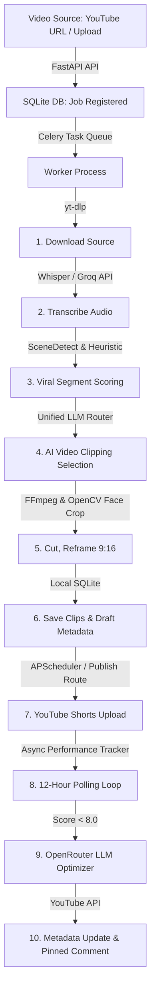
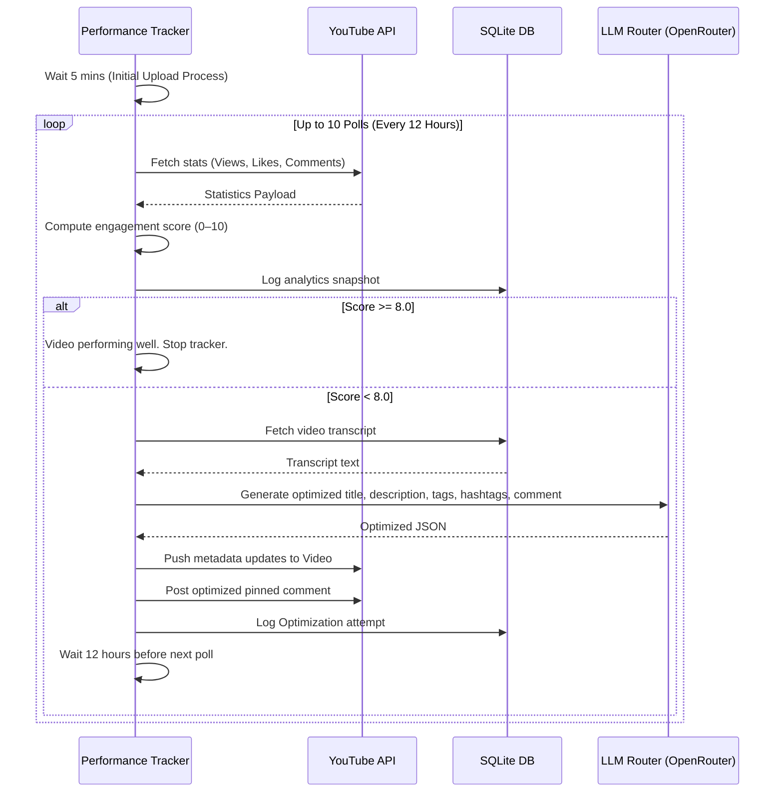

# ClipForge Backend Architecture & Workflow Analysis

This document provides a comprehensive analysis of the ClipForge backend workflow. It serves as a developer guide for editing, extending, or debugging the system.

---

## 1. High-Level Architecture Overview

ClipForge is an AI-powered YouTube automation backend built to ingest source videos, extract viral segments, reframe them to vertical formats (9:16), publish them to YouTube Shorts, and track/auto-optimize post-publish performance.



### Technology Stack
* **Web Framework**: FastAPI (ASGI) for REST APIs and streaming video endpoints.
* **Task Management**: Celery + Redis for heavy, long-running video processing pipelines.
* **Scheduling**: APScheduler (AsyncIOScheduler) embedded in the FastAPI lifespan for periodic channel checks (every 30 mins) and queued scheduling checks (every 1 min).
* **Database**: SQLite (via `aiosqlite` for async application routing and `sqlite3` for synchronous background workers).
* **Video/Audio Manipulation**: FFmpeg subprocesses, PySceneDetect (visual cut markers), OpenCV Haar Cascade (smart face detection for auto-cropping landscape videos).
* **Speech-to-Text**: Whisper (Groq Cloud API with local Whisper fallback).
* **LLM Engine**: Unified router querying OpenRouter (free models prioritized) and Nvidia NIM with automatic failover.

---

## 2. Comprehensive Directory & Module Index

```
backend/
├── main.py                     # FastAPI entrypoint, lifespan event loops, routers and mounts
├── requirements.txt            # System dependencies (FastAPI, SQLAlchemy, Celery, OpenCV, etc.)
├── clipforge.db                # SQLite database storing settings, video, clip, and job records
├── core/
│   └── config.py               # Pydantic settings loading configurations from .env
├── models/
│   ├── database.py             # Engine initialization, database sessions, migration hooks
│   └── models.py               # SQLAlchemy models (Video, Clip, Job, Channel, Metadata, Analytics)
├── api/
│   └── routes/
│       ├── videos.py           # Ingestion: Upload file / YouTube URL processing endpoints
│       ├── clips.py            # Clips: List, edit, download, delete clips
│       ├── jobs.py             # Jobs: Status tracking and manual Celery task cancelation
│       ├── channels.py         # Channels: YouTube channel monitoring config & manual check triggers
│       ├── publish.py          # Publishing: OAuth2 flow, schedule queue, metadata review
│       └── analytics.py        # Analytics: Tracking triggers, metrics retrieve, auto-optimize flags
├── services/
│   ├── downloader.py           # yt-dlp wrapper to grab video files and uploader statistics
│   ├── transcriber.py          # Whisper speech-to-text runner (Groq Cloud / Local fallback)
│   ├── scene_detector.py       # PySceneDetect wrapper to find visual cuts / camera angle shifts
│   ├── clip_scorer.py          # Sliding window builder, heuristic filter & AI segment ranker
│   ├── clip_cutter.py          # FFmpeg utility (cut, scale, overlay blurred BG)
│   ├── publisher.py            # Google OAuth2 client, video uploader, metadata update, comments
│   └── llm_router.py           # Unified LLM dispatcher with ranking, cost filters and automatic failover
├── tasks/
│   ├── process_video.py        # Main Celery worker task running the video processing pipeline
│   └── scheduler.py            # APScheduler execution loop processing queued releases to YouTube
└── new_files/
    ├── metadata_generator.py   # LLM prompt composer generating optimized titles/descriptions/tags
    ├── performance_tracker.py  # Async post-publish polling loop, calculating quality scores
    ├── auto_optimizer.py       # Pushes optimized metadata/pinned comments if view scores underperform
    └── ui_metadata_review.py   # Streamlit application for reviewing and tweaking draft metadata
```

---

## 3. Detailed Step-by-Step Data Flow

### Step 1: Ingestion (`api/routes/videos.py` & `services/downloader.py`)
1. User uploads a file via `/api/videos/upload` or submits a YouTube URL via `/api/videos/url`.
2. A new `Job` record is created in the database with status `pending`.
3. The server dispatches the asynchronous Celery task `process_video` (`tasks/process_video.py`).
4. If a URL is submitted, `yt-dlp` downloads the video stream (`bestvideo[ext=mp4]+bestaudio[ext=m4a]`) and merges it into an MP4 file. The downloader streams stdout back to the task, which maps downloading percentages to job progress (10% to 24%).

### Step 2: Transcription (`services/transcriber.py`)
1. The pipeline calls `transcribe_video` with the downloaded source MP4.
2. If `GROQ_API_KEY` is present, it extracts the audio using FFmpeg (`-acodec libmp3lame -ac 1 -ar 16000`) and posts it to Groq's `whisper-large-v3-turbo` endpoint.
3. If Groq fails or is not configured, it loads the local Whisper model (default `base`) into GPU/CPU memory and executes transcription.
4. Word-level timestamps, segment ranges, and text are returned.
5. The full source text is saved into the `videos` database table.

### Step 3: Scene Detection (`services/scene_detector.py`)
1. In parallel, `detect_scenes` runs PySceneDetect's `ContentDetector` on the source video.
2. It returns a list of cut markers `(start_seconds, end_seconds)` where camera angles change.

### Step 4: Viral Clip Selection (`services/clip_scorer.py`)
1. `build_candidate_windows` slides a temporal window over speech segments to construct candidates ranging from 15 to 60 seconds.
2. It applies a fast **Dialogue Heuristic**:
   * Boosts score for emotional hooks/keywords (*secret, insane, truth, mistake*).
   * Boosts score for punctuation indicators (`!`, `?`).
   * Boosts score if sentences end cleanly (`.`, `!`, `?`).
   * Sweet spot duration: 25–55s (+5.0 points).
   * Incorporates **Visual Activity**: Adds +1.5 points per camera cut in the segment window.
3. If the video is silent or speech is sparse, it generates visual-only candidates in dialogue gaps using scene cuts.
4. Candidates are sorted and filtered to eliminate duplicates (maximum 30% overlap allowed).
5. The top 10 candidates are sent to the **Unified LLM Router** with a viral scoring prompt.
6. The model returns a structured JSON array detailing chosen index positions, titles, viral scores, descriptions, hashtags, and a hook-filled pinned comment.

### Step 5: Cutting & Reframing (`services/clip_cutter.py`)
For each selected candidate, the pipeline executes the following:
1. **Cut Clip**: Cuts the raw segment using FFmpeg:
   ```bash
   ffmpeg -ss {start} -i {source} -t {duration} -c:v libx264 -c:a aac -preset fast -crf 23 {output}
   ```
2. **Reframe 9:16**: Translates landscape video (16:9) to portrait (9:16):
   * **blur (default)**: Scales background to fill 1080x1920, applies box blur (`boxblur=20:10`), and overlays the centered landscape source.
   * **fit**: Fits the landscape video with black bars top and bottom.
   * **crop**: Smart-crops a 9:16 vertical window. If the video contains speakers, it runs OpenCV Haar Cascade face detection, samples 30 frames, finds the median face coordinate `X`, and centers the crop box around it.
4. **Extract Thumbnail**: Grabs a frame at `time=1.0s` as the cover thumbnail.
5. Saves the clip record to the `clips` table and draft metadata to the `metadata` table.

### Step 6: Publishing (`api/routes/publish.py` & `tasks/scheduler.py`)
1. Clips are saved in `draft` status. Users can review them via the frontend or manually edit metadata fields.
2. If published immediately, `publisher.py` accesses YouTube Data API v3, prepends `#Shorts` to the title, appends `#viral` to description tags, uploads the file, and sets the thumbnail.
3. If scheduled, the scheduler updates the status to `queued` with a `scheduled_at` timestamp.
4. The background publisher checks every minute for ready clips, uploads them, and changes their status to `published`.
5. Upon successful upload, it initializes the post-publish **Performance Tracker**.

---

## 4. Performance Tracking & Auto-Optimization

Once a video is published, a background performance tracking cycle starts (`new_files/performance_tracker.py` & `new_files/auto_optimizer.py`).



### Engagement Score Calculation
The performance tracker uses a customized logarithmic formula to evaluate video traction:
$$Score = \min(\text{ViewPoints} + \text{LikeRatio} + \text{CommentRatio}, 10.0)$$

* **View Points**: Log-scaled up to 5 points (hits 5 points at roughly 100k views):
  $$\text{ViewPoints} = \min(\log_{10}(\text{views} + 1), 5.0)$$
* **Like Ratio**: Evaluates likes relative to views, capped at 3 points:
  $$\text{LikeRatio} = \min\left(\frac{\text{likes}}{\text{views}}, 0.3\right) \times 10$$
* **Comment Ratio**: Evaluates comments relative to views, capped at 2 points:
  $$\text{CommentRatio} = \min\left(\frac{\text{comments}}{\text{views}}, 0.2\right) \times 10$$

---

## 5. Unified LLM Router (`services/llm_router.py`)

To minimize operational costs while maintaining processing capabilities, ClipForge incorporates a model dispatcher with failover.

```
       [Prompt Request]
              │
              ▼
    [1. Check OpenRouter API]
    (Fetch active models list)
              │
      ┌───────┴────────┐
      ▼                ▼
[Fetch Success]   [Fetch Failed]
(Rank active list) (Load hardcoded fallbacks)
      │                │
      └───────┬────────┘
              ▼
[Try candidates sequentially]
(Priority: FREE models first, context size >4096, reasoning boosted)
              │
      ┌───────┴───────┐
      ▼ (Success)     ▼ (Error / Timeout / Cooldown)
  [Return Text]    [2. Fallback: Nvidia NIM]
                      │
              ┌───────┴───────┐
              ▼ (Success)     ▼ (Error / Timeout)
          [Return Text]    [Raise RuntimeError]
```

### Model Ranking Criteria:
* **Cost Filtering**: Models with `prompt` and `completion` pricing set to `0.0` are given a $+1000$ points boost.
* **Context Filtering**: Models with context windows less than 4096 tokens are excluded.
* **Reasoning Boosts**:
  * DeepSeek R1 reasoning models: $+300$ points.
  * Llama 3.3 70B & Qwen 72B Instruct: $+150$ points.
  * Gemini Flash models: $+120$ points.
  * Basic Llama/Mistral/Gemma models: $+50$ points.

---

## 6. Database Schema Reference

The tables and fields defined in `backend/models/models.py` are structured as follows:

| Table | Column Name | Type | Key/Index | Description |
| :--- | :--- | :--- | :--- | :--- |
| **videos** | `id` | String | Primary Key | Internal source video UUID |
| | `title` | String(500) | | Source video title (or filename stem) |
| | `youtube_url` | String(500) | | YouTube link if ingested from web |
| | `youtube_id` | String(50) | | Extracted 11-char YouTube video ID |
| | `local_path` | String(1000) | | Absolute file path on disk |
| | `duration` | Float | | Ingestion duration in seconds |
| | `thumbnail_url` | String(500) | | Source video thumbnail image link |
| | `transcript` | Text | | Cached full transcription text |
| | `auto_optimize` | Boolean | Default: True | Master toggle for Phase 5 optimizations |
| **clips** | `id` | String | Primary Key | Generated clip UUID |
| | `video_id` | String | | Foreign Key -> `videos.id` |
| | `title` | String(500) | | Optimized hook title of the clip |
| | `description` | Text | | Clip description |
| | `start_time` | Float | | Offset timestamp in source video |
| | `end_time` | Float | | End timestamp in source video |
| | `duration` | Float | | Duration of cut segment |
| | `score` | Float | | Viral score assigned by LLM/Heuristics |
| | `output_path` | String(1000) | | Path to finalized vertical MP4 |
| | `thumbnail_path` | String(1000) | | Path to generated cover image |
| | `transcript_segment` | Text | | Segment text snippet |
| | `publish_status` | String(50) | Default: 'draft'| State: `draft`, `queued`, `published`, `failed` |
| | `youtube_short_id` | String(50) | | Live YouTube ID after publishing |
| | `scheduled_at` | DateTime | | Scheduled release timestamp |
| | `published_at` | DateTime | | Actual upload completion timestamp |
| **jobs** | `id` | String | Primary Key | Task UUID (matches Celery task ID) |
| | `status` | String(50) | | State: `pending`, `downloading`, `done`, etc. |
| | `progress` | Integer | | Pipeline progress percentage (0-100) |
| | `current_step` | String(200) | | User-friendly stage description |
| | `error_message` | Text | | Error message if processing failed |
| | `celery_task_id` | String(200) | | Celery task ID |
| **metadata** | `video_id` | String | Primary Key | Clip/Video UUID mapping |
| | `title` | String(200) | | Generated hook title |
| | `description` | Text | | Description with tags and call-to-actions |
| | `tags` | String | | Comma-separated tag strings |
| | `hashtags` | String | | Comma-separated high-traffic hashtags |
| | `pinned_comment` | String(150) | | Conversation starter comment text |
| **video_analytics**| `id` | Integer | Primary key | Snapshot ID |
| | `video_id` | String | Indexed | Link to `clips.id` or `videos.id` |
| | `view_count` | Integer | | YouTube view count |
| | `like_count` | Integer | | YouTube like count |
| | `comment_count` | Integer | | YouTube comment thread count |
| | `view_score` | Float | | Evaluated engagement score |
| **optimizations** | `id` | Integer | Primary Key | Optimization attempt ID |
| | `video_id` | String | | Link to target video |
| | `attempt` | Integer | | Index value (e.g., attempt 1, 2, etc.) |
| | `new_title` | String(200) | | Pushed updated hook title |
| | `new_description` | Text | | Pushed updated description |
| | `new_tags` | String | | Updated tags string |
| | `new_hashtags` | String | | Updated hashtags |
| | `view_score` | Float | | Score prior to this optimization attempt |

---

## 7. Developer & Editing Guidelines

When modifying this backend codebase, keep these rules and design patterns in mind:

### Database Transactions
* **Async routes**: Use the `get_db` Dependency Injection helper in FastAPI routes. Make sure all transactions are performed asynchronously via `await db.execute(...)` and `await db.commit()`.
* **Sync background workers**: Celery task executions and the post-publish tracker run inside synchronous contexts. Use the direct SQLite helpers (`sqlite3.connect`) with proper locking timeouts (`timeout=30`) to avoid write locks on the single SQLite file.

### Adding New Video Processing Steps
If you add steps to the video generation process (e.g., face filter overlay, sound normalization, transitions):
1. Register the new phase in `JobStatus` (`models/models.py`).
2. Add your processing script or function under `services/`.
3. In `tasks/process_video.py`, import the service, call it within a try-except block, and update the task status using `update_job_sync(job_id, "your_step", progress_percentage, "Status message")`.

### Extending the LLM Router
* To add new models, edit the hardcoded fallbacks in `get_ranked_openrouter_models` (`services/llm_router.py`).
* To integrate other cloud API providers (e.g., Anthropic, OpenAI):
  1. Add their keys to `Settings` in `core/config.py`.
  2. Implement a `query_provider` function in `services/llm_router.py`.
  3. Include this function in `route_and_generate`'s fallback chain.
