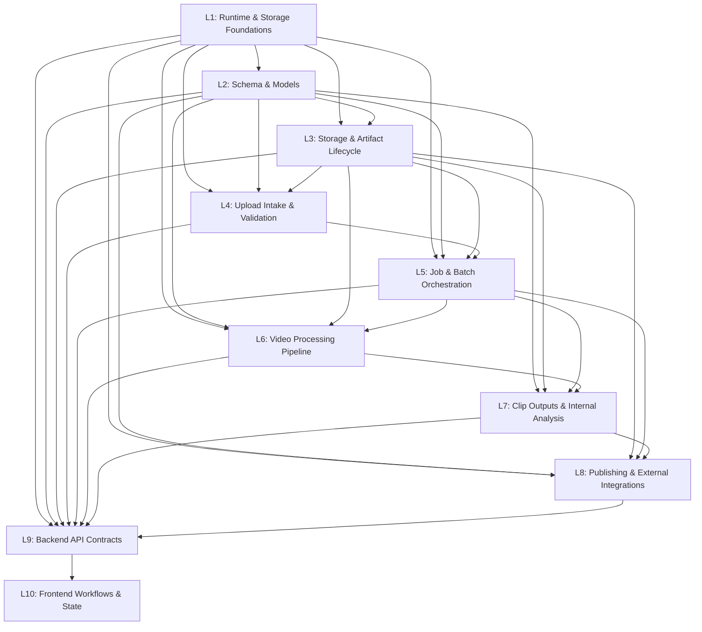

# ClipForge Logic Dependency Map

**Specification:** `ANTIGRAVITY_CLIPFORGE_FREEZE_RULES.md`  
**Master Standard:** `MASTER_ENGINEERING_RULEBOOK.md`  
**Baseline Commit:** `0ba85ff`  
**Current Alembic Head:** `a1b2c3d4e5f6`  
**Last Verified:** 2026-10-13

---

## 1. Architectural Dependency Graph

---

## 2. Domain-by-Domain Dependency Specifications

### L1: Runtime, Configuration & Security Foundations
- **Primary Paths:**
  - `backend/core/config.py` (`Settings`, `get_settings`)
  - `backend/core/storage.py` (`LocalStorageService`, path boundaries)
  - `backend/core/storage_identity.py` (`generate_canonical_hash`)
  - `backend/core/task_execution.py` (`TaskExecutionTracker`)
  - `docker-compose.yml`, `.env`, `.env.example`
- **Shared Contracts:**
  - Base configuration environment variables (`DATABASE_URL`, `REDIS_URL`, `UPLOAD_DIR`, `STORAGE_DIR`, `GOOGLE_CLIENT_ID`, `GOOGLE_CLIENT_SECRET`)
- **Upstream Gates:** None (Root Foundation)
- **Downstream Regression Suites:** All backend test suites (`test_storage_durability.py`, `test_upload_studio_phase1b_runtime.py`)

---

### L2: Data Model and Schema Lifecycle
- **Primary Paths:**
  - `backend/models/models.py` (`Video`, `Clip`, `Job`, `Channel`, `PublishRecord`, `UploadBatch`, `BatchVideoItem`, `VideoDecision`, `VideoDecisionStatus`)
  - `backend/models/database.py` (`Base`, `engine`, `SyncSessionLocal`, `AsyncSessionLocal`)
  - `backend/models/db_sync.py`, `backend/models/artifact_sync.py`
  - `backend/models/hook.py`, `backend/models/layout.py`, `backend/models/dubbing.py`
  - `backend/alembic/versions/*.py` (Migration history through `a1b2c3d4e5f6`)
- **Shared Contracts:**
  - SQLAlchemy model definitions, relational foreign keys, cascade delete rules, enum types (`JobStatus`, `BatchStatus`, `VideoItemStatus`, `VideoDecisionStatus`), and `Job.is_test` partition flag
- **Upstream Gates:** L1 (Database connection and credentials)
- **Downstream Regression Suites:**
  - `test_upload_studio_phase1a_migration.py` (14 tests)
  - `test_job_state_queue_and_cancellation_repair.py` (5 tests)
  - `test_automatic_channel_monitoring_and_decision_lifecycle.py` (15 tests)
  - `alembic -c backend/alembic.ini current`

---

### L3: Storage and Artifact Lifecycle
- **Primary Paths:**
  - `backend/core/storage.py`
  - `backend/services/artifact_manager.py`
  - `backend/cleanup_storage.py`
  - `backend/models/artifact_sync.py`
- **Shared Contracts:**
  - Single-writer file locks, atomic reservation allocation/release, isolated storage roots (`/app/uploads/`, `/app/outputs/`)
- **Upstream Gates:** L1, L2
- **Downstream Regression Suites:**
  - `test_storage_durability.py` (3 tests)
  - `test_upload_studio_phase1b_runtime.py` (13 tests)

---

### L4: Upload Intake and Media Validation
- **Primary Paths:**
  - `backend/api/routes/studio.py` (`initialize_batch`, `initialize_video_item`, `upload_video_chunk`, `finalize_video_item`)
  - `backend/services/output_validator.py` (`validate_video_file`, `get_video_duration`)
  - `backend/tasks/studio_tasks.py`
- **Shared Contracts:**
  - RFC 7233 byte-range chunk protocol, FFprobe container/codec validation schemas
- **Upstream Gates:** L1, L2, L3
- **Downstream Regression Suites:**
  - `test_upload_studio_phase1b_runtime.py` (13 tests)
  - `frontend/test/studio_backend_e2e.test.mjs` (6 tests)
  - `frontend/test/studio_real_browser_e2e.test.mjs` (11 tests)

---

### L5: Batch and Job Orchestration
- **Primary Paths:**
  - `backend/tasks/celery_app.py`
  - `backend/tasks/orchestration.py` (`start_video_processing_task`, `stale_recovery_task`)
  - `backend/tasks/scheduler.py`
  - `backend/tasks/studio_tasks.py` (`process_studio_batch_task`, `recover_stale_studio_batches_task`)
  - `backend/api/routes/jobs.py`
- **Shared Contracts:**
  - Celery task signatures, Celery beat scheduled periodic intervals, Redis task queues
- **Upstream Gates:** L1, L2, L3, L4
- **Downstream Regression Suites:**
  - `test_orchestration.py` (1 live end-to-end load test)
  - `test_pipeline_config_fixes.py` (18 tests)
  - `test_job_cancellation_and_aggregation.py` (3 tests)
  - `test_job_state_queue_and_cancellation_repair.py` (5 tests)

---

### L6: Core Video-Processing Pipeline
- **Primary Paths:**
  - `backend/tasks/video_tasks.py` (`reframe_clip`, `render_clip`)
  - `backend/services/clip_cutter.py`
  - `backend/services/reframe_engine.py`
  - `backend/services/scene_detector.py`
  - `backend/services/sfx_mixer.py`
  - `backend/services/voiceover_engine.py`
  - `backend/services/dubbing_engine.py`
- **Shared Contracts:**
  - FFmpeg command generators, resolution filters, audio ducking formulas, layout schemas (`backend/models/layout.py`)
- **Upstream Gates:** L1, L2, L3, L5
- **Downstream Regression Suites:**
  - `test_equal_splits.py` (5 tests)
  - `test_layout_engine.py` (4 tests)
  - Multi-worker parallel encoding load test

---

### L7: Clip Outputs and Internal Analysis
- **Primary Paths:**
  - `backend/services/clip_scorer.py`
  - `backend/services/metadata_generator.py`
  - `backend/services/auto_optimizer.py`
  - `backend/services/segmentation.py`
  - `backend/services/transcriber.py`
  - `backend/tasks/analysis_tasks.py`
- **Shared Contracts:**
  - Scoring models, candidate set hash generation, internal transcription payloads (scoring-only, no caption burn-in)
- **Upstream Gates:** L2, L3, L5, L6
- **Downstream Regression Suites:**
  - `test_optimizer.py` (1 test)
  - `test_upload_studio_phase2_processing.py` (10 tests)
  - `test_channel_video_selection_workflow.py` (candidate scoring tests)

---

### L8: Publishing and External Integrations
- **Primary Paths:**
  - `backend/services/publisher.py` (`upload_short`, `get_channel_info`, `check_auth_status`, `get_oauth_url`, `exchange_code_for_token`, `update_video_metadata`)
  - `backend/api/routes/publish.py` (`POST /api/publish/publish-now`, `/api/publish/schedule`)
  - `backend/tasks/clip_tasks.py` (`publish_clip_task`)
  - `backend/services/channel_monitor.py`
  - `backend/services/smart_scheduler.py`
- **Shared Contracts:**
  - YouTube Data API v3 resumable upload protocols, `VideoTrackingQueue` database schema and queue payloads, multi-destination records (`PublishDestination`)
- **Upstream Gates:** L1, L2, L3, L5, L7
- **Downstream Regression Suites:**
  - `test_upload_studio_phase3_publishing.py` (15 tests)
  - `test_publish_concurrency.py` (1 test)
  - `test_multi_destination_publishing.py` (7 tests)
  - `test_youtube_reconciliation.py` (3 tests)
  - `test_tracker.py` (4 tests)
  - `test_channel_video_selection_workflow.py` (destination resolution and authorization tests)

---

### L9: Backend API Contracts
- **Primary Paths:**
  - `backend/main.py`
  - `backend/api/routes/studio.py`
  - `backend/api/routes/publish.py`
  - `backend/api/routes/clips.py`
  - `backend/api/routes/videos.py`
  - `backend/api/routes/channels.py`
  - `backend/api/routes/jobs.py`
  - `backend/api/routes/dubbing.py`
- **Shared Contracts:**
  - Pydantic v2 schemas, JSON response envelopes, FastAPI router tags and prefix hierarchies
- **Upstream Gates:** L1–L8 contracts
- **Downstream Regression Suites:**
  - `frontend/test/api_contract.test.mjs` (4 tests)
  - `frontend/test/routes.test.mjs` (2 tests)
  - `frontend/test/validation.test.mjs` (4 tests)
  - `test_job_cancellation_and_aggregation.py` (cancellation route tests)
  - `test_channel_video_selection_workflow.py` (channel filtering & video URL tests)

---

### L10: Frontend Workflows and User-Facing State
- **Primary Paths:**
  - `frontend/app/**` (`studio/page.tsx`, `publish/page.tsx`, `clips/page.tsx`, `analytics/page.tsx`, `page.tsx`)
  - `frontend/components/**` (`Sidebar.tsx`, `RetentionHeatmap.tsx`)
  - `frontend/lib/**` (`studioApi.ts`, `studioStorage.ts`, `api.ts`)
- **Shared Contracts:**
  - REST client DTOs, IndexedDB storage keys, WebSocket/polling state transitions
- **Upstream Gates:** L9 API contracts
- **Downstream Regression Suites:**
  - `npx tsc --noEmit` (TypeScript type check)
  - `npm run build` (Next.js production build)
  - `frontend/test/studio_functional.test.mjs` (7 tests)
  - `frontend/test/studio_real_browser_e2e.test.mjs` (11 tests)

---

## 3. Shared Boundary Files Requiring Extra Approval

The following files cross multiple logic boundaries and must be protected against accidental modification:
1. `backend/models/models.py` (Crosses L2, L5, L7, L8)
2. `backend/api/routes/studio.py` (Crosses L4, L5, L9)
3. `backend/services/publisher.py` (Crosses L8, L9)
4. `backend/core/storage.py` (Crosses L1, L3, L4, L6)
5. `backend/tasks/celery_app.py` (Crosses L1, L5, L6, L8)
