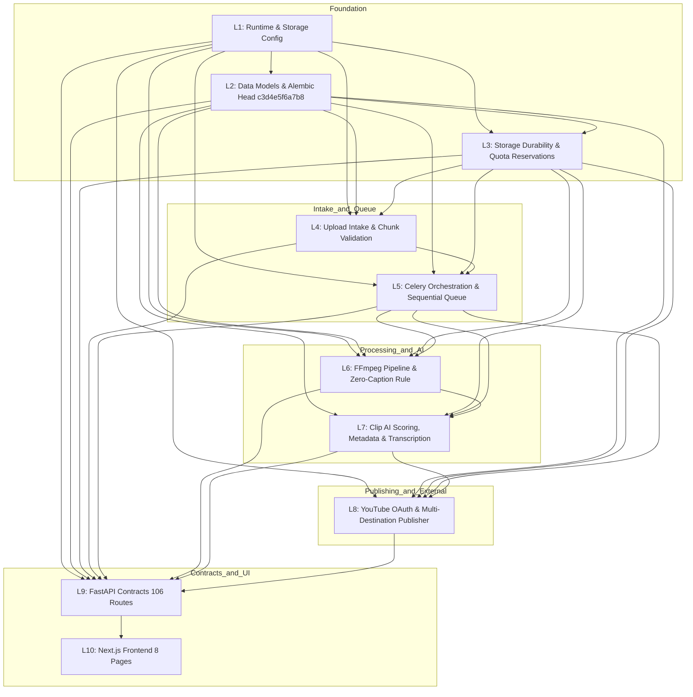

# CLIPFORGE — PHASE 0 SYSTEM DISCOVERY & PHASED REMEDIATION ROADMAP

**Document Type:** Canonical Forensic Discovery & Phased Engineering Architecture Roadmap  
**Author:** Antigravity AI Coding Agent  
**Date:** 2026-10-13  
**Repository Root:** `d:\automation video clips\clipforge`  
**Governing Rulebooks:** `MASTER_ENGINEERING_RULEBOOK.md`, `ANTIGRAVITY_CLIPFORGE_FREEZE_RULES.md`  
**Baseline Git Commit:** `0ba85ff`  
**Database Head Migration:** `c3d4e5f6a7b8`  
**Active Test Baseline:** 42 / 42 Core Backend Tests Passed | Next.js Build Clean (11/11 Routes)

---

## 1. Executive Summary & Mission Scope

ClipForge has accumulated rich capabilities spanning intake, processing, clipping, AI scoring, multi-destination publishing, 24/7 channel automation, and batch Upload Studio pipelines. However, previous broad fixes and historical audits created fragile boundaries and undocumented cross-layer gaps where frontend controls assume endpoints that do not exist, or backend endpoints exist with zero user-facing accessibility.

### Phase 0 Mandate
To ensure permanent system stability, **zero functional code fixes are applied in this session**. Instead, this session establishes:
1. Complete verification of live backend routes (106 registered routes) and frontend UI surfaces (8 Next.js pages).
2. Forensic identification and documentation of all cross-layer disconnects, broken links, missing handlers, contract mismatches, and false documentation claims.
3. End-to-end tracing across all 10 Logic Domains (L1 through L10).
4. A disciplined, sequential, gated Phased Remediation Roadmap where future sessions tackle exactly one tightly coupled scope at a time under the freeze protocol.

---

## 2. Inventory Re-Verification

### 2.1 Backend Endpoint Inventory Audit (`BACKEND_ENDPOINT_INVENTORY.md`)
FastAPI runtime reflection on `backend.main:app` enumerates **106 registered routes** across 10 routers and root mounts:

| Router Module | Route Count | Primary Path Prefix | Core Capabilities | Verified Status |
|---|---|---|---|---|
| `main.py` | 5 | `/api/health`, `/api/stats`, `/docs`, `/redoc`, `/openapi.json` | Active health check (DB/Redis/Worker), aggregate metrics, OpenAPI docs | Verified working |
| `videos.py` | 5 | `/api/videos/*` | YouTube URL ingestion (`/url`), batch ingestion (`/batch`), file upload (`/upload`), video details & listing | Verified working |
| `clips.py` | 19 | `/api/clips/*` | Clip CRUD, downloads, thumbnails, metadata, retention heatmaps, B-roll plans/apply, SFX plans/apply, Hook plans/apply, autofix | **Partially Disconnected** (7 AI sub-endpoints lack UI controls) |
| `jobs.py` | 9 | `/api/jobs/*` | Active jobs, history, queue count, stats, WebSocket status, cancel job (`DELETE`), retry job | Verified working |
| `channels.py` | 14 | `/api/channels/*` | Monitored channels CRUD, manual check, recent videos, video decisions (pending/defaults/customize/history), single & batch video queuing | Verified working (Repairs verified) |
| `publish.py` | 15 | `/api/publish/*` | OAuth URL/callback, channel info, destinations, default destination, publish now, scheduled publish, queue, per-clip status, retry, cancel, metadata | **Partially Disconnected** (Retry/Cancel lack UI triggers) |
| `youtube_channels.py` | 8 | `/api/youtube-channels/*` | Multi-channel destination listing, connect, disconnect, OAuth, refresh stats, default selection, publishing settings | Verified working (Full E2E verified) |
| `studio.py` | 15 | `/api/studio/*` | Upload Studio Phase 1-3: chunked resumable upload, batches, sequential queue, video item lifecycle, cancellation, recovery, outputs | Verified working (Phase 1-3 test suite verified) |
| `analytics.py` | 11 | `/api/analytics/*` | Pipeline telemetry summary, video analytics, active tracking, cancel tracker, auto-optimizer triggers & logs, SEO analysis, A/B experiments, channel insights | **Partially Disconnected** (8 endpoints lack frontend UI) |
| `dubbing.py` | 2 (3 paths) | `/api/dubbing/*`, `/api/clips/{id}/dub`, `/clips/{id}/dub` | Phase 15 multi-language auto-dubbing task trigger | **Completely Disconnected** (0 frontend callers) |
| Static Mounts | 2 | `/outputs`, `/uploads` | Local media file streaming | Verified working |
| **Total** | **106** | — | — | **100% Discoverable** |

### 2.2 Frontend Surface Audit (`FRONTEND_INTERACTION_ENDPOINT_MAP.md`)
Audit of all 8 Next.js pages under `frontend/app/`:

| Page Route | Interactive Controls | Connected API Methods | Discovered Gaps & Status |
|---|---|---|---|
| **`/` (Dashboard)** | 12 | `getStats`, `getActiveJobs`, `getVideos`, `checkHealth`, `submitVideoUrl`, `submitBatchYouTubeUrls`, `uploadVideoFile`, `cancelJob`, `retryJob`, `getJobStats` | Fully wired. Real-time active job polling, cancel/retry working, IST timestamps formatted. |
| **`/automation`** | 24 | `listChannels`, `addChannel`, `getChannelVideos`, `processChannelVideosBatch`, `processChannelVideo`, `getPendingDecisions`, `applyDefaultsDecision`, `customizeDecision`, `saveAndProcessDecision`, `cancelDecision`, `checkChannelNow` | Fully wired. Checkboxes, batch action bar, and dashboard link repaired and verified. |
| **`/studio`** | 18 | `createStudioBatch`, `getStudioBatch`, `initStudioVideo`, `streamFileInChunks`, `processStudioBatch`, `cancelStudioBatch`, `retryStudioVideo`, `getBatchOutputs` | Fully wired. Resumable chunking, IndexedDB staging, drag-and-drop queue working. |
| **`/youtube-channels`** | 14 | `getYoutubeChannels`, `getYoutubeOAuthUrl`, `connectYoutubeChannel`, `refreshYoutubeChannelStats`, `updateYoutubeChannelSettings`, `setPrimaryDefaultDestination`, `disconnectYoutubeChannel` | Fully wired. Glassmorphic cards, settings modals, stats refresh, and token isolation working. |
| **`/publish`** | 15 | `getDestinations`, `publishNow`, `schedulePublish`, `getPublishQueue`, `getAuthStatus`, `submitOAuthCode`, `listClips` | **Gap Identified:** Queue shows items, but `cancelPublish` and `retryPublish` buttons are absent in the UI. |
| **`/clips`** | 16 | `listClips`, `getClip`, `updateClip`, `deleteClip`, `downloadClipUrl`, `thumbnailUrl`, `getClipMetadata` | **Critical Gaps Identified:** 1. `previewCleanup` & `executeCleanup` called on `/clips`, but backend endpoints do NOT exist. 2. `RetentionHeatmap.tsx` uses relative fetch paths missing `API_BASE`. 3. B-roll, SFX, and Hook generation endpoints have no UI triggers. |
| **`/analytics`** | 10 | `getPipelineSummary`, `getABTests`, `getChannelInsights` | **Gap Identified:** Only aggregate cards rendered. No per-video SEO lookup, no tracking queue management, no manual auto-optimizer trigger UI. |
| **`/settings`** | 6 | Local form inputs only | **Gap Identified:** Form saves to `localStorage` only; no backend settings API exists; documentation falsely claimed storage cleanup was on this page. |

---

## 3. Forensic Log of System Discrepancies & Disconnects

Through comprehensive source analysis, 8 distinct defects, disconnects, and documentation inaccuracies were uncovered:

### Discrepancy 1: Missing Backend Endpoints for Storage Cleanup on `/clips`
- **Frontend Code:** `frontend/app/clips/page.tsx:253,266` invokes `previewCleanup()` and `executeCleanup()` from `frontend/lib/api.ts:129-130`.
- **Target Backend Routes:** `GET /api/clips/cleanup/preview` and `POST /api/clips/cleanup/execute`.
- **Reality:** Neither endpoint exists in `backend/api/routes/clips.py` or anywhere in the backend!
- **Runtime Consequence:** Clicking "Preview Cleanup" or "Execute Cleanup" triggers HTTP 404, throwing a browser alert error.
- **Documentation Inaccuracy:** `FRONTEND_INTERACTION_ENDPOINT_MAP.md` claimed storage cleanup was on `/settings` and marked it "Verified working".

### Discrepancy 2: Broken Cross-Origin / Relative URLs in `RetentionHeatmap.tsx`
- **Frontend Code:** `frontend/components/RetentionHeatmap.tsx:34,61,77,81` executes raw `fetch()` calls:
  - `fetch('/api/clips/${clipId}/retention')`
  - `fetch('/api/clips/${clipId}/autofix', { method: 'POST' })`
  - `fetch('/api/clips/${clipId}/sfx-plan')`
  - `fetch('/api/clips/${clipId}/sfx-apply', { method: 'POST', ... })`
- **Reality:** None of these calls prepend `API_BASE` (`http://localhost:8000`) or use the client wrapper in `@/lib/api`.
- **Runtime Consequence:** Because Next.js runs on port 3000 and has no API rewrites configured in `next.config.ts`, these requests hit `http://localhost:3000/api/clips/...`, returning 404 HTML pages and failing silently or throwing errors.

### Discrepancy 3: Missing Publishing Queue Action Controls on `/publish`
- **Backend Endpoints:** `POST /api/publish/clips/{clip_id}/cancel` (`BE-PUB-014`) and `POST /api/publish/clips/{clip_id}/retry` (`BE-PUB-015`).
- **Client Library:** `cancelPublish` and `retryPublish` exported in `frontend/lib/api.ts:444,450`.
- **Reality:** Neither function is imported or rendered in `frontend/app/publish/page.tsx`.
- **Runtime Consequence:** If a scheduled or in-progress publish job encounters an error or needs cancellation, the user has no UI mechanism to cancel or retry it.
- **Documentation Inaccuracy:** `FRONTEND_INTERACTION_ENDPOINT_MAP.md` claimed these controls were present and verified on `/publish`.

### Discrepancy 4: Unwired Clip AI Enhancements (B-Roll, SFX, Hooks)
- **Backend Endpoints:**
  - `GET /api/clips/{clip_id}/broll-plan`, `POST /api/clips/{clip_id}/broll-apply`
  - `GET /api/clips/{clip_id}/sfx-plan`, `POST /api/clips/{clip_id}/sfx-apply`
  - `GET /api/clips/{clip_id}/hook`, `POST /api/clips/{clip_id}/hook/plan`, `POST /api/clips/{clip_id}/hook/apply`
- **Reality:** None of these endpoints have typed helper functions in `frontend/lib/api.ts` (except raw broken calls in `RetentionHeatmap.tsx`), and there is no B-roll or Hook Title generation UI in `/clips`.
- **Runtime Consequence:** Advanced AI video enhancement features exist in backend services (`reframe_engine.py`, `sfx_mixer.py`, `hook_tasks.py`) but cannot be triggered or reviewed by the user.

### Discrepancy 5: Disconnected Per-Video Analytics & Optimization UI
- **Backend Endpoints:**
  - `GET /api/analytics/{video_id}` (`get_analytics`)
  - `GET /api/analytics/active` (`list_active`)
  - `POST /api/analytics/track/{video_id}` (`start_tracker`)
  - `POST /api/analytics/cancel/{task_id}` (`cancel_tracker`)
  - `POST /api/analytics/optimize/{video_id}` (`trigger_optimizer`)
  - `PATCH /api/analytics/optimize/{video_id}/flag` (`set_auto_optimize_flag`)
  - `GET /api/analytics/optimize/{video_id}/log` (`get_optimization_log`)
  - `GET /api/analytics/seo/{video_id}` (`get_seo_analysis`)
- **Reality:** `frontend/app/analytics/page.tsx` only calls `getPipelineSummary()`, `getABTests()`, and `getChannelInsights()`.
- **Runtime Consequence:** 8 powerful endpoints for tracking video performance, viewing SEO recommendations, triggering auto-optimization, and checking logs are completely inaccessible from the frontend.

### Discrepancy 6: Completely Unwired Dubbing Subsystem
- **Backend Endpoints:** `POST /api/dubbing/{clip_id}`, `POST /api/clips/{clip_id}/dub`, `POST /clips/{clip_id}/dub`.
- **Backend Service:** `backend/services/dubbing_engine.py`, `backend/tasks/dubbing_tasks.py`.
- **Reality:** 0 calls in `frontend/lib/api.ts` and 0 UI components across the frontend.
- **Runtime Consequence:** Multi-language dubbing is a backend-only prototype with no frontend integration.

### Discrepancy 7: Settings Page Simulates Persistence via LocalStorage
- **Frontend Code:** `frontend/app/settings/page.tsx:33-46` saves environment settings to browser `localStorage` and instructs the user to manually edit `.env` and restart the server.
- **Backend Status:** No `/api/settings` endpoint exists.
- **Runtime Consequence:** User edits on `/settings` have zero impact on backend clipping thresholds, Ollama endpoints, or Whisper models.

### Discrepancy 8: Database Migration Head Discrepancy in Documentation
- **Ledger & Dependency Map:** State migration head as `a1b2c3d4e5f6` or `f3b4c5d6e7f8`.
- **Actual Alembic Current Output:** `c3d4e5f6a7b8 (head)` (added `publishing_settings` and `cached_stats` for channels).
- **Resolution:** Freeze ledger and continuity records must be updated to reflect `c3d4e5f6a7b8` as the canonical database baseline.

---

## 4. Cross-Layer Architecture & Logic Domain Mapping (L1–L10)

### Invariants Protected Across All Domains:
1. **Zero Caption/Subtitle Burn-In:** Transcription is exclusively for internal scoring and metadata. No subtitle burn-in, ASS/SRT filters, or drawtext filters.
2. **Shorts Duration Limit:** All generated shorts strictly capped at `<= 30.0s`.
3. **Storage Durability:** Uploaded media cannot be deleted while active jobs or batches reference it. Reservations are released exactly once.
4. **Sequential Processing:** Batch items and video processing maintain strict FIFO queue ordering.
5. **No Auto-Publishing:** Uploading, processing, and publishing remain decoupled lifecycle stages.

---

## 5. Phased Remediation Roadmap

To prevent regressions and ensure verified progress, all future remediation must follow this strict, sequential, single-scope phased roadmap. Each phase must satisfy its dependency gate and pass its verification protocol before its baseline is frozen and work proceeds to the next phase.

```mermaid
flowchart LR
    P0[Phase 0: System Discovery] --> P1[Phase 1: API & Client Alignment]
    P1 --> P2[Phase 2: Clips Studio & AI Enhancements]
    P2 --> P3[Phase 3: Publishing Queue Governance]
    P3 --> P4[Phase 4: Analytics & Optimization Dashboard]
    P4 --> P5[Phase 5: Dynamic System Settings]
    P5 --> P6[Phase 6: Multi-Language Dubbing]
    P6 --> P7[Phase 7: End-to-End System Lock]
```

---

### Phase 1: API Contract & Client Library Alignment
- **Scope:** Repair broken client URLs, add missing backend endpoints for storage cleanup, add missing typed client methods, and reconcile audit inventories.
- **Affected Domains:** L2 (Models), L3 (Storage), L9 (API Contracts), L10 (Frontend Client).
- **Upstream Dependency Gates:** L1, L2, L3 frozen baselines confirmed intact.
- **Concrete Technical Changes:**
  1. Fix `frontend/components/RetentionHeatmap.tsx`: Replace relative `fetch('/api/clips/...')` with `API_BASE` prepended or use `api.ts` client helpers.
  2. Implement backend cleanup endpoints in `backend/api/routes/clips.py`:
     - `GET /api/clips/cleanup/preview` -> calls `backend.cleanup_storage.preview()` and returns removable clips count and reclaimable bytes.
     - `POST /api/clips/cleanup/execute` -> calls `backend.cleanup_storage.cleanup()` safely and returns deleted count.
  3. Expand `frontend/lib/api.ts` with typed helpers for:
     - B-roll: `getClipBrollPlan(clipId)`, `applyClipBroll(clipId, plan)`
     - SFX: `getClipSfxPlan(clipId)`, `applyClipSfx(clipId, plan)`
     - Hooks: `getClipHook(clipId)`, `generateClipHookPlan(clipId)`, `applyClipHookPlan(clipId, plan)`
     - Dubbing: `triggerDubbing(clipId, request)`
     - Analytics: `getVideoAnalytics(videoId)`, `startVideoTracker(videoId)`, `cancelVideoTracker(taskId)`, `triggerVideoOptimizer(videoId)`, `getVideoSEO(videoId)`
  4. Update `BACKEND_ENDPOINT_INVENTORY.md` and `FRONTEND_INTERACTION_ENDPOINT_MAP.md` to match reality.
- **Verification Protocol:**
  - Pytest API tests for `cleanup/preview` and `cleanup/execute` (2/2 passing).
  - TypeScript build check (`npx tsc --noEmit` -> 0 errors).
  - Browser inspection of `RetentionHeatmap` ensuring zero 404 network errors.
- **Freeze Gate:** Re-freeze L9 and L10.

---

### Phase 2: Clips Studio & AI Enhancement Workflow
- **Scope:** Complete the `/clips` page UI to expose B-roll, SFX, and Hook generation, and fix cleanup execution feedback.
- **Affected Domains:** L6 (Video Processing), L7 (Clip Outputs), L9 (API Contracts), L10 (Frontend Workflows).
- **Upstream Dependency Gates:** Phase 1 complete and frozen.
- **Concrete Technical Changes:**
  1. In `frontend/app/clips/page.tsx`:
     - Add interactive AI Enhancement Drawer/Tabs in the Clip Preview Modal:
       * **Hook Optimizer:** View suggested viral hooks (`GET /api/clips/{id}/hook`), generate new hooks (`POST .../hook/plan`), and apply chosen hook text to clip metadata.
       * **B-Roll Layer:** Preview B-roll insertion timestamps (`GET .../broll-plan`) and trigger B-roll overlay render (`POST .../broll-apply`).
       * **Auto-SFX:** Preview detected high-energy impact points (`GET .../sfx-plan`) and apply sound effects (`POST .../sfx-apply`).
     - Wire cleanup preview modal properly with disk space reclaimed metrics.
  2. Enforce the **Zero-Caption Rule**: Verify that B-roll and Hook additions generate clean video without burnt-in subtitles.
- **Verification Protocol:**
  - Automated tests verifying B-roll and SFX plan generation and execution (`test_broll_sfx_pipeline.py`).
  - Next.js build clean (`npm run build`).
  - Real browser verification of Clip Preview Modal with interactive AI tabs.
- **Freeze Gate:** Re-freeze L6, L7, L10.

---

### Phase 3: Publishing Management & Queue Governance
- **Scope:** Connect missing publishing queue actions, live per-clip status tracking, and metadata editing on `/publish`.
- **Affected Domains:** L5 (Orchestration), L8 (Publishing), L9 (API Contracts), L10 (Frontend Workflows).
- **Upstream Dependency Gates:** Phase 2 complete and frozen.
- **Concrete Technical Changes:**
  1. In `frontend/app/publish/page.tsx`:
     - Add "Cancel" button on queued publishing items calling `cancelPublish(clipId)`.
     - Add "Retry" button on failed publishing items calling `retryPublish(clipId)`.
     - Add status badge polling `getPublishStatus(clipId)` for active uploads showing progress percentage, retry attempt, and stage.
  2. Connect metadata editor: Allow pre-filling and updating title/description/tags via `GET /api/publish/metadata/{video_id}` and `POST /api/publish/metadata/{video_id}`.
- **Verification Protocol:**
  - Unit and integration tests for publish queue cancellation and retry (`test_publish_queue_controls.py`).
  - Browser verification on `/publish` testing cancellation and retry flows with mock publisher.
- **Freeze Gate:** Re-freeze L5, L8, L10.

---

### Phase 4: Analytics, SEO & Optimization Dashboard
- **Scope:** Complete `/analytics` with per-video SEO diagnostics, active tracking queue management, and manual optimization triggers.
- **Affected Domains:** L7 (Analysis), L8 (Integrations), L9 (API Contracts), L10 (Frontend Workflows).
- **Upstream Dependency Gates:** Phase 3 complete and frozen.
- **Concrete Technical Changes:**
  1. In `frontend/app/analytics/page.tsx`:
     - Add a "Video Performance Drilldown" section with a video selector dropdown.
     - Render detailed SEO analysis (`GET /api/analytics/seo/{video_id}`): Title score, description sentiment, tag density, and recommendations.
     - Add "Manual Optimize" button calling `POST /api/analytics/optimize/{video_id}` with progress and log drawer (`GET .../log`).
     - Render "Active Tracking Queue" table calling `GET /api/analytics/active` with "Cancel Tracking" button (`POST .../cancel/{task_id}`).
- **Verification Protocol:**
  - Backend pytest tests for SEO and analytics endpoints (`test_analytics_routes.py`).
  - Browser verification of `/analytics` with populated video drilldown and SEO cards.
- **Freeze Gate:** Re-freeze L7, L8, L10.

---

### Phase 5: Dynamic System Settings & Configuration Persistence
- **Scope:** Replace `localStorage` simulation on `/settings` with real backend settings persistence.
- **Affected Domains:** L1 (Runtime Config), L9 (API Contracts), L10 (Frontend Workflows).
- **Upstream Dependency Gates:** Phase 4 complete and frozen.
- **Concrete Technical Changes:**
  1. Add backend settings router `backend/api/routes/settings.py` (mounted at `/api/settings`):
     - `GET /api/settings`: Returns non-secret runtime configuration (Ollama models, Whisper model, clips per video, check interval, storage limits). Masks secrets.
     - `PATCH /api/settings`: Validates and dynamically updates runtime configuration in `Settings` and persists overrides to `.env.local` or DB config store.
  2. Update `frontend/app/settings/page.tsx`: Fetch current configuration on mount, save via `PATCH /api/settings`, and display real backend confirmation.
- **Verification Protocol:**
  - Pytest tests for settings retrieval, masking, and validation (`test_settings_api.py`).
  - Security audit verifying zero secrets leaked in API responses.
  - Browser verification of settings save and reload.
- **Freeze Gate:** Re-freeze L1, L9, L10.

---

### Phase 6: Multi-Language Dubbing Integration (Optional / User-Approved)
- **Scope:** Wire Phase 15 multi-language dubbing into the frontend with voice cloning authorization checks.
- **Affected Domains:** L6 (Processing), L7 (Analysis), L9 (API Contracts), L10 (Frontend Workflows).
- **Upstream Dependency Gates:** Phase 5 complete and frozen.
- **Concrete Technical Changes:**
  1. Add "Dub Clip" modal in `/clips` allowing selection of target language (`es`, `fr`, `de`, `hi`, `ja`) and voice cloning toggle.
  2. Implement authorization modal ensuring `authorization_granted=True` is explicitly confirmed for voice cloning.
  3. Clean up route decorator redundancy in `backend/api/routes/dubbing.py`.
- **Verification Protocol:**
  - Dubbing task unit tests (`test_dubbing_variant.py`).
  - Browser verification of dubbing modal and voice clone authorization gate.
- **Freeze Gate:** Re-freeze L6, L7, L9, L10.

---

### Phase 7: End-to-End System Lock & Final Regression Gate
- **Scope:** Execute full-system cross-layer verification across all 10 Logic Domains and lock the final verified baseline.
- **Affected Domains:** All Domains (L1–L10).
- **Upstream Dependency Gates:** Phases 1 through 6 complete.
- **Verification Protocol:**
  1. Full backend pytest regression run: all unit, integration, and E2E tests passing (100% pass rate).
  2. Next.js type check (`npx tsc --noEmit`) clean (0 errors).
  3. Next.js production build (`npm run build`) clean (all routes prerendered).
  4. Real browser automation audit: 8/8 pages loaded, zero console errors, interactive controls verified.
  5. Final update to `LOGIC_FREEZE_LEDGER.md`, `LOGIC_DEPENDENCY_MAP.md`, `IMPLEMENTATION_STATUS.md`, and `PROJECT_CONTINUITY.md`.
- **Freeze Gate:** All 10 Domains set to `FROZEN`.

---

## 6. Multi-Agent Governance & Hand-Off Protocol

When a new session opens or a different agent takes over:
1. **Never skip Phase gates:** Always execute the active phase completely and freeze its baseline before moving to the next.
2. **Never break invariants:** Subtitle burn-in is strictly prohibited; Shorts duration is capped at 30s; PostgreSQL data and schema are protected.
3. **Always document in records:** Update `IMPLEMENTATION_STATUS.md` and `PROJECT_CONTINUITY.md` at each step.
4. **Evidence over assumptions:** Mark an item verified only after actual test execution output is logged in the current environment.
