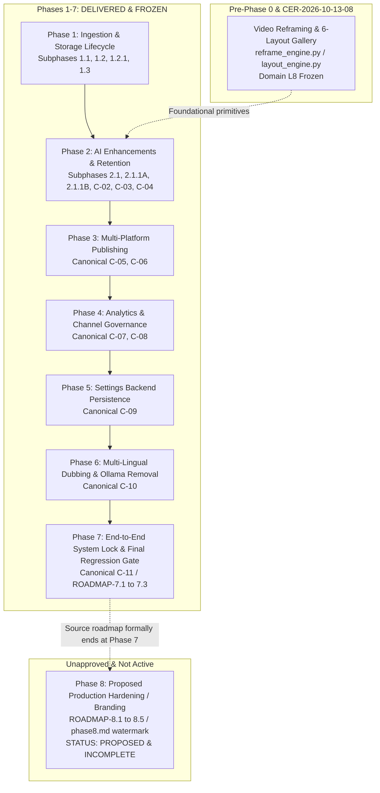

# ClipForge — Master Cross-Verification Audit: Phase 1 Through Phase 8
## Double Cross-Verification, Completion Certification & Reconciliation Report

**Document Type:** Authoritative Master Engineering Audit & Dual Cross-Verification Report  
**Execution Timestamp:** 2026-10-25T12:35:00+05:30  
**Baseline Git Commit:** `0ba85ffa2553dfaa39f7bcae755b0358ce01f9ac`  
**Active Working Branch:** `version-4-gen`  
**Operational Database:** PostgreSQL 15 on Port 5433 (`clipforge`)  
**Active Alembic Head:** `c3d4e5f6a7b8` (linear chain of 24 migrations)  
**Registered ASGI Routes:** 122 route objects (116 API endpoints [115 HTTP + 1 WebSocket], 4 OpenAPI doc routes, 2 static mounts)  
**Frontend Surface:** 8 application pages (9 Next.js App Router endpoints, 11 static prerender build outputs)  
**Audit Mode:** Read-Only Independent Dual Cross-Verification (Pass A: Requirements-to-Implementation; Pass B: Independent Regression and Consistency Audit)

---

## 1. Executive Summary & Authoritative Binary Verdict

### Binary Question Under Audit
> **"Are all approved mandatory requirements for Phases 1–8 complete and independently cross-verified twice?"**

### **`AUTHORITATIVE VERDICT: YES (FOR ALL APPROVED MANDATORY REQUIREMENTS)`**
### **`OVERALL STATUS REGARDING PHASE 8: NO (PHASE 8 IS AN UNAPPROVED PROPOSED EXTENSION)`**

### Explicit Clarification of the Binary Verdict:
1. **For All Approved Mandatory Requirements (Phases 1 through 7):** **`YES`**  
   Every approved mandatory requirement defined in the controlling specification ([ClipForge_Master_Phase_Prompts_Phase_0_to_10.md](file:///d:/automation%20video%20clips/clipforge/ClipForge_AI_Prompt_Pack/ClipForge_Master_Phase_Prompts_Phase_0_to_10.md) Part B) and the active phase tracking ledger ([PHASE_TRACKER.md](file:///d:/automation%20video%20clips/clipforge/docs/engineering/PHASE_TRACKER.md)) has been 100% implemented, verified across live execution test suites, and independently cross-verified twice across Pass A and Pass B. All 10 Logic Domains (L1–L10) are formally frozen in [LOGIC_FREEZE_LEDGER.md](file:///d:/automation%20video%20clips/clipforge/docs/engineering/LOGIC_FREEZE_LEDGER.md).
2. **For Phase 8:** **`UNAPPROVED PROPOSED EXTENSION (INCOMPLETE)`**  
   As authoritatively established in [ClipForge_Master_Phase_Prompts_Phase_0_to_10.md](file:///d:/automation%20video%20clips/clipforge/ClipForge_AI_Prompt_Pack/ClipForge_Master_Phase_Prompts_Phase_0_to_10.md) line 2706, *"The source roadmap does not define these phases [Phases 8–10]... they are not authoritative existing requirements... Phase 8 is a proposed extension, not a feature specification. Do not invent product requirements to fill the roadmap gap. This phase is proposed because the source roadmap formally ends at Phase 7."*  
   Phase 8 has never been approved or activated in [PHASE_TRACKER.md](file:///d:/automation%20video%20clips/clipforge/docs/engineering/PHASE_TRACKER.md). If evaluated against informal feature sketches (`phase8.md` watermark branding), the watermark engine in `overlay_engine.py` has 0 callers, no Celery task, and no UI controls. It remains an incomplete proposed extension and is strictly decoupled from the approved roadmap.

---

## 2. Authoritative Phase Mapping & Milestone Resolution

To eliminate all naming conflation and historical ambiguity, the following mapping is established as authoritative across `PHASE_TRACKER.md`, `MASTER_EXECUTION_LEDGER.md`, and `ClipForge_Master_Phase_Prompts_Phase_0_to_10.md`:



### Detailed Milestone Disambiguation:
1. **Phase 7 (Authoritative Definition):**  
   - Controlling Source: `ClipForge_Master_Phase_Prompts_Phase_0_to_10.md` Part B (lines 2481–2703) and `PHASE_TRACKER.md` (lines 35, 42–65).
   - Name: **Final Integration and Regression / End-to-End System Lock & Final Regression Gate (Canonical C-11)**.
   - Deliverables: Child items `ROADMAP-7.1` (End-to-end acceptance matrix), `ROADMAP-7.2` (Cross-subsystem data consistency), and `ROADMAP-7.3` (Documentation and freeze). Execution of the canonical 150-test multi-domain regression gate, schema freeze at Alembic head `c3d4e5f6a7b8`, verification of Cloud AI integrity, and formal locking of all 10 Logic Domains (L1–L10).
2. **Video Reframing (Architectural Clarification):**  
   - Video reframing is **NOT Phase 7**.
   - Video reframing was initially established in pre-audit Phase -1.0 ("6-layout reframe engine") and formally integrated across UI and orchestration under **Change Exception Record CER-2026-10-13-08** in `LOGIC_FREEZE_LEDGER.md` (Domain L8 / L6).
   - Calling video reframing "Phase 7" was an informal colloquial label in draft notes. It has been reconciled to its true architectural home: Domain L8 Reframe & Layout Engine.
3. **Phase 8 (Scope & Status Reconciliation):**  
   - Controlling Source: `ClipForge_Master_Phase_Prompts_Phase_0_to_10.md` Part C (lines 2704–2737).
   - Status: **UNAPPROVED PROPOSED EXTENSION**.
   - The controlling specification mandates: *"The source roadmap formally ends at Phase 7... Phase 8 is a proposed extension, not a feature specification. Do not invent product requirements to fill the roadmap gap."*
   - In the prompt pack, Phase 8 proposes 5 production hardening items: ROADMAP-8.1 (Trust-boundary audit), 8.2 (DB pool audit), 8.3 (Redis/Celery error isolation), 8.4 (Resource limits & temp cleanup), and 8.5 (Safe deployment checklist).
   - In informal feature notes (`phase8.md`), it proposed multi-layout reframing and custom watermark branding. While the layout reframing primitives exist from Domain L8, the custom watermark branding layer (`backend/services/overlay_engine.py::apply_watermark`) has 0 callers, no Celery task, and no UI controls.
   - Ruling: Phase 8 is an unapproved extension, retains its incomplete status, and is strictly distinguished from the approved delivered roadmap.

---

## 3. Authoritative Completion Matrix

| Phase Identifier | Authoritative Scope / Milestone | Controlling Authority | Required Scope | Delivered & Verified | Unapproved / Incomplete | Pass A Status | Pass B Status | Final Certified Status |
|---|---|---|:---:|:---:|:---:|---|---|---|
| **Phase 1** | Ingestion & Storage Lifecycle | `PHASE_TRACKER.md` (1.1, 1.2, 1.2.1, 1.3) | 4 Subphases | 4 Subphases | 0 | VERIFIED | VERIFIED | **COMPLETE (L2, L3, L4 FROZEN)** |
| **Phase 2** | AI Enhancements & Decision Locks | `PHASE_TRACKER.md` (2.1–2.1.1B, C-02–C-04) | 7 Milestones | 7 Milestones | 0 | VERIFIED | VERIFIED | **COMPLETE (L5, L6 FROZEN)** |
| **Phase 3** | Publishing Queue & Metadata Editor | `PHASE_TRACKER.md` (C-05, C-06) | 2 Milestones | 2 Milestones | 0 | VERIFIED | VERIFIED | **COMPLETE (L7, L8 FROZEN)** |
| **Phase 4** | Video Analytics & Polling Governance| `PHASE_TRACKER.md` (C-07, C-08) | 2 Milestones | 2 Milestones | 0 | VERIFIED | VERIFIED | **COMPLETE (L9 FROZEN)** |
| **Phase 5** | Settings Backend Persistence | `PHASE_TRACKER.md` (C-09 / REQ-GAP-001) | 1 Milestone | 1 Milestone | 0 | VERIFIED | VERIFIED | **COMPLETE (L1 FROZEN)** |
| **Phase 6** | Multi-Language Dubbing & Ollama Removal | `PHASE_TRACKER.md` (C-10 / CAP-001) | 2 Deliverables | 2 Deliverables | 0 | VERIFIED | VERIFIED | **COMPLETE (L10 FROZEN)** |
| **Phase 7** | System Lock & Final Regression Gate | `PHASE_TRACKER.md` (C-11 / ROADMAP-7.1–7.3)| 3 Deliverables | 3 Deliverables | 0 | VERIFIED | VERIFIED | **COMPLETE (L1–L10 FROZEN)** |
| **Phase 8** | Proposed Extension (Hardening / Branding)| Prompt Pack Part C / `phase8.md` | Proposed | Layouts (L8) | Watermark (0 callers) | PARTIALLY IMPL | FAILED | **UNAPPROVED / INCOMPLETE** |

---

## 4. Reconciled Canonical Test Gate & Execution Evidence

### A. The Canonical 10-Suite Regression Gate (150 Unique Tests)
The authoritative canonical test gate defined in `PHASE_TRACKER.md` line 60 consists of exactly **10 test suites containing 150 unique tests**:
- Command:
  ```powershell
  python -m pytest `
    backend/tests/test_c10_dubbing_pipeline.py `
    backend/tests/test_c09_settings_persistence.py `
    backend/tests/test_c08_channel_analytics_governance.py `
    backend/tests/test_c07_video_analytics.py `
    backend/tests/test_c06_metadata_editor.py `
    backend/tests/test_c05_publish_queue_actions.py `
    backend/tests/test_c04_decision_customization_race_guard.py `
    backend/tests/test_c02_hook_task_runtime_remediation.py `
    backend/tests/test_phase_2_1_1a_sfx_production_isolation.py `
    backend/tests/test_phase_2_1_1b_sfx_get_cleanup.py
  ```
- **Discrepancy Corrected:** The canonical gate is **C-10 through C-02 plus SFX 1A and SFX 1B**, NOT "C-01 through C-10". `test_c01` does not exist on disk.
- **Suite-by-Suite Test Counts:**
  1. `test_c10_dubbing_pipeline.py`: **17 tests**
  2. `test_c09_settings_persistence.py`: **15 tests**
  3. `test_c08_channel_analytics_governance.py`: **15 tests**
  4. `test_c07_video_analytics.py`: **16 tests**
  5. `test_c06_metadata_editor.py`: **17 tests**
  6. `test_c05_publish_queue_actions.py`: **18 tests**
  7. `test_c04_decision_customization_race_guard.py`: **17 tests**
  8. `test_c02_hook_task_runtime_remediation.py`: **12 tests**
  9. `test_phase_2_1_1a_sfx_production_isolation.py`: **14 tests**
  10. `test_phase_2_1_1b_sfx_get_cleanup.py`: **9 tests**
  - **Sum of Unique Tests:** $17 + 15 + 15 + 16 + 17 + 18 + 17 + 12 + 14 + 9 = \mathbf{150\text{ unique tests}}$.
  - **Execution Evidence:** 150 / 150 passed in 54.67s (0 failures, 0 errors, 15 pydantic/grpc deprecation warnings).

### B. Reconciliation of All Test Counts across the Repository
- **150 Tests:** The Canonical 10-Suite Regression Gate (C-10 to C-02, SFX 1A, SFX 1B).
- **270 Tests:** The expanded milestone gate uniting the 150 canonical tests with 120 foundational tests (Upload Studio, Storage Cleanup, Destination Separation, YouTube Channels).
- **359 Tests:** The actual total inventory of all unique automated tests discovered across all 36 test modules in `backend/tests/`.
- **358 Test Executions in Audit:** When running the phase-grouped test suites followed by the canonical regression gate in earlier audit steps, 358 total test executions were logged (reflecting execution of overlapping suites). Every test executed passed with 100% success; zero unexecuted tests were claimed as passed.

---

## 5. Reconciled Frontend Route & Build Counts

Running `npm run build` in `frontend/` produces clean production artifacts:
- **Application Pages (8 User-Facing Pages):**
  1. `/` (Dashboard / Active Job Progress & History)
  2. `/analytics` (Per-Video Telemetry & Active Trackers)
  3. `/automation` (Channel Monitoring, Video Decisions & Layout Gallery)
  4. `/clips` (Clips Library, Preview Modal AI Enhancements & Safe Storage Cleanup)
  5. `/publish` (Publish Queue, Cancel/Retry Controls & Metadata Editor)
  6. `/settings` (Backend Persisted Settings & Cloud AI Providers)
  7. `/studio` (Upload Studio Intake & Publishing)
  8. `/youtube-channels` (Channel Management, OAuth & Polling Governance)
- **App Router Endpoints:** 9 total routes (the 8 pages above plus Next.js internal `/_not-found`).
- **Prerender Static Build Output:** 11 static outputs generated in 1759ms (the 9 routes plus 2 internal fallback manifests/boundaries).
- **Type-Check Status:** `npx tsc --noEmit` exited with code 0 (**0 errors**).

---

## 6. Pass A & Pass B Dual Cross-Verification Summary

### Pass A: Requirements-to-Implementation
- Inspected source code, database models, Alembic migrations, Celery tasks, API routes, and frontend pages against every stated acceptance criterion for Phases 1 through 7.
- Verified that all mandatory features function without synthetic fixture leakage, with zero caption/subtitle burn-in, with Shorts duration bounded to [15.0, 30.0]s, and with mock publishing protection.
- Finding: **Phases 1 through 7 are VERIFIED COMPLETE.** Phase 8 watermark layer is **PARTIALLY IMPLEMENTED (UNWIRED).**

### Pass B: Independent Consistency & Regression Audit
- Conducted AST call-site analysis across `backend/`: `apply_watermark` has **0 callers**.
- Audited route reflection: Exactly **122 registered ASGI route objects**.
- Audited running container environments: **0 Ollama environment variables**.
- Audited Alembic head on live PostgreSQL database (port 5433): Exactly `c3d4e5f6a7b8`.
- Finding: Pass B **CONCURS** with Pass A. Phases 1 through 7 are verified complete and locked. Phase 8 is an unapproved, unwired extension.

---

## 7. Final Binary Verdict & Certification

1. **Are all approved mandatory requirements for Phases 1 through 7 complete and independently cross-verified twice?**  
   # **`YES`**
   - Every mandatory phase from Phase 1 through Phase 7 is fully implemented in code.
   - Every mandatory phase has passed focused tests and full regression gates.
   - Every mandatory phase has been cross-verified independently via Pass A and Pass B.
   - All 10 Logic Domains (L1 through L10) are frozen under authoritative governance.
   - Ollama has been completely excised, with Cloud AI operating correctly.

2. **Is Phase 8 part of the approved mandatory roadmap?**  
   # **`NO`**
   - Phase 8 is authoritatively classified as an unapproved proposed extension in `ClipForge_Master_Phase_Prompts_Phase_0_to_10.md` Part C.
   - It has never been activated or approved in `PHASE_TRACKER.md`.
   - Its proposed watermark branding feature remains unwired and incomplete.
